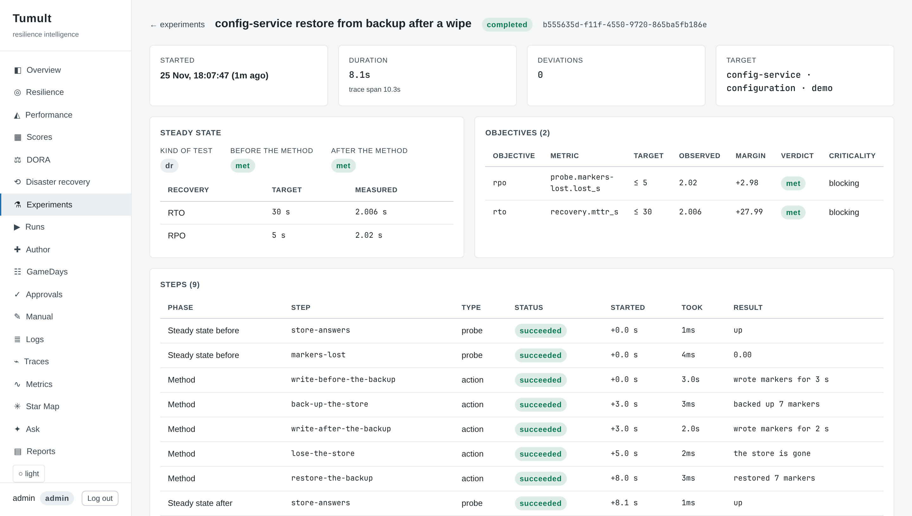
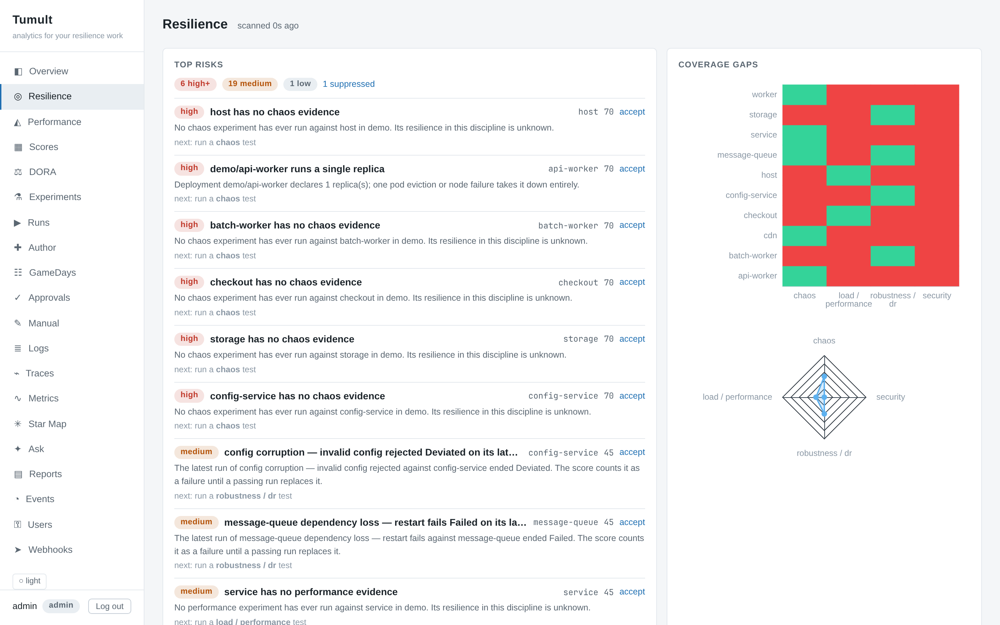
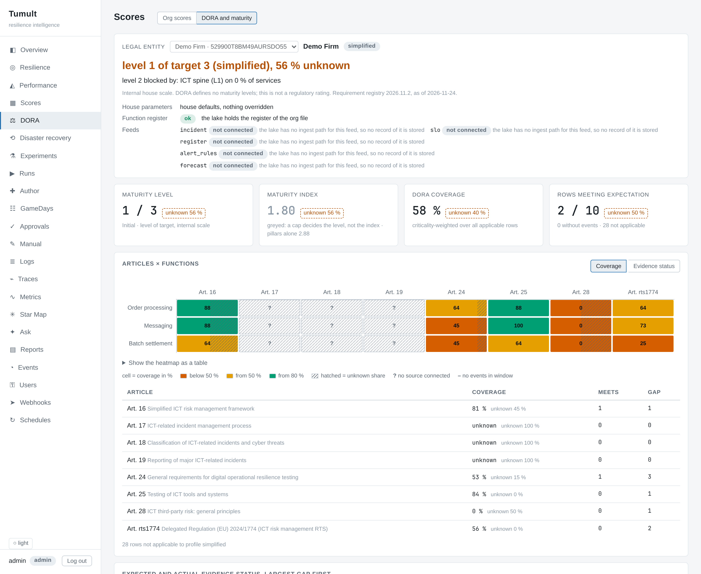

# Tumult

[](https://github.com/mwigge/tumult/actions/workflows/ci.yml)
[](https://github.com/mwigge/tumult/actions/workflows/coverage.yml)


Tumult is a resilience intelligence platform, written in Rust. You test your
systems. Tumult keeps the evidence and tells you what it means.


## Install

```bash
curl -sSL https://raw.githubusercontent.com/mwigge/tumult/main/install.sh | sh
```

It builds the `tumult` CLI, starts test targets in Docker and runs a check.
You need Git, Make, Docker and Rust 1.92.0 or newer. Then follow
[Get started](https://tumult.rs/get-started/).

## Try it

**Run one experiment**, from the `tumult` folder:

```bash
tumult run examples/redis-chaos.toon
```

**See the whole platform** with demo data at <http://localhost:14318/>:

```bash
cp .env.example .env   # set the three KRONIKA_* values
docker compose -f docker/docker-compose.kronika.yml up -d --build
```

**Learn chaos testing in your browser** at <http://localhost:8089>:

```bash
cd chaos-lab && docker compose up -d --build --wait
```

## How it works


- **Collect:** chaos, load, performance and disaster recovery (DR) runs,
  exercises run by hand, and telemetry from your services.
- **Store:** one daemon, `tumultd`, keeps it all in one DuckDB database, the
  lake.
- **Show:** risks, scores, verdicts and forecasts, in the web UI Krönika, a CI
  gate (`tumult gate`) and PDF reports.

| | |
|---|---|
|  |  |
| **DR page.** When each target is due, and its RTO and RPO. | **A DR run.** The time down (RTO) and the data lost (RPO). |
|  |  |
| **Drills by hand.** Signed off by another person. | **Reports for an auditor.** Each DR test against its targets. |
|  |  |
| **Resilience.** Ranked risks and the gaps in your testing. | **DORA.** Coverage per article and a maturity level. |
|  |  |
| **Performance.** Did the new version get slower? | **Run report.** `tumult report` makes one HTML page. |

More pictures: [platform walkthrough](https://tumult.rs/guides/platform-walkthrough.html).

## Safe by design

- Every run gets a risk tier, T0 to T3. Risky runs wait for a second
  person.
- Two clicks stop all running experiments and roll them back.
- Every action goes into an audit trail that shows any change.
- Roles: `viewer`, `operator`, `approver`, `admin`.

Chaos actions break things on purpose. Check every experiment, target and
rollback before you use Tumult outside a test environment. Journals keep
command output, so keep secrets out of experiment arguments. Reports
summarise evidence; they are not legal or audit statements.

## AI agents

Tumult exposes 44 tools over MCP, on stdio or HTTP. Read-only tools need the
`viewer` role. Tools that change or break things need `operator`.

```bash
tumult mcp serve                                                   # stdio
tumult mcp serve --transport http --port 3100 --token "$MCP_TOKEN"
```

<details>
<summary>All 44 tools</summary>

| Area | Tools |
|---|---|
| Experiments | `tumult_run_experiment`, `tumult_validate`, `tumult_discover`, `tumult_create_experiment`, `tumult_list_experiments` |
| Journals and analytics | `tumult_read_journal`, `tumult_list_journals`, `tumult_analyze`, `tumult_analyze_store`, `tumult_store_stats`, `tumult_query_traces`, `tumult_report`, `tumult_compliance`, `tumult_trend` |
| GameDays | `tumult_gameday_run`, `tumult_gameday_analyze`, `tumult_gameday_create`, `tumult_gameday_list` |
| Intelligence | `tumult_recommend`, `tumult_coverage`, `tumult_agents`, `tumult_fault_catalog`, `tumult_scaffold_experiment` |
| Agentic testing | `tumult_agentic_list_scenarios`, `tumult_agentic_smoke`, `tumult_agentic_run_experiment` |
| ChaosGraph | `tumult_chaosgraph_query`, `tumult_chaosgraph_neighbors`, `tumult_chaosgraph_coverage_gaps`, `tumult_chaosgraph_cypher` |
| Topology | `tumult_topology_import`, `tumult_topology_map`, `tumult_compliance_lineage`, `tumult_recommend_injection` |
| Autopilot | `tumult_autopilot_run`, `tumult_autopilot_status`, `tumult_autopilot_respond`, `tumult_autopilot_export`, `tumult_autopilot_notify` |
| Manual registry | `tumult_manual_list`, `tumult_manual_get`, `tumult_manual_create_draft`, `tumult_manual_plans_list` |
| Access | `tumult_whoami` |

Thirty-four tools return structured content with an output schema. Four tools can
break things: `tumult_run_experiment`, `tumult_gameday_run`,
`tumult_autopilot_run` (with `execute=true`) and `tumult_autopilot_respond`
(with `approve=true`).

</details>

More in the [MCP guide](https://tumult.rs/guides/mcp-guide.html).

## Upgrading

Read the [3.0.4 notes](https://tumult.rs/releases/3.0.4.html) first. The
lake moves to schema v26, which an older Tumult cannot open. Stop the
daemon and back up with `tumult store backup --output <dir>`.

## Documentation

| I want to | Go to |
|---|---|
| Start | [Get started](https://tumult.rs/get-started/) |
| Learn the ideas | [Concepts](https://tumult.rs/concepts/) |
| Find a guide | [Guides](https://tumult.rs/guides/) |
| Test disaster recovery | [Disaster recovery](https://tumult.rs/guides/disaster-recovery.html) |
| Look up a command | [CLI reference](https://tumult.rs/guides/cli-reference.html) |
| Run it for real | [Operate](https://tumult.rs/operate/) |
| See what changed | [Release notes](https://tumult.rs/releases/) |

Report a security issue through
[GitHub private vulnerability reporting](https://github.com/mwigge/tumult/security/advisories/new).
See [SECURITY.md](SECURITY.md).

## Contributing

Read [CONTRIBUTING.md](CONTRIBUTING.md) and run its checks before you send
a change.

## License

Apache-2.0. See [LICENSE](LICENSE) and [NOTICE](NOTICE).
