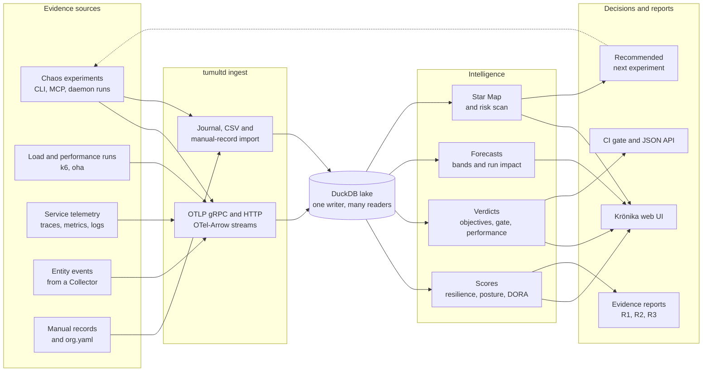
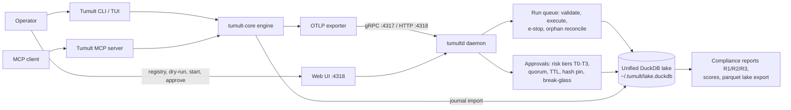
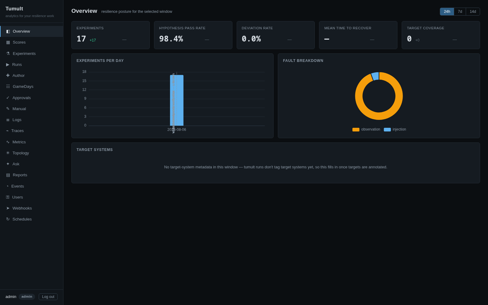
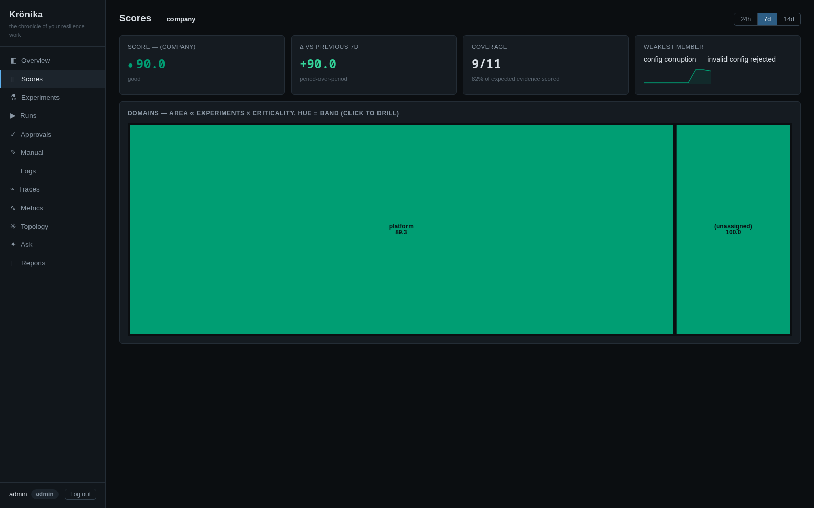
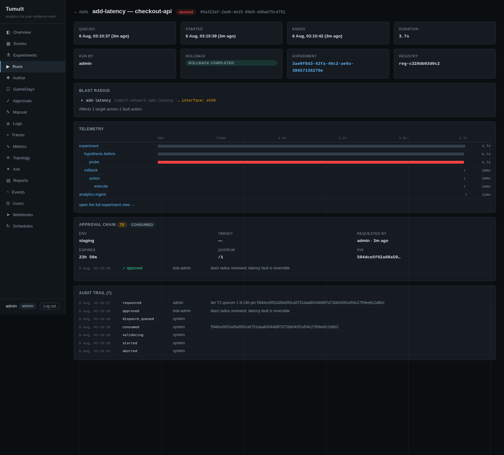
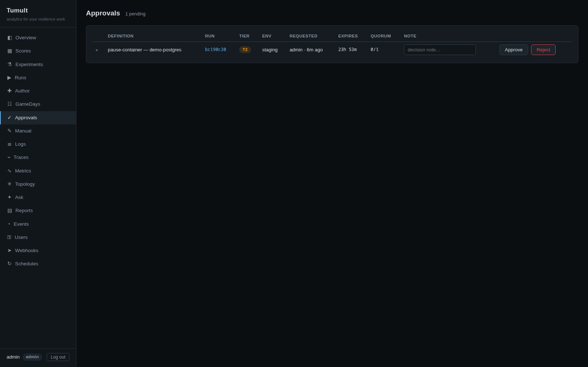
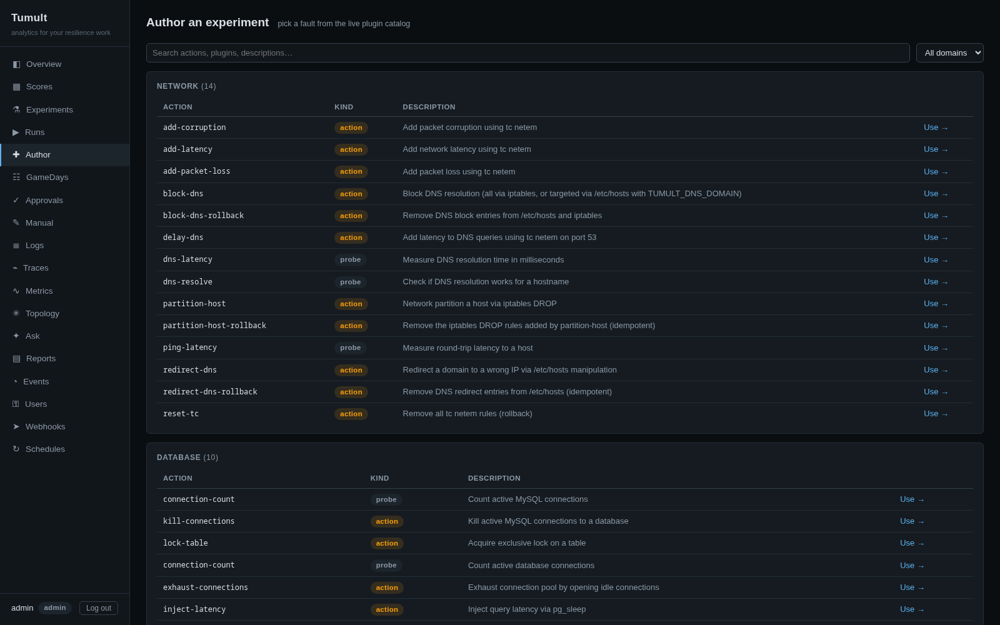
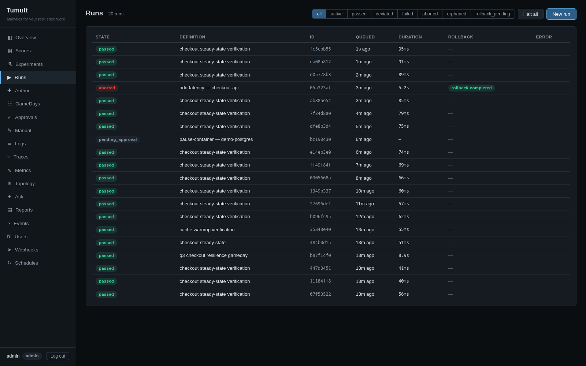

# Tumult

[](https://github.com/mwigge/tumult/actions/workflows/ci.yml)
[](https://github.com/mwigge/tumult/actions/workflows/coverage.yml)


Tumult is a Rust-native resilience intelligence platform. It collects
resilience evidence from several sources, keeps it in one DuckDB lake, and
turns it into scores, verdicts, forecasts and reports a team can decide on.

Chaos experiments, run from a CLI or a Model Context Protocol (MCP) client,
are one evidence source. The others are load and performance runs,
OpenTelemetry telemetry that services send over OTLP or OTel-Arrow, entity
events, manual records of exercises, and the organisation and function
register in `org.yaml`. The `tumultd` daemon ingests and stores all of it,
and its web UI, Krönika, shows what the evidence says: resilience and
posture scores, the DORA coverage and maturity score, performance
regression verdicts per `service.version`, forecast bands and run impact,
and the Star Map of organisation, systems, services and workloads.



## Quick start

### Learn in your browser — Docker only

The [Tumult Chaos Lab](chaos-lab/README.md) runs four guided fault simulations with
live baseline, fault, and recovery measurements. An optional AI tutor supports
OpenAI, Claude, and Ollama. Start with Docker running:

```sh
git clone https://github.com/mwigge/tumult.git
cd tumult/chaos-lab
docker compose up -d --build --wait
```

Open **[http://localhost:8089](http://localhost:8089)** and select **Slow responses**.
Read the hypothesis, tick the sandbox acknowledgement, then click **Run experiment**.
No AI key is needed for the lessons. To add a tutor, open **AI settings** and enter
your provider key. See the [lab README](chaos-lab/README.md) for your first experiment,
Ollama setup, and stopping or resuming the lab.

### Run experiments from the CLI

Prerequisites: Rust 1.92.0 or newer and Docker with Compose.

```bash
git clone https://github.com/mwigge/tumult.git && cd tumult
cargo build --release --locked -p tumult-cli -p tumult-net
docker compose -f docker/docker-compose.yml up -d --wait postgres redis kafka mysql sshd
target/release/tumult validate examples/redis-chaos.toon
target/release/tumult run examples/redis-chaos.toon
```

The run writes a TOON journal and, unless disabled, ingests it into the unified
DuckDB store, a configured daemon, or the configured ClickHouse backend. Follow
the [guided walkthrough](QUICKSTART.md) for
analysis, observability, GameDays, and MCP usage. To see the scores, verdicts
and the Star Map on seeded evidence, start the
[daemon and web UI demo stack](#the-daemon-lake-and-web-ui).

## Capabilities

- Steady-state probes, fault actions, controls, post-method sampling and
  explicit rollback. The [data lifecycle](docs/data-lifecycle.md) distinguishes
  measured results from reserved baseline and recovery fields.
- Script plugins for containers, databases, Kafka, load testing, network
  faults, processes, Pumba, stress, and time-related failure modes.
- Native Rust executors for SSH, userspace TCP fault injection, Kubernetes,
  cloud APIs, and Windows.
- TOON journals, Arrow conversion, DuckDB analytics, and Parquet, CSV, JSON,
  and Arrow IPC export.
- OpenTelemetry traces and metrics across experiment execution, plugins,
  analytics, SSH, Kubernetes, MCP, and agentic test paths.
- Statistical baselines, cross-run trends, GameDay orchestration, compliance
  evidence mapping, ChaosGraph, service topology, and policy-gated autopilot.
- Resilience disciplines (`kind`: chaos, load, performance, robustness, dr,
  security, nfr), non-functional objectives with per-run verdicts, RTO/RPO
  targets measured against recovery, raw probe time series in the lake, and
  a CI gate (`tumult gate`, `GET /api/gate/{target}`) that turns a target's
  evidence into a pass/warn/fail verdict.
- An OpenTelemetry contract any auto-instrumented service meets through its
  environment alone (`resilience.target.*` and the ICT spine as resource
  attributes), a Collector pipeline that enforces it, and
  `GET /api/otel/conformance` to see which deployments carry it.
- A passive risk scan and posture page (`GET /api/risks`, `GET /api/posture`,
  `/posture`): ranked findings and discipline coverage gaps from the evidence
  already in the lake, Kubernetes manifests and the span call graph, with a
  continuous posture score and hash-chained, expiring suppressions.
- Load profiles (ramp, spike, soak) on k6 and oha behind one adapter
  boundary, streamed load samples in the lake, and performance regression
  verdicts per `service.version` with a bootstrap confidence interval
  (`tumult perf`, `GET /api/perf/{target}`, the `/performance` page); each
  run records the version it measured (`tumult run --target-version`).
- OTLP ingest over gRPC and HTTP (gzip accepted on both, zstd on gRPC) and
  OTel-Arrow streams on the gRPC listener, behind one ingest token and one
  writer. See [observability setup](docs/guides/observability-setup.md).
- Forecast bands for semantic metrics and the counterfactual impact and
  recovery time of a run's probes (`GET /api/forecast`,
  `GET /api/runs/{id}/impact`, the Impact panel on the run page), from a
  built-in Holt-Winters provider or the optional `tumult-forecastd`
  Timestral sidecar. See [forecasting](docs/guides/forecasting.md).
- The [Star Map](docs/guides/star-map.md): organisation units, ICT entities,
  systems, components, services, workloads and experiment definitions as one
  graph with evidence, risk and conformance lenses (`GET /api/starmap`, the
  `/starmap` page).
- A [DORA coverage and maturity score](docs/guides/dora-score.md): coverage
  per article and business function with unknown shown apart, and an internal
  1 to 5 maturity level per node (`GET /api/dora`, `GET /api/maturity`,
  Scores → DORA). The score says what evidence exists. It does not say that
  an entity complies with the regulation.
- [Entity events](docs/guides/entity-events.md) (off by default,
  `KRONIKA_ENTITY_EVENTS=1`): OpenTelemetry entity events stored as entities
  with a lifetime, read through `GET /api/entities`.
- Structured logs from every binary: JSON on stderr with stable event names,
  bridged to OTLP. See [logging](docs/guides/logging.md).
- Deterministic and live-proxy fault injection for AI agents, plus adapters for
  Claude Code and Codex.

Run `tumult discover` to obtain the authoritative plugin and action catalog for
the installed build.

## How Tumult differs

Chaos tools such as Gremlin, Chaos Mesh and LitmusChaos inject faults and
report what happened in a run. Tumult injects faults too, and differs in
what it does with the results:

- **Evidence from more than fault runs.** Load and performance runs, the
  telemetry services already emit, entity events and manual records land in
  the same lake as chaos experiments, so a score or a verdict can rest on
  all of them.

- **Agent-first.** A 40-tool MCP server where every tool declares safety
  annotations and role gating (read-only tools need `viewer`, writers and
  live fault executors need `operator`) — plus deterministic and live-proxy fault
  injection for agentic AI systems themselves
  (`demo/experiments/demo-agentic*.toon`).
- **Always-on evidence.** The `tumultd` daemon ingests OTLP telemetry
  (gRPC, HTTP and OTel-Arrow) around the clock into one DuckDB lake, so
  analytics, trends and audit trails accrue without exporting anything.
- **Governance built in.** Risk-tiered approvals, hash-chained audit trails
  and compliance evidence packs (`tumult-compliance/`) mapped to DORA, NIS2,
  ISO 27001 and SOC 2.
- **One Rust binary.** The daemon embeds the lake, the schedulers and the
  web UI in a single `tumultd` binary; the CLI is another.

The launch post has the longer story:
[Introducing Tumult](docs/blog/01-introducing-tumult.md).

## The daemon, lake and web UI

*The chronicle of your resilience work.*

This is where evidence becomes intelligence: the `tumultd` daemon, the
unified DuckDB lake, and Krönika, the embedded SvelteKit web UI. The CLI is
the engine that executes experiments. The daemon is where they are
registered, approved, executed under guardrails, stored, scored and
reported, and where telemetry from other sources is ingested. The
architecture, the data flows and every Krönika page with its charts and the
API behind it are documented in
[docs/architecture/kronika-architecture.md](docs/architecture/kronika-architecture.md).



- **Run registry and daemon-run execution** — definitions are validated
  through the CLI's exact pipeline and content-hash-deduped
  (`POST /api/runs/validate`). You can preview them with a dry run. The
  daemon executes them itself on a bounded worker pool, with e-stop and
  crash-time orphan rollback reconciliation (ADR-011).
- **Approval workflows** — every run is classified into a risk tier (T0–T3)
  at request time. Gated runs wait behind a hash-pinned, quorum- and
  TTL-bound approval with segregation of duties. Production-tier runs also
  sit behind a fail-closed autopilot gate. A break-glass override exists
  and leaves evidence (ADR-013).
- **Authentication and RBAC** — server-side sessions (argon2id, opaque
  cookies) or revocable `kro_`-prefixed API tokens. One route table with
  `viewer < operator < approver < admin` roles and optional
  per-environment scopes (ADR-012).
- **Automatic ingest** — OTLP/gRPC (`:4317`, tumult's exporter), OTel-Arrow
  streams on the same gRPC listener (the Collector's `otelarrow` exporter)
  and OTLP/HTTP protobuf (`:4318`, `/v1/*`) on one daemon. You can also
  import CSV files and tumult journal JSON by hand (`tumultd import <file>`).
- **Unified DuckDB store + parquet lake** — telemetry, run state, manual
  evidence and the analytics family in one store behind one writer.
  Manifest-based Parquet snapshots include late-arriving and changed records
  (`KRONIKA_LAKE_DIR`, `KRONIKA_LAKE_INTERVAL`, `POST /api/lake/export`).
  Automatic hot retention is disabled because reports do not yet query the
  archive. Local files and hash chains do not enforce WORM retention locks.
  [Data portability and recovery](docs/guides/data-portability.md) describes
  archive exclusions and complete database backup/restore.
- **Semantic metrics layer** — YAML metric views (`metrics/*.yaml`)
  compiled to strictly validated SQL.
- **Evidence reports** — R1 executive resilience digest (with
  org-hierarchy rollups), R3 per-run game-day report, and an R2 evidence
  pack (DORA/NIS2/ISO 27001/SOC 2, including the approval-chain
  change-management section). Rendered as embedded-Typst PDFs plus
  print-HTML previews. Includes Gremlin-style resilience scoring and a
  draft → verified manual-evidence lifecycle (reviewer ≠ enterer,
  append-only hash-chained audit).
- **Web UI + query API** — a SvelteKit SPA embedded into the `tumultd`
  binary (Overview, Posture, Performance, Scores, DORA, Experiments, Runs,
  Author, GameDays, Approvals, Manual evidence, Logs, Traces, Metrics,
  Star Map, Ask, Reports, Events, Schedules, plus admin-only Users and
  Webhooks — and a two-click stop-all kill switch on the Runs page). It is backed by a JSON
  API under `/api/*`, including a guarded NL→SQL ask path
  (`tumult_intelligence::sql_guard`).

Try it (full platform, demo seed included):

```bash
cp .env.example .env   # fill in the three KRONIKA_* values — the stack refuses to start without them
docker compose -f docker/docker-compose.kronika.yml up -d --build
# open http://localhost:14318/ (log in with the admin password you set in .env)
```

The compose stack builds the UI and the `tumultd` binary in Docker, seeds a
demo experiment suite plus manual-evidence records, and exports a report
into `demo-out/`. To build locally instead, run
`cd web && npm ci && npm run build` before compiling `tumultd` — the binary
embeds `web/build/`. The CLI-only path above needs none of this: `tumult
run` writes its journal and, when no daemon holds the database, ingests into
the unified store. Set `TUMULT_DAEMON_URL` and `TUMULT_DAEMON_TOKEN` to import
through a running daemon instead, unless `TUMULT_CLICKHOUSE_URL` selects the
ClickHouse backend. If you
have older standalone database files lying around, `tumult store
import-legacy` pulls their data into that store (see the
[CLI reference](docs/guides/cli-reference.md)).

### Screenshots

All captured on the seeded demo stack above; the full click path (login →
register → approve → run → e-stop → evidence pack) is in the
[platform walkthrough](docs/guides/platform-walkthrough.md).

| | |
|---|---|
|  |  |
|  |  |
|  |  |

## CLI

```bash
tumult validate experiment.toon
tumult run experiment.toon
tumult analyze --query "SELECT title, status FROM experiments"
tumult compliance --framework dora .
tumult gameday run gamedays/q2-postgres-resilience.gameday.toon
tumult topology map
tumult autopilot once --policy ~/.tumult/autopilot.toml
```

See the [CLI reference](docs/guides/cli-reference.md) and
[experiment format reference](docs/guides/experiment-format.md).

## MCP server

Tumult exposes 40 tools over stdio or streamable HTTP:

```bash
# Stdio
tumult-mcp

# HTTP, loopback only when authentication is not configured
tumult-mcp --transport http --port 3100

# Authenticated HTTP
TUMULT_MCP_TOKEN='replace-with-a-secret' tumult-mcp --transport http --port 3100
```

| Area | Tools |
|---|---|
| Experiments | `tumult_run_experiment`, `tumult_validate`, `tumult_discover`, `tumult_create_experiment`, `tumult_list_experiments` |
| Journals and analytics | `tumult_read_journal`, `tumult_list_journals`, `tumult_analyze`, `tumult_analyze_store`, `tumult_store_stats`, `tumult_query_traces`, `tumult_report`, `tumult_compliance`, `tumult_trend` |
| GameDays | `tumult_gameday_run`, `tumult_gameday_analyze`, `tumult_gameday_create`, `tumult_gameday_list` |
| Intelligence | `tumult_recommend`, `tumult_coverage`, `tumult_agents`, `tumult_fault_catalog`, `tumult_scaffold_experiment` |
| Agentic testing | `tumult_agentic_list_scenarios`, `tumult_agentic_smoke`, `tumult_agentic_run_experiment` |
| ChaosGraph | `tumult_chaosgraph_query`, `tumult_chaosgraph_neighbors`, `tumult_chaosgraph_coverage_gaps`, `tumult_chaosgraph_cypher` |
| Topology | `tumult_topology_import`, `tumult_topology_map`, `tumult_compliance_lineage`, `tumult_recommend_injection` |
| Autopilot | `tumult_autopilot_run`, `tumult_autopilot_status`, `tumult_autopilot_respond`, `tumult_autopilot_export`, `tumult_autopilot_notify` |
| Access | `tumult_whoami` |

Thirty tools return structured content with an advertised output schema. Every
tool declares MCP safety annotations. Read-only tools require the `viewer` role;
writers and live fault executors require `operator`. The deterministic bundled
agentic test tools remain viewer-level. The destructive tools are four:
`tumult_run_experiment`, `tumult_gameday_run`, `tumult_autopilot_run` (when
`execute=true`), and `tumult_autopilot_respond` (when `approve=true`).

See the [MCP guide](docs/guides/mcp-guide.md) for configuration, resource URIs,
authentication, pagination, schemas, and client examples.

## Configuration

| Variable | Purpose |
|---|---|
| `OTEL_EXPORTER_OTLP_ENDPOINT` | OTLP gRPC endpoint for traces, metrics and logs. |
| `TUMULT_LAKE_PATH` | Override the persistent DuckDB store path (default `~/.tumult/lake.duckdb`). |
| `TUMULT_PLUGIN_PATH` | Add script-plugin discovery directories. |
| `TUMULT_MCP_TOKEN` | Configure one MCP operator bearer token. |
| `TUMULT_MCP_AUTH_CONFIG` | Configure multiple viewer/operator tokens. |
| `TUMULT_TRACE_UI_BASE` | Add trace links to generated reports. |
| `TUMULT_CLICKHOUSE_URL` | Enable ClickHouse/SigNoz correlation. |
| `CLAUDE_CODE_BIN`, `CODEX_BIN` | Override local agent adapter binaries. |

Provider-specific credentials use their standard environment variables.
Keep secrets out of activity arguments and output: journals retain provider
output, which can contain sensitive data. Restrict access to journals and
exports. See [execution bindings](docs/guides/execution-bindings.md) for daemon
execution authorization and [provider prerequisites](docs/guides/production-deployment.md#provider-capabilities)
for the shipped images.

## Safety and evidence scope

Chaos actions are intentionally disruptive. Review every experiment, target,
rollback, guard, and credential scope before using Tumult outside an isolated
environment. MCP HTTP binds without authentication are restricted to loopback.

Compliance reports are evidence summaries, not legal or audit attestations.
Framework mappings and their evidence strength are documented in the
[regulatory mapping](docs/regulatory-mapping.md).

Security issues should be reported through
[GitHub private vulnerability reporting](https://github.com/mwigge/tumult/security/advisories/new).
See [SECURITY.md](SECURITY.md) for the supported-version policy.

## Documentation

- [Chaos Lab: learn in your browser](chaos-lab/README.md)
- [Quickstart](QUICKSTART.md)
- [Guides](docs/guides/index.md)
- [Architecture and Krönika pages](docs/architecture/kronika-architecture.md)
- [Star Map](docs/guides/star-map.md),
  [DORA score](docs/guides/dora-score.md),
  [forecasting](docs/guides/forecasting.md),
  [performance regression](docs/guides/performance-regression.md),
  [entity events](docs/guides/entity-events.md) and
  [logging](docs/guides/logging.md)
- [Plugin reference](docs/plugins/index.md)
- [Data lifecycle](docs/data-lifecycle.md)
- [Security assessment](docs/security-assessment.md)
- [Verification protocol](docs/testprotocol.md)
- [2.22.0 hardening review](docs/guides/hardening-review.md)
- [Quality and release checks](docs/guides/quality-and-release.md)

## Contributing

Before submitting a change, run the
[quality gates](docs/guides/quality-and-release.md), including the web build
before Rust compilation, language checks, tests and dependency policy. The
guide distinguishes advisory exceptions from an exception-free audit and
source verification from release/deployment verification.

Keep commit messages focused on delivered behavior and evidence. Do not include
development-tool or review-process metadata in commit messages.

## License

Apache-2.0. See [LICENSE](LICENSE) and [NOTICE](NOTICE).
