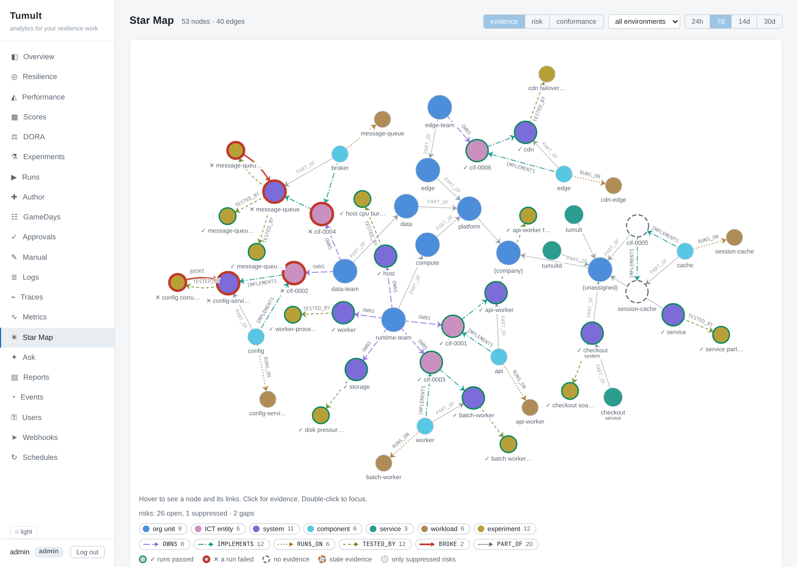
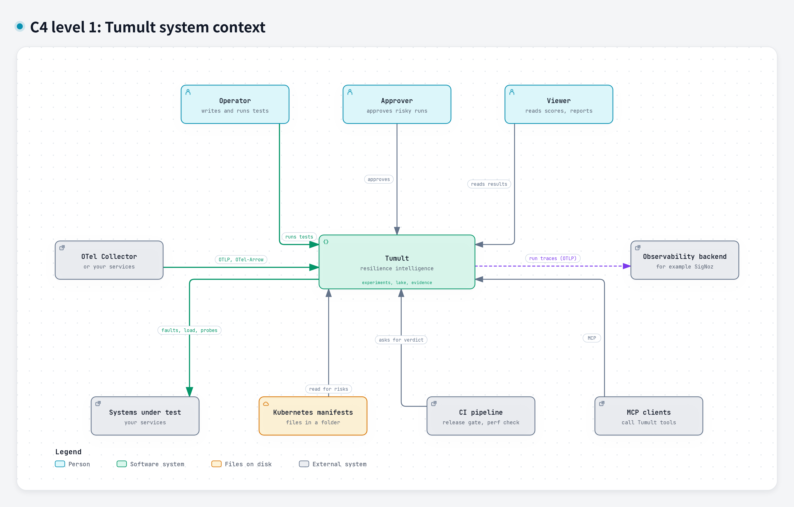
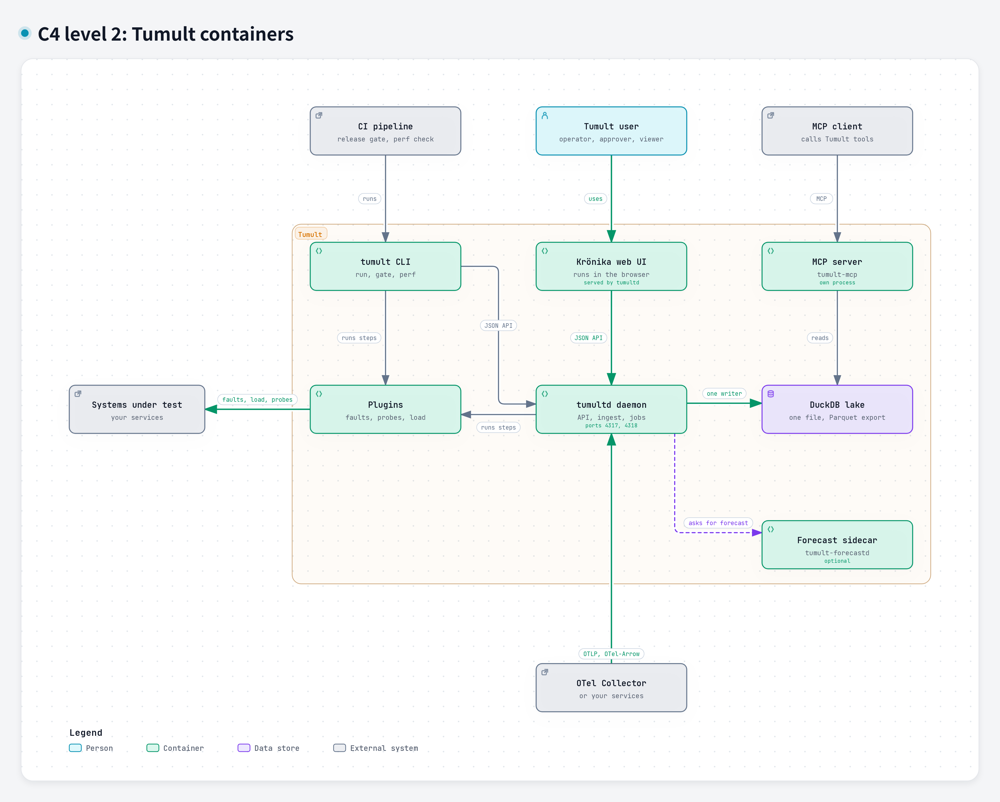

# Tumult

[](https://github.com/mwigge/tumult/actions/workflows/ci.yml)
[](https://github.com/mwigge/tumult/actions/workflows/coverage.yml)


Tumult is a resilience intelligence platform, written in Rust.

It answers one question: **how well does this system cope when things go
wrong, and how do we know?**

You test your systems. Tumult keeps the results and tells you what they
mean.


## What it does

| Step | What happens |
|---|---|
| **Collect** | Chaos experiments, load and performance runs, telemetry from your services, and manual records of exercises all go in. |
| **Store** | One daemon, `tumultd`, keeps everything in one DuckDB database, the lake. |
| **Understand** | Tumult turns the stored evidence into scores, risks, verdicts and forecasts. |
| **Show** | The web UI, Krönika, shows it. A CI gate and PDF reports use the same data. |

Chaos testing is still here. It is now one source of evidence among several.

## What you see

| | |
|---|---|
|  |  |
| **Star Map.** Your organisation, systems and workloads as one graph. Colour shows evidence, risk or telemetry quality. | **Resilience.** A ranked list of risks and the gaps in what you have tested. No fault needs to run. |
|  |  |
| **Scores.** DORA coverage per article and function, and a maturity level from 1 to 5. | **Performance.** Did the new version get slower? A verdict per version, with a confidence interval. |
|  |  |
| **Overview.** Pass rate, deviations and fault mix over time. | **Run detail.** Every step of a run as a timeline, with its approvals and audit trail. |

More pictures: [platform walkthrough](docs/guides/platform-walkthrough.md).

## Try it

You need Docker. Pick one.

**1. See the whole platform (about 15 minutes for the first build)**

```bash
git clone https://github.com/mwigge/tumult.git && cd tumult
cp .env.example .env   # set the three KRONIKA_* values
docker compose -f docker/docker-compose.kronika.yml up -d --build
```

Open <http://localhost:14318/> and sign in as `admin`. The stack runs a demo
suite, so every page has data.

**2. Run one experiment from the command line**

```bash
cargo build --release --locked -p tumult-cli -p tumult-net
docker compose -f docker/docker-compose.yml up -d --wait redis
target/release/tumult run examples/redis-chaos.toon
```

Needs Rust 1.92.0 or newer. The [quickstart](QUICKSTART.md) has the next
steps.

**3. Learn chaos testing in your browser**

```bash
cd chaos-lab && docker compose up -d --build --wait
```

Open <http://localhost:8089>. Four guided lessons, no setup. See the
[Chaos Lab](chaos-lab/README.md).

## How it is built





| Part | Job |
|---|---|
| `tumult` (CLI) | Runs experiments. Works alone, or sends results to the daemon. |
| `tumultd` (daemon) | Takes in telemetry, runs approved experiments, stores, scores, serves the UI and the API. |
| Krönika (web UI) | Built into the daemon. No separate install. |
| Lake | One DuckDB file. One writer, many readers. Exports to Parquet. |
| `tumult-mcp` | Gives AI agents 40 tools, with roles and safety labels. |
| Forecast sidecar | Optional. A built-in forecaster works without it. |

Telemetry comes in as OTLP over gRPC (port 4317) and HTTP (port 4318), and
as OTel-Arrow. More diagrams:
[architecture](docs/architecture/kronika-architecture.md).

## What is new in 3.0

| Feature | In one line | Guide |
|---|---|---|
| Star Map | One graph from organisation to workload | [Star Map](docs/guides/star-map.md) |
| Risks and resilience score | Ranked findings from evidence you already have | [walkthrough](docs/guides/platform-walkthrough.md) |
| DORA score | Coverage and maturity. It shows what evidence exists. It does not say you comply. | [DORA score](docs/guides/dora-score.md) |
| Performance verdicts | Compare two versions of a service | [performance](docs/guides/performance-regression.md) |
| Load profiles | Ramp, spike and soak on k6 and oha | [load testing](docs/guides/load-testing-guide.md) |
| Forecasts | Expected range of a metric, and how far a run pushed it | [forecasting](docs/guides/forecasting.md) |
| OTel-Arrow ingest | A faster way to send telemetry | [observability](docs/guides/observability-setup.md) |
| Entity events | Track what exists and for how long (off by default) | [entity events](docs/guides/entity-events.md) |
| Structured logs | JSON logs with stable event names | [logging](docs/guides/logging.md) |
| CI gate | `tumult gate` gives pass, warn or fail for a target | [CLI](docs/guides/cli-reference.md) |

Not done yet: forecasts and entities have no page of their own. A run page
shows the forecast band of that run; the rest is in the API.

Read the [3.0.0 release notes](docs/releases/3.0.0.md) before you upgrade
from 2.x. The latest release is [3.0.1](docs/releases/3.0.1.md).
**There is no way back:** the lake moves to schema v21 and DuckDB 2.0, and
an older Tumult cannot open it afterwards. Back up first with
`tumult store backup --output <dir>`.

## Safe by design

- Every run gets a risk tier, T0 to T3. Risky runs wait for approval.
- Nobody can approve their own run.
- A two-click stop halts all running experiments and rolls them back.
- Every action goes into a tamper-evident audit trail.
- Roles: `viewer`, `operator`, `approver`, `admin`.

Chaos actions break things on purpose. Check every experiment, target and
rollback before you use Tumult outside a test environment.

Reports are summaries of evidence. They are not legal or audit statements.
See the [regulatory mapping](docs/regulatory-mapping.md).

## Command line

```bash
tumult validate experiment.toon     # check a file
tumult run experiment.toon          # run it
tumult gate my-service              # pass, warn or fail for CI
tumult perf my-service              # compare versions
tumult compliance --framework dora .
tumult discover                     # list all plugins and actions
```

Full list: [CLI reference](docs/guides/cli-reference.md). File format:
[experiment format](docs/guides/experiment-format.md).

## MCP server

Tumult exposes 40 tools over stdio or HTTP.

```bash
tumult-mcp                                    # stdio
TUMULT_MCP_TOKEN=secret tumult-mcp --transport http --port 3100
```

Read-only tools need the `viewer` role. Tools that change or break things
need `operator`. Without a token, HTTP listens on loopback only.

<details>
<summary>All 40 tools</summary>

| Area | Tools |
|---|---|
| Experiments | `tumult_run_experiment`, `tumult_validate`, `tumult_discover`, `tumult_create_experiment`, `tumult_list_experiments` |
| Journals and analytics | `tumult_read_journal`, `tumult_list_journals`, `tumult_analyze`, `tumult_analyze_store`, `tumult_store_stats`, `tumult_query_traces`, `tumult_report`, `tumult_compliance`, `tumult_trend` |
| GameDays | `tumult_gameday_run`, `tumult_gameday_analyze`, `tumult_gameday_create`, `tumult_gameday_list` |
| Intelligence | `tumult_recommend`, `tumult_coverage`, `tumult_agents`, `tumult_fault_catalog`, `tumult_scaffold_experiment` |
| Agentic testing | `tumult_agentic_list_scenarios`, `tumult_agentic_smoke`, `tumult_agentic_run_experiment` |
| ChaosGraph | `tumult_chaosgraph_query`, `tumult_chaosgraph_neighbors`, `tumult_chaosgraph_coverage_gaps`, `tumult_chaosgraph_cypher` |
| Topology | `tumult_topology_import`, `tumult_topology_map`, `tumult_compliance_lineage`, `tumult_recommend_injection` |
| Autopilot | `tumult_autopilot_run`, `tumult_autopilot_status`, `tumult_autopilot_respond`, `tumult_autopilot_export`, `tumult_autopilot_notify` |
| Access | `tumult_whoami` |

Thirty tools return structured content with an output schema. Four tools can
break things: `tumult_run_experiment`, `tumult_gameday_run`,
`tumult_autopilot_run` (with `execute=true`) and `tumult_autopilot_respond`
(with `approve=true`).

</details>

More: [MCP guide](docs/guides/mcp-guide.md).

## Settings

<details>
<summary>Environment variables</summary>

| Variable | Purpose |
|---|---|
| `OTEL_EXPORTER_OTLP_ENDPOINT` | OTLP gRPC endpoint for traces, metrics and logs. |
| `TUMULT_LAKE_PATH` | Override the persistent DuckDB store path (default `~/.tumult/lake.duckdb`). |
| `TUMULT_PLUGIN_PATH` | Add script-plugin discovery directories. |
| `TUMULT_MCP_TOKEN` | Configure one MCP operator bearer token. |
| `TUMULT_MCP_AUTH_CONFIG` | Configure multiple viewer/operator tokens. |
| `TUMULT_TRACE_UI_BASE` | Add trace links to generated reports. |
| `TUMULT_CLICKHOUSE_URL` | Enable ClickHouse/SigNoz correlation. |
| `CLAUDE_CODE_BIN`, `CODEX_BIN` | Override local agent adapter binaries. |

</details>

Keep secrets out of experiment arguments. Journals store command output.

## Read more

| I want to | Go to |
|---|---|
| Start quickly | [Quickstart](QUICKSTART.md) |
| Click through the web UI | [Platform walkthrough](docs/guides/platform-walkthrough.md) |
| Find a guide | [All guides](docs/guides/index.md) |
| Understand the design | [Architecture](docs/architecture/kronika-architecture.md) |
| See the plugins | [Plugin reference](docs/plugins/index.md) |
| Run it in production | [Deployment](docs/guides/production-deployment.md) |
| Check the security work | [Security assessment](docs/security-assessment.md) and [SECURITY.md](SECURITY.md) |
| Read the story | [Introducing Tumult](docs/blog/01-introducing-tumult.md) |

Report security issues through
[GitHub private vulnerability reporting](https://github.com/mwigge/tumult/security/advisories/new).

## Contributing

Run the [quality checks](docs/guides/quality-and-release.md) before you send
a change. Keep commit messages about what changed and how it was tested. Do
not include development-tool or review-process metadata in commit messages.

## License

Apache-2.0. See [LICENSE](LICENSE) and [NOTICE](NOTICE).
