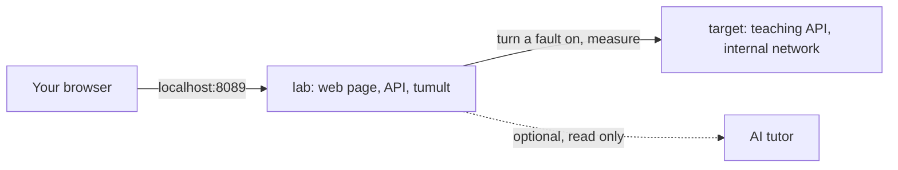

# Tumult Chaos Lab

Learn fault injection in your browser. Run four guided experiments with the
real Tumult engine, compare live measurements, and ask an optional AI tutor
about the results.



**You need Docker with Compose.** Install Docker Desktop on macOS or
Windows, or Docker Engine with the Compose plugin on Linux. The first build
needs internet access. You do not need Python, Node, Rust or an AI key.

## 1. Start the lab

Download and unpack the ZIP or tar.gz bundle from the
[Chaos Lab 1.0.0 release](https://github.com/mwigge/tumult/releases/tag/chaos-lab-v1.0.0),
and open a terminal in the `tumult-chaos-lab-1.0.0` folder. Or clone Tumult:

```sh
git clone https://github.com/mwigge/tumult.git
cd tumult
```

From the bundle folder or the repository root, run:

```sh
cd chaos-lab
docker compose up -d --build --wait
```

Open **[http://localhost:8089](http://localhost:8089)** and wait until the
page says **Tumult ready** and **Sandbox responding**. The first build
takes a few minutes; later starts reuse the images.

Keep your terminal in `chaos-lab/` for the commands below. On Linux and
macOS, `./start.sh` also starts the lab; on Windows, double-click
`start.cmd`.

## 2. Run your first experiment

1. Select **Slow responses** and read its hypothesis.
2. Tick **I understand this changes only the bundled sandbox**.
3. Click **Run experiment** and wait 15 to 20 seconds.
4. Compare **Baseline**, **Fault active** and **Recovery**. The fault adds
   about 400 ms; recovery should come back near the baseline.
5. Read the verdict. **Deviated** is expected here: the fault broke the
   latency objective, even though every request succeeded.

**Stop experiment** cancels a run and cleans up; the sandbox also ends
faults by itself. Then try **HTTP failures**, **Unavailable cache** and
**Database timeout**.

**Learning guide** in the page header explains more. Each run offers
**Export evidence**, **Experiment definition** and **Tumult journal** as
downloads. The lessons change a bundled teaching API: the cache and
database failures are simulated, the HTTP answers and timings are real.

## 3. Add an AI tutor (optional)

1. Click **AI settings**.
2. Choose **OpenAI** or **Claude** and paste your API key. A default model
   is set; change it only if your account needs another.
3. Click **Save connection**, type a question and click **Ask tutor**.

Your provider may charge for this. The key stays in server memory for your
browser session; **Disconnect** removes it. The tutor explains evidence and
cannot start faults. For a local **Ollama** model, follow the
[provider setup](docs/providers.md).

## Stop or resume

From `chaos-lab/`:

```sh
docker compose down          # stop; keep your saved runs
docker compose up -d --wait  # resume; enter your AI key again for the tutor
```

## If something does not work

| Problem | Next step |
|---|---|
| A Docker command fails | Start Docker Desktop, or check that Docker Engine runs. Check that `docker compose version` works. |
| The page does not open | Run `docker compose ps`, then `docker compose logs --tail=100 lab target`. Wait until both are healthy. |
| Port 8089 is taken | Copy `.env.example` to `.env`, set `LAB_PORT=8090`, run `docker compose up -d --wait`, open `http://localhost:8090`. |
| The tutor refuses the key or model | Check your provider account, billing and model access. The experiments work without AI. |
| Ollama cannot connect | Follow the [provider setup](docs/providers.md#local-ollama), with the container-to-host network step. |

## More

- [Learning guide](docs/learning-guide.md): how to read a result.
- [Provider setup](docs/providers.md): OpenAI, Claude, local Ollama and Ollama cloud.
- [Lab behavior and data](docs/reference.md): saved evidence, privacy, settings, and how to erase data.
- [Develop and test the lab](docs/development.md).
- [Acceptance and validation](docs/acceptance.md): what was checked, and the limits.

The lab is for one workstation. Run history is shared between browsers;
there are no accounts. See [data and privacy](docs/reference.md#data-privacy-and-the-local-boundary).

## License

Apache-2.0, as part of Tumult. See [LICENSE](../LICENSE).
