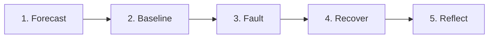

# Learn from a fault, not just a red result

Each lesson follows five steps. Start without an AI key; add the tutor when
you want help reading the evidence, and ask it what was measured and what
it inferred.

## 1. Forecast

Write down your prediction before you run. Will responses get slower,
fail, or both? Will the API still meet the hypothesis? What should happen
after the fault? What would prove you wrong?

The hypothesis of every lesson: each sampled request succeeds, and p95
latency stays at or below **200 ms**. "The server stays up" alone would
miss slow or failed requests.

## 2. Baseline

The lab sends eight requests, one after the other, and records status,
time and dependency details. The baseline must be healthy. When it is
already slow or failing, the result is **inconclusive**: check host load
and the sandbox, then run again.

## 3. Change one behavior

Tumult runs a fixed definition that turns one fault on in the teaching
API and samples the API while it is on. Tutor text never becomes a
command.

| Lesson | What you should see | A question to ask |
|---|---|---|
| Slow responses | About 400 ms more latency; requests can still succeed | Why is a success status not enough? |
| HTTP failures | Fast HTTP 503 answers | How would a latency-only dashboard miss this outage? |
| Unavailable cache | A simulated cache failure fails the request | Serve uncached, serve stale, or fail clearly? |
| Database timeout | About 600 ms, then a 503 | Which timeout should expire first? |

Your own numbers come from your run. Cache and database are simulated in
the application; a 400 ms sleep in the app is not a network delay. One
run at a time; each fault has a short lease, so it ends even when cleanup
fails.

## 4. Recover and compare

Compare **Baseline**, **Fault active** and **Recovery**, for both time and
errors. A fast error is still an error. Recovery back to the baseline shows
that this run undid the change; it does not promise the next one will.

Each phase has **eight requests**. The p95 uses the nearest rank:
`ceil(8 × 0.95) = 8`, so the p95 shown is the **slowest request** of the
phase. Eight requests make a mechanism visible. They do not measure a
production p95, an SLO or capacity.

### Interpret the two results

You get two records, and they answer different questions:

1. **The Tumult journal**: did the experiment run its steps, roll back,
   and find the steady state again?
2. **The lab verdict**: `deviated` when the objective broke during the
   fault while baseline and recovery held; `held` when every phase met it;
   `inconclusive` when the comparison could not be made.

A completed journal next to a deviated verdict is normal: the experiment
ran well and found a weakness. The fields of the journal are in the
[experiment format](https://tumult.rs/guides/experiment-format.html).

## 5. Reflect

Write a short conclusion that keeps what you measured apart from what you
infer, with your own exported numbers:

> During the slow-response run, sampled latency went over 200 ms while
> requests succeeded, and recovery samples came back under it. The added
> delay broke this sandbox's latency objective. This does not show how a
> real network delay would affect retries.

To go further, change a copy of the target, add tests, and run the same
lesson again. Try a cache fallback, a bounded retry, a timeout budget, a
circuit breaker or a concurrency limit, and look at what each costs. For
real Redis, PostgreSQL or network faults, build a separate throwaway
environment.

Keep the definition, the evidence JSON and the journal of a run together,
with your prediction, the run ID, what each phase showed, and the next
question you would test.
