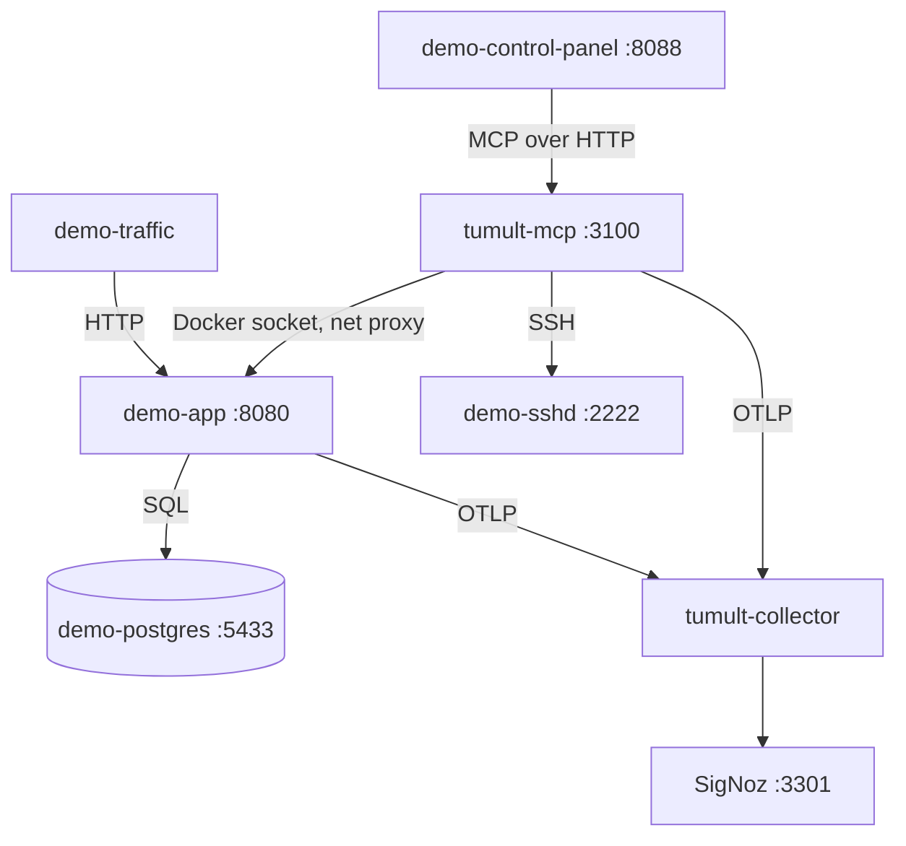

# Tumult one-command demo

One command starts a small real system and Tumult next to it: an order
service on Postgres under steady load, the Tumult MCP server, an OTel
Collector, SigNoz and a web control panel. It then runs one fault per
domain, so the dashboards have data when you open them.

Other ways to try Tumult, such as the Krönika web UI or the Chaos Lab, are
on [Get started](../docs/get-started/other-ways-to-run.md).

## Start it

```bash
make demo          # build, start, run the fault sweep once, print the URLs
# explore, then:
make demo-down     # stop and remove the volumes
```

Open the control panel at **http://localhost:8088**.

## What runs

Everything is on one Docker network, `tumult-demo`. Names, ports and
environment are fixed in [`CONTRACT.md`](./CONTRACT.md).



- **demo-app** sends a span per request; **demo-traffic** keeps a steady
  load on it, so there is always live signal to disrupt.
- **tumult-mcp** is the MCP server. It runs the experiments with the
  Tumult engine, and has the Docker socket so it can reach sibling
  containers. The control panel is its MCP client.
- **tumult-collector** takes spans from the app and from the runs and
  sends them to **SigNoz**.

## The golden path

Each step in the control panel is one MCP tool call:

1. **Inject a fault**: click **Run** on a fault card (`tumult_run_experiment`).
2. **Observe**: follow the trace link into SigNoz and filter on `service = demo-app`.
3. **Analyze**: the **Analytics** card lists recent runs (`tumult_analyze_store`).
4. **Check compliance**: the **Compliance** card shows the DORA evidence (`tumult_compliance`).
5. **Explore the ChaosGraph**: faults, the graph around one experiment and the coverage gaps (`tumult_chaosgraph_query`, `_neighbors`, `_coverage_gaps`).

The **Safety guardrail** card runs `demo-guard-halt.toon`: its guard halts
the run when demo-app turns unhealthy, so **Halted** is the expected
result. The **chaos loop** card runs discover, validate, run, analyze and
recommend as five calls.

The MCP token comes from `TUMULT_MCP_TOKEN` (default `tumult-demo`).
`DEMO_JOURNALS_DIR` (default `/journals`) and `DEMO_COMPLIANCE_FRAMEWORK`
(default `dora`) set what the Compliance card reads.

## Fault domains

One experiment per domain in [`experiments/`](./experiments/). Each checks
the steady state, injects a real fault and checks recovery.

| Domain | Experiment | How |
|---|---|---|
| net | `demo-net.toon` | `tumult-net` proxy in front of demo-app adds 300 ms |
| postgres | `demo-postgres.toon` | `pg_terminate_backend` through `docker exec demo-postgres psql` |
| container | `demo-container.toon` | `docker pause` and `unpause` of demo-postgres |
| stress | `demo-stress.toon` | Pumba `stress` inside demo-app |
| process | `demo-process.toon` | `SIGSTOP` and `SIGCONT` to the main process of demo-app |
| ssh | `demo-ssh.toon` | `tumult-ssh` runs commands, also a stress-ng burst, on demo-sshd |
| agentic | `demo-agentic.toon` | `tumult agentic smoke`: bad model output, with a fake adapter |
| agentic-trajectory | `demo-agentic-trajectory.toon` | `tumult agentic trajectory`: a poisoned retrieval and a reflection loop |
| timewarp-clock | `demo-timewarp-clock.toon` | A skewed clock refuses a short-lived token |
| timewarp-entropy | `demo-timewarp-entropy.toon` | Load on the random number generator; crypto still completes |

Outside the sweep: `demo-guard-halt.toon` (the guardrail card), and
`demo-topo-blind.toon` with `demo-topo-recommended.toon`, which belong to
[`scripts/demo-topology.sh`](../scripts/demo-topology.sh).
`make demo-check` runs all of them.

## make demo-check

The smoke test of the demo. It starts the stack, waits for health, runs
the sweep and checks three things. It exits with a code other than 0 on
any failure.

1. **Each journal is as expected**: `scripts/check-proof-journals.py`
   compares each journal with `demo/experiments/expectations.json`
   (status, steady state before and after, rollbacks, objective verdicts).
2. **Telemetry arrived**: the collector counts accepted spans on `:18888`.
3. **The Star Map holds**: it starts a Krönika demo from
   `docker/docker-compose.kronika.yml`, seeds it, checks the seed journals
   and the Star Map, and removes it.

`make demo` uses the same script to warm the dashboards, without failing.

## Ports

| Port | Service |
|---|---|
| 8080 | demo-app |
| 8088 | demo-control-panel |
| 5433 | demo-postgres |
| 2222 | demo-sshd |
| 3100 | tumult-mcp (HTTP) |
| 3301 | SigNoz UI |
| 14317, 14318 | Collector OTLP gRPC and HTTP |
| 18888, 18889, 13133 | Collector self-telemetry, Prometheus, health |

## Limits

The demo runs in plain Docker Compose; the only extra right is the Docker
socket.

- **No Kubernetes.** The `tumult-kubernetes` plugin is in the image and
  works against a real cluster.
- **net**: the proxy sits in front of demo-app, not between demo-app and
  Postgres, because the database URL of the app is fixed at start.
- **postgres**: the runner image has no `psql`, so the step uses the one in
  the Postgres container. Same SQL as `tumult-db-postgres`.
- **stress**: `tumult-stress` loads its own machine, so the demo uses Pumba
  to load demo-app.
- **ssh**: the host key of demo-sshd changes with each build, so the step
  uses `host_key_policy: accept-any`.
- **agentic**: the fake adapters need no external API.
