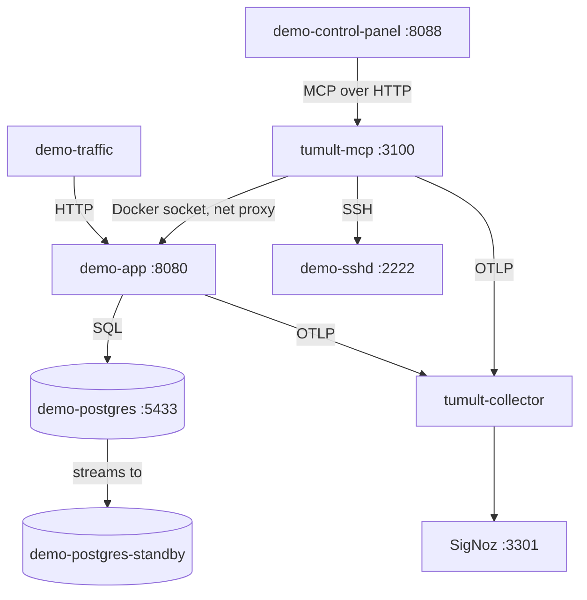

# Tumult one-command demo

One command starts a small real system and Tumult next to it: an order
service on Postgres under steady load, the Tumult MCP server, an OTel
Collector, SigNoz and a web control panel. It then runs one fault per
domain, so the dashboards have data when you open them.

Other ways to try Tumult, such as the Krönika web UI or the Chaos Lab, are
on [Get started](../docs/get-started/other-ways-to-run.md).

## Start it

```bash
make demo          # build, start, run the fault sweep once, print the URLs
# explore, then:
make demo-down     # stop and remove the volumes
```

Open the control panel at **http://localhost:8088**.

## What runs

Everything is on one Docker network, `tumult-demo`. Names, ports and
environment are fixed in [`CONTRACT.md`](./CONTRACT.md).



- **demo-app** sends a span per request; **demo-traffic** keeps a steady
  load on it, so there is always live signal to disrupt.
- **tumult-mcp** is the MCP server. It runs the experiments with the
  Tumult engine, and has the Docker socket so it can reach sibling
  containers. The control panel is its MCP client.
- **tumult-collector** takes spans from the app and from the runs and
  sends them to **SigNoz**.

## The golden path

Each step in the control panel is one MCP tool call:

1. **Inject a fault**: click **Run** on a fault card (`tumult_run_experiment`).
2. **Observe**: follow the trace link into SigNoz and filter on `service = demo-app`.
3. **Analyze**: the **Analytics** card lists recent runs (`tumult_analyze_store`).
4. **Check compliance**: the **Compliance** card shows the DORA evidence (`tumult_compliance`).
5. **Explore the ChaosGraph**: faults, the graph around one experiment and the coverage gaps (`tumult_chaosgraph_query`, `_neighbors`, `_coverage_gaps`).

The **Safety guardrail** card runs `demo-guard-halt.toon`: its guard halts
the run when demo-app turns unhealthy, so **Halted** is the expected
result. The **chaos loop** card runs discover, validate, run, analyze and
recommend as five calls.

The MCP token comes from `TUMULT_MCP_TOKEN` (default `tumult-demo`).
`DEMO_JOURNALS_DIR` (default `/journals`) and `DEMO_COMPLIANCE_FRAMEWORK`
(default `dora`) set what the Compliance card reads.

## Fault domains

One experiment per domain in [`experiments/`](./experiments/). Each checks
the steady state, injects a real fault and checks recovery.

| Domain | Experiment | How |
|---|---|---|
| net | `demo-net.toon` | `tumult-net` proxy in front of demo-app adds 300 ms |
| postgres | `demo-postgres.toon` | `pg_terminate_backend` through `docker exec demo-postgres psql` |
| container | `demo-container.toon` | `docker pause` and `unpause` of demo-postgres |
| stress | `demo-stress.toon` | Pumba `stress` inside demo-app |
| process | `demo-process.toon` | `SIGSTOP` and `SIGCONT` to the main process of demo-app |
| ssh | `demo-ssh.toon` | `tumult-ssh` runs commands, also a stress-ng burst, on demo-sshd |
| agentic | `demo-agentic.toon` | `tumult agentic smoke`: bad model output, with a fake adapter |
| agentic-trajectory | `demo-agentic-trajectory.toon` | `tumult agentic trajectory`: a poisoned retrieval and a reflection loop |
| timewarp-clock | `demo-timewarp-clock.toon` | A skewed clock refuses a short-lived token |
| timewarp-entropy | `demo-timewarp-entropy.toon` | Load on the random number generator; crypto still completes |

Outside the sweep: `demo-guard-halt.toon` (the guardrail card), and
`demo-topo-blind.toon` with `demo-topo-recommended.toon`, which belong to
[`scripts/demo-topology.sh`](../scripts/demo-topology.sh).
`make demo-check` runs all of them.

## The DR examples and the demo GameDay

`make demo-check` also runs two disaster recovery examples and a GameDay.
Each one says what it proves:

| Run | What it proves |
|---|---|
| [`examples/postgres-failover.toon`](../examples/postgres-failover.toon) | The primary stops, the standby is promoted and takes writes, and the app follows it. The RTO runs from the first read that saw the outage to the read where the app was back, within 30 s. |
| [`examples/postgres-restore-rpo.toon`](../examples/postgres-restore-rpo.toon) | The orders database is lost and restored from a backup taken before the last 4 seconds of writes, so those writes are lost. The RPO is the seconds lost, 4 to 7 in the demo, within 10 s. The RTO runs until the app reads its orders again, within 30 s. |
| [`kronika/gamedays/platform-resilience.gameday.toon`](./kronika/gamedays/platform-resilience.gameday.toon) | Four steps, each with a fault its steady-state probe sees. Three recover. The queue loss step fails by design, and the GameDay requires a recovery of each step, so its score is `PARTIAL` with a recovery of 0.75. |

The steady-state probes of these runs only read. A probe that wrote, such
as one that made the directory it checks, would heal the fault it is
there to see: the runner reads it again while the fault is on. A control
or a step of the method sets the stage instead.

The failover leaves a promoted standby and a stopped primary, and the
restore leaves a database without the orders placed after its backup. The
check makes the pair again before and after each example. To do it by
hand:

```bash
docker compose -f docker/docker-compose.demo.yml rm -sfv demo-postgres-standby
docker compose -f docker/docker-compose.demo.yml up -d --wait demo-postgres demo-postgres-standby
```

The new standby copies the primary when it starts.

## make demo-check

The smoke test of the demo. It starts the stack, waits for health, runs
the sweep, the DR examples and the demo GameDay, and checks four
things. It exits with a code other than 0 on any failure.

1. **Each journal is as expected**: `scripts/check-proof-journals.py`
   compares each journal with `demo/experiments/expectations.json`
   (status, steady state before and after, rollbacks, objective verdicts),
   the DR examples with `examples/expectations.json`, which also names
   the RPO the restore must measure, and the GameDay with
   `demo/kronika/gamedays/expectations.json`, which also names its score.
   The check prints the RTO and the RPO each DR example measured.
2. **The DR examples are DR evidence**: before the examples, the check
   starts a Krönika demo from `docker/docker-compose.kronika.yml` and seeds
   it. Its daemon joins the `tumult-demo` network, and each DR example sends
   its journal there. `scripts/dr-check.py` then asks that daemon:
   - `GET /api/dr` holds each DR example as a DR test that is met and
     recovered, and the restore with its RPO in the range of
     `examples/expectations.json`;
   - `GET /dr` serves the DR page. It is the app shell, built in the
     browser, so the check also reads the route module of the page. This
     proves the page is in the build, not what it shows;
   - the DR test report of `demo-postgres` names the restore with its RPO
     and its verdict, and the DORA evidence pack holds the row of RTS
     2024/1774 Art. 26;
   - `GET /api/dora` shows the plan scenario `backup_restore` as passed by
     the restore, for `cif-0001`, the function `demo/kronika/org.yaml`
     binds `demo-postgres` to.
3. **Telemetry arrived**: the collector counts accepted spans on `:18888`.
4. **The Star Map holds**: on the same Krönika demo, it checks the Star
   Map, and then removes the demo.

`make demo` uses the same script to warm the dashboards, without failing.

## Ports

| Port | Service |
|---|---|
| 8080 | demo-app |
| 8088 | demo-control-panel |
| 5433 | demo-postgres |
| 2222 | demo-sshd |
| 3100 | tumult-mcp (HTTP) |
| 3301 | SigNoz UI |
| 14317, 14318 | Collector OTLP gRPC and HTTP |
| 18888, 18889, 13133 | Collector self-telemetry, Prometheus, health |

## Limits

The demo runs in plain Docker Compose; the only extra right is the Docker
socket.

- **No Kubernetes.** The `tumult-kubernetes` plugin is in the image and
  works against a real cluster.
- **net**: the proxy sits in front of demo-app, not between demo-app and
  Postgres, because the database URL of the app is fixed at start.
- **postgres**: `demo-postgres.toon` runs the `psql` of the Postgres
  container. Same SQL as `tumult-db-postgres`. The DR examples run the
  actions of `tumult-db-postgres` with the `psql`, `pg_dump` and
  `pg_restore` of the runner image, of PostgreSQL 16 as the server.
- **stress**: `tumult-stress` loads its own machine, so the demo uses Pumba
  to load demo-app.
- **ssh**: the host key of demo-sshd changes with each build, so the step
  uses `host_key_policy: accept-any`.
- **agentic**: the fake adapters need no external API.
