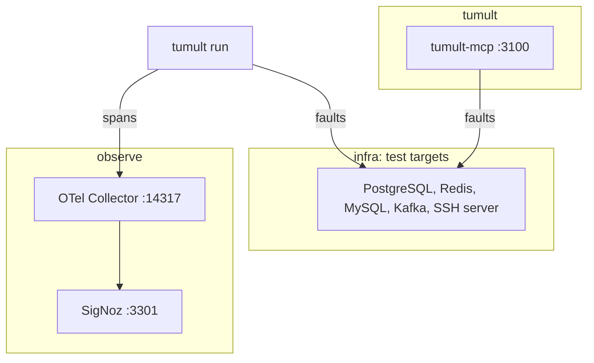

# Tumult Docker lab

Compose files for a Tumult lab: test targets to break, SigNoz to watch,
and the Tumult MCP server. For the shortest way in, see
[Get started](../docs/get-started/index.md). For guided lessons in a
browser, see the [Chaos Lab](../chaos-lab/README.md).

## Images

Each release publishes these to the GitHub Container Registry:

```bash
docker pull ghcr.io/mwigge/tumult:latest       # tumult CLI
docker pull ghcr.io/mwigge/tumult-mcp:latest   # MCP server over HTTP
docker pull ghcr.io/mwigge/tumultd:latest      # daemon with the Krönika web UI
```

`tumult` and `tumult-mcp` hold the binaries `tumult`, `tumult-mcp` and
`tumult-net-proxyd`, the script plugins, the example experiments and the
GameDay files. `tumult discover` in them lists every plugin. Which faults
can run depends on the tools, the rights and the system of the host.

## Bundles

`./start.sh` in the repository root starts the bundles you name:



| Bundle | Compose file | Command | What starts |
|---|---|---|---|
| **infra** | `docker-compose.yml` | `./start.sh infra` | PostgreSQL 16, Redis 7, MySQL 8, Kafka 3.8, an SSH server |
| **observe** | `docker-compose.observability.yml` | `./start.sh observe` | SigNoz and the OTel Collector |
| **tumult** | `docker-compose.tumult.yml` | `./start.sh tumult` | The MCP server (Streamable HTTP) |
| **aqe** | `docker-compose.aqe.yml` | `./start.sh aqe` | Agentic QE Fleet; needs a clone in `../agentic-qe` |

`./start.sh` alone starts infra and observe. `./start.sh all` starts all
four, `./start.sh status` lists the containers, and `./start.sh down`
stops infra, observe and tumult. Start infra first: the other bundles use
its `tumult-e2e` network.

The Krönika demo is separate. Copy `.env.example` to `.env`, fill in the
`KRONIKA_*` values, then run
`docker compose -f docker/docker-compose.kronika.yml up -d --build`.

## Run an experiment against the lab

```bash
./start.sh
export OTEL_EXPORTER_OTLP_ENDPOINT=http://localhost:14317
tumult run examples/postgres-failover.toon
open http://localhost:3301                     # the traces in SigNoz
```

Settings for the plugins and the lab targets:

```bash
export TUMULT_PG_HOST=localhost TUMULT_PG_PORT=15432
export TUMULT_PG_USER=tumult TUMULT_PG_PASSWORD=tumult_test TUMULT_PG_DATABASE=tumult_test
export TUMULT_REDIS_HOST=localhost TUMULT_REDIS_PORT=16379
export TUMULT_KAFKA_BOOTSTRAP=localhost:19092
export TUMULT_MCP_TOKEN=replace-with-a-secret   # the compose default is a dev token
```

`make ssh-key` copies the test key of the SSH server (user `tumult`, key
login only) to `/tmp/tumult-test-key`.

### The MCP server

```bash
export OTEL_EXPORTER_OTLP_ENDPOINT=http://tumult-collector:4317
./start.sh tumult                              # then http://localhost:3100/mcp
```

The MCP compose file falls back to `otel-collector`, while the observe
bundle names its collector `tumult-collector`, so set the endpoint as
above. To pull the image instead of building it:
`docker compose -f docker/docker-compose.tumult.yml pull`.

The aqe compose file sets `http://otel-collector:4317` itself. To send its
spans to `tumult-collector`, add an override file with
`OTEL_EXPORTER_OTLP_ENDPOINT` for the `agentic-qe` service, and pass it
after the base file.

## Ports

Targets and the collector use ports from 10000 up. The observe bundle and
the Krönika demo both publish `14317` and `14318`, so do not run both with
the default ports.

| Bundle | Service | Port |
|---|---|---|
| infra | PostgreSQL, Redis, MySQL | 15432, 16379, 13306 |
| infra | Kafka (KRaft), SSH server | 19092, 12222 |
| observe | SigNoz UI | 3301 |
| observe | SigNoz OTLP gRPC and HTTP | 4317, 4318 |
| observe | Collector OTLP gRPC, HTTP, Arrow | 14317, 14318, 14319 |
| observe | Collector Prometheus, self-telemetry, health | 18889, 18888, 13133 |
| observe, profile `classic` | Jaeger, Prometheus, Grafana | 16686, 19090, 13000 |
| tumult | MCP server | 3100 |
| Krönika demo | tumultd: OTLP, web UI and API | 14317, 14318 |

## Files

| File | What it is |
|---|---|
| `docker-compose.yml` | The test targets |
| `docker-compose.observability.yml` | SigNoz, the OTel Collector, and the `classic` profile |
| `docker-compose.tumult.yml` | The MCP server |
| `docker-compose.aqe.yml` | Agentic QE Fleet |
| `docker-compose.kronika.yml` | The Krönika demo: tumultd, seed, report and forecast |
| `docker-compose.kronika-collector.yml` | An optional collector that forwards to a tumultd on the host |
| `docker-compose.grafana-full.yml` | Tempo, Mimir, Loki and Grafana; see the [Grafana guide](../docs/guides/grafana-stack.md) |
| `docker-compose.demo.yml` | The one-command demo of `make demo`; see the [demo README](../demo/README.md) |
| `Dockerfile.tumult`, `Dockerfile.tumult-mcp`, `Dockerfile.tumultd` | The three published images |
| `Dockerfile.sshd` | The SSH test target `tumult-sshd:lab`, also the stress-ng of the Pumba stress steps |
| `Dockerfile.demo-*` | The images of the demo stack |
| `tumult-collector/config.yaml` | The collector pipeline |
| `signoz/` | SigNoz dashboards |

## When something goes wrong

| Problem | Fix |
|---|---|
| A port is taken | Change the port in the compose file |
| The build is slow | Pull the published images: `docker compose pull` |
| Kafka is slow to start | KRaft needs about 30 seconds: `docker compose logs kafka` |
| SigNoz shows nothing | Wait 30 seconds for the first data |
| ClickHouse runs out of memory | Give Docker 4 GB or more |
