# Architecture

Tumult has two programs. The CLI, `tumult`, runs experiments. The daemon,
`tumultd`, takes in evidence, keeps it in one database and serves the web
UI. This page shows the parts and how the data moves between them.

## Who uses Tumult

People use the web UI. A CI pipeline calls the CLI. An AI agent talks to the
MCP server. Your services send telemetry, and Tumult tests them.

## The parts

| Part | Job |
|---|---|
| `tumult` (CLI) | Runs experiments. Works alone, or sends its results to the daemon. |
| Plugins | The faults, probes and load tools that touch your systems. |
| `tumultd` (daemon) | Takes in evidence, runs approved experiments, scores, and serves the API and the web UI. |
| Krönika (web UI) | Built into the daemon, on the same port as the API. |
| Lake | One DuckDB file. One writer, many readers. |
| MCP server | Gives AI agents the tools of Tumult, with roles. |
| Forecast sidecar | Optional. The daemon has a forecaster of its own. |

## Evidence in

- Telemetry comes in as OTLP over gRPC on port 4317, which also takes
  OTel-Arrow streams, and as OTLP over HTTP on port 4318. With
  `KRONIKA_INGEST_TOKEN` set, every sender needs that token.
- Each request becomes rows: spans, logs and metrics. Journals from the CLI,
  manual records and the state of daemon runs come in beside them.
- Everything goes through one queue to one writer. Nothing else writes the
  lake. When a write fails, the sender gets an answer that tells it to send
  again (gRPC `UNAVAILABLE`, HTTP 503).

The size limits of the gRPC port are in
[observability setup](../guides/observability-setup.md).

## Answers out

- The API reads the lake on read-only connections, so a read never waits
  for the writer.
- Scores, risks, the Star Map, performance verdicts and forecasts are worked
  out when you ask, from the stored rows, `org.yaml` and the Kubernetes
  manifests.
- A few answers are stored back through the writer: the daily score
  snapshot, a performance verdict you save, and the forecast cache.
- Forecasts come from a built-in Holt-Winters model, or from the
  `tumult-forecastd` sidecar when `TUMULTD_FORECAST_URL` is set. When the
  sidecar fails, the daemon uses Holt-Winters and says so.
- Each page of the web UI calls this API with your session. The
  [page reference](../reference/kronika-pages.md) lists the API of each page.

## The lake

- The CLI and the daemon both find the lake with `TUMULT_LAKE_PATH`. The
  default is `~/.tumult/lake.duckdb`.
- Only one process may write the lake. While the daemon runs, go through
  it: the CLI imports through `TUMULT_DAEMON_URL`, and a report comes from
  `GET /report`.
- Tumult makes the folder of the lake readable by its owner only. DuckDB
  does not encrypt the file, so keep it on an encrypted disk.
- The schema is at version 21. A build does not write a lake that a newer
  build made. Take `tumult store backup` before an upgrade.
- Every 24 hours (`KRONIKA_LAKE_INTERVAL`) the daemon exports the lake to
  Parquet files, without the tables of users, sessions and tokens. Nothing
  is deleted by itself. See [data portability](../guides/data-portability.md).

| What | Tables |
|---|---|
| Telemetry | `spans`, `logs`, `metric_sums`, `metric_gauges`, `metric_histograms` |
| Journals | `experiments`, `activity_results`, `load_results`, `probe_samples`, `nfr_verdicts` |
| Daemon runs | `run_registry`, `runs`, `run_audit`, `approval_requests`, `approval_decisions`, `run_schedules` |
| Manual evidence | `manual_experiments`, `manual_experiment_audit`, `evidence_attachments`, `manual_exercise_steps`, `manual_action_items`, `manual_experiment_links`, `manual_exercise_plans`, `manual_plan_audit`, `manual_signoffs` |
| Scores and findings | `requirement_status_daily`, `maturity_daily`, `risk_suppressions`, `perf_verdicts`, `forecasts` |
| Entities | `entity_versions`, written only with `KRONIKA_ENTITY_EVENTS` set |
| Access | `users`, `sessions`, `tokens`, `user_env_scopes` |

## Settings

The daemon reads environment variables with three prefixes.

| Prefix | For |
|---|---|
| `KRONIKA_*` | The daemon: ingest, tokens, lake export, scores. The names stay as they are. |
| `TUMULTD_*` | Newer daemon settings: the run queue, approvals, forecasts. |
| `TUMULT_*` | The CLI, and the path of the lake. |

[Production deployment](../guides/production-deployment.md) lists them.

## Next

- [Runs, approvals and roles](runs-and-approvals.md): how the daemon decides
  who may run what.
- [How a run works](../guides/execution-flow.md): the steps of one run.
