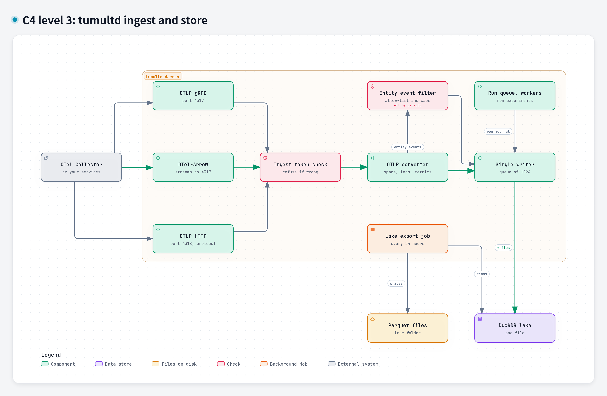
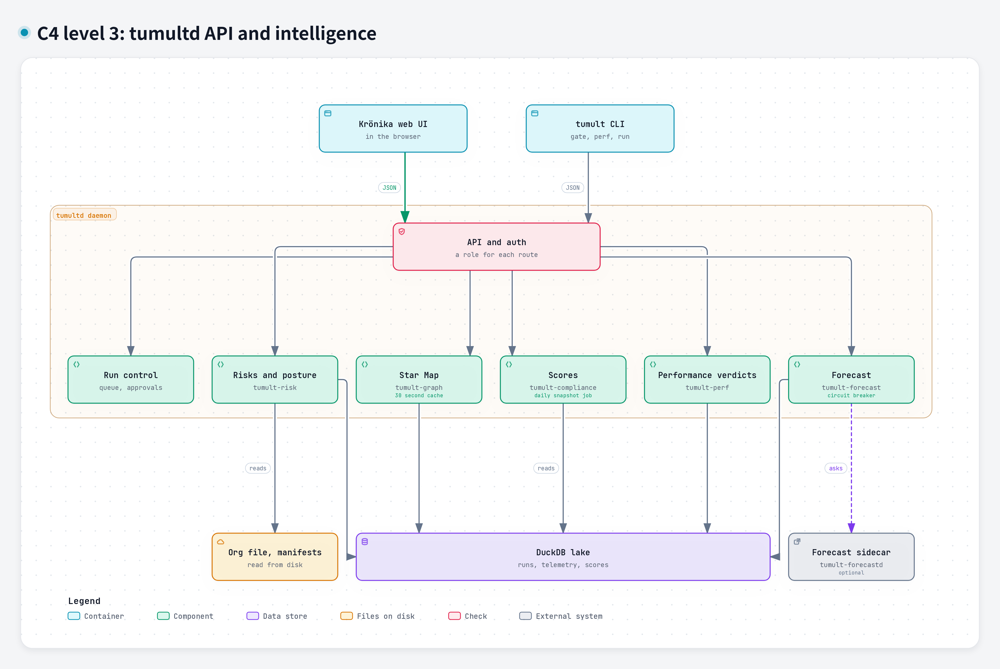
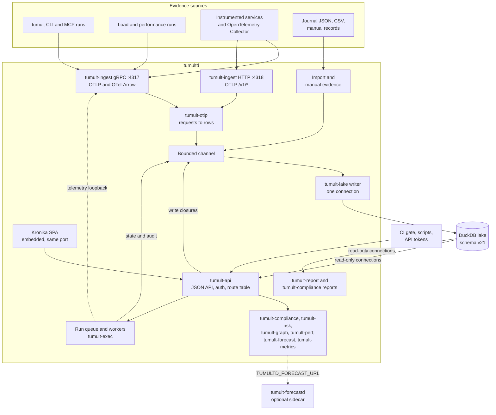
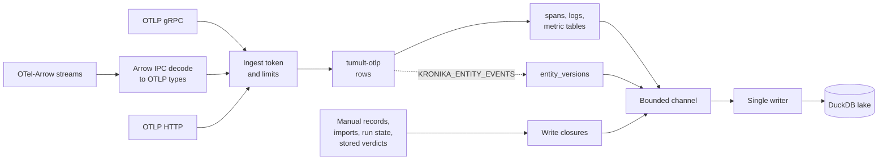
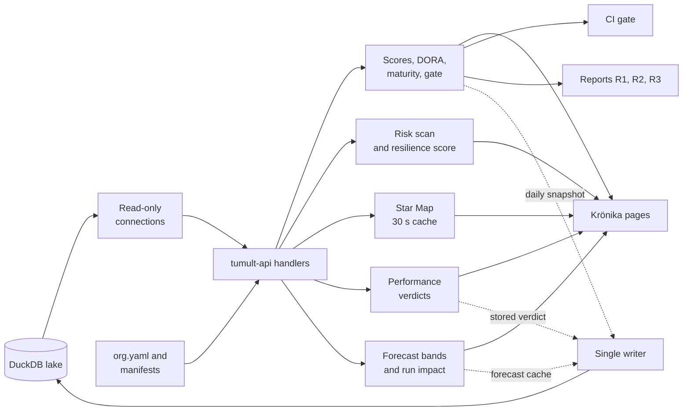

# Architecture: tumultd, the lake and Krönika

This is the architecture of the part of Tumult that turns resilience
evidence into intelligence: the `tumultd` daemon, its embedded web UI
(Krönika), and the crates behind them. The daemon ingests evidence from
several sources (chaos experiments, load and performance runs, service
telemetry, entity events, manual records), stores it in the embedded
DuckDB lake, executes registered experiment definitions under an approval
workflow, and serves scores, verdicts, forecasts, the Star Map, the web UI
and compliance reports from that one store. Next to
OTLP/gRPC and OTLP/HTTP, the gRPC listener also speaks OTel-Arrow (OTAP,
the Collector's `otelarrow` exporter): `tumult-ingest::otap` decodes the
Arrow IPC tables back into the OTLP request types, so the same
`tumult-otlp` conversion and the same single-writer channel serve both
carriers and the rows are identical whichever one delivered them. The Arrow
receiver treats every declared size as hostile: rows, attributes, decoded
bytes, message size, retained dictionary bytes, open streams, stream age
and decode time are bounded by the `KRONIKA_OTAP_*` limits
(`tumult-ingest::otap::limits`), connections, their handshake time and
their age by the `KRONIKA_GRPC_*` limits (`tumult-ingest::listener`). The
listener does the TLS handshake itself and, when an ingest token is set,
knows which connections have made an authorised call: one that has not
is closed after `KRONIKA_GRPC_AUTH_TIMEOUT_SECS` and gives its place to a
newcomer when there is no room. One
connection or peer (an IPv4 address or an IPv6 /64) gets only a share of
the streams and of the retained bytes, and waiting batches are decoded
peer by peer in turn. Because release builds abort on panic, Arrow
IPC is decoded by a checked reader of its own (`tumult-ingest::otap::ipc`)
that accepts only the column types OTAP uses.
Everything lives in this repository as first-class `tumult-*` crates.

The daemon's configuration surface keeps `KRONIKA_*` environment variable
names (`KRONIKA_HTTP_ADDR`, `KRONIKA_INGEST_TOKEN`, `KRONIKA_LAKE_DIR`,
…) — those are stable identifiers, not product names.

Three environment-variable prefixes coexist, each with a distinct scope:
`KRONIKA_*` is the daemon's original configuration surface (frozen
identifiers, kept for backwards compatibility); `TUMULTD_*` covers newer
run-queue settings added after the import (`TUMULTD_RUN_CONCURRENCY`,
`TUMULTD_RUN_QUEUE_DEPTH`, `TUMULTD_APPROVAL_SWEEP_S`); and `TUMULT_*`
belongs to the CLI/native side (`TUMULT_OTEL_ENABLED`, `TUMULT_LAKE_PATH`,
…). New daemon settings should use `TUMULTD_*`; the `KRONIKA_*` names are
not being renamed.

## C4 diagrams

| Level | Diagram |
|---|---|
| 1, context |  |
| 2, containers |  |
| 3, ingest and store |  |
| 3, intelligence and API |  |

The source of each diagram is the `.json` file beside it.

## Container view



## Main data flows

Evidence in: every source ends on the same writer.



Evidence out: every read uses a read-only connection, and the few derived
rows that are stored go back through the writer.



## Component diagram

```
                        ┌────────────────────────────────────────────┐
                        │                  tumultd                   │
                        │                                            │
 tumult ──OTLP/gRPC──▶  │  tumult-ingest (grpc :4317, OTLP +         │
 Collector ─OTAP────▶   │                 OTel-Arrow streams)         │
 (TUMULT_OTEL_ENABLED, │  tumult-ingest (http :4318, /v1/*,          │
  OTEL_EXPORTER_       │                          /healthz)          │
  OTLP_ENDPOINT)       │        │ decode prost (opentelemetry-proto) │
                       │        ▼                                    │
 smedja ──OTLP/HTTP──▶ │  tumult-otlp — pure translation:            │
 (SMEDJA_OTLP_         │  promote resilience.* + service.name to     │
  ENDPOINT, /v1/*)     │  columns, rest into MAP attrs               │
                       │        │ row batches                        │
 files (CSV / tumult   │  ManualImporter ─────────────┐              │
  journal JSON) ──────▶│  (tumultd import <file>)     │              │
                       │        ▼                     ▼              │
                        │  single bounded mpsc channel (backpressure) │
                        │    ▲ Batch::Exec — manual-evidence, run-    │
                        │    │ queue and approval closures from       │
                        │    │ tumult-api ride the same channel       │
                        │    │ (the API opens no write conn)          │
                        │        ▼                                    │
                        │  tumult-lake WRITER (single DuckDB conn)    │
                        └────────┬───────────────────────────────────┘
                                 │ exclusive write lock
                                 ▼
                    ┌─────────────────────────┐
                    │  ~/.tumult/lake.duckdb  (dir mode 0o700)      │
                    │  spans · logs · metric_sums/gauges/histograms │
                    │  import_batches · view: experiment_runs       │
                    │  manual_experiments · manual_experiment_audit │
                    │  evidence_attachments · users/sessions/tokens │
                    │  run_registry · runs · run_audit ·            │
                    │  approval_requests · approval_decisions (v7)  │
                    └────────┬─────────────────┘
              read-only conns (AccessMode::ReadOnly, many, coexist)
              ┌──────────────┼───────────────────────────┐
              ▼              ▼                           ▼
      tumult-metrics    tumult-report             tumult-api
      YAML semantic     digest renderer           JSON API (/api/*,
      layer → SQL       (ad-hoc + scheduled)      spawn_blocking)
              │              │                    │  overview · series ·
              │   tumult-compliance               │  experiments · runs ·
              │   compliance reports              │  approvals · logs ·
              │   (R1/R2/R3 → PDF +               ▼  traces · metrics ·
              │    HTML, scores)              web/ SPA (rust-embed, same
              │         │                     HTTP port) ──┘
              ▼         ▼                        ▲  POST /api/ask ──▶ tumult-
         <db dir>/reports/  (+ reports/v2/       │  intelligence::llm →
         report_<epoch>.html  KRK-*.pdf/.html/.json)  sql_guard → read-only
         (store closed)                          │  execution (guarded, LIMIT)
```

## Data flow

1. **OTLP in** — gRPC (tonic) and HTTP (axum, `application/x-protobuf`)
   servers receive `Export{Trace,Metrics,Logs}ServiceRequest`s.
2. **Normalize** — `tumult-otlp` converts proto values to plain row structs,
   promoting the tumult metadata standard's (`resilience.*` v2.0)
   low-cardinality keys and `service.name`/`service.version` into wide-table
   columns; dynamic keys stay in `MAP(VARCHAR, VARCHAR)` columns.
3. **Store** — batches travel a bounded tokio mpsc channel (batching +
   backpressure) to the single writer connection. A FATAL persist error
   (DuckDB invalidates the connection) makes the writer task rebuild the
   connection with bounded retries instead of acking errors forever; the
   failed batch is reported, never retried.
4. **Semantic layer** — `metrics/*.yaml` definitions compile to strictly
   validated SQL (`[a-z0-9_.]` identifiers only → injection-impossible).
5. **UI / reports** — `tumult-api` answers the UI's queries through fresh
   read-only connections (never touching the write lock); the SPA itself is
   rust-embedded into tumultd and served from the same HTTP port. Beyond
   Overview/Experiments it backs the explorer pages: `/api/logs[ /volume]`
   (raw log search + severity volume), `/api/traces[ /durations, /{id}]`
   (spans grouped into traces, duration percentiles, per-trace detail),
   `/api/metrics/catalog` + `/api/metrics/query` (raw sums/gauges/histograms
   with optional attribute grouping; histogram p95 interpolated in Rust) and
   `/api/starmap` (organisation, entities, systems, services, workloads
   and definitions as one graph, assembled per request and cached for
   30 s per parameter set and scopes in a bounded cache that every write
   the map shows clears), `/api/topology` (compatibility
   view of its service/system call graph, ids `svc:` and
   `sys:<environment>/<system>`, `7d` unless `range` says otherwise),
   `/api/perf/{target}`
   (performance regression verdict between two of a target's
   `service.version`s inside one environment — the version each run
   recorded, in deployment order unless named — with a bootstrap
   interval; `POST /api/perf/{target}/verdicts` appends it to
   `perf_verdicts`; `/api/perf` lists the targets and
   `/api/perf/{target}/version` tells a runner which version served a
   window; the `/performance` page shows both sides, the verdict and its
   stored history),
   and `/api/gate/{target}`
   (the CI gate: a target's score as a `pass|warn|fail` verdict with
   reasons and evidence, computed with the same freshness-decayed model as
   `/api/scores` and confined to the principal's environment scopes), and
   `/api/risks` + `/api/posture` (the passive risk scan: ranked findings
   from the latest evidence per target and discipline, objective verdicts,
   the span call graph, registered definitions and the Kubernetes
   manifests under `KRONIKA_MANIFESTS_DIR`, with the coverage matrix and
   the continuous resilience score; `POST /api/risks/{id}/suppress` accepts a
   finding for a while; `POST /api/risks/{id}/recommend` turns one into a
   registered experiment and an autopilot candidate with a `risk`
   trigger, gated and recorded when a policy is loaded), and
   `/api/forecast` + `/api/runs/{id}/impact` (forecast bands for semantic
   metrics and the counterfactual impact and recovery time of a run's
   probes; the provider is the built-in Holt-Winters in `tumult-forecast`,
   or the `tumult-forecastd` Timestral sidecar when `TUMULTD_FORECAST_URL`
   is set, with the model named in every response). Mutating routes exist but
   stay read-only in spirit: they ride the single-writer channel (run
   control below, manual-evidence lifecycle, approval decisions). Ad-hoc
   digests come from `tumultd report` / `GET /report`; with
   `KRONIKA_REPORT_INTERVAL` set, the daemon additionally renders a digest
   per interval into `<db dir>/reports/` (listed by `/api/reports`). When
   an LLM is reachable, digests (scheduled and `POST /api/reports/generate`)
   gain a narrative section via `tumult_report::narrative`, which keeps
   only sentences whose numbers are grounded in the report's own facts.

The docker demo (`docker/docker-compose.kronika.yml`) is the **reference
ingestion flow** end to end: a pinned tumult binary runs the
experiment suite and emits genuine OTLP/gRPC (traces, metrics, logs) into
tumultd, which normalizes, stores and renders it into the HTML reports
under `demo-out/`. Whatever tumult emits on the wire is exactly what the
semantic layer computes over.

## Scores, verdicts, forecasts and the Star Map

Everything in this section is computed from rows already in the lake. None
of it has a store of its own beyond the derived tables named here.

- **Compliance score and gate.** `/api/scores` and `/api/scores/tree` roll
  the latest run per experiment up the `org.yaml` hierarchy with freshness
  decay; `/api/gate/{target}` returns the same model as a `pass|warn|fail`
  verdict for CI.
- **DORA coverage and maturity score.** `/api/dora`, `/api/dora/{article}`
  and `/api/maturity` match runs and verified manual records to the
  requirement registry in `tumult-compliance`, per function of the register
  in `org.yaml`, and keep unknown apart from missing. A daily job stores
  the status in `requirement_status_daily` and `maturity_daily`
  (`KRONIKA_SCORE_SNAPSHOT_INTERVAL`); history and the Operating status
  count stored days only. Responses are reused for
  `KRONIKA_SCORE_CACHE_TTL` seconds. The score reports what evidence
  exists; see [the DORA score guide](../guides/dora-score.md).
- **Risk scan and resilience score.** `tumult-risk` ranks findings from the latest
  evidence per target and discipline, objective verdicts, the span call
  graph, registered definitions and the manifests. Accepting a finding
  appends to the hash-chained `risk_suppressions`.
- **Performance verdicts.** `tumult-perf` compares latency samples of two
  `service.version`s of a target inside one environment with a bootstrap
  interval. A stored verdict is a row in `perf_verdicts`. See
  [performance regression](../guides/performance-regression.md).
- **Forecasts.** `tumult-forecast` is pure and opens no database. The API
  resamples on a reader, asks the provider and caches the answer in
  `forecasts`. The provider is the built-in Holt-Winters, or the optional
  `tumult-forecastd` sidecar (`forecastd/`, a Python service around the
  Timestral model, weights mounted by the operator) when
  `TUMULTD_FORECAST_URL` is set. A circuit breaker skips a failing sidecar
  and falls back to Holt-Winters, and every response names the model and
  the fallback reason. See [forecasting](../guides/forecasting.md).
- **Star Map.** `/api/starmap` assembles organisation units, ICT entities,
  systems, components, services, workloads and definitions as one graph
  from spans, runs, manual records, suppressions, `org.yaml` and the
  manifests. Responses are cached for 30 s per parameter set and scopes in
  a cache bounded to 64 entries and 64 MiB; a write the map shows clears
  it, and ingested telemetry shows after the 30 s at the latest. See
  [the Star Map guide](../guides/star-map.md).
- **Entities.** With `KRONIKA_ENTITY_EVENTS=1` entity events in OTLP logs
  are stored in `entity_versions` and read through `/api/entities` and
  `/api/entities/{key}/history`. The Star Map, the scores and the web UI do
  not read them yet. See [entity events](../guides/entity-events.md).

## Krönika pages and the API behind them

Krönika is a SvelteKit single-page application (`web/`) with ECharts,
embedded in the `tumultd` binary and served from the HTTP port. A page
holds no evidence of its own; it calls the JSON API with the user's
session. The charts and the evidence on each page are described in
[the page reference](../reference/kronika-pages.md).

| Page | Route | API | Role |
|---|---|---|---|
| Overview | `/` | `/api/overview`, `/api/experiments/windows` | viewer |
| Resilience | `/resilience` | `/api/risks`, `/api/posture`, `/api/scores/tree`, `/api/otel/conformance`; `POST /api/risks/{id}/suppress` | viewer; operator to accept a finding |
| Performance | `/performance` | `/api/perf`, `/api/perf/{target}`; `POST /api/perf/{target}/verdicts` | viewer; operator to store a verdict |
| Scores | `/scores` | `/api/scores/tree` | viewer |
| DORA | `/scores?view=dora` | `/api/dora`, `/api/dora/{article}`, `/api/maturity` | viewer |
| Experiments | `/experiments`, `/experiments/{id}` | `/api/experiments`, `/api/experiments/{id}`, `/api/dimensions` | viewer |
| Runs | `/runs`, `/runs/new`, `/runs/{id}` | `/api/runs`, `/api/registry`, `/api/runs/dry-run`, `/api/runs/{id}`, `/api/runs/{id}/impact` | viewer; operator to dry-run, start or stop |
| Author | `/author`, `/author/new` | `/api/authoring/catalog`, `/api/authoring/scaffold`, `/api/runs/validate` | viewer; operator to register a definition |
| GameDays | `/gamedays`, `/gamedays/{id}` | `/api/gamedays`, `/api/gamedays/{id}`, `POST /api/gamedays/{id}/runs` | viewer; operator to start a campaign |
| Approvals | `/approvals` | `/api/approvals`, `POST /api/runs/{id}/approve`, `POST /api/runs/{id}/reject` | viewer; approver to decide |
| Manual | `/manual` | `/api/manual/experiments` and its submit, verify and reject routes | viewer; operator to enter, approver to review |
| Logs | `/logs` | `/api/logs`, `/api/logs/volume` | viewer |
| Traces | `/traces`, `/traces/{id}` | `/api/traces`, `/api/traces/durations`, `/api/traces/{id}` | viewer |
| Metrics | `/metrics` | `/api/metrics/catalog`, `/api/metrics/query`, `/api/experiments/windows` | viewer |
| Star Map | `/starmap` (`/topology` redirects here) | `/api/starmap`, `/api/gate/{target}` | viewer |
| Ask | `/ask` | `POST /api/ask` | viewer |
| Reports | `/reports` | `/api/reports`, `/api/reports/v2` and its generate, HTML and PDF routes | viewer; operator to generate |
| Events | `/events` | `/api/events` | viewer |
| Schedules | `/schedules` | `/api/schedules` | viewer to read; operator to change (the sidebar shows it to operators) |
| Users | `/users` | `/api/users`, `/api/tokens` | admin |
| Webhooks | `/webhooks` | `/api/webhooks` | admin |

The authoritative role of every route is the route table in `tumult-api`;
a route missing from it requires admin. Three API surfaces have no page
yet: `/api/forecast` (the run page draws only `/api/runs/{id}/impact`),
`/api/entities`, and `POST /api/risks/{id}/recommend` (the Resilience page
shows the recommended kind of experiment and does not call the route).

## Single-writer model (tumult-lake)

DuckDB is single-writer per file; a read-write open holds an exclusive lock.
The engine is the bundled DuckDB 2.0 (`duckdb` crate 1.20000) and the lake
schema is at version 21.

- **One writer per process** — every ingest path funnels through the channel
  onto one `Writer`. A second read-write open maps the opaque DuckDB lock
  error to `StoreError::StoreLocked` (after a short bounded retry).
- **Many readers** — `AccessMode::ReadOnly` connections do not take the write
  lock, so reports and the UI API coexist with the writer *inside the daemon
  process*. Cross-process, DuckDB permits only one process with the file open
  read-write: `tumultd report` therefore requires the daemon to be stopped,
  and the live `GET /report?metric=<name>` endpoint exists precisely so
  reports can be produced while the daemon holds the store.
- **At rest** — DuckDB has no encryption at rest; the store directory is
  created `0o700` and should sit on an encrypted volume for sensitive data.

## Daemon-run experiments (schema v5)

The daemon executes experiments itself, not only ingests their telemetry
(ADR-011). `POST /api/runs/validate` applies the CLI's exact
parse/resolve/validate pipeline (`tumult_ingest::prepare_run`) and
registers the definition content-hash-deduped in `run_registry`;
`POST /api/runs/dry-run` previews the resolved plan; `POST /api/runs`
enqueues onto a bounded in-process queue (`TUMULTD_RUN_CONCURRENCY` /
`TUMULTD_RUN_QUEUE_DEPTH`, 429 on overload); `POST /api/runs/{id}/stop`
cancels the runner's e-stop token mid-method (rollbacks unwind the fault)
or cancels before start; `GET /api/runs[/{id}]` read state and audit
trail; `GET /api/runs/{id}/audit/verify` re-verifies the run's v7 audit
hash chain (`{run_id, chain_valid}`). Execution goes through `tumult-exec`'s `ProviderExecutor` — the
same crate the CLI uses — on a fixed worker pool, with every state
transition persisted through the single-writer channel (`runs` +
`run_audit`, deliberately index-free since schema v5: ART index desync
after SIGKILL made crash-time UPDATEs fail fatally). At startup, runs
left active by a previous process lifetime are reconciled: marked
`orphaned`, rollbacks attempted (`run_orphan_rollback`) even when the
state writes themselves fail, outcome recorded (`rollback_pending` flags
the failures for an operator). A telemetry loopback points the daemon's
own OTel exporter at its own gRPC ingest, so daemon-run experiments land
in the same tables and UI as CLI runs. The UI drives the whole loop: the
Run page (`/runs/new`) picks a validated definition from
`GET /api/registry[/{id}]`, renders a parameter form from the
definition's `${var}` placeholders, previews the resolved plan
(`dry-run`), and enqueues; the run detail (`/runs/[id]`) polls state,
embeds the live waterfall as loopback spans land, and exposes the
two-step e-stop with rollback status — all role-aware (viewer is
read-only).


## Authentication and RBAC (schema v6)

The API authenticates once any real user exists (ADR-012) — until then it
behaves exactly as before, so upgrades and loopback dev are unaffected.
Primitives live in the shared `tumult-auth` crate (also used by the MCP
server): argon2id password hashing at OWASP parameters, opaque ids, and
the `host_is_loopback` bind policy. Browser sessions are 256-bit opaque
cookies (`HttpOnly`, `SameSite=Strict`, `Secure` when direct TLS is enabled, 12h);
automation uses `kro_`-prefixed bearer tokens. Both are stored only as
sha256 hashes in the index-free v6 auth tables (`users`, `sessions`,
`tokens`, `user_env_scopes`) behind the single writer. Authorization is a
middleware over a single route table (`viewer < operator < approver <
admin`; unmatched routes fail closed to admin) plus optional per-user
environment scopes that restrict experiment/run reads and mutations. Global
operations without environment ownership require an unscoped identity. See
[Execution bindings](../guides/execution-bindings.md) for authoritative
execution context and migration requirements. Run-audit
events and manual-evidence mutations record the authenticated username;
pre-auth free-text actors are attributed to a disabled `legacy` backfill
user seeded by the migration. Bootstrap: `tumultd create-admin` (one-time
password, `must_change` at first login) with the MCP-style guard — a
non-loopback bind refuses to start unauthenticated.
`POST /api/users/{id}/password` is the admin recovery path for a
locked-out user: a supplied one-time password with `must_change`
re-armed.
`KRONIKA_INGEST_TOKEN` guards OTLP `/v1/*` HTTP, gRPC and OTel-Arrow ingest;
clients authenticate with the standard `OTEL_EXPORTER_OTLP_HEADERS`, and
the CLI sends `TUMULT_DAEMON_TOKEN` on journal import.

## Approval workflows and hash pinning (schema v7)

Run creation is change management (ADR-013). `POST /api/runs` resolves
and validates the definition at request time and classifies it into a
risk tier from frozen facts (env class, fault kinds, rollback presence,
destructive-name heuristic, probe-only): T0 (catalog hash or probe-only)
enqueues directly; T1/T2/T3 park in `pending_approval` behind an
approval request that pins the resolution inputs (SHA-256 over
`{definition_toon, params, env, target}` — the inputs, not the resolved
artifact, whose `HashMap` fields serialize nondeterministically). Quorum
is 1 approver (T1/T2) or 2 (T3) with writer-enforced segregation of
duties (approver ≠ requester, one decision each); approvals lapse (T1
72h, T2 24h, T3 4h — swept to terminal `expired`, re-request only) and
are single-use (consumed at dispatch). T3 approvals re-run the
tumult-autopilot gate in-process against current ambient facts
(`KRONIKA_AUTOPILOT_POLICY`, fail-closed unset); a Veto is never
approval-overridable. Break-glass (admin, mandatory justification)
bypasses quorum and TTL — never the pin, which the worker re-verifies at
the last moment (`dispatch_refused` on drift) — and opens a
retrospective manual-evidence draft as compliance debt. `run_audit`
gains a per-run hash chain (`prev_hash`/`new_hash`,
`verify_run_audit_chain` for tamper detection) with the authenticated
actor on every transition. Surfaces: `GET /api/approvals` +
approve/reject/break-glass endpoints (route-table roles), the
`/approvals` queue page and run-detail chain card in the UI, and an
"Approval chain (change management)" section in the R2 evidence pack
(SOC 2 CC8.1).


## Parquet lake + retention (durability story)

The DuckDB database is the hot query and operational state store. Portable
Parquet export now publishes complete content-addressed table snapshots via
an atomic manifest, including late and changed records. Consumers read only
the files listed in that manifest; globbing every historical file can duplicate
data. Credential and operational-secret tables are excluded from the portable
archive and are covered by a separate complete database backup.

Automatic hot deletion is disabled (`KRONIKA_RETENTION_DAYS=0` and
`TUMULTD_RUN_RETENTION_DAYS=0`) because current reports do not combine hot and
archived evidence. Nonzero retention settings are rejected. Local Parquet and
hash chains do not provide administrator-proof WORM or object-lock retention.
See [Data portability and recovery](../guides/data-portability.md) for the
current format, exclusions, integrity checks and restore procedure. ADR-010
records the earlier event-time-watermark design; its export/retention behavior
has been superseded by this implementation.

## Schema v2

Wide, ClickHouse-exporter-aligned tables: `spans`, `logs`, `metric_sums`,
`metric_gauges`, `metric_histograms` (+ `import_batches` for manual imports,
`schema_meta` versioning). View `run_roots` holds the root of every run: its
`resilience.experiment` span, or a row built from its journal when the run
sent no trace (`journal_only`). View `run_completions` holds the last
`experiment.completed` log of each run, so a run that logged its end twice is
one row. Rollup view `experiment_runs` projects one row per run root.

v2 adds manual evidence: `manual_experiments` (content + draft → submitted →
verified/rejected lifecycle + provenance + `content_hash`),
`manual_experiment_audit` (append-only, `prev_hash → new_hash` hash chain),
and `evidence_attachments` (external URIs only). The org hierarchy is not a
table — it is `org.yaml` (`KRONIKA_ORG_FILE`, default `<db dir>/org.yaml`)
loaded at daemon start; org rollups are computed at read time from the
latest-run scoring SQL (see ADR-009).

v8 extends the v5 index-free rule to `manual_experiments`: the table
receives UPDATEs throughout its review lifecycle, so a primary key and
secondary indexes left it exposed to the same post-SIGKILL ART-desync
fatal-UPDATE bug class the v5 run-table rebuild fixed. The v8 migration
rebuilds it index-free by table-scan copy; `manual_experiment_audit` and
`evidence_attachments` keep their indexes because they are INSERT-only.

v16 adds the objectives family: `experiments.test_kind` plus RTO/RPO target
and measured columns, the raw `probe_samples` time series and `nfr_verdicts`
(one row per objective evaluated against a run). v17 adds `risk_suppressions`:
the append-only record of passive-scan findings an operator accepted for a
while, hash-chained per risk id (`prev_hash → new_hash`, the `run_audit` link
function) so an auditor can verify nothing was silenced off the record.
Suppressions carry an optional expiry; the scanner applies the latest active
row per finding at read time.

v19 adds `forecasts`: the cache behind `/api/forecast`, one row per computed
forecast keyed by series, model, step, horizon bucket and context window, with
the quantile levels and the `quantiles[step][level]` matrix as DuckDB lists and
the provenance (model, version, weights hash) alongside. Forecasting itself is pure
(`tumult-forecast` opens no database): the API handler resamples on a
read-only reader, asks the provider, and writes the cache row through the
single-writer channel, which also caps the rows per series and prunes expired
ones a batch at a time. Rows are derived data and can be deleted at any time.

v20 adds the function register behind the DORA score: `ict_legal_entities`,
`ict_functions` and `ict_function_services` (what `org.yaml` declares, with
register codes that are assigned once and never renumbered) and the daily
snapshots `requirement_status_daily` and `maturity_daily`. All five are
index-free under the same rule as the run tables.

v21 adds `entity_versions` and the view `entities_current`: what
OpenTelemetry entity events reported, one row per distinct state of an
entity per environment (identical heartbeats move `last_seen_ns`, a delete
sets `deleted_at_ns` on the latest row), with `liveness` (`live`,
`expired`, `gone`) computed when the view is read. The table is written
only when `KRONIKA_ENTITY_EVENTS` is set and, like the run tables, has no
primary key or index because its rows are updated. v21 also adds the
nullable `logs.event_name` and `logs.scope_attrs`. See
[the entity events guide](../guides/entity-events.md).

Rolling back: a schema version only moves forward, and from this version
on a build refuses to open for writing a lake whose recorded version is
later than its own (`lake schema vN is newer than this build supports
(vM)`), before it changes anything in it. Earlier builds had no such check
and failed later, on the first insert into a table that had gained a
column. The way back to an older build is unchanged: take
`tumult store backup` before the upgrade and restore that backup with the
older build ([data portability](../guides/data-portability.md)). Reading
stays possible: `tumult store restore` and `GET /readyz` open the lake
read-only and are not refused.

## Roadmap: external tooling on the lake

The parquet lake (above) is the substrate for future external tooling —
any parquet-capable engine can query the recorded history without
touching the hot store.
