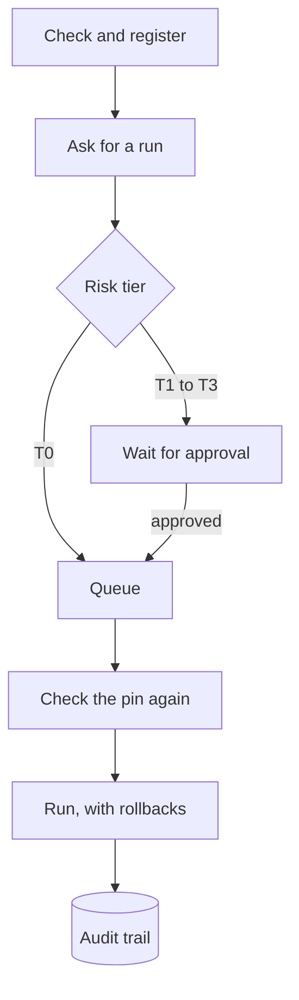
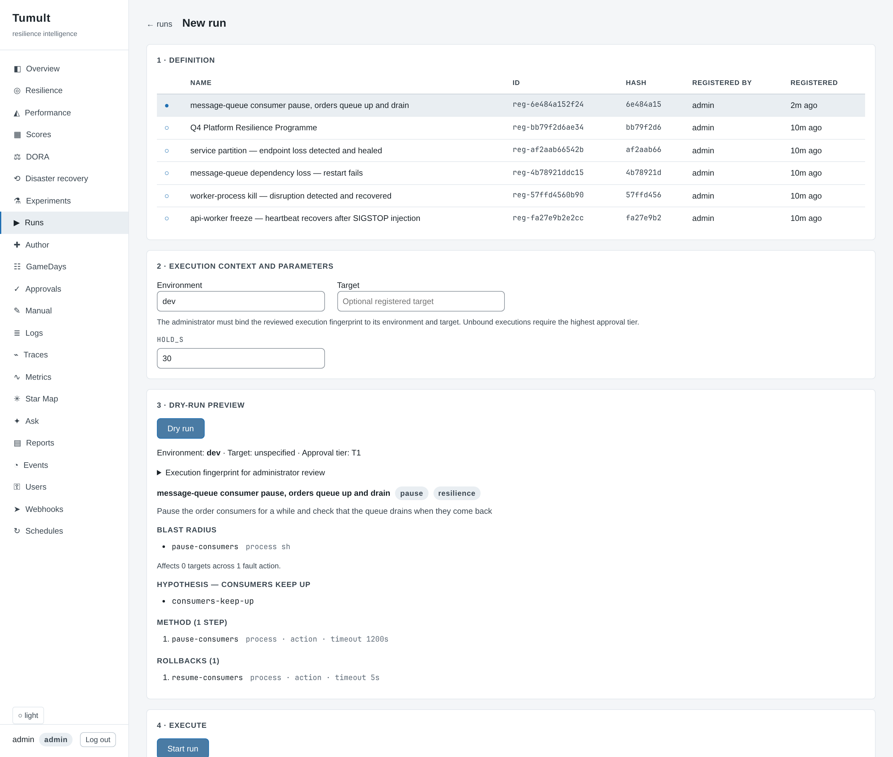
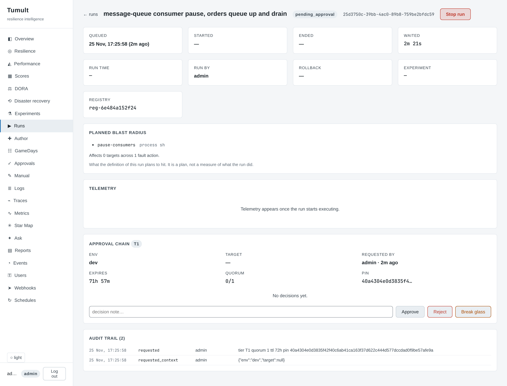
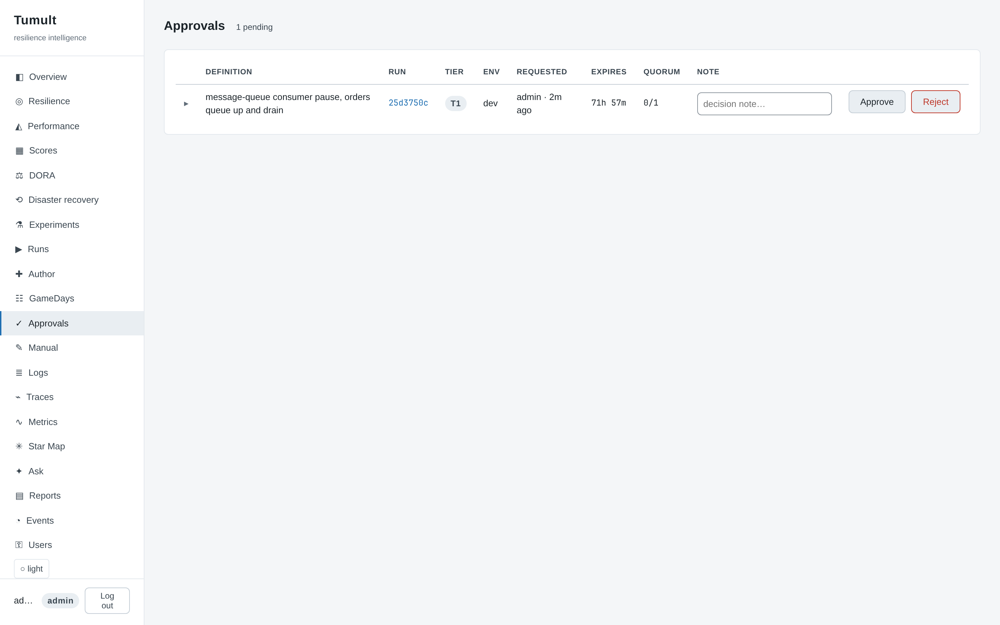
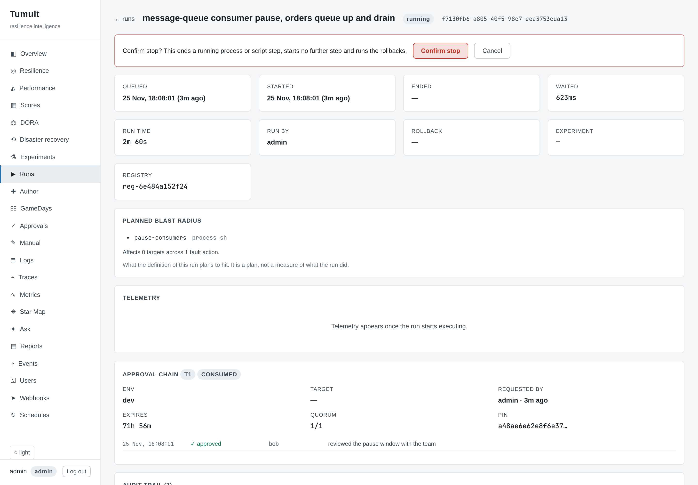
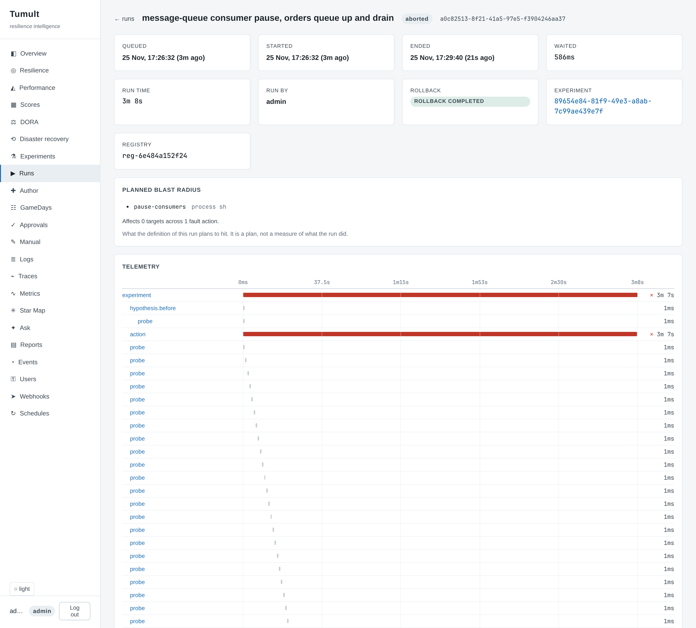

# Runs, approvals and roles

The daemon runs experiments itself. Each run gets a risk tier, may wait for
a second person, and leaves an audit trail that shows any change. This page
says how.

## A run, step by step

1. **Register.** `POST /api/runs/validate` checks a definition as the CLI
   does, and stores it once in the registry.
2. **Dry run.** `POST /api/runs/dry-run` shows the steps with every value
   filled in.
3. **Ask.** `POST /api/runs` gives the run a risk tier. A T0 run goes to the
   queue; any other run waits for approval.
4. **Run.** A worker runs the experiment with the same code as the CLI. The
   telemetry of the run goes to the daemon's own ingest, so it shows like a
   run from the CLI.
5. **Stop.** `POST /api/runs/{id}/stop` stops the run, and its rollbacks run.

The queue runs 2 runs at a time and holds 32 more (`TUMULTD_RUN_CONCURRENCY`,
`TUMULTD_RUN_QUEUE_DEPTH`). When it is full, a new run gets HTTP 429.

When the daemon starts, a run that was still active is marked `orphaned`,
and its rollbacks run again. If one fails, the run shows `rollback_pending`
for an operator to check.

## Risk tiers

The highest rule that matches sets the tier.

| Tier | When | Approvers | Approval ends after |
|---|---|---|---|
| T0 | The run only reads: no action in it. | none | |
| T1 | Any other run. | 1 | 72 hours |
| T2 | A staging environment, or a fault with a destructive name. | 1 | 24 hours |
| T3 | A production environment, a fault without a rollback, more than one kind of fault, or no [execution binding](../guides/execution-bindings.md). | 2 | 4 hours |

- Nobody can approve their own run, and each approver decides once.
- An approval is used once. It pins a SHA-256 of the definition, its
  values, the environment and the target. Just before the run starts, the
  worker checks the pin again and refuses the run when anything changed.
- A T3 approval also asks the autopilot policy (`KRONIKA_AUTOPILOT_POLICY`).
  Without a policy, or when the policy says no, the approval is refused.
- Break-glass lets an admin start a run without the approvals. It needs a
  reason, still checks the pin, and opens a manual evidence record to fill
  in afterwards.

Each change of a run goes into `run_audit` with the user who made it, in a
hash chain. `GET /api/runs/{id}/audit/verify` checks the chain.

## Roles and sign-in

The API asks for a login once the first user exists.

| Role | May |
|---|---|
| `viewer` | Read the evidence, the runs and the reports. |
| `operator` | Also register, start, stop and schedule runs, and enter manual records. |
| `approver` | Also approve or reject runs, and verify manual records. |
| `admin` | Also manage users, tokens and webhooks, and use break-glass. |

- `tumultd create-admin` makes the first admin, with a one-time password
  that must be changed at the first login.
- A browser session lasts 12 hours. Scripts use API tokens that start with
  `kro_`. Passwords are hashed with argon2id; sessions and tokens are stored
  only as hashes.
- An admin can limit a user to some environments.
- A route that is missing from the route table needs `admin`.
- On an address other than localhost, the daemon does not start without
  sign-in, and it needs `KRONIKA_INGEST_TOKEN` for telemetry.

More for a real install: [production deployment](../guides/production-deployment.md).
