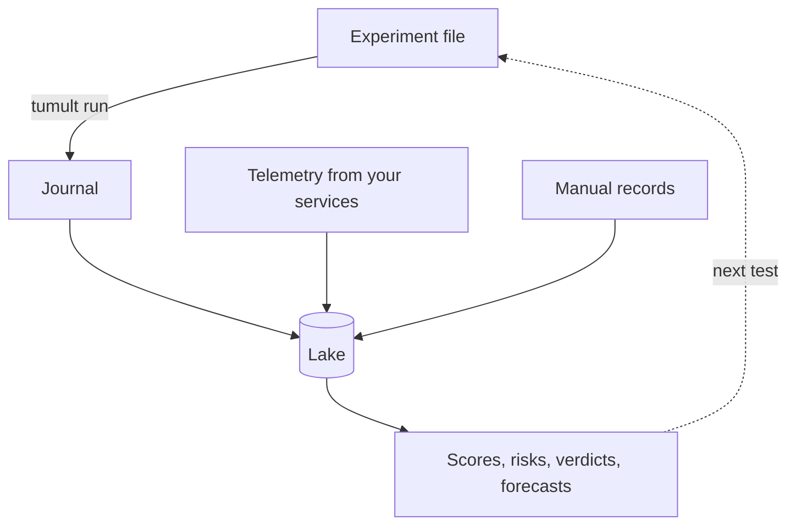

# Concepts

The words Tumult uses, and how its parts fit together. Read this once, and
the guides make more sense.

## Words

| Word | Meaning |
|---|---|
| Experiment | A file in TOON format that says what to check, what to break and how to undo it. |
| Steady-state hypothesis | The probes that must hold before and after the fault. |
| Method | The steps of the experiment: the faults and the probes. |
| Action | A step that changes something, such as a fault. |
| Probe | A step that only reads, such as a health check. |
| Rollback | A step that undoes a fault. You write it. |
| Guard | A probe that stops the run when it breaches while the fault is on. |
| Objective | A target, such as a latency or a recovery time. Each run gives it a verdict. |
| Run | One execution of an experiment. |
| Journal | The record of one run: every step, sample and result. |
| GameDay | A group of experiments, run as one scored campaign. |
| Plugin | A set of actions and probes, built in or as scripts. |
| Lake | The one DuckDB database that holds all evidence. |
| Evidence | What the lake holds: runs, telemetry and manual records. |
| `tumultd` | The daemon. It takes in evidence, runs approved experiments and serves the web UI. |
| Krönika | The web UI, built into the daemon. |

## Pages

- [How a run works](../guides/execution-flow.md): the steps of a run, what
  the journal records, and where the data goes.
- [Architecture](../architecture/kronika-architecture.md): the CLI, the
  daemon, the lake and the web UI, with diagrams.
- [Runs, approvals and roles](../architecture/runs-and-approvals.md): how
  the daemon decides who may run what.
