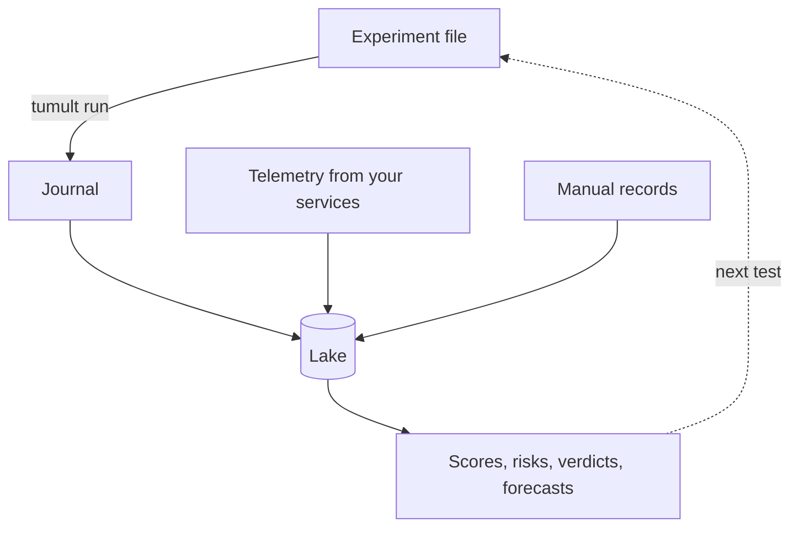
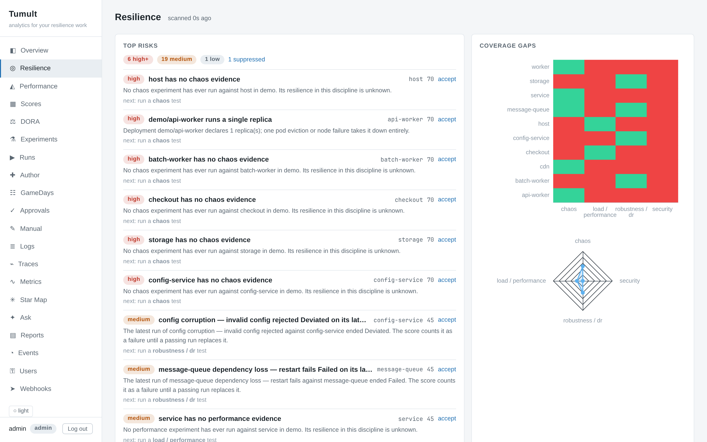
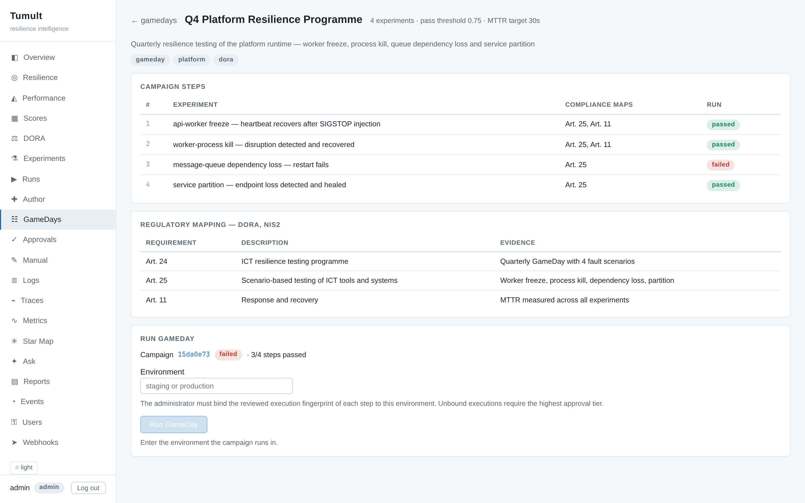

# Concepts

The words Tumult uses, and how its parts fit together.

## Words

| Word | Meaning |
|---|---|
| Experiment | A file in TOON format that says what to check, what to break and how to undo it. |
| Kind of test | `chaos`, `robustness`, `dr`, `performance` or `security`. It says what an experiment tests. |
| Steady-state hypothesis | The probes that must hold before and after the fault. |
| Method | The steps of the experiment: the faults and the probes. |
| Action | A step that changes something, such as a fault. |
| Probe | A step that only reads, such as a health check. |
| Rollback | A step that undoes a fault. You write it. |
| Guard | A probe that stops the run when it breaches while the fault is on. |
| Load | Traffic from k6 or oha that runs while the fault is on. |
| Objective | A target, such as a latency or a recovery time. Each run gives it a verdict. |
| Verdict | The answer for one objective: `met`, `breached` or `inconclusive`. Inconclusive is never a pass. |
| DR test | A test that a system comes back after you lose it: a run of kind `dr`, or a manual record. |
| RTO | Recovery time objective: how long the system may be down. A DR test times it from the outage its probes see. |
| RPO | Recovery point objective: how many seconds of data a recovery may lose. |
| Run | One execution of an experiment. |
| Journal | The record of one run: every step, sample and result. |
| Manual record | A test that people run by hand, such as a restore drill or a tabletop, with its files and sign-off. |
| GameDay | A group of experiments, run as one scored campaign. |
| Performance verdict | Whether a new build is slower than the last: `improved`, `unchanged`, `regressed` or `inconclusive`. |
| Scores | The compliance and resilience scores of a target, the GameDay score and the DORA score. |
| DORA score | The evidence per DORA article and business function, and an internal level from 1 to 5. |
| Finding | A risk the scan of the lake raises, such as a late DR test or a run that did not recover. |
| Plan scenario | A scenario of DORA RTS 2024/1774 that a test names, such as `power_outage`. |
| Plugin | A set of actions and probes, built in or as scripts. |
| Lake | The one DuckDB database that holds all evidence. |
| Evidence | What the lake holds: runs, telemetry and manual records. |
| `tumultd` | The daemon. It takes in evidence, runs approved experiments and serves the web UI. |
| Krönika | The web UI, built into the daemon. |

## Kinds of testing

[Kinds of testing](kinds-of-testing.md) compares chaos, robustness, DR and
load.

## Regulations

[Regulations and standards](regulations.md) says which test counts for
which framework.

## Pages

- [How a run works](../guides/execution-flow.md): its steps and data.
- [Architecture](../architecture/kronika-architecture.md): the parts.
- [Runs, approvals and roles](../architecture/runs-and-approvals.md): who
  may run what.
