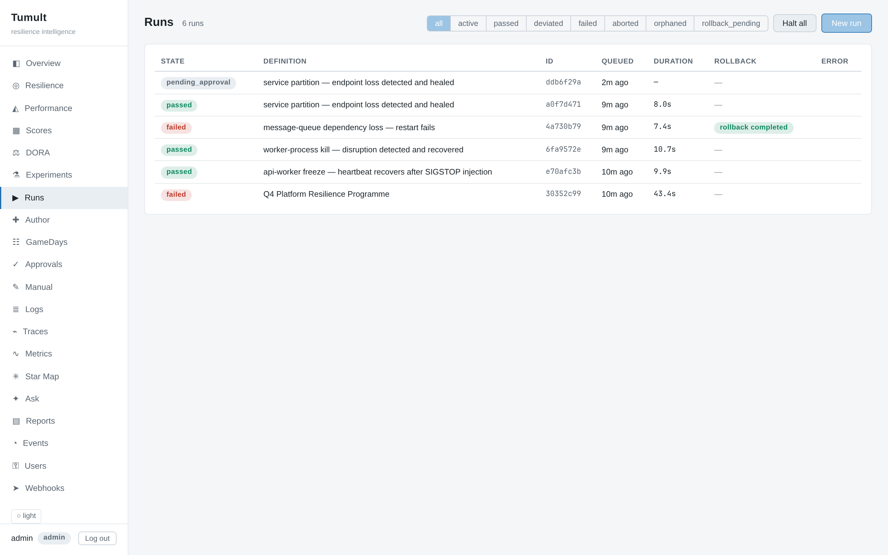
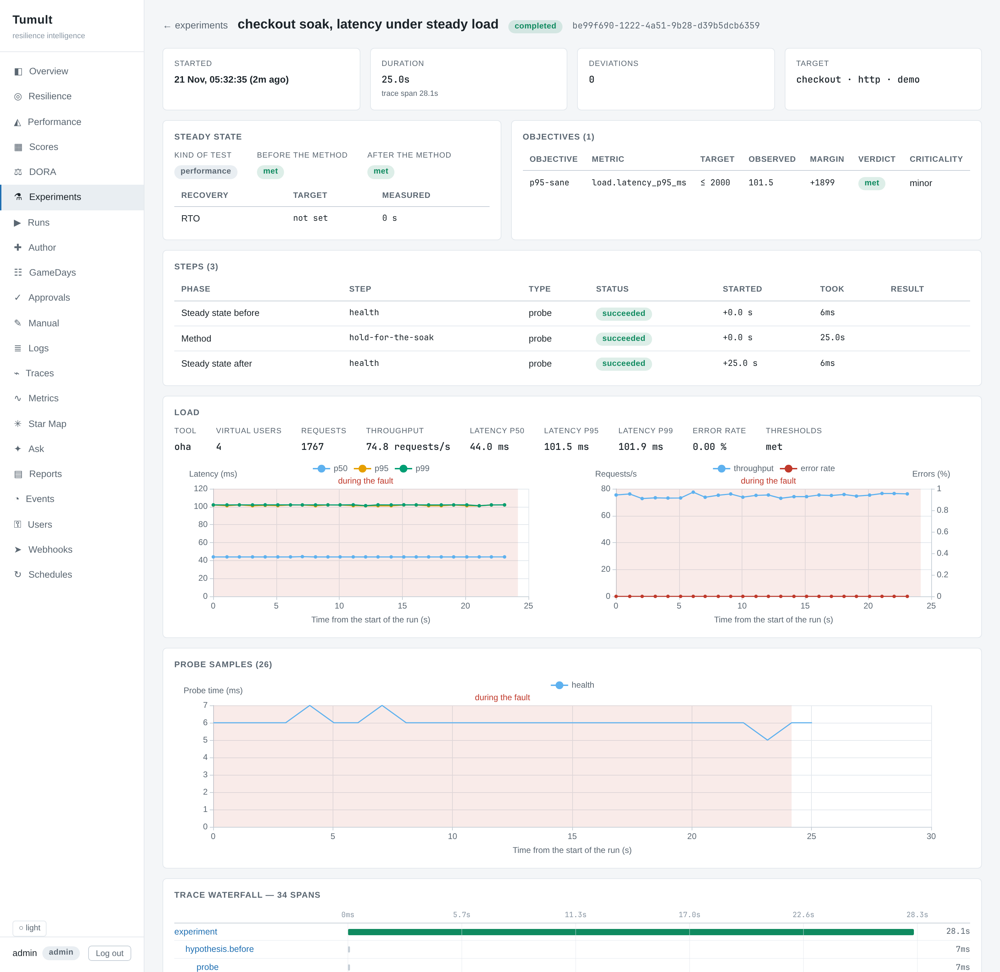
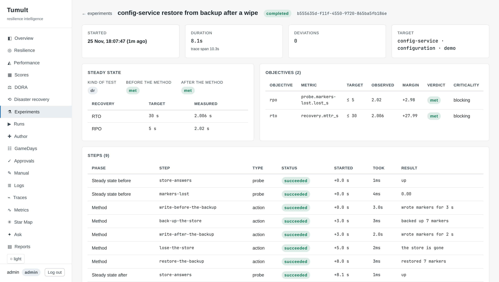
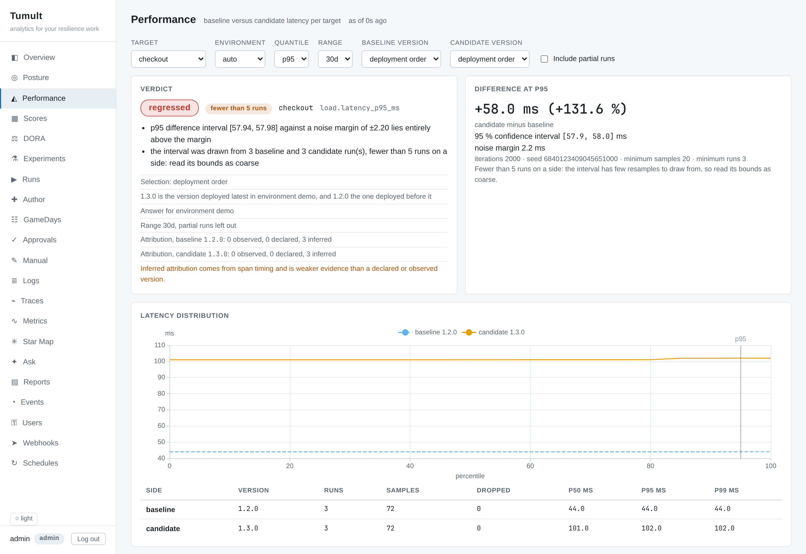
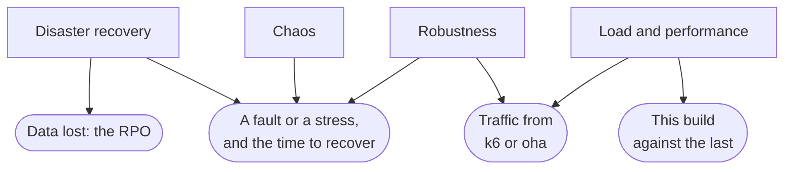

# Kinds of testing

Tumult runs four kinds of resilience test. Each asks its own question. All
four use the same experiment file, objectives, journal and lake. The `kind`
of an experiment says which one it is.

| Kind | Question | Fault or stress | Measure | Typical cadence | In Tumult |
|---|---|---|---|---|---|
| Chaos | Does it stay healthy when one part fails? | Kill, pause, cut off or slow one part | Steady state before, during and after; time to recover | Often, on a timer; a GameDay each quarter | `kind: chaos`, schedules, GameDays |
| Robustness | Does it hold under stress, and come back? | Traffic past capacity, a spike, a long soak, CPU pressure, bad input | Availability under stress, p95 drift, recovery after a spike | Before a release, and after a capacity change | `kind: robustness` with a `load` section |
| Disaster recovery | Does it come back in time, with its data? | Lose the whole system or its data | RTO and RPO against their targets | Once a year or more often, per target | `kind: dr`, manual records, the DR page, DR reports |
| Load and performance | Is it fast enough, and is this build slower? | None, only traffic | Latency, throughput, error rate; build against build | Each build, in the pipeline | A `load` section, `tumult perf` |

A fifth kind, `security`, is not on this page.

## Chaos engineering

**Does the system stay healthy when one part fails?**

- **Breaks:** one part at a time. Kill a process, pause a container, cut
  the network or add latency.
- **Measures:** the steady state before, during and after the fault, and
  the time to recover. A guard stops the run when the system breaches.
- **When:** often and on a timer, so a change that breaks resilience shows
  soon. Group runs in a GameDay.
- **In Tumult:** an experiment of `kind: chaos`, the default. Run it with
  `tumult run`, on a [schedule](../guides/scheduling.md), or in a GameDay.
  See [Experiment format](../guides/experiment-format.md).



## Robustness

**Does the system hold under stress, and come back after it?**

- **Stresses:** traffic past its capacity, a sudden spike, hours of steady
  load, CPU pressure or malformed input.
- **Measures:** availability under the stress, how far the p95 and the
  error rate drift in a soak, and how fast the p95 comes back after a
  spike. The system may slow down. It must not fall over.
- **When:** before a release, and after a change of capacity.
- **In Tumult:** an experiment of `kind: robustness` with a `load` section,
  such as `examples/api-saturation.toon`. See
  [Robustness under load](../guides/disaster-recovery.md#robustness-under-load).



## Disaster recovery

**Does the system come back in time after you lose it, and with its data?**

- **Breaks:** the whole system or its data. Stop the primary, lose a zone,
  wipe a store and restore it.
- **Measures:** the RTO, from the outage the probes saw to the read where
  they pass again, and the RPO, the seconds of data lost. Each against its
  target. A run that saw no outage is no evidence.
- **When:** once a year or more often, and after a change to the recovery
  path. The DR page says when each target is due.
- **In Tumult:** a run of `kind: dr` with `rto_target_s`, or a manual
  record of a drill that people run. See
  [Disaster recovery](../guides/disaster-recovery.md).



## Load and performance

**Is the system fast enough, and is the new build slower than the last?**

- **Stresses:** nothing breaks. k6 or oha sends traffic in a ramp, a spike
  or a soak.
- **Measures:** latency (p50, p95, p99), throughput and error rate.
  Objectives judge each number. A performance verdict compares two builds:
  `improved`, `unchanged`, `regressed` or `inconclusive`.
- **When:** on each build, as a gate in the pipeline.
- **In Tumult:** a `load` section, and `tumult perf` for the verdict. See
  [Load testing](../guides/load-testing-guide.md) and
  [Performance verdicts](../guides/performance-regression.md).



## What differs

The kinds differ in what they break and in what counts as a pass.

- **Chaos** passes when the steady state holds through the fault.
- **Robustness** passes when the system bends but does not fall.
- **Disaster recovery** passes when the RTO and the RPO are met.
- **Load and performance** passes when the numbers meet their objectives
  and the build is no slower than the last.

## What overlaps



- Chaos, robustness and DR put a fault or a stress on the system and time
  how long it takes to come back.
- Robustness and load use the same `load` section and the same traffic
  profiles.
- For the scores, DR counts as robustness and `load` as `performance`. The
  Resilience page shows the gaps of each target by kind.

## Combine them

**A load test with a fault.** `examples/pg-load-chaos.toon` sends queries
with k6 while Pumba pauses the PostgreSQL container. The journal keeps the
load result next to the steps of the fault. Add an objective on
`load.error_rate` to judge it.

```toon
kind: chaos
load:
  tool: k6
  script: examples/k6/pg-load.js
  vus: 5
  duration_s: 15.0
```

**A DR test under load.** Add load to a DR test from the command line. The
load runs through the failover and the recovery check, so the RTO is
measured while users still call. Make the method as long as the load, as
[When the load runs](../guides/load-testing-guide.md#when-the-load-runs)
says.

```bash
tumult run examples/postgres-failover.toon --load oha \
  --load-script http://demo-app:8080/health --load-vus 20 --load-duration 30s
```

## Next

- [Regulations and standards](regulations.md): which kind of test gives
  evidence for DORA, NIS2 and five more frameworks.
- [Objectives](../guides/objectives.md): every metric a run can judge.
