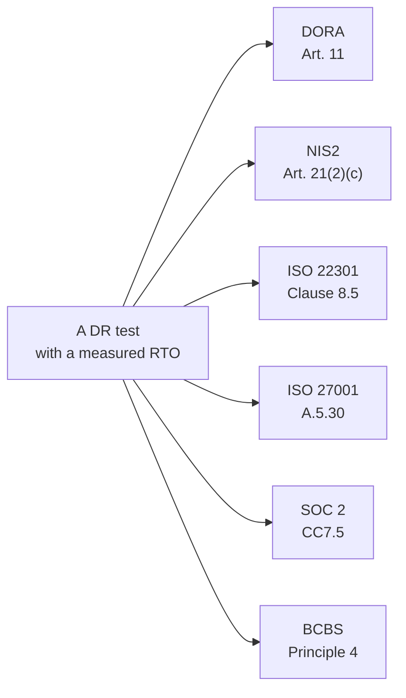
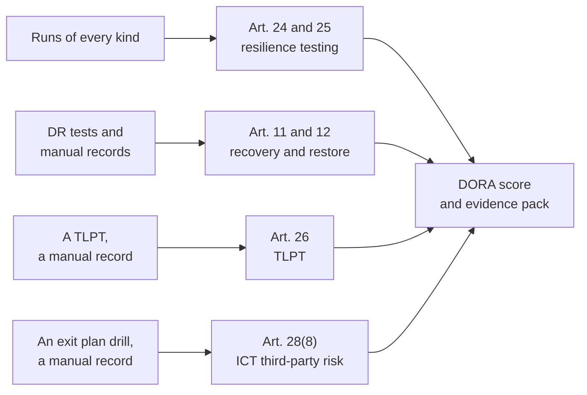
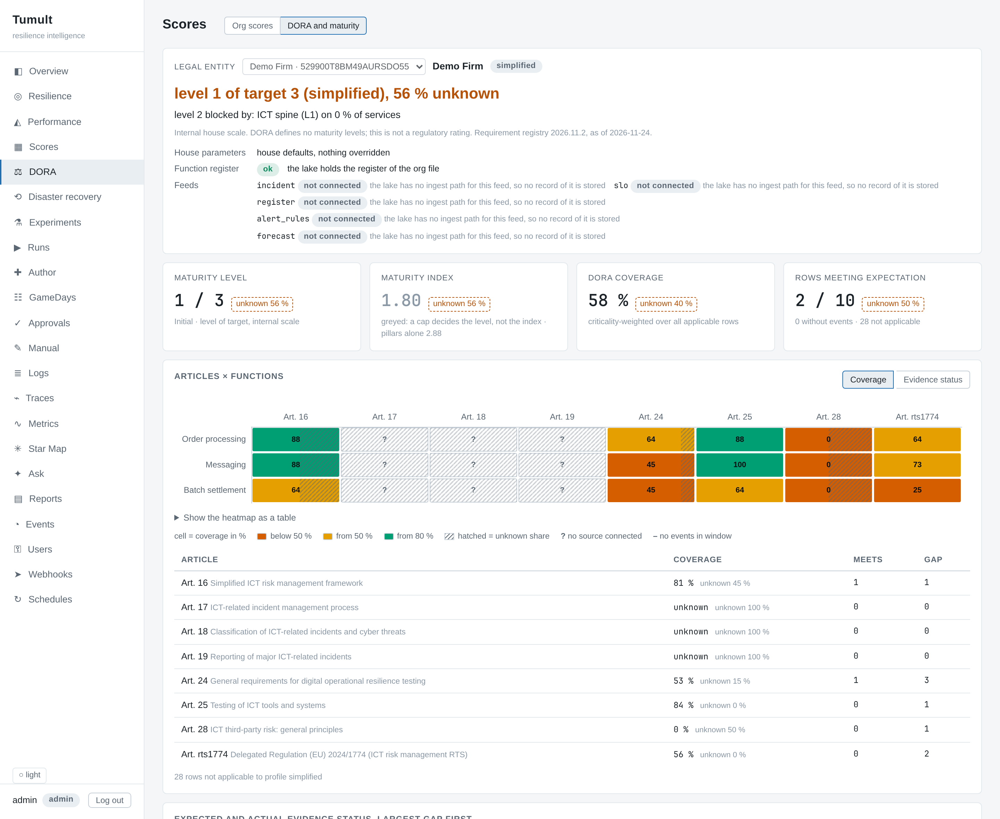
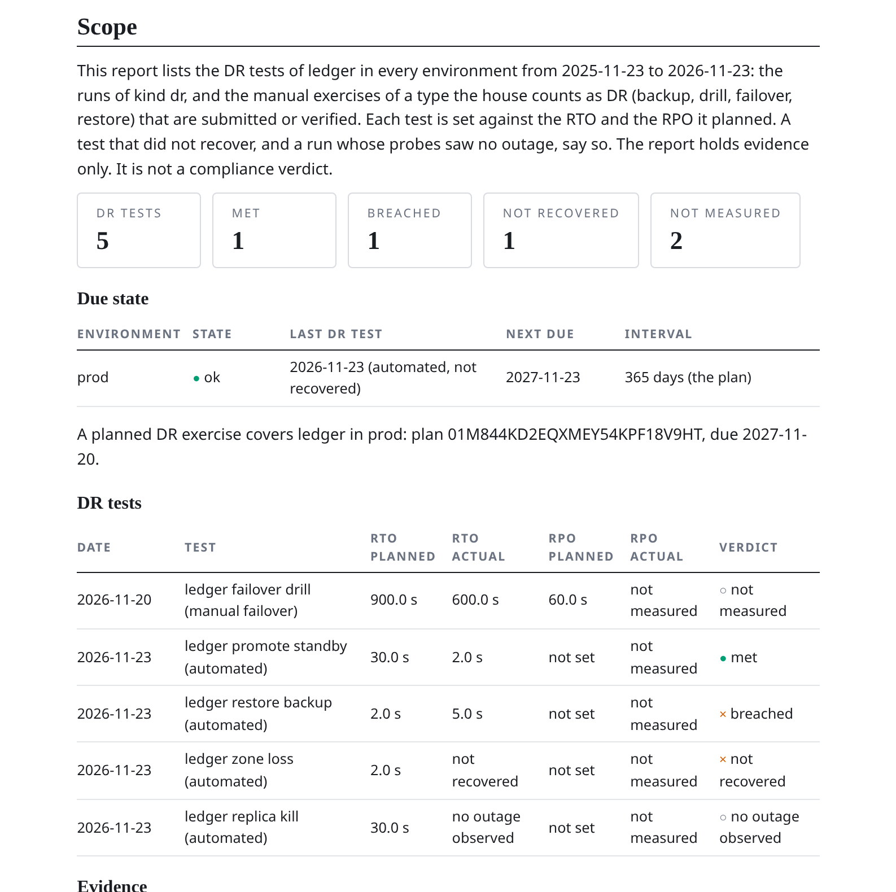

# Regulations and standards

Seven frameworks ask for resilience to be tested or shown. This page says
what each asks, and which [kind of test](kinds-of-testing.md) gives
evidence for it. Every control, with its strength and where Tumult keeps
the evidence, is in [Regulatory mapping](../regulatory-mapping.md).

> **Evidence, not compliance.** A run gives evidence toward a control.
> Passing runs do not prove compliance and are no legal attestation. An
> auditor decides compliance against the official text.

## The frameworks

| Framework | Applies to | What it asks |
|---|---|---|
| DORA, Regulation (EU) 2022/2554 | EU financial entities | A testing programme (Art. 24), yearly tests of the systems behind critical or important functions (Art. 24(6)), tests such as scenario, performance and end-to-end tests (Art. 25), tested continuity, response and recovery plans (Art. 11), tested backup and restore (Art. 12) |
| NIS2, Directive (EU) 2022/2555 | EU essential and important entities | Measures for business continuity, such as backup and disaster recovery (Art. 21(2)(c)), incident handling (Art. 21(2)(b)), a way to assess that the measures work (Art. 21(2)(f)) |
| ISO 22301:2019 | Voluntary, often in contracts | A programme of exercises and tests, with a report after each (Clause 8.5) |
| ISO 27001:2022 | Voluntary, often in contracts | ICT continuity planned and tested (A.5.30), security kept during a disruption (A.5.29) |
| SOC 2, Trust Services Criteria 2017 | Voluntary, often in contracts | Recovery from incidents (CC7.5), response to incidents (CC7.4), monitoring for anomalies (CC7.2) |
| PCI DSS 4.0 | Anyone who handles card data | The incident response plan tested at least once every 12 months (Req. 12.10.2) |
| Basel Committee (BCBS) | Banks | Continuity exercises under severe but plausible scenarios (Principles for Operational Resilience, Principle 4) |

## Which kind of test counts

Each cell names the controls where a kind gives its main evidence, as
[Regulatory mapping](../regulatory-mapping.md) describes the evidence.

| Framework | Chaos | Robustness | Disaster recovery | Load and performance |
|---|---|---|---|---|
| DORA | Art. 25 | Art. 25 | Art. 11, Art. 12 | Art. 25 |
| NIS2 | Art. 21(2)(b), Art. 21(2)(f) | Art. 21(2)(f) | Art. 21(2)(c) | |
| ISO 22301 | Clause 8.5 | | Clause 8.5 | |
| ISO 27001 | A.5.29 | A.5.29 | A.5.30 | |
| SOC 2 | CC7.4 | | CC7.5 | |
| PCI DSS | Req. 12.10.2 | | | |
| Basel | Principle 4 | | Principle 4 | |

Every kind counts toward DORA Art. 24 and Art. 24(6): a programme of dated
tests. DORA Art. 12 counts only a test that restores something. The spans
and metrics of a run count toward SOC 2 CC7.2.

## What overlaps

In this mapping, six of the seven have a control on recovery or
continuity. One DR test with a measured RTO gives evidence toward all six.

- **Incident response.** A controlled fault exercises it for NIS2
  Art. 21(2)(b), SOC 2 CC7.4 and PCI DSS Req. 12.10.2.
- **One run, many frameworks.** The `regulatory` block of an experiment
  lists every framework the run counts for, such as
  `frameworks[2]: DORA, NIS2`. See
  [Tag an experiment](../regulatory-mapping.md#tag-an-experiment).

## What differs

- **Law or choice.** DORA and NIS2 are EU law. ISO 22301, ISO 27001 and
  SOC 2 are voluntary and often in contracts. PCI DSS applies to anyone who
  handles card data, and the BCBS principles to banks.
- **How often.** Three controls of the mapping set a period: tests at
  least yearly (DORA Art. 24(6)), a TLPT at least every three years (DORA
  Art. 26), and an incident response test at least once every 12 months
  (PCI DSS Req. 12.10.2).
- **Load.** In this mapping, only DORA Art. 25 names performance testing,
  so load tests count for DORA alone.
- **Security tests.** DORA Art. 26 asks for threat-led penetration tests,
  and PCI DSS Req. 11.4 and 11.4.5 for penetration and segmentation tests.
  A Tumult run is none of these.

## DORA in short

DORA here is the EU act. The DevOps "four keys" that share the name are in
the [metadata standard](../resilience-metadata-standard.md#scores).

- **Resilience testing, Art. 24 and Art. 25.** Art. 25 sets no frequency
  of its own: the yearly test is Art. 24(6). The `tester` of the
  `regulatory` block says whether the tester is `internal` or `external`
  (Art. 24(4)).
- **TLPT, Art. 26.** Financial entities that the competent authority
  identifies run a threat-led penetration test (TLPT) on live production
  systems at least every three years. A Tumult run is not a TLPT. It can
  help design the scenarios. Record a TLPT as a manual record of type
  `tlpt`.
- **ICT third-party risk, Art. 28.** The DORA score has a row for a tested
  exit plan (Art. 28(8)): a manual record of the drill that names
  `dora.art28.8`. A
  run can test what happens when a provider fails or goes insolvent: name
  the plan scenario `third_party_failure` of RTS 2024/1774 (Art. 25(2)(b),
  Art. 26(2)(b), Art. 26(4)).
- **Where the score fits.** The [DORA score](../guides/dora-score.md)
  shows the evidence per article and per business function, and an
  internal level from 1 to 5. No authority defines that level.

- **Where the DR reports fit.** The DR test report and the DR exercise
  report show each DR test against its RTO and RPO. The evidence pack holds
  the DORA matrix of the requirement registry. See
  [Reports for an auditor](../guides/disaster-recovery.md#reports-for-an-auditor).

## Next

- [Regulatory mapping](../regulatory-mapping.md): every control, its
  strength and the journal field that holds the evidence.
- [DORA score](../guides/dora-score.md): coverage per article and the
  plan scenarios.
