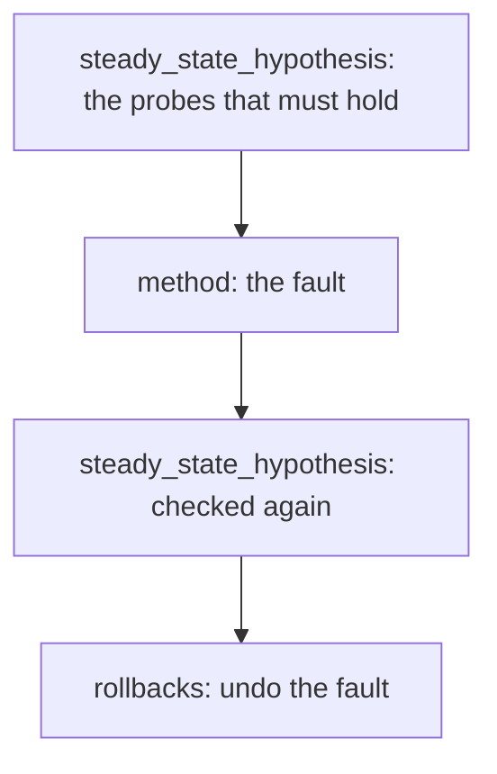
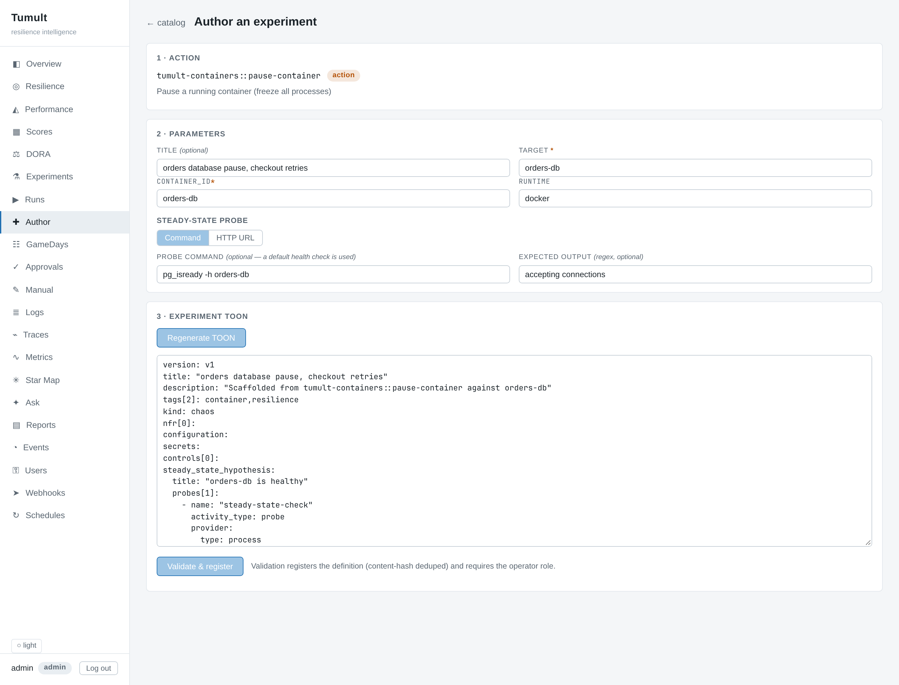

# Your first experiment

Write an experiment for your own service: check that it is healthy, break
one thing, and undo it. You need `tumult` from [Get started](index.md).



## Start from a template

```bash
tumult templates
tumult new --from container-pause --set container=my-redis --out my-experiment.toon
```

`tumult templates` lists the starters and their values. `tumult new` with no
flags asks you step by step. The Author page of the web UI has the same
wizard:



## Or write it by hand

This file checks a health URL, stops a dependency, and starts it again.

```toon
title: My service health check
description: Verify my-service handles connection loss

steady_state_hypothesis:
  title: Service responds 200
  probes[1]:
    - name: health-check
      activity_type: probe
      provider:
        type: process
        path: curl
        arguments[6]: "-s", "-o", "/dev/null", "-w", "%{http_code}", "http://localhost:8080/health"
        timeout_s: 5.0
      tolerance:
        type: regex
        pattern: "200"

method[1]:
  - name: kill-dependency
    activity_type: action
    provider:
      type: process
      path: sh
      arguments[2]: "-c", "docker stop my-dependency-container"
      timeout_s: 10.0
    pause_after_s: 5.0

rollbacks[1]:
  - name: restart-dependency
    activity_type: action
    provider:
      type: process
      path: sh
      arguments[2]: "-c", "docker start my-dependency-container"
      timeout_s: 10.0
```

| Part | Here |
|---|---|
| `steady_state_hypothesis` | The health URL answers 200, before and after. |
| `tolerance` | What a probe must return to pass: here the text `200`. |
| `method` | Stop the dependency, then wait 5 seconds. |
| `rollbacks` | Start the dependency again. |

Arrays carry their length: `probes[1]` has one item.

## Check it, then run it

```bash
tumult validate my-experiment.toon         # check the file
tumult run my-experiment.toon --dry-run    # show the plan, run nothing
tumult run my-experiment.toon
```

`tumult discover` lists every action and probe you can use.

## Next

- [How a run works](../guides/execution-flow.md): what happens, step by
  step, and when the rollbacks run.
- [Experiment format](../guides/experiment-format.md): every field.
- [Plugins](../plugins/index.md): the faults for databases, Kafka,
  containers, Kubernetes, the network and more.
