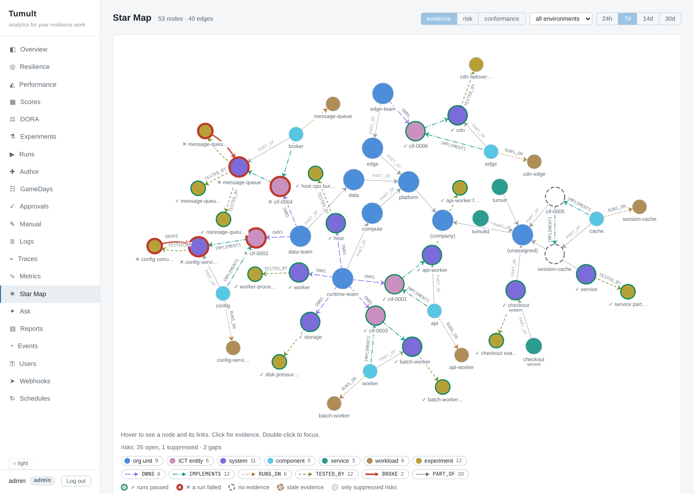

# Get started

Install Tumult, start the test targets and run your first experiment, in
about 10 minutes.


This page runs Tumult from a terminal. To learn in a browser first, or to
start the whole platform with demo data, see
[other ways to run](other-ways-to-run.md).

## 1. Install

Pick one.

**From source** (needs [Rust](https://rustup.rs/), Git, Make, Docker):

```bash
curl -sSL https://raw.githubusercontent.com/mwigge/tumult/main/install.sh | sh
```

**Clone and build:**

```bash
git clone https://github.com/mwigge/tumult.git && cd tumult
cargo build --release --locked -p tumult-cli -p tumult-mcp -p tumult-net
export PATH="$PWD/target/release:$PATH"
```

**Docker only** (no Rust needed):

```bash
docker pull ghcr.io/mwigge/tumult:latest
docker run --rm ghcr.io/mwigge/tumult discover
```

The Docker image is good for a first look. To run experiments from a
container you also need the access described in the
[deployment guide](../guides/production-deployment.md#provider-capabilities).

## 2. Start targets

Run this from the repository root.

```bash
make up-targets
```

| Service | Port | Login |
|---|---|---|
| PostgreSQL 16 | localhost:15432 | tumult / tumult_test |
| Redis 7 | localhost:16379 | none |
| Kafka 3.8 | localhost:19092 | none |
| MySQL 8 | localhost:13306 | root / tumult_test |
| SSH server | localhost:12222 | key from `make ssh-key` |

## 3. Run an experiment

```bash
tumult run examples/redis-chaos.toon
```

```
Running experiment: Redis freeze — a paused store gives no answer, then comes back with its data
Status: Completed
Duration: 3262ms
Method steps: 5 executed
Hypothesis: met before, met after
Journal written to: journal.toon
Journal SHA-256: 5f0c…e91a
Ingested into persistent analytics store
```

The `Journal SHA-256` line is the SHA-256 of the journal file.
`sha256sum journal.toon` gives the same value, and so does the footer of
the HTML report.

This first one pauses Redis, checks that it gives no answer, and reads its
key back afterwards. Now try some more:

| Experiment | Command |
|---|---|
| Kill PostgreSQL connections | `tumult run examples/postgres-failover.toon --journal-path postgres.journal.toon` |
| Add 200 ms network delay | `tumult run examples/pumba-latency.toon --journal-path pumba.journal.toon` |
| Stress a host over SSH | `make ssh-key`, then `tumult run examples/ssh-remote.toon --journal-path ssh.journal.toon` |

## 4. Look at the results

Every run writes a journal file and goes into the local database.

```bash
tumult analyze --query "SELECT title, status, duration_ms FROM experiments ORDER BY started_at_ns DESC"
tumult report --format html journal.toon      # HTML report
tumult export --format parquet journal.toon   # for BI tools
tumult compliance --framework dora .          # evidence summary
tumult discover                               # what can I break?
tumult init                                   # start a new experiment file
```

## 5. Open the web UI

This is where the evidence becomes scores, risks and verdicts. The web UI
runs in a stack of its own, with demo data: start
[the whole platform](other-ways-to-run.md#the-whole-platform-in-the-web-ui).



The [platform walkthrough](../guides/platform-walkthrough.md) shows each
page.

## More things to try

**A GameDay.** Four PostgreSQL experiments, scored and mapped to DORA
articles, in one command:

```bash
./scripts/gameday-demo.sh
```

**AI agents.** Give an agent the same tools over MCP:

```bash
tumult mcp serve                                              # local, stdio
tumult mcp serve --transport http --port 3100 --token "$MCP_TOKEN"
```

Without a token, HTTP listens on loopback only.

**The knowledge graph.**

```bash
tumult chaosgraph query --kind fault
tumult chaosgraph coverage-gaps --framework dora
```

## Test your own service

Write a file like this. It checks a health URL, stops a dependency, and
starts it again.

```toon
title: My service health check
description: Verify my-service handles connection loss

tags[1]: my-service

steady_state_hypothesis:
  title: Service responds 200
  probes[1]:
    - name: health-check
      activity_type: probe
      provider:
        type: process
        path: curl
        arguments[6]: "-s", "-o", "/dev/null", "-w", "%{http_code}", "http://localhost:8080/health"
        timeout_s: 5.0
      tolerance:
        type: regex
        pattern: "200"

method[1]:
  - name: kill-dependency
    activity_type: action
    provider:
      type: process
      path: sh
      arguments[2]: "-c", "docker stop my-dependency-container"
      timeout_s: 10.0
    pause_after_s: 5.0

rollbacks[1]:
  - name: restart-dependency
    activity_type: action
    provider:
      type: process
      path: sh
      arguments[2]: "-c", "docker start my-dependency-container"
      timeout_s: 10.0
```

```bash
tumult validate my-experiment.toon
tumult run my-experiment.toon
```

## Stop everything

```bash
make down
```

## Next steps

| Topic | Guide |
|---|---|
| Other ways to start Tumult | [Other ways to run](other-ways-to-run.md) |
| Every page of the web UI | [Platform walkthrough](../guides/platform-walkthrough.md) |
| Load tests and version verdicts | [Load testing](../guides/load-testing-guide.md), [performance](../guides/performance-regression.md) |
| Star Map, DORA score, forecasts | [Star Map](../guides/star-map.md), [DORA score](../guides/dora-score.md), [forecasting](../guides/forecasting.md) |
| Send telemetry from your services | [Auto-instrumentation](../guides/otel-autoinstrumentation.md), [entity events](../guides/entity-events.md) |
| Write experiments | [Experiment format](../guides/experiment-format.md), [plugins](../plugins/index.md) |
| All guides | [Guides](../guides/index.md) |
