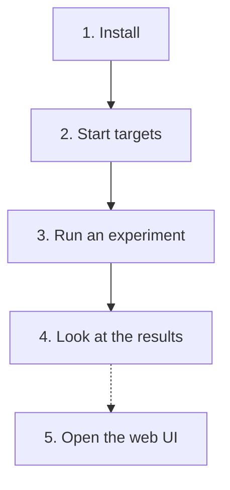

# Get started

Install Tumult, start some test targets and run your first experiment. It
takes about 10 minutes.



To learn in a browser first, or to see the whole platform with demo data,
see [other ways to run](other-ways-to-run.md).

## 1. Install

You need Git, Make, Docker and [Rust](https://rustup.rs/) 1.92.0 or newer.

```bash
curl -sSL https://raw.githubusercontent.com/mwigge/tumult/main/install.sh | sh
cd tumult
```

The script clones the repository into `tumult`, builds the CLI, starts the
test targets of step 2 and runs a short check. It copies `tumult` to
`/usr/local/bin` when it may. If it may not, it tells you what to do.

Or build it yourself:

```bash
git clone https://github.com/mwigge/tumult.git && cd tumult
cargo build --release --locked -p tumult-cli -p tumult-net
export PATH="$PWD/target/release:$PATH"
```

No Rust? Each [release](https://github.com/mwigge/tumult/releases) has
`tumult` for Linux and macOS. Put `tumult` and `tumult-net-proxyd` from the
archive on your `PATH`, and clone the repository for the examples.

## 2. Start targets

From the root of the repository:

```bash
make up-targets
```

| Service | Port | Login |
|---|---|---|
| PostgreSQL 16 | localhost:15432 | tumult / tumult_test |
| Redis 7 | localhost:16379 | none |
| Kafka 3.8 | localhost:19092 | none |
| MySQL 8 | localhost:13306 | root / tumult_test |
| SSH server | localhost:12222 | key from `make ssh-key` |

## 3. Run an experiment

```bash
tumult run examples/redis-chaos.toon
```

```
Running experiment: Redis freeze — a paused store gives no answer, then comes back with its data
Status: Completed
Duration: 3262ms
Method steps: 5 executed
Hypothesis: met before, met after
Journal written to: journal.toon
Journal SHA-256: 5f0c…e91a
Ingested into persistent analytics store
```

It pauses Redis, shows that Redis gives no answer, and reads its key back
afterwards. The journal is the record of the run; `sha256sum journal.toon`
gives the same hash. Now try more:

| Experiment | Command |
|---|---|
| Kill PostgreSQL connections | `tumult run gamedays/pg-connection-kill.toon --journal-path postgres.journal.toon` |
| Add 200 ms network delay | `tumult run examples/pumba-latency.toon --journal-path pumba.journal.toon` |
| Stress a host over SSH | `make ssh-key`, then `tumult run examples/ssh-remote.toon --journal-path ssh.journal.toon` |

A PostgreSQL failover to a standby and a restore that measures its RPO
need the demo stack: `make demo-check` runs
`examples/postgres-failover.toon` and `examples/postgres-restore-rpo.toon`
there. See
[the demo](https://github.com/mwigge/tumult/blob/main/demo/README.md#the-dr-examples-and-the-demo-gameday).

## 4. Look at the results

Every run goes into a local database, the lake.

```bash
tumult analyze --query "SELECT title, status, duration_ms FROM experiments ORDER BY started_at_ns DESC"
tumult report --format html journal.toon      # an HTML report
tumult compliance --framework dora .          # an evidence summary
tumult discover                               # what can I break?
```


## 5. Open the web UI

The web UI turns the evidence into scores, risks and verdicts. It runs in a
stack of its own, with demo data: start
[the whole platform](other-ways-to-run.md#the-whole-platform-in-the-web-ui).


The [platform walkthrough](../guides/platform-walkthrough.md) shows each
page.

## Stop

`make down` stops the targets.

## Next

- [Other ways to run](other-ways-to-run.md): Chaos Lab, the demo, Docker.
- [Your first experiment](first-experiment.md): test your own service.
- [Platform walkthrough](../guides/platform-walkthrough.md): every page of
  the web UI.
- [How a run works](../guides/execution-flow.md) and the
  [experiment format](../guides/experiment-format.md).
- [MCP guide](../guides/mcp-guide.md): give an AI agent the same tools.
