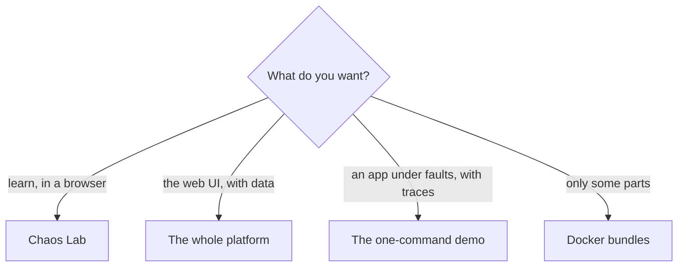
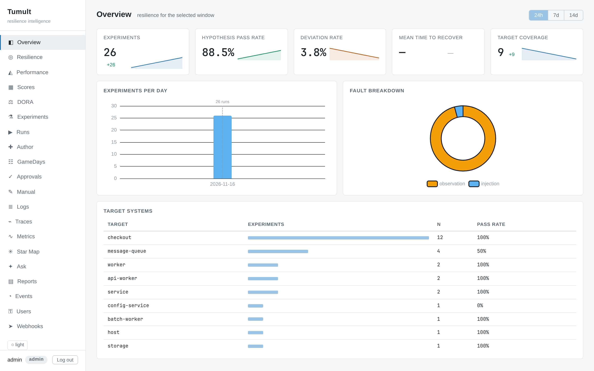

# Other ways to run

[Get started](index.md) runs Tumult from a terminal. These are the other
ways in. Each needs Docker. Run the commands from the root of a clone of the
repository.



## Chaos Lab in your browser

Four guided lessons with the real engine, and an optional AI tutor. Open
<http://localhost:8089>. More in the
[Chaos Lab README](https://github.com/mwigge/tumult/blob/main/chaos-lab/README.md).

```bash
cd chaos-lab && docker compose up -d --build --wait
```

## The whole platform in the web UI

The daemon, the web UI and a demo suite, so every page has data. Set the
three `KRONIKA_*` values in `.env` first; the file says how. Then open
<http://localhost:14318/> and sign in as `admin`.

```bash
cp .env.example .env
docker compose -f docker/docker-compose.kronika.yml up -d --build
```



The [platform walkthrough](../guides/platform-walkthrough.md) is a tour of
every page.

## The one-command demo

An order service under load, SigNoz at <http://localhost:3301> and a
control panel at <http://localhost:8088>. One fault per domain has already
run when it opens. More in the
[demo README](https://github.com/mwigge/tumult/blob/main/demo/README.md).

```bash
make demo        # make demo-down stops it
```

## Docker bundles

Start only the parts you need: test targets, SigNoz with a collector, the
MCP server. More in the
[Docker README](https://github.com/mwigge/tumult/blob/main/docker/README.md).

```bash
./start.sh infra observe   # targets, then SigNoz at http://localhost:3301
OTEL_EXPORTER_OTLP_ENDPOINT=http://localhost:14317 tumult run examples/redis-chaos.toon
```

## The CLI in a container

No Rust needed for a first look:

```bash
docker run --rm ghcr.io/mwigge/tumult discover
```

To run experiments from a container, it needs access to the targets; see
[production deployment](../guides/production-deployment.md).
