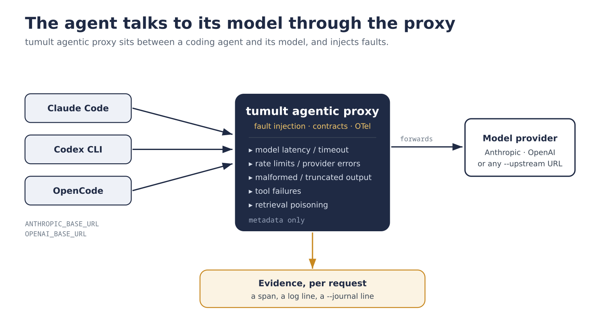

# Agentic live clients

Run the faults of a scenario pack against a real coding agent. Tumult sits
between the agent and its model as a local proxy, forwards the traffic, and
breaks some of it on purpose.



## Start the proxy

```bash
tumult agentic proxy \
  --listen 127.0.0.1:8080 \
  --upstream https://api.anthropic.com \
  --scenario malformed-json-recovery \
  --client claude-code \
  --journal target/agentic/proxy.jsonl
```

The first lines it prints:

```text
Tumult agentic fault-injecting proxy
  listening: http://127.0.0.1:8080
  upstream:  https://api.anthropic.com
  scenario:  malformed-json-recovery
  client:    claude-code
  base-url:  set ANTHROPIC_BASE_URL=http://127.0.0.1:8080
  faults:    malformed_output
  journal:   target/agentic/proxy.jsonl
```

`--client` (`claude-code`, `codex`, `copilot` or `opencode`) tags the spans of
the proxy with `tumult.client`, so you can compare clients later.

## Wire up a client

Leave the proxy running and start the agent in a second terminal.

| Client | Start it with | `--upstream` |
|---|---|---|
| Claude Code | `ANTHROPIC_BASE_URL=http://127.0.0.1:8080 claude` | `https://api.anthropic.com` (the default) |
| Codex CLI | `OPENAI_BASE_URL=http://127.0.0.1:8080/v1 codex` | `https://api.openai.com` |
| OpenCode | `OPENAI_BASE_URL=http://127.0.0.1:8080/v1 opencode`, or the provider `baseURL` in its config | The API of its provider |

The proxy is a base URL for the agent. It does not open an HTTPS tunnel, so
an agent that only takes `HTTPS_PROXY`, such as the Copilot CLI, gets its
`CONNECT` refused and cannot be faulted this way.

Start with `--scenario malformed-json-recovery`, which breaks the answers, or
`--scenario concurrency-storm`, which answers 429 so you can watch the
backoff.

## How faults map to HTTP

| Fault | What the proxy does |
|---|---|
| `model_latency`, `tool_latency` | Waits before it forwards the request |
| `rate_limit` | Answers `429` with `retry-after`, without calling the provider |
| `provider_error` | Answers with the status code of the fault |
| `model_timeout` | Answers `504` |
| `malformed_output`, `output_truncation` | Breaks or cuts the answer |
| `tool_failure` | Swaps the answer for a tool error |
| `retrieval_poisoning` | Adds poisoned content to the answer |
| `hallucinated_tool_call`, `context_truncation`, `token_budget_exhaustion`, `retry_loop_pressure` | Records them and forwards the answer unchanged |

The faults of the last row live inside the agent, so the proxy cannot force
them. Use `tumult agentic run` for those.

Each request draws its faults from `--seed` (default 1) plus its number, so a
second run makes the same choices. The bundled packs fault every request.

## The evidence

Each request gets a log line, a `tumult.agentic.fault` span, and with
`--journal` one JSON line:

```json
{"scenario":"malformed-json-recovery","method":"POST","path":"/v1/messages","status":200,"latency_ms":1,"faults":["malformed_output"],"contracts":["valid_json=fail","graceful_error=pass"],"body_bytes":15}
```

No prompt or answer is stored: only counts, times, fault names and contract
verdicts. See [Agentic observability](agentic-observability.md).

## Safety

- The proxy forwards your real credentials, the `authorization` header
  included, to the upstream. Keep it on `127.0.0.1`.
- It drops `accept-encoding` so it can read the answer, drops the hop-by-hop
  headers, and sends its own `traceparent` in place of the one it got.
- The agent gets broken answers on purpose. Give it a throwaway task, not
  real work.

The [security assessment](../security-assessment.md) has the full trust
boundary analysis.
