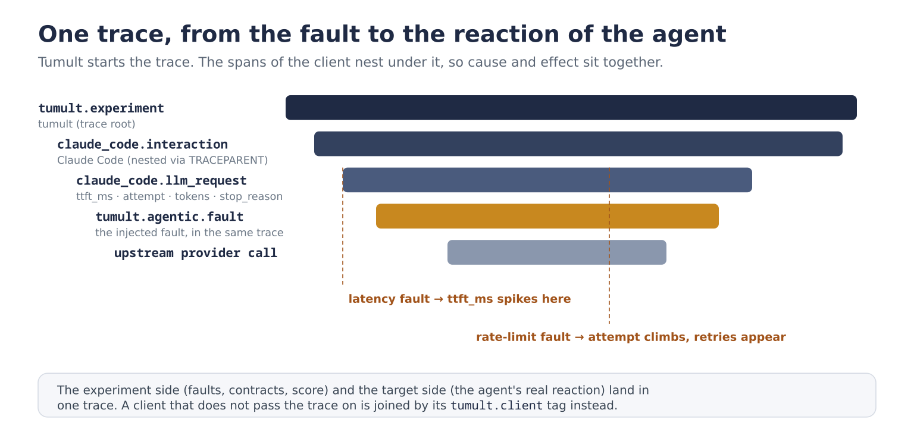
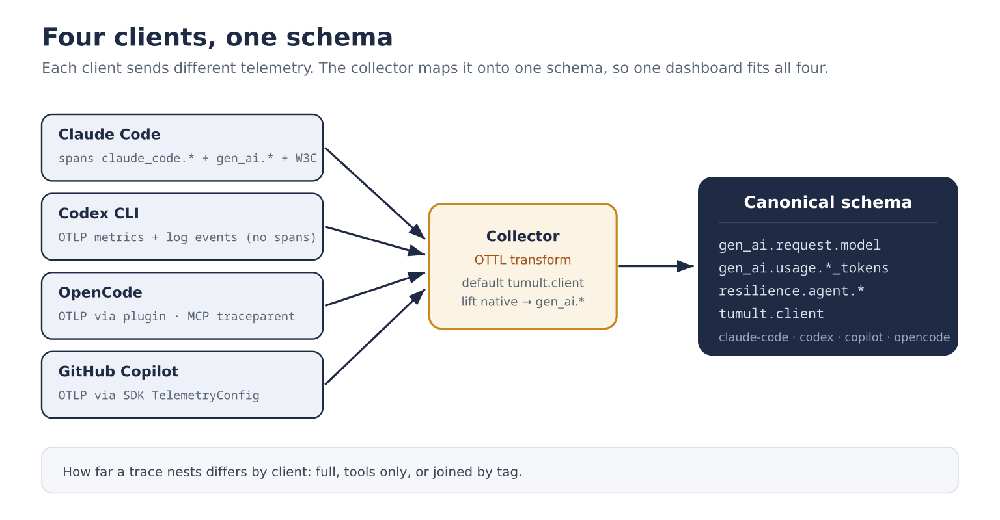

# Agentic observability

An agent run leaves evidence on two sides: what Tumult did (the faults, the
contracts, the score) and how the agent reacted (its own spans). When the
trace context flows, both sides sit in one trace.



## What Tumult records

| Span | Made by | One per |
|---|---|---|
| `tumult.experiment` | `tumult agentic run-live` | Live run. It is the root of the trace, and the agent gets it as `TRACEPARENT` |
| `resilience.agentic.experiment` | `tumult agentic run` and `run-live`, the MCP tools `tumult_agentic_smoke` and `tumult_agentic_run_experiment` | Run, with a `fault` event per fault and a `contract` event per contract |
| `tumult.agentic.fault` | `tumult agentic proxy` | Proxied request, under the trace the client sent, if any |
| `tumult.agentic.tool` | The MCP server | Agentic tool call. The experiment span nests under it |

`tumult agentic smoke` and `replay` write a journal but no span. The spans go
to `OTEL_EXPORTER_OTLP_ENDPOINT`, like every Tumult span.

| Attribute | Where |
|---|---|
| `tumult.client` | Every agentic span: `claude-code`, `codex`, `copilot`, `opencode` or `unknown` |
| `resilience.agent.scenario` | Every agentic span but the tool span |
| `resilience.agent.payload.capture_policy` | Every agentic span. Always `metadata_only` |
| `resilience.agent.target_type`, `resilience.agent.score`, `resilience.agent.fault.count`, `resilience.agent.contract.count` | The experiment span |
| `resilience.agent.fault.type`, `resilience.agent.fault.applied` | Its `fault` events |
| `resilience.agent.contract`, `.contract.passed`, `.contract.severity`, `.contract.reason` | Its `contract` events |
| `http.request.method`, `url.path`, `http.response.status_code`, `resilience.duration_ms`, `resilience.agent.faults_injected` | The proxy span |
| `gen_ai.tool.name` | The tool span |

Each run also counts `tumult.agent.faults_applied`,
`tumult.agent.contracts.passed`, `tumult.agent.contracts.failed` and
`tumult.agent.runs_with_failure`, and records `tumult.agent.score`.

## Privacy

Tumult stores metadata only: names, labels, counts, sizes, scores and trace
ids. No prompt, answer, tool input or output, retrieved document or
credential reaches a span, a journal or the lake. No setting changes that.

## Query the lake

`tumult agentic smoke`, `run` and `replay` add rows to the lake. Ask them with
`tumult analyze --query "..."`:

```sql
SELECT run_id, scenario, resilience_score FROM agentic_runs;
SELECT run_id, contract_type, passed, reason FROM agentic_contract_outcomes;
SELECT run_id, fault_type, applied FROM agentic_fault_applications;
SELECT run_id, replay_id, passed FROM agentic_replay_outcomes;
```

## Compare clients

The four clients send different telemetry. An OpenTelemetry collector with
[`collector/otel-agentic-normalization.yaml`](https://github.com/mwigge/tumult/blob/main/collector/otel-agentic-normalization.yaml)
puts it on one schema: `gen_ai.*` from the clients, `resilience.agent.*`
from Tumult, and the resource attribute `tumult.client`. Slice on
`tumult.client` to compare clients.



The collector copies the native keys of Claude Code onto `gen_ai.*` and sets
`tumult.client` to `unknown` when the telemetry has none. To name the client,
set the resource attribute on it, for example
`OTEL_RESOURCE_ATTRIBUTES=tumult.client=claude-code`.

How far a trace nests depends on the client. Each client that goes through
the proxy gets the same proxy span, so they share one floor of evidence.

| Client | Point it at the proxy | Its own telemetry | Nesting |
|---|---|---|---|
| Claude Code | `ANTHROPIC_BASE_URL` | `CLAUDE_CODE_ENABLE_TELEMETRY=1` | Full, on the model and the MCP calls, with `CLAUDE_CODE_PROPAGATE_TRACEPARENT=1` |
| OpenCode | `OPENAI_BASE_URL`, or the provider `baseURL` | `OPENCODE_OTLP_ENDPOINT`, and `"experimental": {"openTelemetry": true}` in its config | The MCP calls only |
| Codex CLI | `openai_base_url` in `config.toml` | An `[otel]` table in `config.toml` | By tag only |
| Copilot | Not possible, see [live clients](agentic-live-clients.md#wire-up-a-client) | `TelemetryConfig.otlpEndpoint` of the SDK | By tag only |

Claude Code, with the proxy on `127.0.0.1:8080` and a collector on
`127.0.0.1:4318`:

```bash
export CLAUDE_CODE_ENABLE_TELEMETRY=1
export CLAUDE_CODE_ENHANCED_TELEMETRY_BETA=1
export CLAUDE_CODE_PROPAGATE_TRACEPARENT=1
export OTEL_TRACES_EXPORTER=otlp
export OTEL_EXPORTER_OTLP_ENDPOINT=http://127.0.0.1:4318
export ANTHROPIC_BASE_URL=http://127.0.0.1:8080
claude
```

Codex, in `config.toml`:

```toml
openai_base_url = "http://127.0.0.1:8080/v1"

[otel]
exporter = "otlp-http"
endpoint = "http://127.0.0.1:4318"
log_user_prompt = false
```

`tumult agentic run-live` sets the Claude Code variables for you and makes
Tumult the root of the trace.

## Next

- [Live clients](agentic-live-clients.md): run the proxy.
- [Agentic quickstart](agentic-quickstart.md): the packs, faults and
  contracts.
