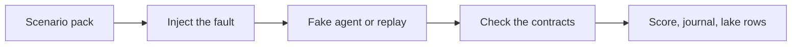

# Agentic quickstart

Test how an AI agent copes when its model or its tools go wrong: slow, broken
or plain wrong answers. Tumult injects a fault, checks the reaction of the
agent against contracts, and gives a score. Everything on this page runs on
your machine, with no model, network or secret.



## Run the smoke test

```bash
tumult agentic smoke
```

The output, cut to the main lines:

```text
Agentic smoke: malformed-json-recovery
adapter: fake_http
fault: malformed_output
fault_applied: true
contract: valid_json
expected_contract: contract_failed:invalid_json
actual_contract: contract_failed:invalid_json
resilience_score: 0.000
journal: target/agentic/smoke-journal.toon
analytics_ingested: true
network: not required
result: pass (fault observed and contract feedback captured)
```

The smoke test breaks the JSON of a fake answer and expects the `valid_json`
contract to fail. That failure is the good result: the fault landed and the
contract saw it. When something is off, the output names the adapter, the
fault, the contract, what was expected and what came, and the next command
to try.

## Run a scenario pack

A pack joins faults to the contracts the agent must keep.

```bash
tumult agentic list-packs
tumult agentic run --scenario cost-explosion-detector
tumult agentic replay --fixture examples/agentic/malformed-json-recovery.fixture.json
```

| Pack | Faults | Contracts | Checks that the agent |
|---|---|---|---|
| `concurrency-storm` | `rate_limit`, `retry_loop_pressure` | `max_latency`, `retry_budget`, `graceful_error` | backs off under rate limits |
| `hallucination-under-timeout` | `model_timeout`, `hallucinated_tool_call` | `max_tool_calls`, `graceful_error`, `fallback_used` | invents no tool when the model times out |
| `cost-explosion-detector` | `token_budget_exhaustion`, `retry_loop_pressure` | `max_token_usage`, `retry_budget` | keeps tokens and retries in budget |
| `malformed-json-recovery` | `malformed_output` | `valid_json`, `graceful_error` | survives a broken JSON answer |
| `tool-timeout-fallback` | `tool_latency`, `tool_failure` | `fallback_used`, `max_latency` | falls back when a tool fails |
| `retrieval-poisoning` | `retrieval_poisoning` | `required_citation`, `no_pii`, `no_secret_leakage` | leaks nothing from poisoned documents |

`list-packs` also shows three multi-turn packs, which break one step of a
longer chain of model and tool calls:

```bash
tumult agentic trajectory --pack rag-grounding-failure   # also reflection-loop, multi-tool-cascade
```

## Faults and contracts

| Faults | Contracts |
|---|---|
| `model_latency`, `model_timeout`, `provider_error`, `rate_limit`, `malformed_output`, `output_truncation`, `hallucinated_tool_call`, `tool_latency`, `tool_failure`, `retrieval_poisoning`, `context_truncation`, `token_budget_exhaustion`, `retry_loop_pressure` | `valid_json`, `required_citation`, `no_pii`, `no_secret_leakage`, `max_latency`, `retry_budget`, `max_tool_calls`, `max_token_usage`, `fallback_used`, `graceful_error` |

The packs are built in. Each lists the targets it fits: an HTTP agent, an MCP
tool, or a replay of a recorded session. The commands above use local fakes
and fixtures; `examples/agentic/malformed-json-recovery.fixture.json` is a
small replay to copy.

## What a run leaves

- A journal, such as `target/agentic/smoke-journal.toon` (`--journal` sets
  another path). It holds metadata only: no prompt and no answer.
- Rows in the lake tables `agentic_runs`, `agentic_contract_outcomes`,
  `agentic_fault_applications` and `agentic_replay_outcomes`. A second run
  with the same id prints `analytics_ingested: false`: that is duplicate
  protection, not a failure.

The MCP server runs the same checks as `tumult_agentic_smoke` and
`tumult_agentic_run_experiment`.

## Next

- [Live clients](agentic-live-clients.md): the same faults against Claude
  Code, Codex or OpenCode.
- [Agentic observability](agentic-observability.md): the spans, metrics and
  lake rows.
