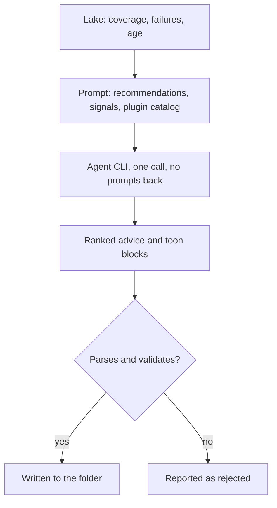

# Agentic recommendations

`tumult recommend` reads the lake and suggests what to test next: actions no
experiment has tried, the experiments that fail most, and the ones not run for
the longest time. With `--agent`, a coding agent on your machine ranks those
suggestions again, explains them, and can write new experiment files. Tumult
checks every file before it keeps it.



## Use it

```bash
tumult agents                                   # which agent CLIs are installed and logged in
tumult recommend --agent claude-code
tumult recommend --agent codex --generate-experiments out/experiments
```

Tumult does not call a model API itself. It runs the agent CLI once, with no
terminal and no session. The login you already have on that CLI is what
signs the call. `--agent-model` picks a model and `--agent-timeout` sets
the limit (default 120 seconds).

| `--agent` | Runs | Override the binary with |
|---|---|---|
| `claude-code` | `claude -p --output-format json`, prompt on stdin | `CLAUDE_CODE_BIN` |
| `codex` | `codex exec --ephemeral ... -`, prompt on stdin | `CODEX_BIN` |

The agent inherits your environment, so `ANTHROPIC_API_KEY` or
`OPENAI_API_KEY` reach it when set.

## What the agent sees

One prompt with everything it needs, so it opens no file:

1. The recommendations that `tumult recommend` made on its own.
2. The journal signals behind them: coverage, failures and age.
3. The plugin catalog, with the rule that only these actions may be used.
4. With `--generate-experiments`, a real experiment as an example of the
   format.
5. A strict answer format: a `## Recommendations` section, then one fenced
   `toon` block per experiment.

## Every proposed file is checked

Each `toon` block must parse as an experiment and pass its checks: version,
a method, hypothesis probes, regex and range tolerances. A valid one is
written as `<dir>/<title-slug>.toon`. A file that exists is never
overwritten: the next name gets `-2`, `-3` and so on. A rejected one is
listed with its error:

```text
Wrote out/experiments/redis-restart-under-load.toon
Rejected experiment: experiment has no method steps
1 experiment(s) written, 1 rejected (validation failed)
```

With `--format json` the output has an `agent` object with `adapter`,
`model`, `recommendations`, `experiments_written` and
`experiments_rejected`.

A valid file is not a safe file. Read it, and run it with `--dry-run`, before
it goes near real systems.

## Next

- [Experiment format](experiment-format.md): the format the agent writes.
- [Agentic quickstart](agentic-quickstart.md): the other direction, faults
  injected into an agent.
- A new agent CLI is an adapter in `tumult-agent-cli`, registered in
  `AdapterRegistry::builtin()`.
