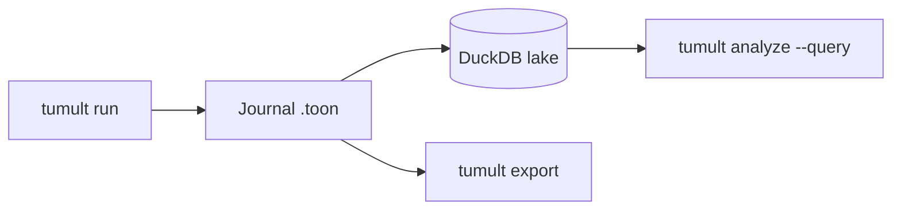

# SQL analytics

Every run lands in one DuckDB store, the lake. You can ask it anything
in SQL, from the command line, without a server.



## Where the lake is

`tumult run` adds each journal to `~/.tumult/lake.duckdb`. Set
`TUMULT_LAKE_PATH` to put it somewhere else.

```bash
tumult store path     # where the lake is
tumult store stats    # how much it holds
```

`--no-ingest` runs an experiment without adding it to the lake.

## Ask a question

```bash
# A summary of the latest run
tumult analyze

# Any SQL, read-only
tumult analyze --query "SELECT status, count(*) FROM experiments GROUP BY status"

# The same over journal files, without the lake
tumult analyze journals/ --query "SELECT * FROM experiments WHERE status = 'deviated'"
```

Useful queries:

```sql
-- Runs and average time by status
SELECT status, count(*) AS runs, avg(duration_ms) AS avg_ms
FROM experiments GROUP BY status;

-- The slowest steps
SELECT name, phase, avg(duration_ms) AS avg_ms
FROM activity_results GROUP BY name, phase ORDER BY avg_ms DESC LIMIT 10;

-- Share of runs that did not complete
SELECT count(*) FILTER (WHERE status != 'completed')::float / count(*) * 100 AS failure_pct
FROM experiments;
```

## The main tables

| Table | One row per |
|---|---|
| `experiments` | run: title, `status`, times, `duration_ms`, hypothesis before and after, `test_kind`, `target_version`, the RTO and RPO targets and measures. What the probes saw: `impact_observed`, `outage_started_at_ns`, `recovered_at_ns`, and `mttr_s`, the time to recovery |
| `nfr_verdicts` | objective of a run: its target, what was observed and `state`. `recovered` says whether the run recovered (the RTO only), `reason` why the verdict is what it is, such as `no outage observed` |
| `run_roots` | run: its root span, or the same columns from the journal of a run that sent no trace. Then `recovery_time_s` is the time to recovery of the journal |
| `activity_results` | step of a run: `name`, `activity_type`, `status`, `phase`, `duration_ms`, `output`, `error` |
| `load_results` | load test: tool, throughput, p50, p95 and p99 latency, error rate |
| `probe_samples` | sample of a probe or of a load window, with its phase. `value` is the probe duration, `reading` the number a `number` or `range` probe printed |
| `spans`, `logs` | span and log record the daemon received |

A column added in a later version is empty on the runs stored before it.
`status` of a run is `completed`, `deviated`, `failed`, `aborted`,
`interrupted` or `halted`. `phase` of a step is `hypothesis_before`,
`method`, `hypothesis_after` or `rollback`. To see every column of a
table:

```bash
tumult analyze --query "DESCRIBE experiments"
```

## Export and trends

```bash
# The run in journal.parquet, its steps in activities/journal.parquet
tumult export journal.toon --format parquet

# Also csv, json or arrow
tumult export journal.toon --format csv

# How a metric moves across runs
tumult trend journals/ --metric resilience_score --last 30d
```

## Keep the lake safe

DuckDB does not encrypt the file. Tumult creates the lake folder for the
owner only, but put it on an encrypted volume when the data is sensitive
(`TUMULT_LAKE_PATH=/mnt/encrypted/tumult/lake.duckdb`).

To back it up, export it or remove old runs, see
[Data portability](data-portability.md).

## Next

- [ChaosGraph](chaosgraph.md): the same results as a graph.
- [MCP guide](mcp-guide.md): let an agent query the lake.
