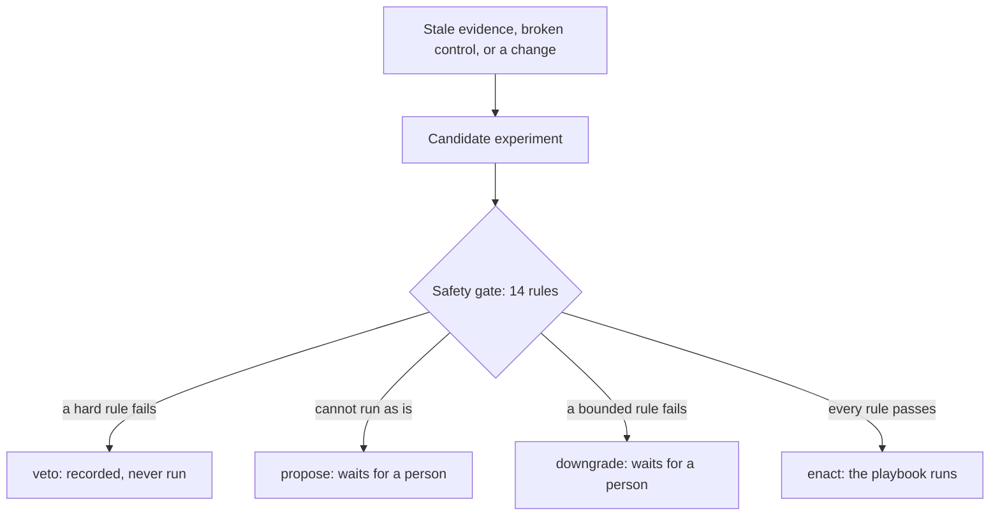

# Autopilot

Autopilot picks the next experiment for you and runs it only when your policy
allows. It looks for stale evidence, broken controls and recent changes, and a
fixed safety gate decides each case. Every decision is stored, with the reasons
and the hash of the policy, before anything runs.



## Run it

```bash
tumult autopilot once --policy autopilot.toml             # decide and record only
tumult autopilot once --policy autopilot.toml --execute   # also run what the gate allows
tumult autopilot status --verdict propose                 # the queue and the history
tumult autopilot approve <decision-id> --policy autopilot.toml
tumult autopilot deny <decision-id> --reason "not this week"
tumult autopilot notify-change --service checkout --source deploy-webhook
tumult autopilot export <dir>                             # Parquet copy of the decisions
```

Without `--execute` nothing is injected. The guard probes still run once
against the target, to check that the gate can see the blast. The MCP server
has the same loop as `tumult_autopilot_run`, `tumult_autopilot_status`,
`tumult_autopilot_respond`, `tumult_autopilot_export` and
`tumult_autopilot_notify`.

## The policy file

```toml
[autopilot]
enabled = true                 # false (the default) vetoes everything
max_runs_per_day = 6           # daily budget, then veto
cooldown_hours = 12            # time between runs on one service
evidence_ttl_days = 90         # evidence older than this is stale
enact_tiers = ["service", "edge"]   # the only tiers that may enact
require_guard = true           # no guard, no enact
business_hours_only = false
require_enrollment = false     # true: only enrolled_services may be hit
enrolled_services = []
autonomy_threshold = 0.8       # clean-run share a fault class needs
autonomy_min_samples = 3

[autopilot.evidence_ttl_days_by_framework]
DORA = 90

[[autopilot.pretrusted]]       # trust this fault class from the start
plugin = "tumult-containers"
action = "kill-container"
tier = "data"

[[autopilot.playbook]]         # the experiment to run for a fault class
plugin = "tumult-containers"
action = "kill-container"
service = "demo-postgres"      # optional
experiment = "demo/experiments/demo-topo-recommended.toon"
```

## The verdicts

| Verdict | When | What happens |
|---|---|---|
| `veto` | Autopilot is off, the target is not enrolled, it has an open deviation, another experiment runs, the daily budget is spent, or the experiment cannot prove anything | Recorded with the rule that fired. Never runs |
| `propose` | The validator found a blocker, such as no playbook | Waits for a person |
| `downgrade` | It would enact, but a bounded rule failed: tier, guard, guard telemetry, business hours, cooldown, confidence, or autonomy not earned | Waits for a person, with the exact blocker named |
| `enact` | All 14 rules pass | With `--execute`, the playbook runs with its guards armed and its rollback checked |

`approve` runs the gate again on the current state. The playbook runs only
if the answer is now `enact`, so an approval clears a hold that has passed, such
as a cooldown, but never a tier, confidence, autonomy or validator blocker.
`deny` is final and counts against the fault class.

## Earned autonomy

A fault class is `plugin::action@tier`. It starts at propose, and it enacts on
its own once its share of clean enacted runs reaches `autonomy_threshold` over
at least `autonomy_min_samples` runs. A veto, an override or a failed recovery
sends it back to zero. `[[autopilot.pretrusted]]` is the only shortcut.

## More inputs

- `notify-change` records a deploy or a config change. For 7 days the service
  is a candidate for a new check.
- `TUMULT_CRITICALITY_FILE` names a JSON file of service to observed span
  rate, such as `{"checkout": 1200}`. Busier services rank higher.
  `scripts/demo-topology.sh 5` builds one from the span counts of SigNoz on
  the demo.
- `tumult topology discover-k8s` proposes a topology from a cluster, to review
  and import.

## Where decisions go

Decisions and their events are in two insert-only lake tables,
`autopilot_decisions` and `autopilot_events`. Each decision is also a
`recommendation` node in [ChaosGraph](chaosgraph.md), and an enacted one links
to its run with an `enacted` edge, so one query answers "why did this run
happen?". `make demo-topology-4` shows the whole story on the demo stack.
