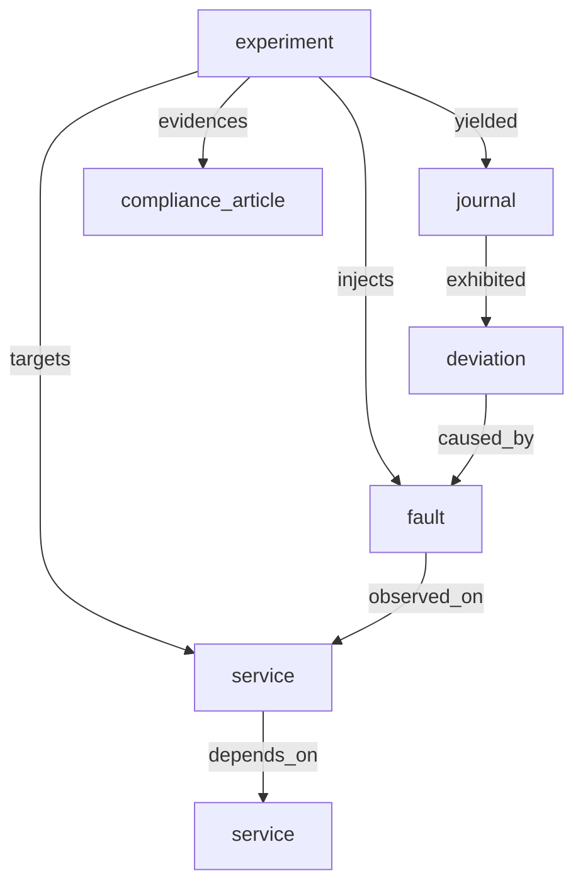

# ChaosGraph and topology

ChaosGraph is a small graph of what your experiments did: which fault
each one injects, which service it hits, how each run ended and which
control it gives evidence for. Tumult builds it as runs land in the lake.
Agents read it over MCP, and you read it with `tumult chaosgraph` and
`tumult topology`.

A graph answer stays small. "Which fault does this experiment inject?"
costs the same few lines after ten runs or after a thousand, where reading
the journals grows with every run.

## The model



| Node | Id | What it is |
|---|---|---|
| `experiment` | `exp:<title>` | One experiment, the same node for all its runs |
| `fault` | `fault:<plugin>::<function>` | A fault, such as `fault:tumult-net::inject_latency` |
| `service` | `svc:<host>` | A service a run acts on, such as `svc:demo-app` |
| `journal` | `run:<experiment_id>` | One run, labelled with how it ended |
| `deviation` | `dev:<experiment_id>` | A run that did not complete |
| `compliance_article` | `compliance:<framework>/<control>` | A control, such as `compliance:DORA/Art.25` |
| `coverage_gap` | `gap:<plugin>::<action>` | A fault that no stored run injected |
| `fault_domain` | `domain:<plugin>` | The plugin a gap belongs to |

A hundred runs of one experiment share one `exp:` node and one `fault:`
node, and add a hundred `run:` nodes. Two DuckDB tables hold the graph:
`graph_nodes` and `graph_edges`. The [Star Map](star-map.md) draws the
same tables together with your organisation.

A service comes from the step that injects the fault: the first of
`upstream`, `target`, `host`, `service`, `endpoint`, `address`, `url` or
`pod`, without scheme, path or port. A process step gets one from its
`docker` or `podman` container, an `http(s)` URL or an `ssh` host. Other
steps give a fault but no service.

## Ask the graph

```bash
tumult chaosgraph query --kind fault --filter latency
tumult chaosgraph neighbors --node "exp:My experiment" --depth 1
tumult chaosgraph coverage-gaps --framework dora
```

Add `--format json` for structured output. Over MCP the same questions
are `tumult_chaosgraph_query`, `tumult_chaosgraph_neighbors` and
`tumult_chaosgraph_coverage_gaps`. `tumult_chaosgraph_cypher` runs any
read-only openCypher query, up to 500 rows by default:

```text
MATCH (e:experiment)-[:injects]->(f:fault)-[:observed_on]->(s:service)
RETURN e.id, f.id, s.id
```

## Declare your topology

Services and their dependencies come from a file you review, never from
a guess:

```toml
# topology.toml
[[service]]
name = "gateway"
depends_on = ["api"]
tier = "edge"
owner = "team-platform"

[[service]]
name = "api"
depends_on = ["db"]

[[service]]
name = "db"
tier = "data"
```

```bash
tumult topology import topology.toml
```

Every `depends_on` name must be declared in the same file. Name services
the way your experiments do (`upstream = "api:8080"` becomes `svc:api`).
Import again to replace the whole topology. `tumult topology discover-k8s`
proposes a file from the Services of a cluster for you to review.

## See where compliance breaks

For each control and service, the lineage gives one state:

| State | Meaning |
|---|---|
| evidenced | The latest run of every experiment for this pair completed |
| broken | The latest run declared the control but gave no evidence, and deviated. The cell names the cause when it is clear |
| untested | No experiment connects the control to the service |

One broken experiment makes the pair broken, even if another gives
evidence.

```bash
tumult topology lineage --framework dora
tumult topology map --framework dora                  # text with recommendations
tumult topology map --framework dora --format mermaid # paste into a mermaid view
tumult topology recommend --framework dora --limit 3
```

The map colours services green (evidenced), red (broken) or amber
(untested). The recommender ranks the next faults to inject. Each score
is broken 1.0 or untested 0.6, times the citation strength, how many
services depend on this one, how close it is to a broken service, and a
bonus for a fault never run. Every recommendation lists its reasons, and
the same lake always gives the same ranking.

Over MCP: `tumult_topology_import` (Operator), `tumult_topology_map`,
`tumult_compliance_lineage` and `tumult_recommend_injection` (Viewer).

`make demo-topology` runs the whole loop on the demo stack: a green
lineage, a break with its cause, then recommend, run and improve.

## Next

- [MCP guide](mcp-guide.md): connect an agent.
- [SQL analytics](analytics-guide.md): the lake the graph lives in.
