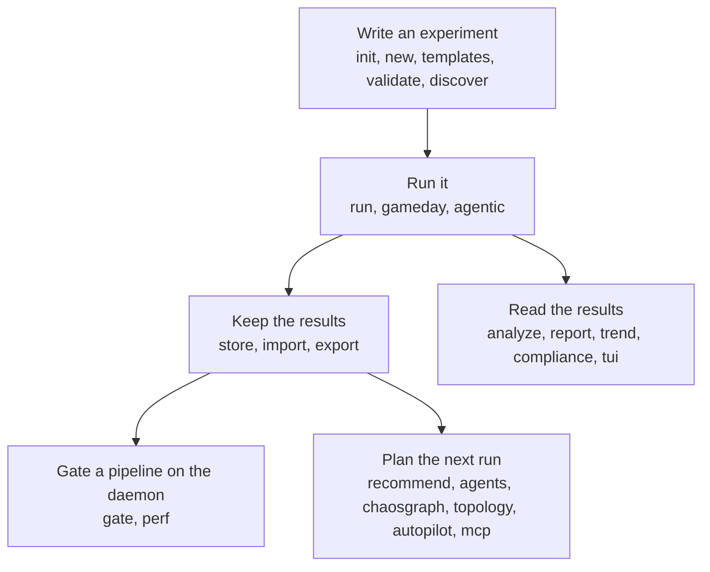
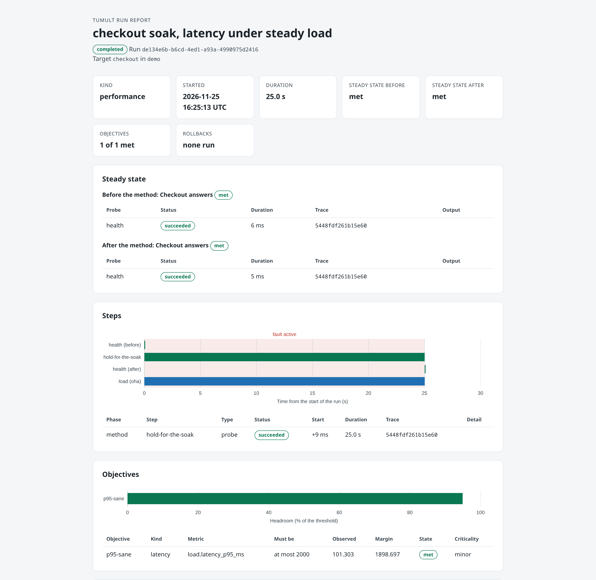

# CLI reference

`tumult` is one binary with one command per task. This page lists every
command and every flag; `tumult <command> --help` prints the same list.



| Command | What it does |
|---|---|
| [`run`](#tumult-run) | Run an experiment |
| [`validate`](#tumult-validate) | Check an experiment file and its plugin references |
| [`discover`](#tumult-discover) | List the plugins, actions and probes |
| [`analyze`](#tumult-analyze) | SQL over journal files or the store |
| [`export`](#tumult-export) | Turn a journal into Parquet, Arrow, CSV or JSON |
| [`compliance`](#tumult-compliance) | Evidence summary for one regulation |
| [`report`](#tumult-report) | HTML, JSON or JUnit report of a journal |
| [`trend`](#tumult-trend) | One metric across many runs |
| [`init`](#tumult-init) | Write a starter `experiment.toon` |
| [`new`](#tumult-new) | Pick a fault and get a ready experiment |
| [`templates`](#tumult-templates) | List the starter templates of `new` |
| [`import`](#tumult-import) | Read a Parquet directory into the store |
| [`store`](#tumult-store) | Back up, restore, export and clean the store |
| [`recommend`](#tumult-recommend) | Suggest the next useful experiment |
| [`agents`](#tumult-agents) | List the agent command lines Tumult can use |
| [`agentic`](#tumult-agentic) | Fault scenarios for AI agents |
| [`gameday`](#tumult-gameday) | Run many experiments as one campaign |
| [`mcp`](#tumult-mcp-serve) | Start the MCP server |
| [`chaosgraph`](#tumult-chaosgraph) | Query the graph of runs, faults and services |
| [`topology`](#tumult-topology) | Service map and compliance lineage |
| [`autopilot`](#tumult-autopilot) | Decide and record the next faults, by policy |
| [`gate`](#tumult-gate) | Pass or fail a target in CI |
| [`perf`](#tumult-perf) | Performance regression verdict in CI |
| [`tui`](#tumult-tui) | Dashboard of the store in the terminal |

Every command also takes `-h, --help` and `-V, --version`.

## tumult run

`tumult run <EXPERIMENT> [OPTIONS]` runs an experiment, writes its journal
and stores the run.

| Flag | Default | What it does |
|---|---|---|
| `--journal-path <JOURNAL_PATH>` | `journal.toon` | Where the journal is written |
| `--force` | off | Overwrite a journal that exists |
| `--dry-run` | off | Check the file and print the plan; run nothing |
| `--rollback-strategy <ROLLBACK_STRATEGY>` | `on-deviation` | `always`, `on-deviation` (alias `deviated`) or `never` |
| `--baseline-mode <BASELINE_MODE>` | `full` | `full` and `skip` use the declared tolerances; `only` reads the steady-state probes once, runs no fault, load, control or rollback, and is not stored |
| `--no-ingest` | off | Do not store the run |
| `--output-format <OUTPUT_FORMAT>` | none | `json`: print the journal as JSON on stdout when the run ends; the summary goes to stderr. Not with `--dry-run` |
| `--var <KEY=VALUE>` | none | Fill `${KEY}` in every string of the file. Repeat for more |
| `--target-version <VERSION>` | none | The version of the target this run measures, kept as `declared` |
| `--recovery-window <SECONDS>` | none | How many seconds the run watches for recovery after the method. It sets `recovery.window_s` of the file, at most `3600` |
| `--load <LOAD>` | none | `k6` or `oha` runs this load with the method; `none` drops the load of the file |
| `--load-script <LOAD_SCRIPT>` | `load.js` | The k6 script, or the URL that oha calls |
| `--load-vus <LOAD_VUS>` | `10` | Virtual users of the load |
| `--load-duration <LOAD_DURATION>` | `30s` | How long the load runs, such as `30s` or `5m` |

The load defaults apply only with `--load k6` or `--load oha`. A
`${KEY}` that no `--var` sets stops the run before it starts. Without
`--target-version` and `target.version`, a stored run asks the daemon or
the store which `service.version` the target's spans carried, and keeps it
as `observed`. When a run ends, it prints a summary:

```text
Running experiment: Checkout answers while a slow job runs
Status: Completed
Duration: 3169ms
Method steps: 1 executed
Hypothesis: met before, met after
Objectives: 3 met, 1 breached, 1 inconclusive
Load (oha): 10611 requests, 3531.4 requests/s, p50 0.5 ms, p95 0.8 ms, p99 1.4 ms, error rate 0.00 %, thresholds met
Journal written to: journal.toon
Journal SHA-256: e97edc233991dfdebf733d0af92a92e83b29c9710320016b7e814cfc2c80f474
Ingested into persistent analytics store
```

It exits `0` when the run completed, and `1` when it deviated, failed,
halted, was interrupted or aborted, or the command failed. The run is
stored in `~/.tumult/lake.duckdb` (`TUMULT_LAKE_PATH` moves it). With
`TUMULT_DAEMON_URL` set, the journal goes to the daemon instead
(`POST /api/import/journal`, with `TUMULT_DAEMON_TOKEN` as the bearer
token); when no daemon answers, the CLI writes the store itself. The file
format is in [Experiment format](experiment-format.md).

## tumult validate

`tumult validate <EXPERIMENT>` checks an experiment file: its syntax, its
structure and every plugin, action and objective metric it names. It has no
flags. It does not read `.gameday.toon` files; `tumult gameday run` checks
those.

## tumult discover

`tumult discover [--plugin <PLUGIN>]` lists the script plugins on disk and
the native plugins built into the binary, with their actions and probes.
`--plugin` shows one plugin in detail.

Script plugins are read from `./plugins/` in the working directory, then
`~/.tumult/plugins/`, then each folder of `TUMULT_PLUGIN_PATH` (split by
`:`). The first plugin of a name wins. The native plugins are `tumult-ssh`,
`tumult-net`, `tumult-kubernetes`, `tumult-cloud` and `tumult-windows`.

## tumult analyze

`tumult analyze [JOURNALS] [OPTIONS]` runs SQL over journal files, or over
the store when no folder is given. The tables are in the
[Analytics guide](analytics-guide.md).

| Flag | What it does |
|---|---|
| `--query <QUERY>` | Run this SQL. Only one `SELECT` or `WITH` statement is accepted |
| `--last <LAST>` | Summary of the last N runs (1 when there is no `--query`) |
| `--all` | Summary of the whole store |

## tumult export

`tumult export <JOURNAL> [--format <FORMAT>]` turns one journal into files
in the working directory.

| Flag | Default | What it does |
|---|---|---|
| `--format <FORMAT>` | `parquet` | `parquet`, `csv`, `json` or `arrow` |

`json` writes the whole journal to `<journal>.json`. The other formats
write two tables: `<journal>.<ext>` holds the run (one row) and
`activities/<journal>.<ext>` its steps. Both have the column
`experiment_id`.

## tumult compliance

`tumult compliance <JOURNALS> --framework <FRAMEWORK>` sums up the evidence
in journal files for one regulation. The mapping is in
[Regulatory mapping](../regulatory-mapping.md).

| Flag | What it does |
|---|---|
| `--framework <FRAMEWORK>` | `dora`, `nis2`, `pci-dss`, `iso-22301`, `iso-27001`, `soc2` or `basel-iii` |
| `--sources` | List each mapped control with its source URL and the date it was checked. Needs no journals |

The summary gives the pass rate (the share of runs that completed) and the
recovery share: of the runs that measured a recovery, the share that came
back within their own `rto_target_s`, or within 30 seconds when they
declare none. A run that measured no recovery is left out. With no run
left, the recovery is `not measured`, and the verdict rests on the pass
rate only. How each run counts is in
[Objectives](objectives.md#recovery-over-many-runs).

The summary is evidence, not a compliance decision. `tumult compliance`
exits `0` whatever the verdict, and `1` when it cannot read the journals.

## tumult report

`tumult report <JOURNAL> [OPTIONS]` writes a report of one journal.

| Flag | Default | What it does |
|---|---|---|
| `--output <OUTPUT>` | `<journal>.<ext>` in the working directory | Where the report is written |
| `--format <FORMAT>` | `html` | `html`, `pdf`, `json` or `junit` |
| `--trace-ui-base <TRACE_UI_BASE>` | `TUMULT_TRACE_UI_BASE` | Base URL of a trace UI, such as Jaeger; each `trace_id` becomes a link |



The HTML report is one file with every table and up to five charts, and
needs no network. `pdf` writes the HTML and prints how to turn it into a
PDF. `junit` has one test case per step and per steady-state check, so a
deviated run fails in CI. `SOURCE_DATE_EPOCH` (seconds) fixes the date the
report shows.

## tumult trend

`tumult trend <JOURNALS> [OPTIONS]` follows one metric across the runs in
journal files. It reads the files, not the store.

| Flag | Default | What it does |
|---|---|---|
| `--metric <METRIC>` | `resilience_score` | `resilience_score`, `duration_ms`, `estimate_accuracy` or `method_step_count` |
| `--last <LAST>` | all runs | Only runs that started in this window, such as `30d` |
| `--target <TARGET>` | all runs | Only runs on this target: the system or technology the journal names, whole name, any case |

## tumult init

`tumult init [--plugin <PLUGIN>]` writes `experiment.toon` in the working
directory from the starter template, which uses only `uname` and `sh`: no
fault, no Docker, no network. It does not overwrite a file. `--plugin`
starts the method with the first probe of that script plugin; a native
plugin gets the plain starter, and a plugin that is not installed is
refused.

## tumult new

`tumult new [OPTIONS]` asks you to pick a fault step by step (domain,
action, arguments, target, probe, title) and writes a checked experiment.
With `--from` it fills a starter template and asks nothing.

| Flag | Default | What it does |
|---|---|---|
| `--from <FROM>` | none | The template to fill |
| `--set <KEY=VALUE>` | none | A parameter of the template. Repeat for more |
| `--out <OUT>` | `<template>.toon`, or `<action>.toon` when you pick | Where the experiment is written |

```bash
tumult new --from pg-kill-connections --set container=db-1 --out pg-kill.toon
```

## tumult templates

`tumult templates` lists the starter templates that `tumult new` fills,
with their parameters and defaults. It has no flags.

## tumult import

`tumult import <PARQUET_DIR>` reads the directory that `tumult store
export` writes into the store: runs and steps, and the load samples and
version history when the directory holds them. A row the store already
has is skipped, and each pair of files is committed only when both load.

## tumult store

`tumult store <SUBCOMMAND>` looks after the store, `~/.tumult/lake.duckdb`
(`TUMULT_LAKE_PATH` moves it).

| Subcommand | Flags | What it does |
|---|---|---|
| `stats` | | Count runs and steps, show the file size |
| `backup` | `--output <OUTPUT>` (default `tumult-backup`) | Copy the whole database with a checksum manifest. Stop every writer first; the copy holds credentials |
| `restore` | `--input <INPUT>`, `--output <OUTPUT>` | Check a backup and restore it into a new database file. Never overwrites |
| `export` | `--output <OUTPUT>` (default `tumult-export`) | Write the Parquet directory that `tumult import` reads. Refuses a directory that already holds one |
| `purge` | `--older-than-days <OLDER_THAN_DAYS>` | Delete runs older than N days, with their steps, load results, probe samples, verdicts and graph rows. Telemetry, the run registry, the audit trail, manual records, forecasts, sightings and the autopilot tables stay |
| `path` | | Print the path of the store |
| `migrate` | | Copy the store to ClickHouse (deprecated; Tumult 3.1 removes ClickHouse) |
| `import-legacy` | `--analytics-db <ANALYTICS_DB>`, `--kronika-db <KRONIKA_DB>`, `--store <STORE>` | Read the databases of older installs into the store; rows already there are skipped |

A backup and a Parquet export are not the same thing; read
[Data portability and recovery](data-portability.md) before you rely on
one. With `TUMULT_CLICKHOUSE_URL` set, `tumult run` writes to ClickHouse
and not to the store, and warns that ClickHouse is deprecated.

## tumult recommend

`tumult recommend [OPTIONS]` suggests the next useful experiment from the
gaps, failures and stale runs in the store. An agent command line can add
its own ideas; see [Agentic recommendations](agentic-recommendations.md).

| Flag | Default | What it does |
|---|---|---|
| `--goal <GOAL>` | none | What you want to improve |
| `--store-path <STORE_PATH>` | the store | Store to read |
| `--model <MODEL>` | none | Model label put in the output |
| `--no-draft` | off | Leave out the draft experiment |
| `--format <FORMAT>` | `text` | `text` or `json` |
| `--agent <AGENT>` | none | Agent command line to ask: `claude-code` or `codex` |
| `--agent-model <AGENT_MODEL>` | none | Model the agent uses. Needs `--agent` |
| `--agent-timeout <AGENT_TIMEOUT>` | `120` | Seconds the agent may take |
| `--generate-experiments <DIR>` | none | Write the agent's experiments that pass validation to this folder; never overwrites. Needs `--agent` |

## tumult agents

`tumult agents` lists the agent command lines (`claude-code`, `codex`):
installed or not, version and sign-in state, with an install hint when one
is missing. It has no flags. `CLAUDE_CODE_BIN` and `CODEX_BIN` point at a
binary that is not on the `PATH`.

## tumult agentic

`tumult agentic <SUBCOMMAND>` runs fault scenarios for AI agents: on fixed
local fixtures, or through a proxy on live model traffic. See the
[Agentic quickstart](agentic-quickstart.md).

| Subcommand | Flags (default) | What it does |
|---|---|---|
| `list-packs` | | List the bundled scenario packs |
| `smoke` | `--journal` (`target/agentic/smoke-journal.toon`) | Run the local smoke test |
| `run` | `--scenario` (`malformed-json-recovery`), `--journal` (`target/agentic/run-journal.toon`) | Run a scenario pack on local fixtures |
| `trajectory` | `--pack` (`rag-grounding-failure`), `--journal` (`target/agentic/trajectory-journal.toon`) | Fault one step of a multi-turn trajectory and check its contracts. No network |
| `replay` | `--fixture` (`examples/agentic/malformed-json-recovery.fixture.json`), `--journal` (`target/agentic/replay-journal.toon`) | Check a replay fixture |
| `proxy` | `--listen` (`127.0.0.1:8080`), `--upstream` (`https://api.anthropic.com`), `--scenario` (`malformed-json-recovery`), `--journal`, `--seed` (`1`), `--client` (`unknown`) | Stand between an agent and its model, and inject the pack's faults |
| `run-live` | `--prompt`, `--scenario` (`malformed-json-recovery`), `--base-url` (`http://127.0.0.1:8080`), `--otlp`, `--client` (`claude-code`) | Run `claude -p` through the proxy with Tumult as the trace root, and check the pack's contracts |

## tumult gameday

`tumult gameday <SUBCOMMAND>` runs many experiments as one campaign under a
shared load, and scores it. A schedule of the daemon runs registered
experiments only. To run a GameDay on a timer, use cron or a systemd timer
([Scheduling](scheduling.md#without-the-daemon)).

| Subcommand | Flags | What it does |
|---|---|---|
| `create <NAME>` | `--experiments <EXPERIMENTS>` (comma-separated), `--load` (`k6`, `oha` or `none`), `--load-script <LOAD_SCRIPT>`, `--load-vus <LOAD_VUS>`, `--framework` (`dora`, `nis2`, `pci-dss`, `iso-22301`, `iso-27001`, `soc2` or `basel-iii`) | Write a `.gameday.toon` file from experiment files |
| `run <GAMEDAY>` | `--force` | Run every experiment of the GameDay. `--force` overwrites the journal of an earlier run |
| `analyze <GAMEDAY>` | | Sum up a finished GameDay from the journals next to it |

`tumult gameday run` writes its journal, then exits `0` when the GameDay is
`COMPLIANT` and `1` when it is `PARTIAL`, `NON-COMPLIANT` or could not run.

The GameDay score is a weighted mean of four parts. At `0.90` or more the
GameDay is `COMPLIANT`, at `0.75` or more `PARTIAL`, and below that
`NON-COMPLIANT`.

| Part | Weight | What it is |
|---|---|---|
| Pass rate | 0.30 | The share of runs that completed |
| Recovery | 0.25 | The recovery share, see below |
| Load impact | 0.25 | The share of requests of the shared load without an error; 1 with no load |
| Compliance | 0.20 | The share of the `compliance_maps` articles with a completed run; 1 with none |

The recovery share judges each run against its own `rto_target_s`, and a
run that declares none against `scoring.mttr_target_s` (default `30`). A
run that measured no recovery (no outage seen, method failed, watch cut
short) is left out. With `scoring.recovery_required: true` it counts as
late. `tumult gameday create` writes `recovery_required: true`. When no
run is left, the recovery is `not measured` and the other three parts share
its weight: the score is their weighted mean over `0.75`. How each run
counts is in [Objectives](objectives.md#recovery-over-many-runs).

## tumult mcp serve

`tumult mcp serve [OPTIONS]` starts the MCP server, so an AI agent can call
Tumult as tools. The release archives ship this command. Roles, TLS and
the service files are in [Production deployment](production-deployment.md).

| Flag | Default | What it does |
|---|---|---|
| `--transport <TRANSPORT>` | `stdio` | `stdio` for a local agent, `http` for the network |
| `--host <HOST>` | `127.0.0.1` | Bind address. Another address needs `--token` or `--auth-config` |
| `--port <PORT>` | `3100` | Port of the HTTP transport |
| `--health-port <HEALTH_PORT>` | port + 1 | Port of `GET /health` |
| `--token <TOKEN>` | none | Require this bearer token (the `operator` role) |
| `--auth-config <AUTH_CONFIG>` | none | TOML file that gives each token a role; wins over `--token` |

## tumult-mcp

`tumult-mcp [OPTIONS]` is a separate binary with the same server and the
same flags as `tumult mcp serve`. It is in the container images and in a
build from source, not in the release archives. It offers 40 tools; the
[MCP guide](mcp-guide.md) explains each one.

| Area | Tools |
|---|---|
| Experiments | `tumult_run_experiment`, `tumult_validate`, `tumult_discover`, `tumult_create_experiment`, `tumult_list_experiments` |
| Journals and analytics | `tumult_read_journal`, `tumult_list_journals`, `tumult_analyze`, `tumult_analyze_store`, `tumult_store_stats`, `tumult_query_traces`, `tumult_report`, `tumult_compliance`, `tumult_trend` |
| GameDays | `tumult_gameday_run`, `tumult_gameday_analyze`, `tumult_gameday_create`, `tumult_gameday_list` |
| Intelligence | `tumult_recommend`, `tumult_coverage`, `tumult_agents`, `tumult_fault_catalog`, `tumult_scaffold_experiment` |
| Agentic testing | `tumult_agentic_list_scenarios`, `tumult_agentic_smoke`, `tumult_agentic_run_experiment` |
| ChaosGraph | `tumult_chaosgraph_query`, `tumult_chaosgraph_neighbors`, `tumult_chaosgraph_coverage_gaps`, `tumult_chaosgraph_cypher` |
| Topology | `tumult_topology_import`, `tumult_topology_map`, `tumult_compliance_lineage`, `tumult_recommend_injection` |
| Autopilot | `tumult_autopilot_run`, `tumult_autopilot_status`, `tumult_autopilot_respond`, `tumult_autopilot_export`, `tumult_autopilot_notify` |
| Access | `tumult_whoami` |

## tumult chaosgraph

`tumult chaosgraph <SUBCOMMAND>` queries the graph of experiments, faults,
services and journals in the store. Each subcommand takes `--format`
(`text` or `json`, default `text`) and `--store <STORE>`. See
[ChaosGraph](chaosgraph.md).

| Subcommand | Flags (default) | What it does |
|---|---|---|
| `query` | `--kind <KIND>`, `--filter <FILTER>` | List the nodes of one kind, such as `experiment`, `fault`, `service` or `journal`; the filter matches the label, any case |
| `neighbors` | `--node <NODE>`, `--rel <REL>`, `--depth` (`1`) | Show the nodes around one node, such as `exp:My experiment`, along one relation when `--rel` is given |
| `coverage-gaps` | `--framework <FRAMEWORK>`, `--domain <DOMAIN>`, `--refresh` | List actions no tested run has used. `--refresh` also writes the gaps into the store, which takes the write lock |

## tumult topology

`tumult topology <SUBCOMMAND>` handles the declared service topology, the
compliance lineage and the next faults to inject. Each subcommand except
`discover-k8s` takes `--store <STORE>`. See
[ChaosGraph and topology](chaosgraph.md).

| Subcommand | Flags (default) | What it does |
|---|---|---|
| `import <PATH>` | | Read a topology TOML (services and `depends_on`) into the store |
| `discover-k8s` | `--namespace` (repeat; all but `kube-system`), `--output <OUTPUT>` | Propose a topology TOML from the Services of a live cluster. Never writes the store |
| `map` | `--framework`, `--control`, `--format` (`text`, or `mermaid`, `json`), `--no-recommend`, `--limit` (`3`) | Draw the service map with its compliance state |
| `lineage` | `--framework`, `--control`, `--service`, `--format` (`text`, or `json`) | Show which service gives evidence for which article |
| `recommend` | `--framework`, `--limit` (`3`), `--format` (`text`, or `json`) | Rank the next fault injections, with reasons |

## tumult autopilot

`tumult autopilot <SUBCOMMAND>` decides the next faults by policy and
records each decision before anything runs. Nothing is injected without
`--execute`. Each subcommand takes `--store <STORE>`. See
[Autopilot](autopilot.md).

| Subcommand | Flags (default) | What it does |
|---|---|---|
| `once` | `--policy <POLICY>`, `--execute`, `--limit` (`3`, at most `10`) | One pass: gate the candidates and record each decision |
| `status` | `--verdict` (`enact`, `downgrade`, `propose` or `veto`), `--limit` (`20`), `--format` (`text`, or `json`) | List the decisions with their latest event |
| `approve <ID>` | `--policy <POLICY>` | Approve a proposal. It is gated again first, and runs only if that answers enact |
| `deny <ID>` | `--reason <REASON>` | Deny a proposal and record why |
| `notify-change` | `--service <SERVICE>`, `--source` (`manual`), `--detail <DETAIL>` | Record a deploy or config change; the next pass treats that service's evidence as out of date |
| `export <DIR>` | | Write the decision and event tables as Parquet |

## tumult gate

`tumult gate <TARGET> [OPTIONS]` asks the daemon whether a target may be
promoted (`GET /api/gate/{target}`). Use it as a pipeline step; CI
templates are in `deploy/ci/`.

```bash
export TUMULT_DAEMON_URL=https://tumultd.internal:4318
export TUMULT_DAEMON_TOKEN=kro_...   # a viewer token is enough
tumult gate payments-api --min-score 70 --max-age-days 30 --env prod
```

| Flag | Default | What it does |
|---|---|---|
| `--min-score <MIN_SCORE>` | `70` (daemon) | Lowest score that passes, 0 to 100 |
| `--max-age-days <MAX_AGE_DAYS>` | `30` (daemon) | Evidence older than this is stale |
| `--env <ENV>` | none | One environment only |
| `--daemon-url <DAEMON_URL>` | `TUMULT_DAEMON_URL` | The daemon |
| `--fail-on <FAIL_ON>` | `fail` | `fail`, `warn` or `never`: which verdicts exit non-zero |
| `--json` | off | Print the daemon's JSON answer |

The verdict is `fail` below the score or with no run, `warn` on stale
evidence or a failed experiment, and `pass` otherwise. The command exits
`0` when the verdict passes `--fail-on`, and `1` when it does not or when
the daemon answers with an error, such as for an unknown target.

## tumult perf

`tumult perf <TARGET> [OPTIONS]` asks the daemon whether the latest build
of a target is slower than the one before (`GET /api/perf/{target}`). Use
it after a build is deployed and under load. The rules are in
[Performance regression](performance-regression.md).

```bash
tumult perf checkout --quantile p95 --margin-pct 5 --env staging --store
```

| Flag | Default | What it does |
|---|---|---|
| `--probe <PROBE>` | `load.latency_p95_ms` (daemon) | The probe series compared |
| `--quantile <QUANTILE>` | `p95` (daemon) | `p50`, `p95` or `p99` |
| `--min-samples <MIN_SAMPLES>` | `20` (daemon) | Fewer samples on a side is inconclusive |
| `--min-runs <MIN_RUNS>` | `3` (daemon) | Fewer runs on a side is inconclusive; 1 to 1000 |
| `--seed <SEED>` | fixed (daemon) | Seed of the resampling; the same runs and seed give the same answer |
| `--margin-pct <MARGIN_PCT>` | `5` (daemon) | Noise margin, in percent of the baseline |
| `--env <ENV>` | none | The environment. Needed when the target has versions in more than one |
| `--baseline <BASELINE>` | the version before the candidate | The version compared against |
| `--candidate <CANDIDATE>` | the version deployed last | The version judged |
| `--store` | off | Save the verdict in the daemon (operator role) |
| `--daemon-url <DAEMON_URL>` | `TUMULT_DAEMON_URL` | The daemon |
| `--range <RANGE>` | `30d` (daemon) | How far back samples are read, such as `12h` |
| `--include <INCLUDE>` | none | `partial` also counts aborted and cut runs |
| `--fail-on <FAIL_ON>` | `regressed,inconclusive` | Which verdicts exit non-zero, comma-separated; `never` alone always exits 0 |
| `--json` | off | Print the daemon's JSON answer |

| Exit code | Meaning |
|---|---|
| `0` | `improved` or `unchanged`, or a verdict `--fail-on` lets pass |
| `1` | The command failed, or `--store` did not store |
| `2` | Wrong flags |
| `3` | `regressed` |
| `4` | `inconclusive` |

## tumult tui

`tumult tui [OPTIONS]` opens a read-only dashboard of the store in the
terminal. `tumult dashboard` is the same command.

| Flag | Default | What it does |
|---|---|---|
| `--store <STORE>` | the store | Store to read |
| `--refresh-secs <REFRESH_SECS>` | `2` | Seconds between refreshes, at least 1 |

## Environment variables

| Variable | What it does |
|---|---|
| `TUMULT_LAKE_PATH` | Path of the store. Default `~/.tumult/lake.duckdb` |
| `TUMULT_PLUGIN_PATH` | More script plugin folders, split by `:` |
| `TUMULT_DAEMON_URL` | Daemon for `run`, `gate` and `perf`, such as `http://localhost:4318` |
| `TUMULT_DAEMON_TOKEN` | `kro_` API token sent to that daemon |
| `TUMULT_TRACE_UI_BASE` | Default of `report --trace-ui-base` |
| `OTEL_EXPORTER_OTLP_ENDPOINT` | Where traces, metrics and logs go. Unset: they are not sent |
| `OTEL_SERVICE_NAME` | Service name of the telemetry. Default `tumult` |
| `TUMULT_OTEL_ENABLED` | `false` or `0` turns telemetry off. Default `true` |
| `TUMULT_OTEL_CONSOLE` | `true` also prints spans to the console. Default `false` |
| `RUST_LOG`, `TUMULT_LOG_FORMAT` | Log level and format; see [Logging](logging.md) |
| `TUMULT_MCP_TOKEN`, `TUMULT_MCP_AUTH_CONFIG` | Auth of the MCP server; `--token` and `--auth-config` set them |
| `CLAUDE_CODE_BIN`, `CODEX_BIN` | Path of an agent binary for `recommend` and `agents` |
| `TUMULT_CLICKHOUSE_URL` | Deprecated: `run` writes to ClickHouse instead of the store |
| Your own names | Read by the `configuration` and `secrets` blocks of an experiment |
