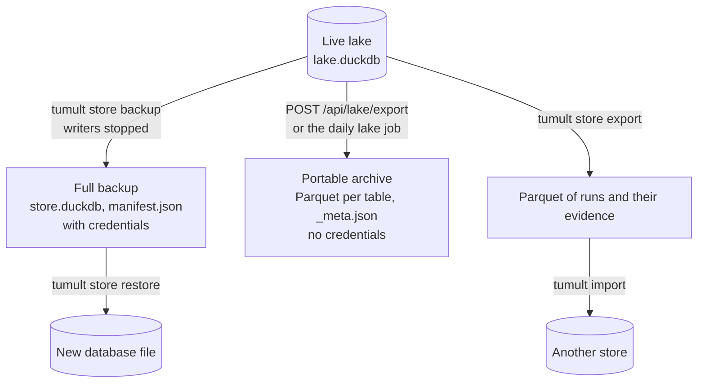

# Data portability and recovery

Tumult can copy its data out in three ways. Only the full backup brings back a
working installation; the other two are for reading and moving evidence.



| You want to | Use |
|---|---|
| Recover the installation after a loss | Full backup and restore |
| Give the evidence to another tool or keep it long term | Portable archive |
| Move runs and their load and probe evidence to another store | `tumult store export` and `tumult import` |

## Full backup and restore

1. Stop `tumultd` and every other process that writes the database. DuckDB
   lets one process own the file.
2. Back up to a new folder. Its parent must exist; the folder must not:

   ```bash
   TUMULT_LAKE_PATH=/srv/tumult/lake.duckdb tumult store backup --output /secure-backups/tumult-20261008
   ```

   The folder gets `store.duckdb` and `manifest.json` (format, schema
   version, credential policy, SHA-256), and the files attached to manual
   records in `attachments/`, each checked against its SHA-256. On Unix
   only the owner can read it.
3. Restore into a new file:

   ```bash
   tumult store restore --input /secure-backups/tumult-20261008 --output /srv/tumult/restored.duckdb
   ```

   Restore checks the manifest and the checksum, and refuses a changed or
   incomplete backup. It never overwrites a database or its WAL file. It
   brings the attachment files back into the `attachments` folder next to
   the new file, each checked against its SHA-256, and never writes over a
   file that is there. A backup made before 3.0.4 restores with no files.
4. Point `TUMULT_LAKE_PATH` at the restored file, review its schedules and
   webhooks, then start the daemon.

A backup holds password hashes, token hashes and signing secrets: keep it on
an encrypted volume and guard it like the live database. Back up separately
what is not in the database: secrets in the environment, TLS keys, plugins,
attachment files outside Tumult, and the portable archive. Test a restore on
an isolated installation before you trust your backups.

## Portable archive

`POST /api/lake/export` and the lake job (`KRONIKA_LAKE_INTERVAL`, default
`24h`, `0` or `off` turns it off) write Parquet snapshots to `KRONIKA_LAKE_DIR`
(default: a `lake` folder next to the database).

- Read `_meta.json` and only the files its `snapshots` map names. The folder
  also keeps older versions and the leftovers of an interrupted export.
- Check each file against `file_checksums` before you load it. Tumult's own
  reader refuses a damaged file, and the next export rebuilds it.
- `watermark_ns` is when the snapshot was published. It does not prove that
  every earlier event had arrived.

It holds telemetry, runs and their steps, load results, probe samples,
verdicts, forecasts, manual evidence, approvals, audit trails, schedules, the
graph and the function register. It leaves out users, sessions, tokens,
environment scopes, webhook settings, recovery plans and execution pins; the
manifest lists them. The files attached to manual records travel with it,
in its `attachments` folder, each named by its SHA-256 in the `attachments`
map of `_meta.json`. Links to evidence elsewhere are only referenced.

Your own data can still be sensitive: telemetry and definitions may hold
application data. The archive is not redacted, so share it only with people
who may see it. An archive in the old format 1 is refused: keep its files and
point `KRONIKA_LAKE_DIR` at a new, empty folder.

## Move runs to another store

`tumult store export --output <folder>` writes the experiments, steps, load
results, probe samples, run roots and version history as Parquet.
`tumult import <folder>` reads them into another store and adds each row once,
so a performance verdict works there too. It moves no spans, credentials or
schedules: it is not a backup.

## Keep retention at zero

Keep `KRONIKA_RETENTION_DAYS=0` and `TUMULTD_RUN_RETENTION_DAYS=0`, the
defaults. Any other value stops the daemon at start, because reports read
only the live database and would lose history. `tumult store purge` deletes
runs for good; it is not an archive policy.
