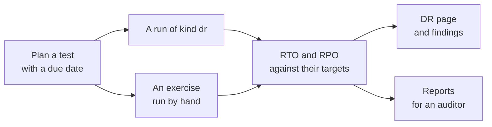
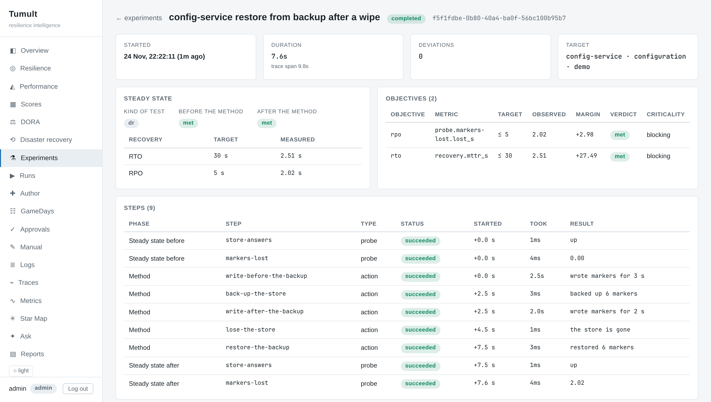
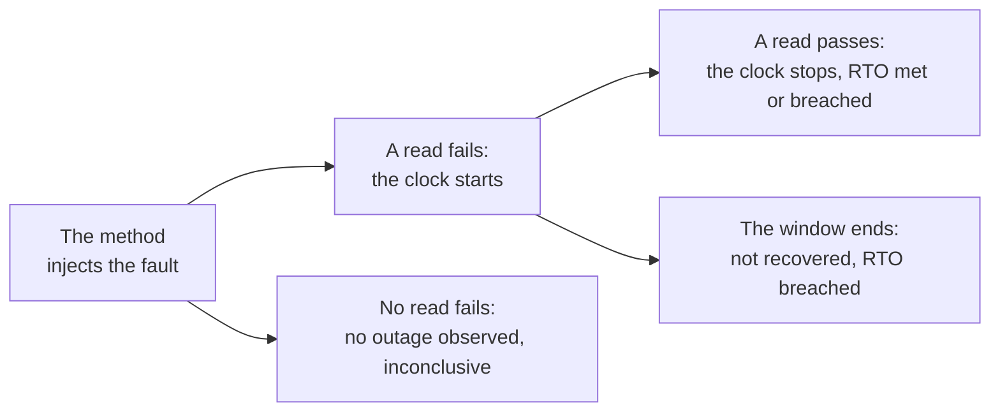
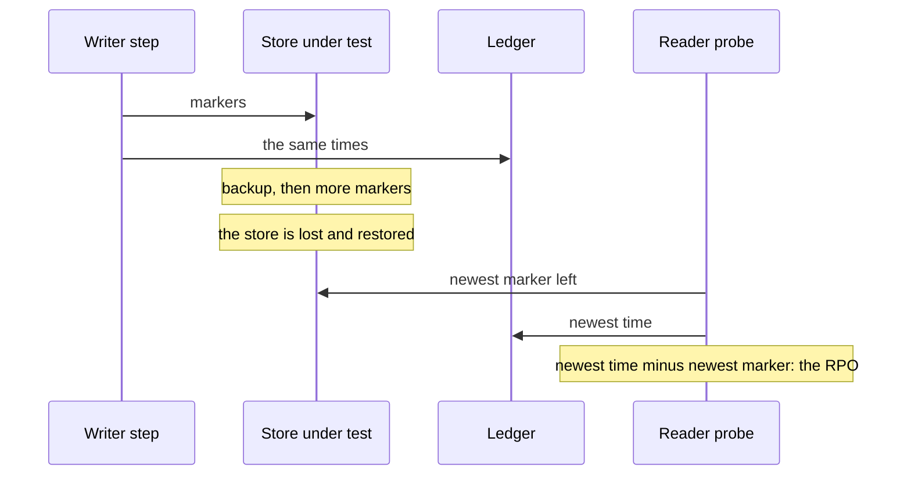
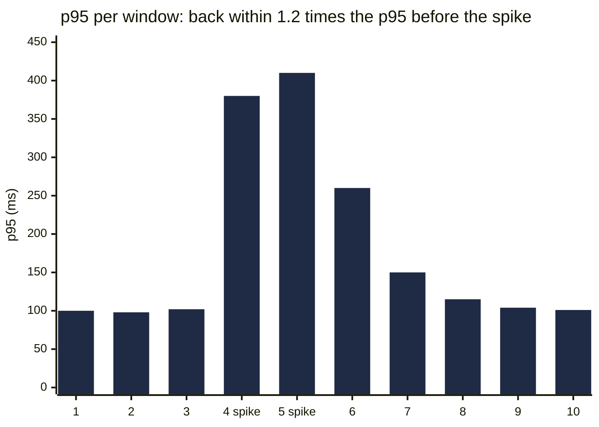
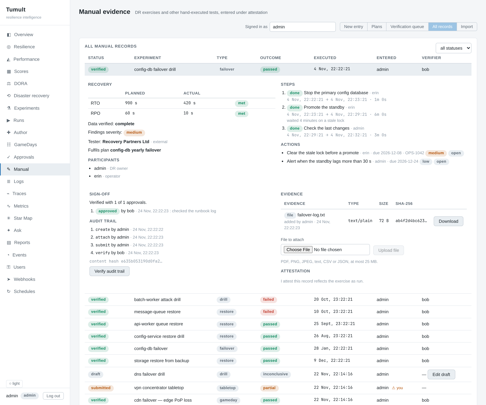
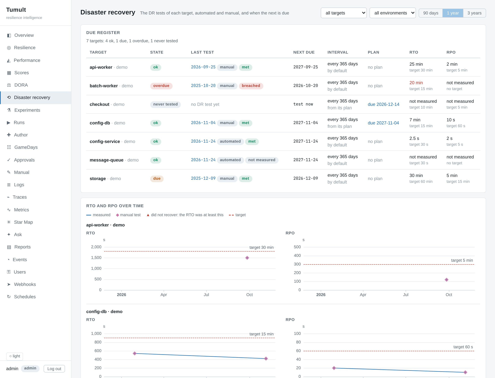
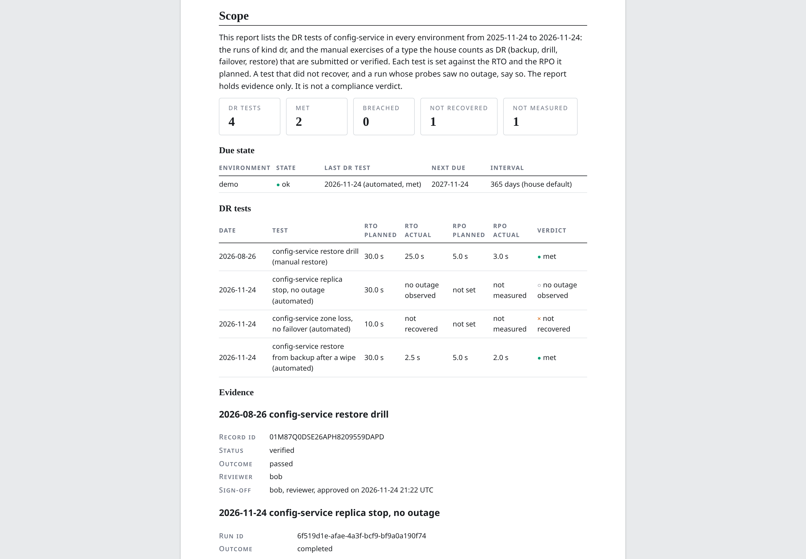
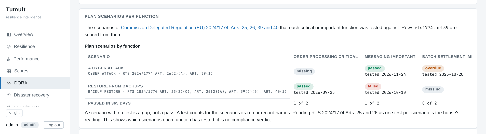

# Disaster recovery

A disaster recovery (DR) test shows that a system comes back after you lose
it. It must come back within its RTO, the time it may be down, and lose no
more data than its RPO allows. A robustness test shows that a system holds
under stress. For the scores, DR counts as robustness. The DR page and the
findings show DR on its own.



## Write a DR test

A DR test is an experiment of `kind: dr`. It must set `rto_target_s`. The
method takes the system down and brings it back, for example with the
[PostgreSQL steps](../plugins/tumult-db.md#postgresql-disaster-recovery)
`stop-primary`, `promote-replica`, `backup` and `restore`. The steady-state
probes say when the system is back.

```toon
kind: dr
target:
  system: config-service
  environment: demo
rto_target_s: 30
rpo_target_s: 5
recovery:
  window_s: 40
  interval_s: 1
```

The run page shows the RTO and the RPO the run measured, against their
targets.



All fields are in the [experiment format](experiment-format.md#the-sections)
and in [Objectives](objectives.md#recovery-targets).

## The RTO starts at the outage

The RTO clock starts at the first read of a steady-state probe that fails
after the method started. It stops at the first read that passes after the
last failure. After the method, the run reads the probes every `interval_s`
seconds, for at most `window_s` seconds (by default 1 and 30).
`tumult run --recovery-window 90` sets the window for one run.



- A run that does not come back breaches its RTO. The verdict says
  `recovered: false` and gives the time it watched as the least the RTO was.
- A run whose probes never failed saw no outage. It is no evidence of
  recovery.
- Make the window at least as long as the RTO. `tumult validate` warns when
  it is shorter.

## The RPO comes from markers

The RPO of a run is the seconds of written data it lost. A step writes
markers before the fault and notes each one in a ledger outside the store. A
probe reads them back after the recovery.



The reader has the tolerance `number`, and an `rpo` objective reads
`probe.<reader>.lost_s`. See [Measure the RPO](objectives.md#measure-the-rpo).
The demo runs one for real: `examples/postgres-restore-rpo.toon` restores a
backup that misses the last seconds of writes, see
[the RPO example](../plugins/tumult-db.md#the-rpo-example-of-the-demo).

## Robustness under load

Two load profiles of oha judge robustness. A soak checks that the p95 and
the error rate do not drift. A spike checks that the p95 comes back after
the peak.



```toon
nfr[2]:
  - id: p95-drift
    kind: latency
    metric: load.p95_drift_pct
    operator: lte
    threshold: 20
  - id: back-after-spike
    kind: recovery
    metric: load.spike_recovery_s
    operator: lte
    threshold: 10
```

`load.p95_drift_pct` and `load.error_rate_drift` need a `soak`, and
`load.spike_recovery_s` a `spike` with `sample_interval_s`. See
[Judge a soak or a spike](load-testing-guide.md#judge-a-soak-or-a-spike).

## Exercises run by hand

A restore test, a failover drill or a tabletop that people run is a manual
record. Open **Manual** in Krönika, or use `tumult manual` from a terminal.



1. **Plan** the exercise with an owner and a due date. A DR plan comes back
   every 365 days, unless you set an interval.
2. **Record** it: the RTO and the RPO planned and actual, whether the data
   was checked, the people, the steps and the actions with their owners.
3. **Attach** files as evidence, such as a runbook log. Tumult keeps each
   file by its SHA-256.
4. **Sign off.** Another user approves the record. The house can ask for
   more than one sign-off per exercise type.
5. **Verify** the audit trail at any time. It finds a changed, moved or
   deleted row.

The steps are in [Manual](../reference/kronika-pages.md#manual) of the
Krönika pages. An agent over MCP may draft a record. Only a person submits
and signs it.

## The DR page

The **Disaster recovery** page (`/dr`) shows the DR tests of each target,
runs and manual records together. The due register says when each target
needs its next test.



| State | When |
|---|---|
| `ok` | The next test is due in more than 30 days |
| `due` | The next test is due within 30 days |
| `overdue` | The next test is past its due date |
| `never tested` | The target declares an RTO or has a DR plan, and has no DR test yet |

A run that saw no outage is no DR test here. The interval comes from a
planned DR exercise of the target, else from the DR test plan of its
function, else it is 365 days. The risk scan reads the same facts: see
[Findings about recovery](../reference/kronika-pages.md#findings-about-recovery).
In SQL, read the view
[`dr_tests`](analytics-guide.md#dr-tests).

## Reports for an auditor

Three reports give an auditor the DR evidence. Make them with
`POST /api/reports/v2/generate`, or with `tumultd report` while the daemon
is stopped.



| Report | What it holds | Request |
|---|---|---|
| R4, DR test report | The DR tests of one target over a period, each against its RTO and RPO, with its evidence | `{"type": "dr-test", "target": "config-service"}` |
| R5, DR exercise report | One manual DR exercise: plan, people, steps, RTO and RPO, actions, files, sign-offs and the audit verify | `{"type": "dr-exercise", "record_id": "<id>"}` |
| R2, evidence pack | The DORA matrix from the requirement registry, the tests with their RTO and RPO, and how many name an external tester | `{"type": "evidence-pack", "framework": "dora"}` |

```bash
tumultd report --template dr-test --target config-service --out config-service.pdf
```

Each report states the SHA-256 of its PDF. More in
[Reports](../reference/kronika-pages.md#reports).

## Plan scenarios of RTS 2024/1774

The DORA ICT risk RTS (Delegated Regulation (EU) 2024/1774) names the
scenarios that continuity plans must be tested against, such as a cyber
attack or a power outage. Name the scenarios a test covers: a run in
`regulatory.scenarios`, a manual record in `scenarios`.

```toon
regulatory:
  frameworks[1]: DORA
  requirements[1]:
    - id: rts1774.art39
      description: The plan tested against a cyber attack
      evidence: The journal of the run
  scenarios[1]: cyber_attack
```

The DORA view shows, for each critical or important function, which
scenarios passed, failed, are overdue or were never tested.



A run counts for `backup_restore` only when it ran a backup or restore
step. The ids and the rows they count for are in
[Plan scenarios](dora-score.md#plan-scenarios). The view shows what was
tested. It does not say that a plan complies.

## Next

- [Objectives](objectives.md): every metric and verdict of a run.
- [tumult-db](../plugins/tumult-db.md#postgresql-disaster-recovery): the
  PostgreSQL steps for backup, restore and failover.
- [DORA score](dora-score.md): how DR tests count for DORA.
