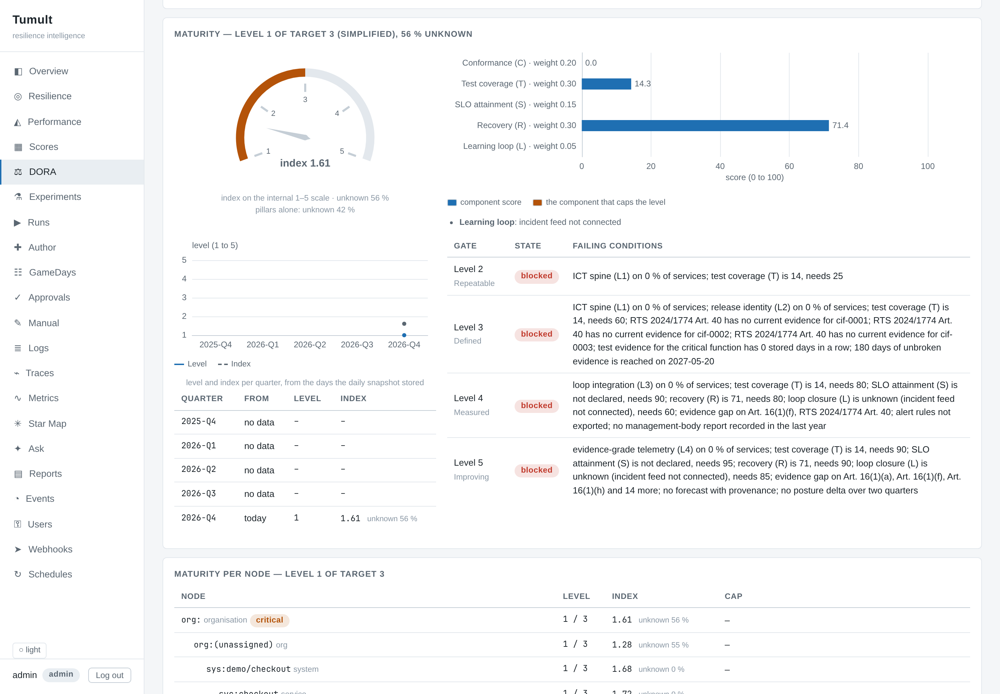

# DORA score

The DORA score answers two questions for one legal entity:

1. **Coverage**: for each DORA article and each business function, is
   there evidence, how fresh is it, and how much can Tumult not see?
2. **Maturity**: an internal level from 1 to 5, and the node that holds
   it down.

Open **Scores**, then **DORA and maturity** (`/scores?view=dora`).


**Read this first.** The score says what evidence exists. It does not
say that you comply with the regulation. The 1 to 5 level is an internal
scale: no authority defines it.


## Declare your functions

The score counts per business function, not per service. Declare the
legal entity and its functions in the org file: `KRONIKA_ORG_FILE`, or
`org.yaml` next to the lake file.

```yaml
legal_entities:
  - lei: 529900T8BM49AURSDO55
    name: Demo Firm
    profile: simplified        # full or simplified
functions:
  - id: cif-0001               # the ict.entity.id your telemetry carries
    name: Order processing
    tier: critical             # critical, important or other
    org_unit: platform/compute
    rto_s: 3600
    services: ["api-worker*", order-archive]
```

The daemon reads the file again every minute
(`KRONIKA_REGISTER_RELOAD_INTERVAL`), so a change needs no restart. A
file with any error is refused as a whole, and the lake keeps the
previous register. The page shows the state of the register: `ok`,
`stale`, `invalid` or `none`.

The profile picks the rows: under `simplified`, Art. 16 and Delegated
Regulation 2024/1774 replace Arts. 5 to 15. An id looks like `cif-0042`.

## Coverage

For each function and requirement row, Tumult takes the best evidence:

```text
value = freshness × outcome × strength
```

| Factor | Values |
|---|---|
| Freshness | 1 inside the row's window, then it halves every quarter of the window |
| Outcome | passed 1, partial 0.75, failed 0.5. An aborted or interrupted run is no evidence |
| Strength | direct 1, supporting 0.75, indirect 0.25, manual test record 0.75 |

Coverage of an article is the mean of these values, weighted by the row
and by the tier of the function (critical 3, important 2, other 1.5).
Every number comes with its unknown share, the hatched part of a cell:
rows Tumult cannot see because no source is connected.

Each cell also has an evidence status:

| Status | Rule |
|---|---|
| None | No evidence and nothing declared |
| Designed | A plan, schedule or target is declared, but there is no evidence. A declaration never gives more |
| Existing | Value of 0.75 or more today |
| Operating | Value of 0.75 or more today and on each of the last 180 stored days |

The daemon stores each day's status (`KRONIKA_SCORE_SNAPSHOT_INTERVAL`,
default `24h`). Only stored days count, and a missed day starts the
streak again.

## Maturity



Five pillars, each 0 to 100: C conformance of telemetry, T test coverage,
S service-level objectives, R recovery inside the target, L findings
closed by a passing run.

```text
index = 1 + 4 × weighted mean of the pillars / 100
level = the lower of floor(index) and the highest gate passed
```

A gate is a condition a level needs whatever the index: for example,
level 3 needs recovery (R) of 60 or more. The page lists failed gates.

The pillars roll up from workload to organisation, with two rules:

- **Unknown counts as the lowest level.** A declared service that sends
  no telemetry and has no test pulls its parent down.
- **The weakest critical child caps the level.** A parent is never higher
  than a critical child.

So "level 1, capped by svc:order-archive" means a critical function names
a service that sends nothing. Instrument it or test it, and the cap lifts.

Incident, SLO, register, alert-rule and forecast records are not ingested
yet, so a live lake reaches level 3 at most.

## The API

| Request | Returns |
|---|---|
| `GET /api/dora?lei=&profile=&by=entity\|org&env=` | Coverage per article and function, the expectation table and register readiness |
| `GET /api/dora/{article}?entity=&lei=&profile=&env=` | One article with every evidence row |
| `GET /api/maturity?lei=&profile=&by=node\|entity\|org&env=` | Level, index, pillars, gates, the cap and four quarters of history |

All need the Viewer role. A user with environment scopes sees only the
functions in those scopes.

## Change the house numbers

Every weight, window and gate is a house choice, not regulation. The
defaults are in
[`params.rs`](https://github.com/mwigge/tumult/blob/main/tumult-compliance/src/dora/params.rs).
Change any of them in the `score:` section of the org file:

```yaml
score:
  operating_days: 180
  targets: {simplified: 3}
  gates: {l3_recovery: 60}
```

Every answer lists your changes in `params.overridden`, and the page
shows them. A value out of range refuses the file.

## Next

- [Star Map](star-map.md): the same organisation as a graph.
- [Regulatory mapping](../regulatory-mapping.md): which tests count for which article.
- [Data portability](data-portability.md): take a backup before you upgrade.
