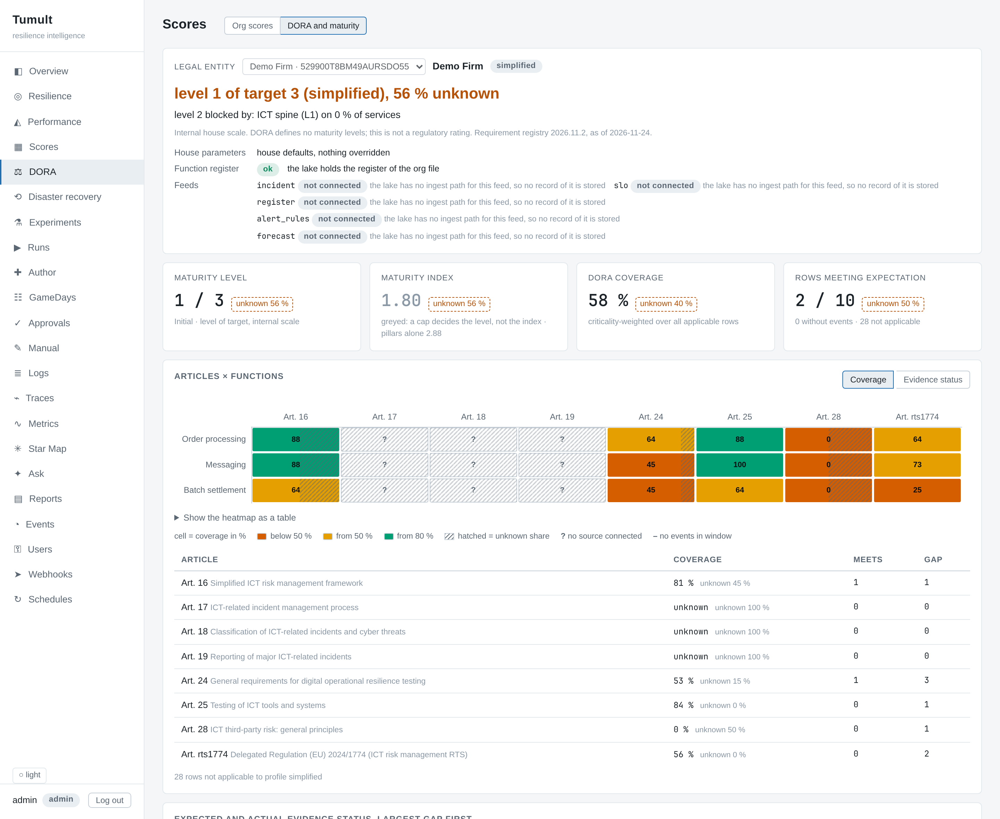
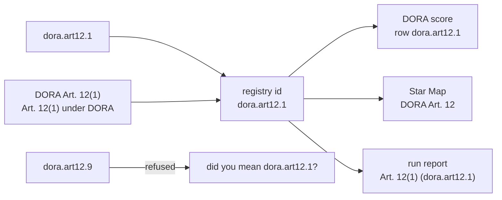
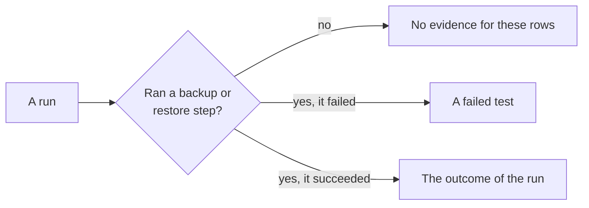
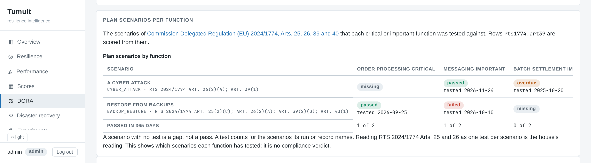
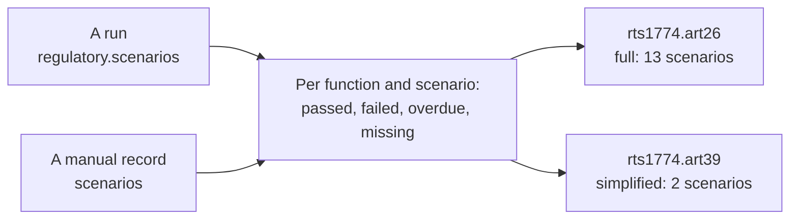

# DORA score

The DORA score answers two questions for one legal entity:

1. **Coverage**: for each DORA article and each business function, is
   there evidence, how fresh is it, and how much can Tumult not see?
2. **Maturity**: an internal level from 1 to 5, and the node that holds
   it down.

Open **Scores**, then **DORA and maturity** (`/scores?view=dora`).



**Read this first.** The score says what evidence exists. It does not
say that you comply with the regulation. The 1 to 5 level is an internal
scale: no authority defines it.



## Declare your functions

The score counts per business function, not per service. Declare the
legal entity and its functions in the org file: `KRONIKA_ORG_FILE`, or
`org.yaml` next to the lake file.

```yaml
legal_entities:
  - lei: 529900T8BM49AURSDO55
    name: Demo Firm
    profile: simplified        # full or simplified
functions:
  - id: cif-0001               # the ict.entity.id your telemetry carries
    name: Order processing
    tier: critical             # critical, important or other
    org_unit: platform/compute
    rto_s: 3600
    services: ["api-worker*", order-archive]
```

The daemon reads the file again every minute
(`KRONIKA_REGISTER_RELOAD_INTERVAL`), so a change needs no restart. A
file with any error is refused as a whole, and the lake keeps the
previous register. The page shows the state of the register: `ok`,
`stale`, `invalid` or `none`.

The profile picks the rows: under `simplified`, Art. 16 and Delegated
Regulation 2024/1774 replace Arts. 5 to 15. An id looks like `cif-0042`.

## Coverage

For each function and requirement row, Tumult takes the best evidence:

```text
value = freshness × outcome × strength
```

| Factor | Values |
|---|---|
| Freshness | 1 inside the row's window, then it halves every quarter of the window |
| Outcome | passed 1, partial 0.75, failed 0.5. An aborted or interrupted run is no evidence |
| Strength | direct 1, supporting 0.75, indirect 0.25, manual test record 0.75 |

The recovery rows, Art. 12(6) and 12(7), judge each DR run and each
verified manual record against its own RTO and RPO first, and those of its
function second. A run that did not recover failed its recovery. A run that
measured no recovery (no outage seen, a failed method, a watch cut short)
is no evidence for these rows.

Coverage of an article is the mean of these values, weighted by the row
and by the tier of the function (critical 3, important 2, other 1.5).
Every number comes with its unknown share, the hatched part of a cell:
rows Tumult cannot see because no source is connected.

Each cell also has an evidence status:

| Status | Rule |
|---|---|
| None | No evidence and nothing declared |
| Designed | A plan, schedule or target is declared, but there is no evidence. A declaration never gives more |
| Existing | Value of 0.75 or more today |
| Operating | Value of 0.75 or more today and on each of the last 180 stored days |

The daemon stores each day's status (`KRONIKA_SCORE_SNAPSHOT_INTERVAL`,
default `24h`). Only stored days count, and a missed day starts the
streak again.

## Requirement ids

Each row of the score has one id, the registry id: `dora.art24.6` for
Art. 24(6), `dora.art11.6a` for Art. 11(6)(a), `rts1774.art25` for
Art. 25 of the RTS 2024/1774. An article the registry has rows of is
`dora.art24`. `GET /api/dora` lists every row with its `id` and `cite`.

Use this id where you name a requirement:

| Where | Field | Example |
|---|---|---|
| A manual record | `framework_refs` | `["dora.art12.1", "ISO 27001 A.5.30"]` |
| A run | `regulatory.requirements[].id` | `dora.art12.1` |



- A DORA id the registry does not know is refused when you write it, with
  the nearest registry id: 422 from the manual API, an error from
  `tumult validate`. An experiment file that holds one still runs.
- The older forms are still read: `DORA Art. 24(6)`, `DORA-Art24`,
  `RTS 2024/1774 Art. 25`, and a bare `Art. 24(6)` in a run whose
  `frameworks` lists DORA. The score, the Star Map and the run report read
  each one as its registry id, so they show the same requirement. A record
  stored with an older form now counts for its row.
- An id of another framework, such as `ISO 27001 A.5.30`, is kept as
  written. The registry holds DORA only.

## What counts as a restore test

Four rows ask that a backup, a restore or a switchover is tested. A run
counts for them only when it ran a step that backs up or restores data,
or promotes a standby. The kind of the run does not decide: a `dr` run
that only kills connections is no test of a restore.

| Row | Profile | Asks for |
|---|---|---|
| Art. 12(2) | full | Backup and restoration tested |
| Art. 11(6), switchover | full | Switchover to redundant capacity tested yearly |
| Art. 16(1)(f) | simplified | Continuity through backup and restoration |
| RTS 2024/1774 Art. 40 | simplified | Backup and restore tested every year |

Under `simplified`, the test coverage pillar (T) of the maturity level
reads the RTS row.



| Plugin | Steps that count |
|---|---|
| `tumult-db-postgres` | `backup`, `restore`, `promote-replica` |

- Tumult reads the steps from the trace of the run, in the method and in
  the rollbacks. For a run that sent no trace, it reads the actions of the
  method from the definition the run was stored with.
- A `process` step names no plugin function, so it does not count.
- A verified manual record counts as before: an exercise whose type
  `manual_kinds` maps to `dr` (`failover`, `drill`, `restore` and
  `backup` by default).

## Plan scenarios

Delegated Regulation (EU) 2024/1774 names the scenarios that continuity
plans must be tested against
([ELI](https://eur-lex.europa.eu/eli/reg_del/2024/1774/oj)). Tumult
tracks them for each critical or important function. It shows which
scenarios have a passing test, which failed, which are overdue and which
were never tested.

| Id | Scenario | RTS 2024/1774 |
|---|---|---|
| `cyber_attack` | A cyber attack | Art. 26(2)(a), Art. 39(1) |
| `switchover` | Switchover to the redundant capacity | Art. 25(2)(c), Art. 26(2)(a) |
| `backup_restore` | Restore from backups | Art. 25(2)(c), Art. 26(2)(a), Art. 39(2)(g), Art. 40(1) |
| `redundant_facility` | Switchover to redundant facilities | Art. 25(2)(c), Art. 26(2)(a) |
| `function_degraded` | A critical or important function degrades or fails | Art. 26(2)(b) |
| `third_party_failure` | An ICT third-party provider fails or goes insolvent | Art. 25(2)(b), Art. 26(2)(b), Art. 26(4) |
| `premises_loss` | Offices, business premises or data centres fail | Art. 26(2)(c) |
| `ict_asset_failure` | ICT assets or the communication network fail | Art. 26(2)(d) |
| `staff_unavailable` | Too few staff to keep operations going | Art. 26(2)(e) |
| `physical_event` | Climate events, natural disasters, pandemics, physical attacks | Art. 26(2)(f) |
| `insider_attack` | An insider attack | Art. 26(2)(g) |
| `political_instability` | Political or social instability | Art. 26(2)(h), Art. 25(2)(b) |
| `power_outage` | A widespread power outage | Art. 26(2)(i) |

Name the scenarios a test covers:

| Where | Field | Example |
|---|---|---|
| A run | `regulatory.scenarios` | `scenarios[2]: premises_loss,power_outage` |
| A manual record | `scenarios` | `["premises_loss"]` |

- An id that is not in the table is refused, with the nearest id: 422
  from the manual API, an error from `tumult validate`. An experiment file
  that holds one still runs.
- A run counts for `backup_restore` only when it ran a backup or restore
  step, as in [What counts as a restore test](#what-counts-as-a-restore-test).
  A record counts as written.

The DORA view has a table of the plan scenarios of each critical or
important function.



Each scenario of a function has one state:

| State | Rule |
|---|---|
| passed | A test passed in the last 365 days |
| failed | Tested in the last 365 days, and no test passed |
| overdue | Every test is older than 365 days |
| missing | Never tested. A gap, not a pass |



Two rows of the score read the states:

| Row | Profile | Scenarios it needs |
|---|---|---|
| `rts1774.art26` | full | All 13. A microenterprise needs 10: Art. 25(2)(c) spares it `switchover`, `backup_restore` and `redundant_facility` |
| `rts1774.art39` | simplified | `cyber_attack` and `backup_restore` |

The value of a row for a function is the mean, over the scenarios it
needs, of the best test of each scenario. A scenario never tested counts
0. The rule "one test per scenario" is the house's reading of Arts. 25(2)
and 26(2). The view shows what was tested. It does not say that a plan
complies.

## Maturity


Five pillars, each 0 to 100: C conformance of telemetry, T test coverage,
S service-level objectives, R recovery inside the target, L findings
closed by a passing run.

```text
index = 1 + 4 × weighted mean of the pillars / 100
level = the lower of floor(index) and the highest gate passed
```

A gate is a condition a level needs whatever the index: for example,
level 3 needs recovery (R) of 60 or more. The page lists failed gates.

The pillars roll up from workload to organisation, with two rules:

- **Unknown counts as the lowest level.** A declared service that sends
  no telemetry and has no test pulls its parent down.
- **The weakest critical child caps the level.** A parent is never higher
  than a critical child.

So "level 1, capped by svc:order-archive" means a critical function names
a service that sends nothing. Instrument it or test it, and the cap lifts.

Incident, SLO, register, alert-rule and forecast records are not ingested
yet, so a live lake reaches level 3 at most.

## The API

| Request | Returns |
|---|---|
| `GET /api/dora?lei=&profile=&by=entity\|org&env=` | Coverage per article and function, the expectation table, the plan scenarios per function (`scenarios`) and register readiness |
| `GET /api/dora/{article}?entity=&lei=&profile=&env=` | One article with every evidence row |
| `GET /api/maturity?lei=&profile=&by=node\|entity\|org&env=` | Level, index, pillars, gates, the cap and four quarters of history |

All need the Viewer role. A user with environment scopes sees only the
functions in those scopes.

## Change the house numbers

Every weight, window and gate is a house choice, not regulation. The
defaults are in
[`params.rs`](https://github.com/mwigge/tumult/blob/main/tumult-compliance/src/dora/params.rs).
Change any of them in the `score:` section of the org file:

```yaml
score:
  operating_days: 180
  targets: {simplified: 3}
  gates: {l3_recovery: 60}
```

Every answer lists your changes in `params.overridden`, and the page
shows them. A value out of range refuses the file.

## Next

- [Star Map](star-map.md): the same organisation as a graph.
- [Regulatory mapping](../regulatory-mapping.md): which tests count for which article.
- [Data portability](data-portability.md): take a backup before you upgrade.
