# Entity events

An OpenTelemetry Collector can report the hosts, pods and deployments it
sees as *entity events*. `tumultd` can store them as entities with a
lifetime and tell you what exists, what went silent and what was deleted.
This is off by default: the specification is still in Development, and
the Star Map, the scores and the web UI do not read entities yet.



## Switch it on

| Variable | Default | Meaning |
|---|---|---|
| `KRONIKA_ENTITY_EVENTS` | off | `1`, `true`, `yes` or `on` stores entity events as entities. Read at start |
| `KRONIKA_ENTITY_LABEL_ALLOW` | empty | Kubernetes labels to keep, such as `team,app.kubernetes.io/name` |
| `KRONIKA_ENTITY_ATTRIBUTE_ALLOW` | empty | More description keys to keep: a whole key, or a start followed by `*` |
| `KRONIKA_ENTITY_MAX_PER_ENVIRONMENT` | `50000` | Most entities in one environment. The lake holds four times as many |

With the flag off, an entity event is a log record, stored whole in
`logs`, labels and annotations included.

## Collector configuration

Give entity events a logs pipeline of their own:

```yaml
receivers:
  host_metrics:
    collection_interval: 30s
    metadata_collection_interval: 1m
    scrapers:
      memory:
  k8s_cluster:                       # remove on docker-only stacks
    collection_interval: 30s
    metadata_collection_interval: 5m
processors:
  resourcedetection:
    detectors: [system]
    system:
      hostname_sources: [os]
      resource_attributes:
        host.id:
          enabled: true
  batch:
exporters:
  otlp/tumultd:                      # otelarrow/tumultd works the same way
    endpoint: ${env:TUMULTD_OTLP_ENDPOINT:-tumultd.host:14317}
    tls:
      insecure: true
    headers:
      authorization: "Bearer ${env:KRONIKA_INGEST_TOKEN}"
service:
  pipelines:
    logs/entity_events:
      receivers: [host_metrics, k8s_cluster]
      processors: [resourcedetection, batch]
      exporters: [otlp/tumultd]
```

`resourcedetection` gives a host its `host.id`; a host event without one
is dropped. `metadata_collection_interval` is how often an entity
reports. The daemon reads the default form of the Collector and the form
of the specification (a Collector feature gate).

## What is stored

`entity_versions` keeps one row per distinct state of an entity, not one
per report. A thousand reports of the same state are one row. A new
state opens a new row and keeps the old one as history. The view
`entities_current` adds a `liveness`:

| `liveness` | Meaning |
|---|---|
| `live` | A report came within three report intervals, or the entity reports only once |
| `expired` | Not deleted, but silent for more than three report intervals |
| `gone` | A delete event came |

Silence is counted by the daemon's clock. An entity that is gone or
expired is removed 30 days after the daemon last heard of it.

The daemon keeps a description key only when it is listed, because
labels and annotations can hold secrets. The keys kept by default:

| Key | What it is |
|---|---|
| `host.*`, `os.*`, `service.*`, `deployment.*`, `cloud.*`, `ict.*` | Every key in these namespaces |
| `container.image.*`, `container.id`, `container.name`, `container.runtime`, `container.status`, `container.status.reason`, `k8s.container.name` | The container |
| `k8s.workload.kind`, `k8s.workload.name` | The workload an object belongs to |
| `k8s.<kind>.name`, `k8s.<kind>.uid` | Name and uid of the object and its owner, namespace and node |
| `k8s.<kind>.start_time`, `k8s.<kind>.creation_timestamp`, `<kind>.creation_timestamp` | When it started or was created |
| `k8s.<kind>.phase`, `k8s.<kind>.status_reason`, `k8s.node.condition_*` | Its status |
| `schedule`, `concurrency_policy`, `current_revision`, `update_revision` | Cron job and stateful set fields |

A key with a segment that starts with `label`, `annotation` or
`selector` is always removed, unless you name it.
`tumultd_entity_event_keys_filtered_total` counts removed keys.

## Trust

Nothing in an entity event is checked: anyone with the ingest token can
create, change or delete any entity in any environment. `org.yaml` stays
the source of truth. Have senders write a team, not a person, as
`ict.entity.owner`.

## Limits

An event that cannot be stored is dropped, counted by reason in
`tumultd_entity_events_dropped_total` and named in the answer to the
Collector, which does not retry it.

- One export stores at most 10 000 entity events: set `send_batch_max_size`
  of the `batch` processor to 10 000 or less.
- A description may be 64 KiB, and an entity keeps its last 100 rows.
- In a full environment, gone and expired entities make room. Live
  entities are never pushed out.

## Read entities

| Request | Returns |
|---|---|
| `GET /api/entities?type=&liveness=&range=&sort=&limit=&cursor=` | The current row of each entity, 100 a page by default, at most 1000 |
| `GET /api/entities/{key}/history?environment=&limit=&cursor=` | Every stored row of one entity, newest first |

Both need the Viewer role and show only your environments. A key looks
like `host|host.id=4c4c4544004d`: percent-encode the whole key in the
path, as `encodeURIComponent` does. For the next page, send the
`next_cursor` of the answer as `cursor`.

`DELETE /api/entities?environment=staging&type=k8s.pod` (Admin role)
removes the entities of one environment, or of one type in it. An entity
that still reports comes back with its next report: rotate the ingest
token to stop a sender.

To switch it off, unset `KRONIKA_ENTITY_EVENTS` and restart. The stored
entities stay readable until you remove them.

## Next

- [Auto-instrumentation](otel-autoinstrumentation.md): the attributes an entity can carry.
- [Observability setup](observability-setup.md): the ingest token and ports.
