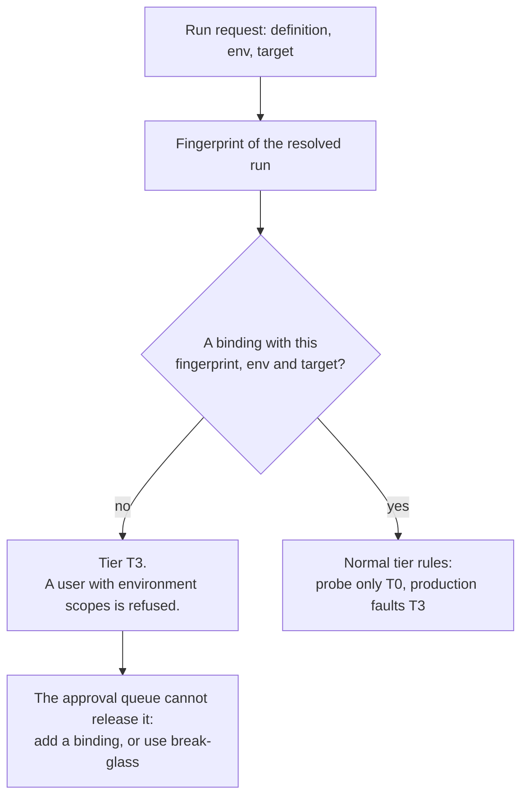
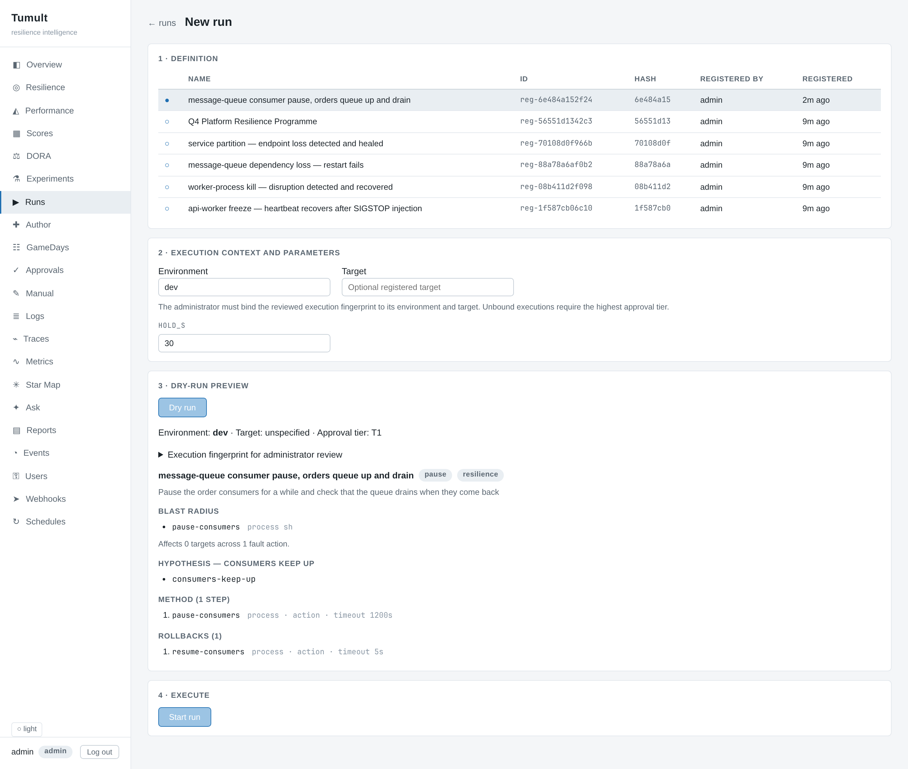

# Execution bindings

A binding says that one reviewed experiment, with its resolved inputs, may run
in one environment and on one target. The daemon does not trust the `env`
label of a request: without a binding a run is tier T3.



## What a binding changes

- **Unbound:** tier T3, also for a `dev` label or a run that says it only has
  probes. The approval queue cannot release T3: **Approve** answers `422` with
  `"missing": "execution_binding"`. Add the binding, reject the request and
  start the run again, or use break-glass.
- **Bound:** the normal tier rules apply. A probe-only plan can be T0; faults
  in production stay T3, and the other risk rules still count. A request for
  another environment or target than its binding is refused.
- **Users with environment scopes** cannot start an unbound run at all.
- **Schedules and GameDays** follow the same rules. A scheduled run keeps the
  identity of its author, and each fire checks again that the author is
  enabled, is still an operator and may use the environment.

## Add a binding

1. Register the experiment, then open **Runs**, **New run**. Pick the
   environment and target, fill in the parameters and run a dry run. The
   preview masks configuration and secret values.
2. Review the definition and where its connections, configuration and
   secrets come from. Open **Execution fingerprint for administrator review**
   to copy its SHA-256. Only an admin without environment scopes sees it (the
   `binding_hash` field of the dry-run answer).
3. Add the fingerprint, the environment and the target to the bindings file.
   `target` is `null` when no target is picked; it must match the request
   exactly.

   ```json
   [
     {
       "sha256": "<binding_hash from the reviewed dry run>",
       "env": "staging",
       "target": "database-a"
     }
   ]
   ```

4. Replace the file in one step (write a new file, then rename it). Only the
   admin may write it; the daemon must read it.



The Krönika demo binds its GameDay experiments the same way:
`demo/kronika/gamedays/seed-gameday.sh`.

## Where the file is

`TUMULTD_EXECUTION_BINDINGS` names the file. Without it the daemon reads the
file next to the database: `/var/lib/tumult/lake.duckdb` uses
`/var/lib/tumult/lake.execution-bindings.json`. A missing default file means
no bindings. A file that cannot be read or parsed, or a named file that is
missing, makes the daemon refuse runs until you fix it.

## Keep it safe

- The fingerprint covers the resolved experiment and every injected
  configuration and secret value. A change to a parameter, a destination or a
  secret needs a new review and a new binding.
- Treat the fingerprint as a secret: with the rest of the run known, it can
  help guess a weak secret value. Do not publish binding files.
- Other clients get only an `execution_hash` preview token. Send it back
  unchanged with the run request. It stops working when the daemon restarts;
  run the dry run again.
- A binding does not sandbox a script, freeze a remote service or prove who
  a target is. Control the scripts, credentials and network yourself, and
  run with as few privileges as you can.
