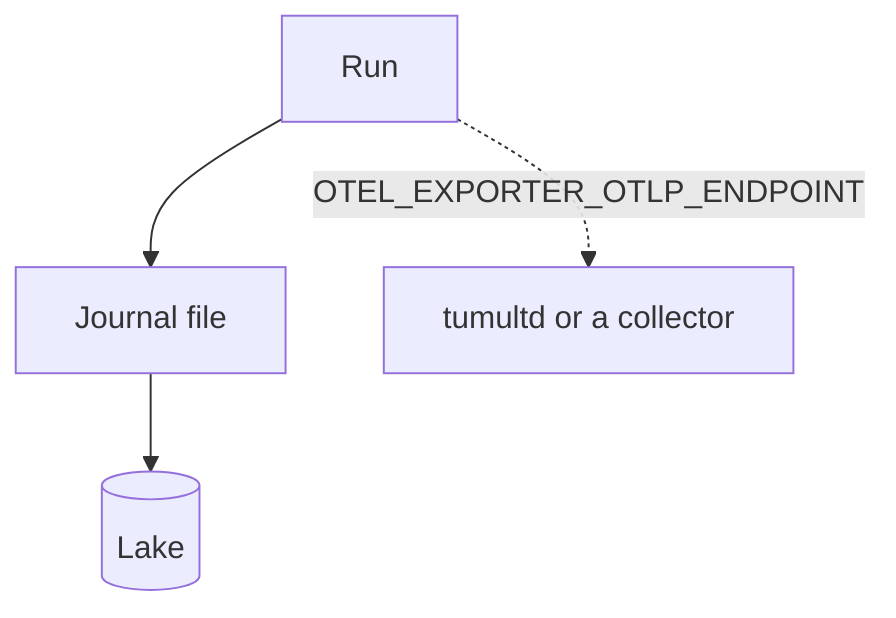

# How a run works

A run takes one experiment file through a fixed order of steps and writes a
journal: the record of every check, fault and cleanup. The order is the same
from the CLI, the MCP server and the daemon.


## The steps

1. **Check the run.** Tumult reads the file, fills in its values and
   validates it. The daemon also needs an
   [execution binding](execution-bindings.md) and any approvals first.
2. **Tell the controls.** Controls hear that the run starts. They run code
   of their own, so treat them as part of the experiment.
3. **Steady state.** The probes of the steady-state hypothesis must hold. If
   one does not, no fault runs and the run ends as `aborted`.
4. **Start load.** A declared load starts (k6 or oha). If it cannot start,
   the run fails before any fault.
5. **Run the method.** The faults and probes run in order. Meanwhile the
   steady-state probes are sampled every second (at most 300 times) and the
   guards are watched.
6. **Measure recovery.** Right after the method, before any cleanup, the
   probes are sampled until they all pass, for at most 30 seconds.
7. **Steady state again.** The load stops. Each objective gets a verdict,
   then the probes must hold once more.
8. **Status and rollback.** Tumult sets the status, then runs the rollbacks
   that the [rollback strategy](#rollback-strategy) asks for.
9. **Return the journal.** The journal gets every result.
10. **Save the evidence.** The journal goes to a file and into the lake.

A rollback is a step you write. Tumult does not guess how to undo a fault.

## How a run ends

| Status | When |
|---|---|
| `completed` | Nothing went wrong. |
| `deviated` | After the method the steady state did not hold, a probe of the method did not hold, a blocking objective was breached, or the load missed its thresholds. |
| `aborted` | The steady state did not hold before the method. No fault ran. |
| `failed` | An action failed, or the load did not start or left no result. |
| `halted` | A guard breached while the fault was on. |
| `interrupted` | You stopped the run. |

A guard breach or a stop ends the method at once. A `process` or `script`
step is killed with its process group, and its error ends in `stopped before
it finished`. A `native` step runs to its end. Rollbacks are never cut short.

A stop is a request: a step that runs may still finish or time out first.
Read the status and every rollback result before you call the target clean.
When the daemon restarts during a run, it tries the rollbacks of that run
again.

## Rollback strategy

Set it with `tumult run --rollback-strategy`.

| Strategy | Rollbacks run |
|---|---|
| `on-deviation` (default) | When the run deviated, aborted or halted, or failed or was stopped after a fault started. |
| `always` | After every run. |
| `never` | Never. You clean up. |

## Baseline mode

Set it with `tumult run --baseline-mode`.

| Mode | What runs |
|---|---|
| `full` (default) | Everything, with the tolerances the file declares. |
| `skip` | The same. Tumult does not derive a statistical baseline in a run. |
| `only` | The steady-state probes, once. No controls, method, load or rollback. The journal is an observation and does not go into the lake. |

## What the journal records

| Field | What it holds |
|---|---|
| `steady_state_before`, `steady_state_after` | Each probe of the steady state, and whether it held. |
| `method_results`, `rollback_results` | Each step: status, output, error and time. |
| `during_result` | Samples per probe while the fault was on: count, mean, min and max duration, error rate, breaches. |
| `post_result` | Recovery: `full_recovery`, `recovery_time_s` and `mttr_s`. |
| `load_result` | What the load tool measured. |
| `objectives` | A verdict per objective: met, breached or inconclusive. |
| `halt` | The guard that stopped the run, and when. |
| `analysis` | Only with an `estimate`: whether your guess was right, as 1 or 0. |

Read these with care:

- `mttr_s` is empty when recovery was not seen, or when an action of the
  method failed.
- Recovery is measured before the rollbacks, so a fault that needs a
  rollback may still be on.
- The probe numbers are how long each probe took, not a value it printed.
- Tumult does not check your data for loss. Write a probe for that.
- Units are in the name: `_ns` is nanoseconds since 1970, `_ms`
  milliseconds, `_s` seconds.

## Where the data goes



- The CLI writes `journal.toon` (`--journal-path` sets another name), then
  imports it into the lake. `--no-ingest` skips the import.
- With `TUMULT_DAEMON_URL` set, the daemon does the import. Without it, the
  CLI opens the lake file itself (`TUMULT_LAKE_PATH`, by default
  `~/.tumult/lake.duckdb`). Only one process can write a lake, so use the
  daemon when one is running.
- Spans, metrics and logs go out only when `OTEL_EXPORTER_OTLP_ENDPOINT` is
  set. See [observability setup](observability-setup.md).

The imported runs are in the tables `experiments`, `activity_results`,
`load_results`, `probe_samples` and `nfr_verdicts`. For example, the failed
steps of each run:

```sql
SELECT e.title, a.name, a.phase, a.error
FROM experiments e
JOIN activity_results a ON a.experiment_id = e.experiment_id
WHERE a.status = 'failed'
ORDER BY a.started_at_ns DESC;
```

Run it with `tumult analyze --query "..."`. Backups and the Parquet archive
are in [data portability](data-portability.md).

## Next

- [Experiment format](experiment-format.md): write the file a run reads.
- [Architecture](../architecture/kronika-architecture.md): the parts that
  store and read the data.
