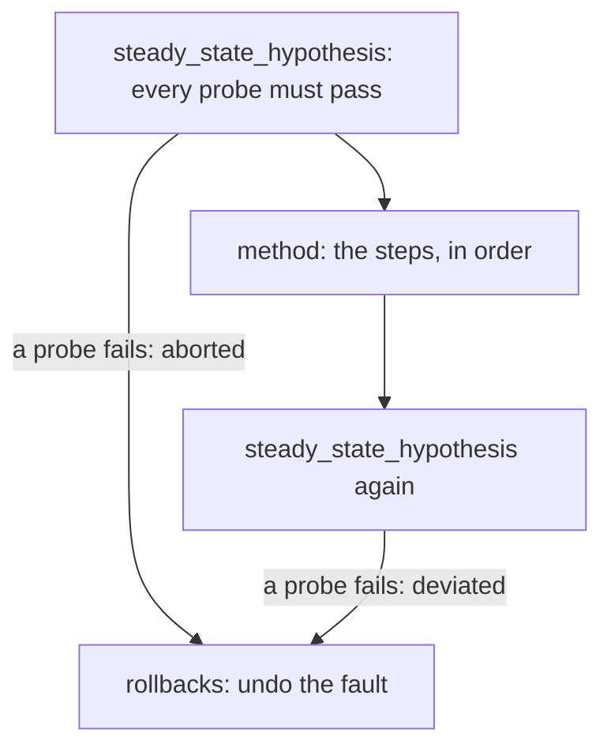
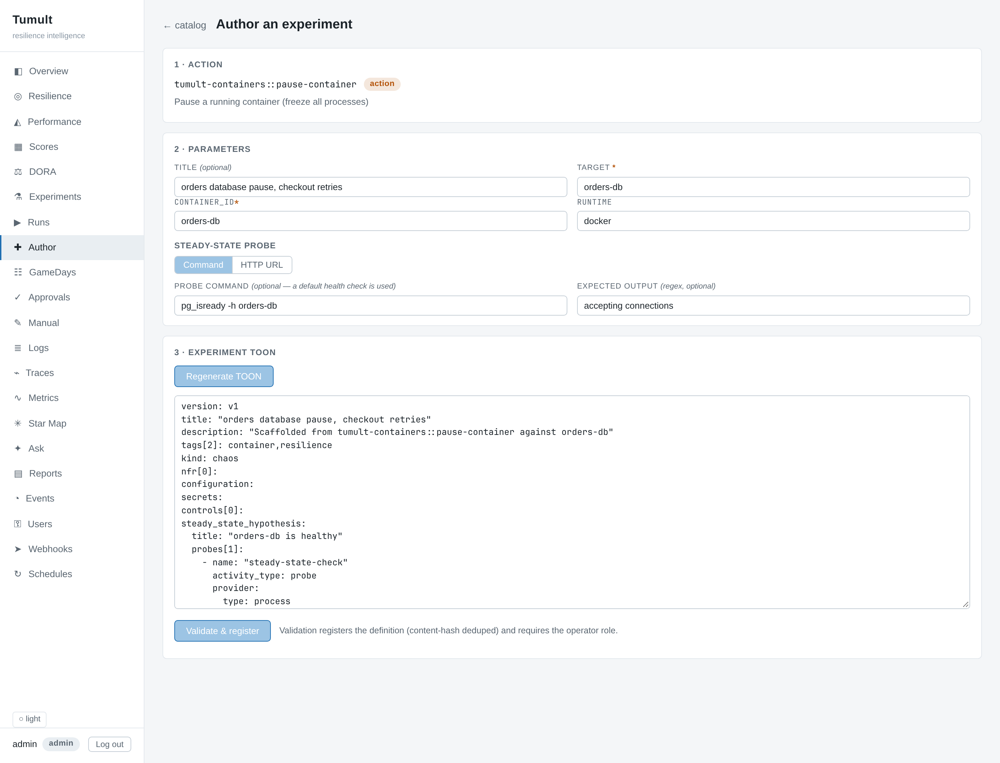

# Experiment format

An experiment is one TOON file. It says what healthy looks like, which fault
to inject, and how to undo it. This page shows a small file, then each part.

## A small experiment

```toon
title: Redis comes back after a restart
description: Restart the Redis container and check that it answers again
kind: chaos
target:
  system: redis
  environment: lab

steady_state_hypothesis:
  title: Redis answers a ping
  probes[1]:
    - name: redis-ping
      activity_type: probe
      provider:
        type: process
        path: docker
        arguments[4]: "exec", "docker-redis-1", "redis-cli", "ping"
        timeout_s: 5.0
      tolerance:
        type: regex
        pattern: "PONG"

method[1]:
  - name: restart-redis
    activity_type: action
    provider:
      type: process
      path: docker
      arguments[2]: "restart", "docker-redis-1"

rollbacks[1]:
  - name: start-redis
    activity_type: action
    provider:
      type: process
      path: docker
      arguments[2]: "start", "docker-redis-1"
```

A run reads the file in this order:



`tumult validate <file>` checks a file without running it. To start one,
`tumult new` asks for a fault and writes a valid file, and `tumult init`
writes a sample.

## The sections

Only `method` is required.

| Section | What it holds |
|---|---|
| `title`, `description`, `tags` | The name and the labels of the run |
| `kind` | `chaos` (default), `performance` (`load` is the same), `robustness`, `dr`, `security` |
| `target` | The system under test: `system` (required), `technology`, `environment`, `criticality`, `namespace`, `version` |
| `steady_state_hypothesis` | A `title` and the `probes` that say what healthy is |
| `method` | The steps that inject and observe the fault |
| `rollbacks` | The steps that undo the fault |
| `guards` | Probes read during the method. A breach stops the method, runs the rollbacks and ends the run `halted` |
| `configuration`, `secrets` | Values for the steps, see [Variables and secrets](variables-and-secrets.md) |
| `controls` | Hooks called at each event of the run. A `process` hook reads the event from `TUMULT_CONTROL_EVENT`. A failing hook is logged and the run goes on |
| `nfr`, `rto_target_s`, `rpo_target_s` | [Objectives](objectives.md) the run is checked against. A `dr` run needs `rto_target_s` |
| `recovery` | How long the run watches for recovery after the method: `window_s` (default 30) and `interval_s` (default 1). See [Objectives](objectives.md) |
| `load` | Traffic during the method, see [Load testing](load-testing-guide.md) |
| `estimate` | Your guess before the run: `expected_outcome` (`recovered`, `deviated`, `unaffected`), `expected_recovery_s`, `confidence` and more |
| `blast_radius`, `max_concurrent_faults` | A note for the audit, and a cap on background faults at once |
| `regulatory` | The frameworks and requirements the run gives evidence for, and the `tester` (`name`, and `kind` `internal` or `external`). See [Regulatory mapping](../regulatory-mapping.md#tag-an-experiment) |
| `version` | `v1`, the default |
| `baseline` | Kept so old files stay valid. A run does not use it |

`target.version` is the build the run measures. `tumult run --target-version`
sets it too. Without either, the run reads it from the spans of the target.

A key that Tumult does not know is an error, and so is a key written twice in
one object.

## Steps

Each entry of `method`, `rollbacks` and `steady_state_hypothesis.probes` is a
step.

| Field | What it does |
|---|---|
| `name` | A unique name. The journal shows it |
| `activity_type` | `action` changes the system, `probe` reads it |
| `provider` | How the step runs, see the next table |
| `tolerance` | What a probe must read |
| `pause_before_s`, `pause_after_s` | Seconds to wait before or after the step |
| `background` | `true` runs the step while the next steps run |

| Provider `type` | Fields | Runs |
|---|---|---|
| `process` | `path`, `arguments`, `env`, `timeout_s` | A program on this machine. Use `curl` to probe an HTTP endpoint |
| `script` | `plugin`, `function`, `arguments`, `timeout_s` | An action of a script plugin, through `/bin/sh` (not on Windows) |
| `native` | `plugin`, `function`, `arguments` | A function built into Tumult: `tumult-ssh`, `tumult-net`, `tumult-kubernetes`, `tumult-cloud`, `tumult-windows` |

A script plugin is found in `./plugins/` of the current directory, then in
`~/.tumult/plugins/`, then in each folder of `TUMULT_PLUGIN_PATH`.
`tumult discover` lists what it finds. Each argument reaches the script as an
environment variable: `dns_domain` becomes `TUMULT_DNS_DOMAIN`.

A step runs on the machine that runs Tumult. To reach a remote host, use
[tumult-ssh](../plugins/tumult-ssh.md) (function `execute`). For a container,
use `docker exec` or the `tumult-containers` plugin, and for a pod,
[tumult-kubernetes](../plugins/tumult-kubernetes.md).

## Tolerances

| `type` | Fields | Passes when the output |
|---|---|---|
| `exact` | `value` | equals the value |
| `range` | `from`, `to` | is a number in the range |
| `regex` | `pattern` | matches the pattern |

A probe outside its tolerance is a failed step, with the error `the output is
outside the tolerance`. What that does depends on where the probe is:

| The probe is in | The run |
|---|---|
| The hypothesis, before the method | ends `aborted` |
| The method | ends `deviated`; rollbacks run and recovery is measured |
| The hypothesis, after the method | ends `deviated` |
| The rollbacks | counts a failed rollback |

A failed action in the method ends the run `failed`: the fault was not
applied as written.

## Rollbacks

`tumult run --rollback-strategy` says when `rollbacks` run:

| Strategy | Rollbacks run |
|---|---|
| `on-deviation` (default) | When the run deviates, or fails or stops after a fault started |
| `always` | After every run |
| `never` | Never |

## Objectives

`nfr`, `rto_target_s` and `rpo_target_s` set the numbers a run must meet,
such as a p95 latency under 250 ms. See [Objectives](objectives.md).

## Write it in the web UI

The **Author** page builds the file for you from a fault of the plugin
catalog, then validates and registers it.



## Next

- [Load testing](load-testing-guide.md): add traffic to a run.
- [Examples](https://github.com/mwigge/tumult/tree/main/examples): one file
  per fault, such as `examples/api-saturation.toon` for a robustness run.
