# Forecasting and run impact

Tumult forecasts two things from the telemetry in the lake:

- **Where a metric is heading.** `GET /api/forecast` returns the recent
  series of a metric with a band for the next steps.
- **What a run did to the system.** `GET /api/runs/{id}/impact` compares
  each probe with what it would have read without the fault, and reports
  how far it moved and how long it took to come back. The run page shows
  this as the **Impact** panel.

The built-in model needs no network and no model weights. A sidecar with
a larger model is optional. Every answer names the model that made it.



## Read the band

A forecast gives three values for each future step: the 10th, 50th and
90th percentile. The chart draws the median as a dashed line and the 10
to 90 range as a shaded **80 % band**.

Read the band as: if the series keeps behaving as it did, about eight of
ten values fall inside it. It is not a promise and not an SLO. A value
outside the band is unusual for recent history, which is what a fault
should cause. The band grows wider the further ahead it looks.

## Read the impact

Impact is how far a reading is from the median, counted in half band
widths:

```text
impact = (observed − median) / ((upper − lower) / 2)
```

`0` is on the median, `±1` is on the edge of the band, `4` is far
outside. The panel shows the mean and the peak during the fault, and the
share of samples outside the band.

A probe that always reads the same value (`200`, `true`) has a band with
no width. Tumult then uses a small floor for the band and marks it
`degenerate_band: true`. Read such an impact as "the probe left its flat
line": the direction and the timing are real, the size is not.

## Read the recovery

A probe has recovered at the first step after the fault from which it
stays inside the band for three samples in a row. `recovery_time_s` is
the time from the end of the fault to that step.

| `recovery_status` | Meaning |
|---|---|
| `recovered` | No probe stayed out and at least one came back. The time is that of the slowest probe |
| `unrecovered` | At least one probe never came back |
| `undetermined` | Probes were sampled too few times after the fault to tell |
| `not_measurable` | No probe could be compared, for example it had no samples during the fault |

The forecast for a run comes from the samples before the fault. A run
with no samples before the fault uses its settled samples after the fault
instead (`reference: post_backcast`). If the system had not recovered by
the end of the run, that view understates the impact.

## The forecast API

| Parameter | Default | Meaning |
|---|---|---|
| `metric` | required | A metric name from `/api/metrics` |
| `target` | all | One target system |
| `env` | your scopes | One environment; `403` outside your scopes |
| `range` | `24h` | History to learn from: `1h`, `6h`, `24h`, `7d`, `14d`, `30d`, `90d` |
| `horizon` | `24` | Steps to forecast, 1 to 1024 |

Both endpoints need the Viewer role. `404` means the metric or run is
unknown or has no samples. Forecasts are cached in the lake, so asking
again within one step costs nothing.

## Add the sidecar

The sidecar `tumult-forecastd` runs Mistral's Timestral model. Point the
daemon at it:

```sh
TUMULTD_FORECAST_URL=http://forecastd:8700 \
  docker compose -f docker/docker-compose.kronika.yml --profile forecast up
```

On Kubernetes, apply `deploy/k8s/tumult-forecastd.yaml` and set
`TUMULTD_FORECAST_URL=http://tumult-forecastd:8700` on `tumultd`.

When the sidecar is unset, down or busy, the daemon answers with the
built-in Holt-Winters model and says why in
`provenance.fallback_reason` (`unreachable`, `timeout`, `bad_response`,
`rejected`, `busy` or `circuit_open`). After a failure the daemon skips
the sidecar for `TUMULTD_FORECAST_COOLDOWN_S` seconds (default `30`).

Start with the built-in model. Try the sidecar when your series have
patterns Holt-Winters cannot follow, and compare both on your own data:
the `provenance` of each answer makes that easy.

Install, weights, offline hosts and logs are in the
[sidecar README](https://github.com/mwigge/tumult/blob/main/forecastd/README.md).

### Size the sidecar

Measured with `Timestral-5M` on a CPU with four threads
(`FORECASTD_THREADS`), one forecast inside the sidecar:

| Context steps | Horizon | Median time |
|---|---|---|
| 512 | 24 | 25 ms |
| 4,096 | 96 | 105 ms |
| 32,768 | 24 | 508 ms |

The model loads in about two seconds and holds about 300 MB, so a 1 GB
memory limit is enough. At start the sidecar copies the weights to its
temporary directory to check them. Size the `emptyDir` of the Kubernetes
manifest to the model: 512Mi for `5M` and `28M`, 1Gi for `123M`, 2Gi for
`209M`. Only the 5M model was measured.

## Limits

- Under eight points of history the forecast is flat and marked
  `insufficient_history: true`. Short runs often show this.
- The band learns from the recent past. A deploy or an incident in that
  window counts as normal.
- Impact is not a cause. Anything else that happened during the fault
  counts too.
- Recovery is measured to one sampling step.

## Next

- [Performance verdicts](performance-regression.md): is a new version slower?
- [Star Map](star-map.md): where the evidence sits.
