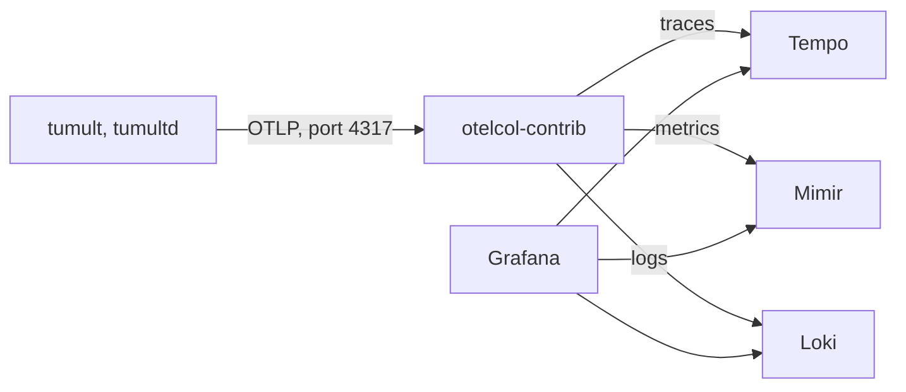

# Grafana stack

One command starts an OpenTelemetry Collector, Tempo, Mimir, Loki and a
Grafana with a dashboard for Tumult. It is a reference to explore on a
laptop, not a production setup: one node each, no auth, no TLS.



The Collector config is `collector/otel-collector-grafana.yaml`.

## Run it

```bash
docker compose -f docker/docker-compose.grafana-full.yml up -d
```

After about 30 seconds, check the parts:

```bash
curl -s http://localhost:13200/ready   # Tempo
curl -s http://localhost:19009/ready   # Mimir
curl -s http://localhost:13100/ready   # Loki
curl -s http://localhost:23133/        # Collector health
```

Run an experiment against the Collector. `tumultd` reads the same
variable.

```bash
OTEL_EXPORTER_OTLP_ENDPOINT=http://localhost:4317 tumult run examples/cpu-stress.toon
```

Open Grafana at `http://localhost:13001` (anonymous Viewer; the admin
login is `admin` / `tumult`). The dashboard **Grafana Full Stack
(reference)** shows runs by status, action p95, recent traces and logs.
**Explore** queries Tempo, Mimir and Loki.

This stack takes host ports `4317` and `4318`, so do not run it next to
the observability stack. Stop it with
`docker compose -f docker/docker-compose.grafana-full.yml down -v`.

## Metric names in Mimir

Prometheus allows no dots, so the Collector renames metrics on the way
to Mimir:

| Tumult sends | Mimir and PromQL show |
|---|---|
| `tumult.experiments.total` | `tumult_experiments_total` |
| `tumult.actions.total`, `tumult.probes.total` | `tumult_actions_total`, `tumult_probes_total` |
| `tumult.hypothesis.deviations.total` | `tumult_hypothesis_deviations_total` |
| `tumult.rollbacks.total`, `tumult.plugin.errors.total` | `tumult_rollbacks_total`, `tumult_plugin_errors_total` |
| `tumult.action.duration` (seconds) | `tumult_action_duration_seconds_bucket`, `_sum`, `_count` |
| `tumult.probe.duration`, `tumult.experiment.duration` | `tumult_probe_duration_seconds_*`, `tumult_experiment_duration_seconds_*` |
| `resilience.store.size_bytes` | `resilience_store_size_bytes` |

Dots become underscores, a counter ends in one `_total`, and a histogram
in seconds gains `_seconds`. Labels keep their names with underscores,
such as `resilience_outcome_status`. `service.name` becomes the `job`
label. List the real names with
`curl -s http://localhost:19009/prometheus/api/v1/label/__name__/values`.

```promql
# Runs by outcome
sum by (resilience_outcome_status) (tumult_experiments_total)

# Action p95 per plugin
histogram_quantile(0.95,
  sum by (le, resilience_plugin_name) (rate(tumult_action_duration_seconds_bucket[$__rate_interval])))
```

## Logs in Loki

Loki indexes only `service_name` and `deployment_environment`. The
`resilience.*` attributes are structured metadata, with underscores:
filter on them after the stream selector. The audit events are JSON, so
add `| json` to read their fields.

<!--  -->

```logql
# Logs of one run
{service_name="tumult"} | resilience_experiment_id="418efc30-..."

# Audit events as text
{service_name="tumult"} | json | line_format "{{.event}} {{.status}}"

# Failed runs only
{service_name="tumult"} | json | status="failed"
```

<!--  -->

Each log line carries its `trace_id`, so Grafana jumps from a span in
Tempo to its log lines.

## Traces in Tempo

```traceql
# Failed runs
{ name = "resilience.experiment" && span.resilience.outcome.status = "failed" }

# Runs where the steady state did not hold
{ name = "resilience.experiment" && span.resilience.outcome.hypothesis_met = false }

# Slow actions
{ name = "resilience.action" && duration > 5s }
```

## Limits

- No auth and no TLS. Do not expose these ports.
- Single node, files on disk: Loki keeps 7 days, Tempo 24 hours.
- Versions are pinned and tested together: otelcol 0.157.0, Tempo 2.9.4,
  Mimir 3.1.4, Loki 3.6.2, Grafana 12.4.6.

For production, use the vendors' Helm charts with object storage and
auth, and keep `collector/otel-collector-grafana.yaml` as the routing
reference.

## Next

- [Telemetry reference](telemetry-reference.md): every span and metric.
- [Observability setup](observability-setup.md): other backends.
