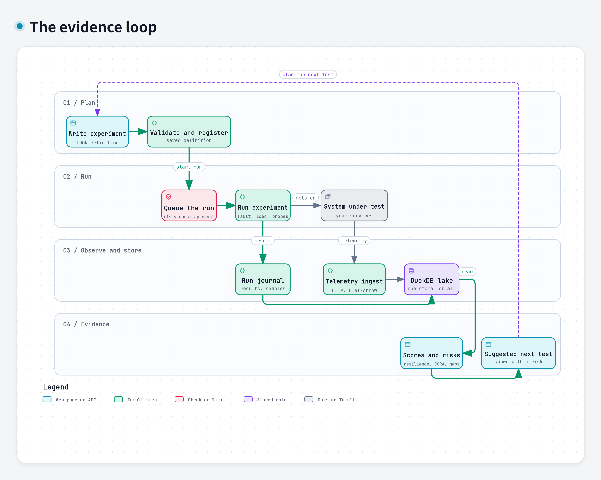

# Guides

Tumult collects resilience evidence, stores it, and tells you what it means.
The guides follow that loop.

New here? Start with the [Platform Walkthrough](platform-walkthrough.md).

## 1. Create evidence

| Guide | What you learn |
|---|---|
| [Experiment Format](experiment-format.md) | How to write an experiment file |
| [Execution Flow](execution-flow.md) | The five phases of a run |
| [CLI Reference](cli-reference.md) | Every command |
| [Load Testing Guide](load-testing-guide.md) | Ramp, spike and soak tests with k6 and oha |
| [Experiment Scheduling](scheduling.md) | Run experiments and GameDays on a timer |
| [Autopilot](autopilot.md) | Automatic fault injection behind a policy |
| [Windows Faults](windows-faults.md) | Faults on Windows hosts |

## 2. Send and store telemetry

| Guide | What you learn |
|---|---|
| [Observability Setup](observability-setup.md) | OTLP, OTel-Arrow, collectors and backends |
| [OpenTelemetry Auto-instrumentation](otel-autoinstrumentation.md) | Name your services so Tumult can match them |
| [Entity Events](entity-events.md) | Track what exists and for how long |
| [Logging](logging.md) | Structured JSON logs |
| [Grafana Stack](grafana-stack.md) | A ready Tempo, Mimir and Loki setup |
| [SigNoz Bulk Import](signoz-bulk-import.md) | Load old spans into SigNoz |
| [Data portability and recovery](data-portability.md) | Export, back up and restore |

## 3. Read what the evidence says

| Guide | What you learn |
|---|---|
| [Star Map](star-map.md) | One graph from organisation to workload |
| [DORA Coverage and Maturity Score](dora-score.md) | Coverage per article and a 1 to 5 level |
| [Performance Regression](performance-regression.md) | Is the new version slower? |
| [Forecasting and run impact](forecasting.md) | Expected ranges and how far a run pushed them |
| [Analytics Guide](analytics-guide.md) | SQL over your results |
| [Topology](topology.md) | Service maps and where to inject next |
| [ChaosGraph](chaosgraph.md) | The knowledge graph for agents |

## 4. Work with AI agents

| Guide | What you learn |
|---|---|
| [MCP Guide](mcp-guide.md) | The 40 tools and how to connect |
| [Agentic Quickstart](agentic-quickstart.md) | Inject faults into AI agents |
| [Agentic Scenarios](agentic-scenarios.md) | Write scenario packs |
| [Agentic Live Clients](agentic-live-clients.md) | Faults for Claude Code, Codex, OpenCode and Copilot traffic |
| [Agentic Observability](agentic-observability.md) | Spans and metrics for agent runs |
| [Agentic Cross-Client Observability](agentic-cross-client-observability.md) | One telemetry schema across clients |
| [Agentic Recommendations](agentic-recommendations.md) | Let a local agent suggest experiments |
| [Token Efficiency](token-efficiency.md) | Keep agent context small |

## 5. Run it for real

| Guide | What you learn |
|---|---|
| [Platform Walkthrough](platform-walkthrough.md) | Every page of the web UI, with pictures |
| [Production Deployment](production-deployment.md) | Binaries, containers and hardening |
| [Execution bindings](execution-bindings.md) | Which targets the daemon may touch |
| [Quality and release checks](quality-and-release.md) | The checks before a release |
| [Testing policy](testing.md) | What a test must prove |
| [Functional hardening review](hardening-review.md) | The 2.22.0 review and its limits |
