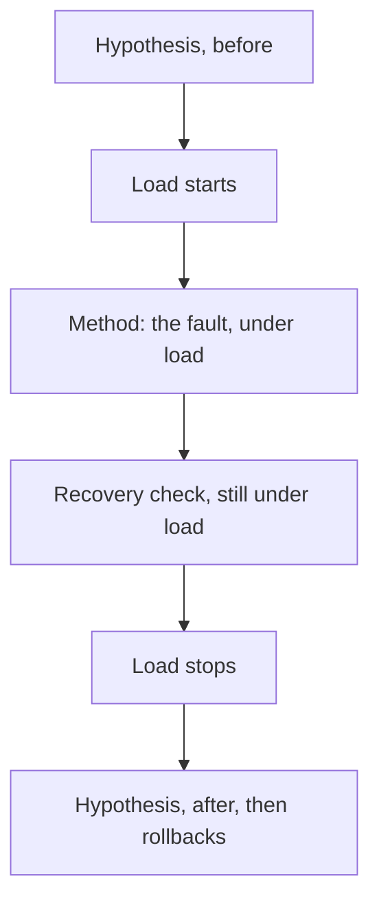
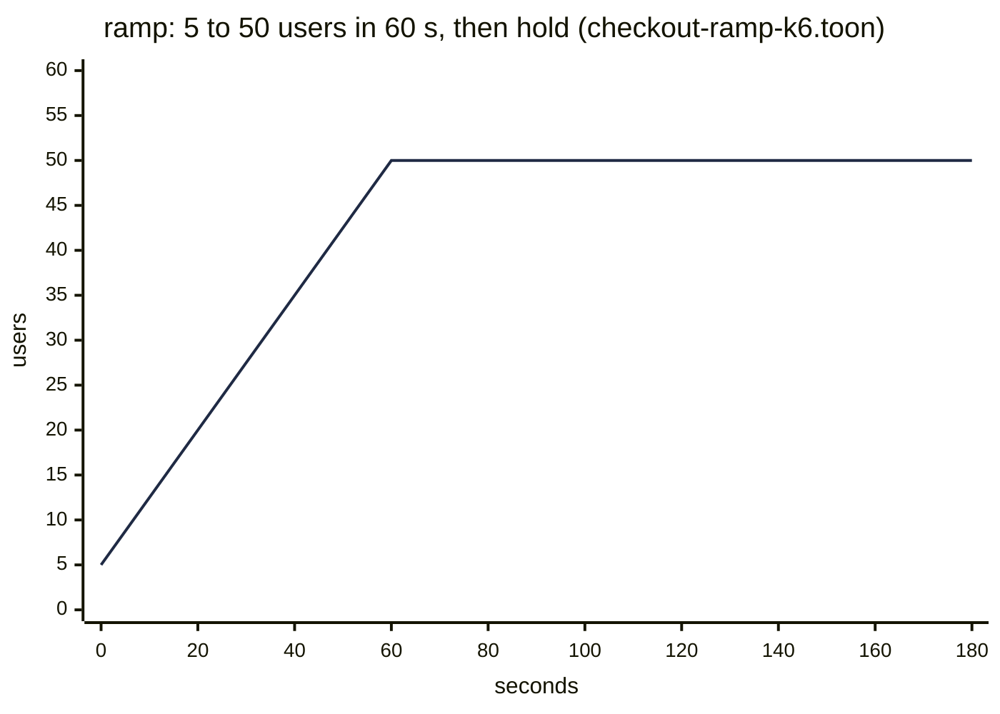
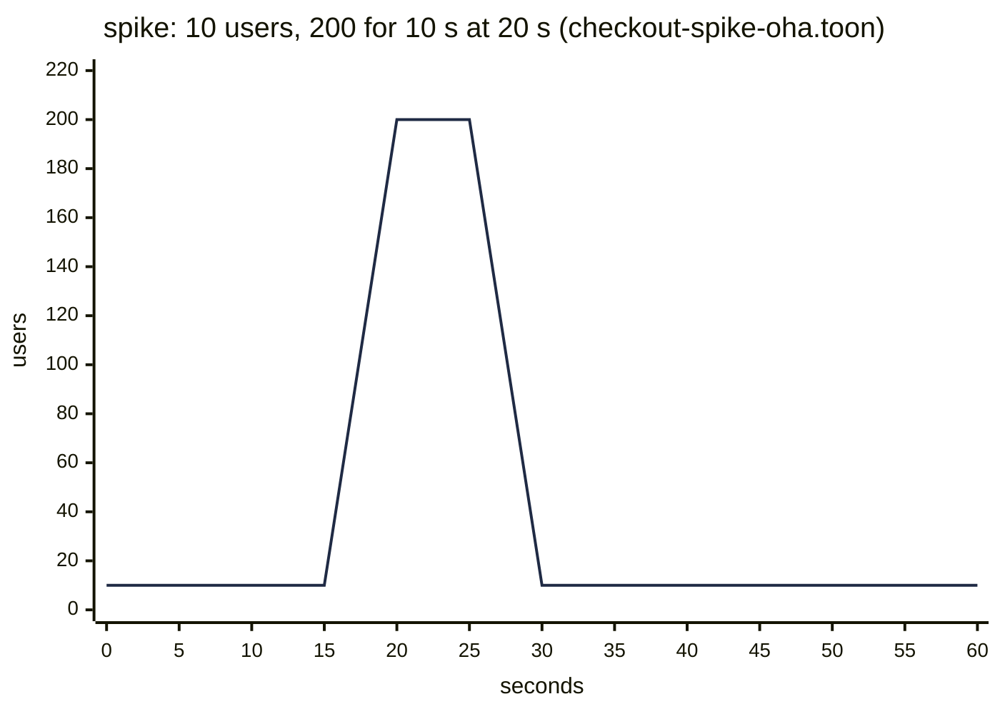
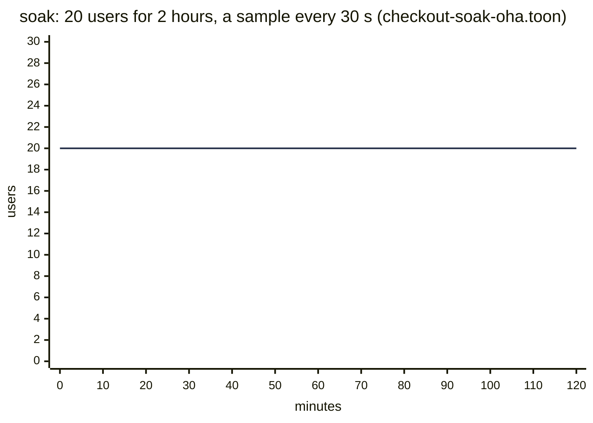

# Load testing

A fault that does no harm at idle can break a service under traffic. Add a
`load` section to an experiment, and Tumult runs k6 or oha while the fault is
on and keeps the numbers with the run.


## Add load to an experiment

```toon
load:
  tool: oha
  script: http://127.0.0.1:8080/checkout/1
  vus: 20
  duration_s: 120
  thresholds:
    error_rate: 0.02
```

| Field | Meaning |
|---|---|
| `tool` | `k6` or `oha` |
| `script` | The k6 script, or the URL that oha calls |
| `vus` | Virtual users (default 10) |
| `duration_s` | Seconds of load (default 30). A `profile` needs it |
| `thresholds` | Bounds for oha: `latency_p50_ms`, `latency_p95_ms`, `latency_p99_ms`, `error_rate` (upper) and `throughput_rps` (lower). k6 uses the thresholds of its script and ignores these, with a warning |
| `profile` | The shape of the traffic, see below |

The same from the command line, which replaces the `load` of the file:

```bash
tumult run experiment.toon --load oha --load-script http://127.0.0.1:8080/health --load-vus 20 --load-duration 60s
tumult run experiment.toon --load none   # run without the load of the file
```

## When the load runs



Make the method as long as `duration_s`. When the method ends first, the run
does not wait: k6 gets 10 seconds to end, and oha stops after the window it
is in. The windows that never ran make the run `deviated`.

## Traffic profiles

| `type` | Fields | Shape |
|---|---|---|
| `ramp` | `start_vus`, `ramp_up_s` | From `start_vus` up to `vus` in `ramp_up_s`, then `vus` |
| `spike` | `peak_vus`, `after_s`, `hold_s` | `vus`, then `peak_vus` for `hold_s` after `after_s`, then `vus` again |
| `soak` | `sample_interval_s` | `vus` for the whole (long) run, with a sample every `sample_interval_s` |







`tumult validate` refuses a ramp longer than the run, a spike that does not
fit or does not rise above `vus`, and a sample interval under 1 second or
longer than the run. The three examples are in the `examples/` folder.

## k6 or oha

| | k6 | oha |
|---|---|---|
| Input | A script | One URL |
| Samples | One summary at the end | One per window (a soak: one per `sample_interval_s`) |
| Thresholds | In the script | The `thresholds` of the load section |
| Binary | `TUMULT_K6_BINARY`, default `k6` | `TUMULT_OHA_BINARY`, default `oha` (1.x) |

oha runs one process per window and waits for the requests still in flight,
so a slow answer is measured, not dropped. A request gives up after the length
of its window (at most 30 seconds); `TUMULT_OHA_REQUEST_TIMEOUT_S` sets
another limit. The error rate counts transport errors and answers outside
2xx and 3xx.

## What the load does to the run

| The load | The run |
|---|---|
| Did not start, for example because the binary is missing | `failed` before the method, with no journal |
| Left no result, or sent no request | `failed` |
| Missed a threshold, or did not run its whole plan | `deviated` |
| Met its thresholds | Keeps its status |

A window in which nothing answered is recorded, but is no deviation by
itself. Declare `thresholds.error_rate` (oha) or a k6 threshold when it should
be. A guard halt or Ctrl-C stops the load before the rollbacks; the result is
marked `execution.aborted: true` and never meets its thresholds.

## Where the numbers go

- The journal keeps the `load_result`, with planned and completed windows.
- The lake keeps each oha window as `probe_samples` series in the `during`
  phase: `load.throughput_rps`, `load.latency_p50_ms`, `load.latency_p95_ms`,
  `load.latency_p99_ms`, `load.error_rate` and `load.window_s`.
- [Objectives](objectives.md) read the `load.*` metrics, and the
  [performance verdict](performance-regression.md) compares the p95 of each
  window between builds.

To start k6 as a step of the method instead, see the
[tumult-loadtest](../plugins/tumult-loadtest.md) plugin.
