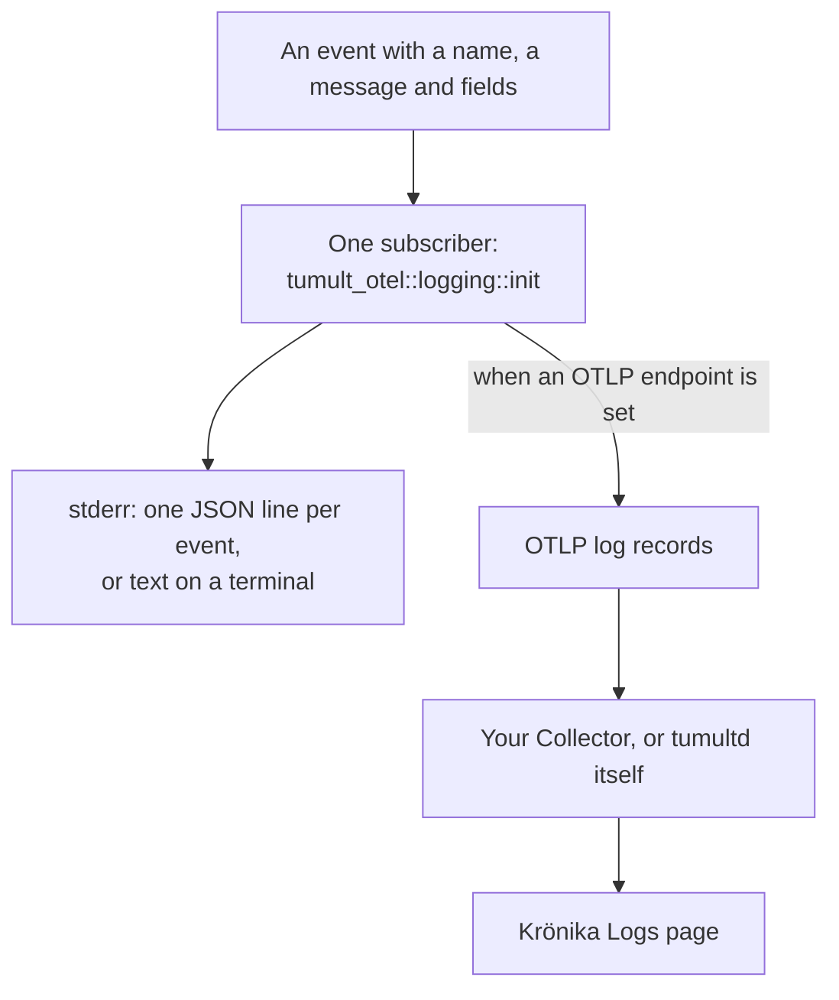
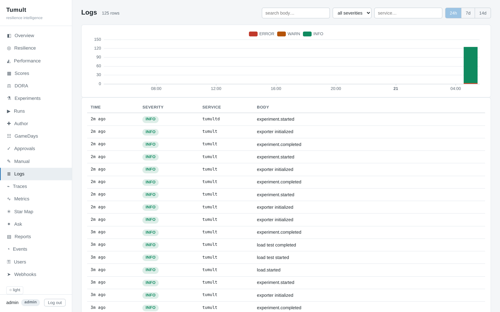

# Logging

Every Tumult binary writes its diagnostics as structured events to stderr.
This page shows how to read and configure them, and the rules for a Tumult
developer who adds an event. Command results (`tumult run` output, reports,
the MCP stream) go to stdout; logs never do.





## Read a log line

```json
{"timestamp":"2026-11-13T09:14:02.118334Z","level":"WARN","target":"tumult_cli::commands::events","event.name":"cli.daemon.unreachable","message":"daemon unreachable, writing the store directly","service.name":"tumult","service.version":"3.0.2","url.full":"http://127.0.0.1:4318","error.message":"connection refused"}
```

| Key | Meaning |
|---|---|
| `timestamp` | RFC 3339, UTC, microseconds |
| `level` | `TRACE`, `DEBUG`, `INFO`, `WARN` or `ERROR` |
| `target` | the Rust module of the event |
| `event.name` | the stable name of the event; match alerts and tests on it |
| `message` | a constant sentence |
| `service.name`, `service.version` | the binary and its version |
| `deployment.environment.name` | when it is configured |
| `trace_id`, `span_id` | inside an OpenTelemetry span |
| `spans` | the enclosing `tracing` spans, outermost first |

Every other key is a field of the event. A field that has one of the names
above is written as `field.<name>`. One event is one line; control
characters are escaped; numbers and booleans keep their JSON type. A string
longer than 8 KiB is cut and ends with `...[truncated N bytes]`, the same on
stderr and in OTLP. A closed stderr never stops the process.

## Configure

| Variable | Effect |
|---|---|
| `RUST_LOG` | The level filter (`debug`, `info,tumult_ingest=debug`). It replaces the default. A bad value logs `logging.filter.invalid` and keeps the default. |
| `TUMULT_LOG_FORMAT` | `json` or `text`. Unset: text on a terminal, JSON otherwise. An unknown value gives JSON and `logging.format.invalid`. |
| `NO_COLOR` | No colour in the text format. |
| `OTEL_RESOURCE_ATTRIBUTES` | `deployment.environment.name=...` goes on every line. |
| `TUMULT_ENVIRONMENT` | The environment when `OTEL_RESOURCE_ATTRIBUTES` sets none. |
| `OTEL_SERVICE_NAME` | Replaces `service.name` (`tumultd`, or `tumult` for `tumult` and `tumult-mcp`). |

Without `RUST_LOG`, `tumultd` and `tumult-net-proxyd` log at `info`, and
`tumult` and `tumult-mcp` at `warn` (`info` when an OTLP endpoint is set). The
default filter caps the HTTP, gRPC, TLS and OpenTelemetry libraries at `warn`,
and the exporter's own events are never exported. `tumultd` exports to its own
ingest, so the events of its ingest and store path stay on stderr only.

## When a process ends badly

An error that ends a process is its last event: `process.fatal`, with
`error.message`, and a non-zero exit code. A panic is `process.panic` with
`exception.message`. Both reach stderr even when the filter hides them
(then as one JSON line). If logging cannot start, the binary writes one `logging.init.failed`
line and exits. The standard panic text and backtrace follow only when
`RUST_BACKTRACE` is set and not `0`.

## Child processes and shutdown

- `tumult-net-proxyd` logs JSON to a private `stderr.log` file while it
  runs, under `$XDG_RUNTIME_DIR` or the temp folder. The file stops at 1 MiB
  with one `logging.output.limit_reached` warning, and is removed when the
  proxy stops.
- Output of plugin scripts and agent CLIs is data, not log: it is captured
  and returned to the caller. A script's output is cut at 8 MiB.
- A stopping `tumultd` exports its last spans, metrics and logs and waits up
  to 15 seconds (`daemon.telemetry.flush.timed_out` after that).

## Event names and fields

An event name is lowercase and dotted, `component.thing.happened`, for
example `cli.journal.skipped`. The first part is the component (`daemon`,
`auth`, `lake`, `cli`, `mcp`, `net`, `runs`, ...); the last says what happened
(`failed`, `skipped`, `rejected`, `timed_out`). The message is constant; what
varies goes in fields. Use the OpenTelemetry name where one exists:

| Field | Use |
|---|---|
| `error.message`, `error.type` | the error (full chain) and a short class such as `io` or `timeout` |
| `exception.message` | the payload of a caught panic |
| `resilience.experiment.id`, `resilience.experiment.name`, `resilience.run.id`, `resilience.outcome.status` | control-plane ids, as on the spans |
| `user.name`, `client.address` | the user and the peer of a request |
| `server.address`, `server.port`, `url.full`, `url.path` | where a call goes; URLs are always sanitized |
| `http.request.method`, `http.response.status_code`, `http.response.body.size` | HTTP calls |
| `file.path`, `config.key`, `config.value` | a file, a setting, and its value (never a secret) |
| `process.pid`, `process.exit.code`, `process.executable.name`, `process.stream` | child processes |
| `gen_ai.tool.name`, `db.namespace`, `signal`, `attempt`, `max_attempts` | tools, databases, signals, retries |
| `*_ms`, `*_s`, `*_bytes` | durations and sizes carry their unit |

## For Tumult developers

**Never log** passwords, tokens, keys, cookies, `Authorization` headers,
query strings, request or response bodies, prompts, model output, the output
of child processes, or SQL and Cypher text. Log the name of a setting, a
size, or a bounded class instead. Pass every URL through
`logging::sanitize_url`, and an error text that may quote one through
`logging::redact_url`; their rustdoc gives the exact rules.

**Add an event** test first. `tumult_otel::logging::testing::capture_json`
runs a closure and returns what it logged (`LogCapture` in async tests):

```rust
let logs = capture_json(tracing::Level::WARN, || {
    journal_skipped(Path::new("a.toon"), &error);
});
assert_eq!(logs.named("cli.journal.skipped")[0]["file.path"], "a.toon");
```

Give the event a name, a constant message and fields from the table, then run
`python3 scripts/check-log-messages.py`. It rejects old field names (`error`,
`path`, `run_id`, ...), span names that are not dotted, and an
`error.message` built with `format!`. Pick `ERROR` when work was lost, `WARN`
when a failure was handled or a setting is unsafe, `INFO` for lifecycle,
`DEBUG` for detail. An error is returned or logged, never dropped.

**Do not print.** Clippy denies `println!`, `eprintln!` and `dbg!`; the few
places whose output is the product of a command carry an `#[allow]` with a
comment. `tumult` prints results with the `outln!`, `out!` and `errln!` macros
of `tumult_cli::output`, which survive a closed pipe. The crates listed in
`DEFERRED` in `scripts/check-log-messages.py` still log events without names.
