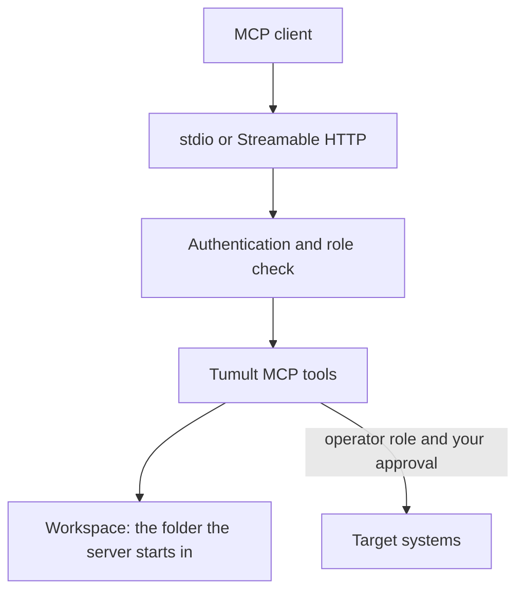

# MCP guide

Tumult has a Model Context Protocol server with 40 tools. An AI agent uses
them to find faults, write and run experiments, read journals and ask the
lake. Roles and safety labels keep it from doing more than you allow.



## Start the server

```bash
tumult mcp serve                                   # stdio, for a local client
tumult mcp serve --transport http --port 3100      # Streamable HTTP on 127.0.0.1
TUMULT_MCP_TOKEN='replace-with-a-secret' \
  tumult mcp serve --transport http --host 0.0.0.0 --port 3100
```

Most clients take a block like this for the stdio server:

```json
{ "mcpServers": { "tumult": { "command": "tumult", "args": ["mcp", "serve"] } } }
```

File arguments are read from the folder the server starts in; a path that
leaves it is refused. `/health` answers on the next port (3101 by default,
`--health-port` sets it).

## The tools

| Group | Tools |
|---|---|
| Experiments | `tumult_run_experiment`, `tumult_validate`, `tumult_discover`, `tumult_create_experiment`, `tumult_list_experiments` |
| Journals and analytics | `tumult_read_journal`, `tumult_list_journals`, `tumult_analyze`, `tumult_analyze_store`, `tumult_store_stats`, `tumult_query_traces`, `tumult_report`, `tumult_compliance`, `tumult_trend` |
| GameDays | `tumult_gameday_run`, `tumult_gameday_analyze`, `tumult_gameday_create`, `tumult_gameday_list` |
| Intelligence | `tumult_recommend`, `tumult_coverage`, `tumult_agents`, `tumult_fault_catalog`, `tumult_scaffold_experiment` |
| Agentic testing | `tumult_agentic_list_scenarios`, `tumult_agentic_smoke`, `tumult_agentic_run_experiment` |
| ChaosGraph | `tumult_chaosgraph_query`, `tumult_chaosgraph_neighbors`, `tumult_chaosgraph_coverage_gaps`, `tumult_chaosgraph_cypher` |
| Topology | `tumult_topology_import`, `tumult_topology_map`, `tumult_compliance_lineage`, `tumult_recommend_injection` |
| Autopilot | `tumult_autopilot_run`, `tumult_autopilot_status`, `tumult_autopilot_respond`, `tumult_autopilot_export`, `tumult_autopilot_notify` |
| Access | `tumult_whoami` |

Thirty tools return `structuredContent` and advertise its `outputSchema`. Ask
`tools/list` when you connect, so the client follows the server you run and
not this page.

`tumult_trend` takes the metrics of [`tumult trend`](cli-reference.md#tumult-trend),
the RTO and RPO ones too. The point of a run that did not recover has
`recovered: false` and a `bound`. `runs_without_outage` and
`runs_not_measured` count the runs that are no point. The verdict reads a
smaller time and a larger margin as `improving`.

`tumult_run_experiment` stores its journal in the lake by default and says if
that worked. `no_ingest` turns it off, and `store_path` picks another store.
It and `tumult_gameday_run` refuse to overwrite an earlier journal unless
`force` is set. Workspace files are also resources: `tumult://journal/{file}`,
`tumult://experiment/{file}` and `tumult://gameday/{file}`.

## Tokens and roles

Without a token the server is open, and only on loopback. Once a token is set,
every request needs one, `tools/list` included:

- Over HTTP, send `Authorization: Bearer <token>`. A request without it gets a
  401.
- Over stdio, pass `_meta.authorization: "Bearer <token>"` in the request
  params.

`TUMULT_MCP_TOKEN` (or `--token`) sets one operator token. For more tokens and
roles, point `TUMULT_MCP_AUTH_CONFIG` (or `--auth-config`) at a file like
this:

```toml
[[tokens]]
token = "a-long-random-viewer-token"
role = "viewer"

[[tokens]]
token = "a-long-random-operator-token"
role = "operator"
```

A viewer calls the read-only tools. An operator, approver or admin calls them
all. The HTTP transport limits each client session to 20 requests a second, in
bursts of up to 60: `TUMULT_MCP_RATE_LIMIT_RPS` (`0` turns it off) and
`TUMULT_MCP_RATE_LIMIT_BURST` change that.

## Safety

Every tool says whether it is read-only, destructive, idempotent and open
world. Four tools are destructive: `tumult_run_experiment`,
`tumult_gameday_run`, `tumult_autopilot_run` with `execute=true`, and
`tumult_autopilot_respond` with `approve=true`. Make your client ask a person
before each of them, by name.

- An autopilot approval checks the whole policy gate again first, and only
  one autopilot fault runs at a time on a server.
- `tumult_autopilot_run` with `execute=false` injects nothing, but it runs the
  guard probes once against the target.
- A viewer cannot pick the store of `tumult_store_stats`,
  `tumult_analyze_store`, `tumult_chaosgraph_cypher` or
  `tumult_autopilot_status`: they read the default store.
- `tumult_recommend` with an agent may call a model; any experiment it
  proposes is still parsed and validated before it is written.

## Keep the context small

Every token an agent reads costs time and money. Tumult helps in three ways:

- **TOON is shorter than JSON.** It has no braces, few quotes and no commas
  between fields. The 18 journals in `examples/recorded` take 65 kB as TOON,
  91 kB as compact JSON, and 133 kB as the JSON that
  `tumult export --format json` writes. Fewer characters mean fewer tokens.
- **Ask for TOON or a summary.** `tumult_read_journal` returns JSON unless you
  pass `format: "toon"`, or `summary: true` for a short summary.
- **Empty fields are left out.** A journal omits most optional fields that
  have no value, such as `halt`, `objectives` and the `error` of a step that
  passed. A phase that did not run stays as one line, such as
  `baseline_result: null`.

## Next

- [Agentic recommendations](agentic-recommendations.md): an agent suggests
  experiments.
- [ChaosGraph](chaosgraph.md): the graph the `tumult_chaosgraph_*` tools ask.
- The MCP [transport](https://modelcontextprotocol.io/specification/2025-11-25/basic/transports)
  and [authorization](https://modelcontextprotocol.io/specification/2025-11-25/basic/authorization)
  specifications.
