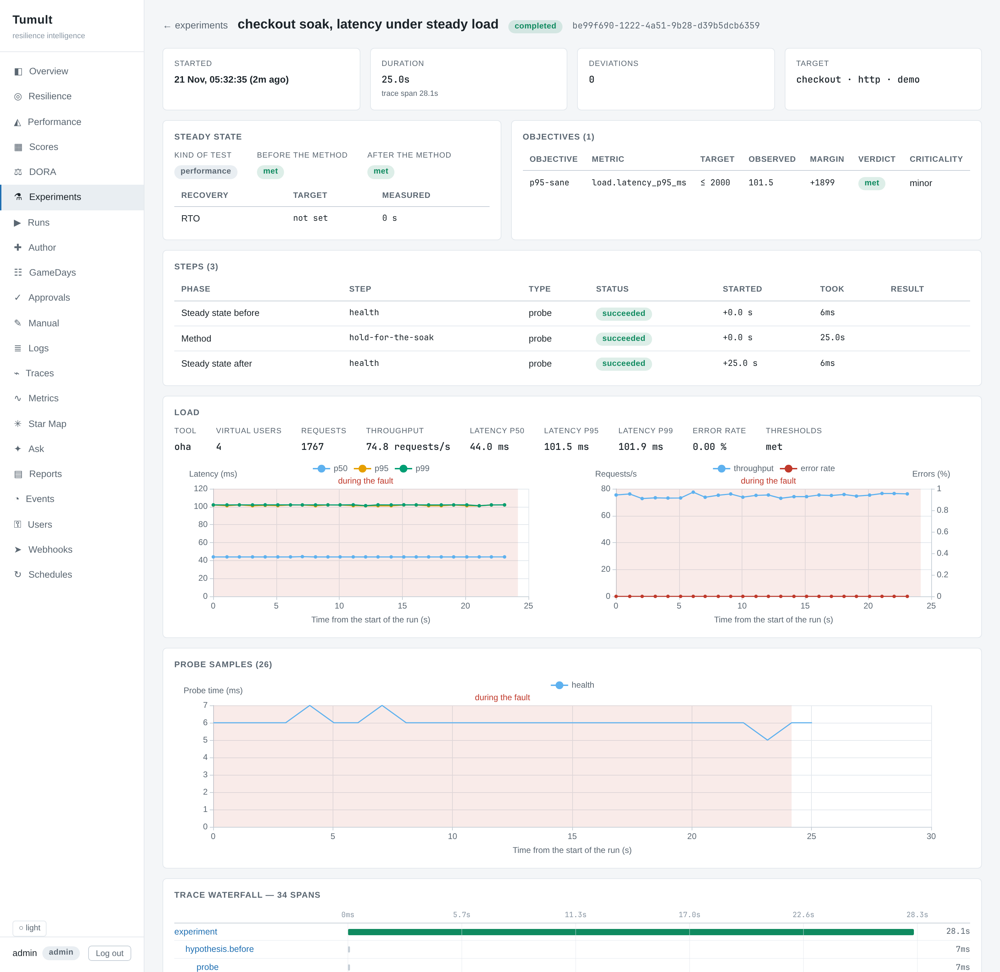
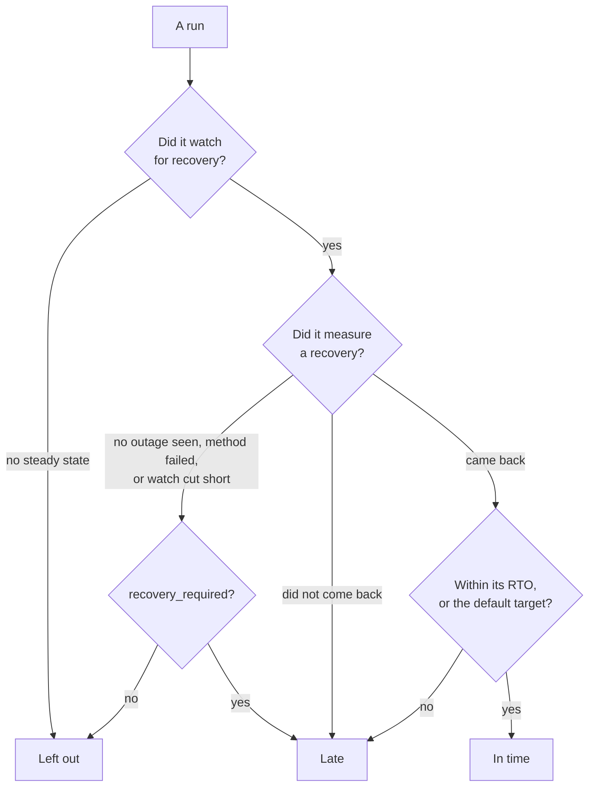

# Objectives

An objective is a number a run must meet, such as a p95 latency under
250 ms. Each run checks its objectives and gives each one a verdict.



## Write an objective

Objectives go in the `nfr` list of the [experiment file](experiment-format.md).

```toon
nfr[2]:
  - id: p95
    kind: latency
    metric: load.latency_p95_ms
    operator: lte
    threshold: 250
    criticality: blocking
  - id: avail
    kind: availability
    metric: during.availability
    operator: gte
    threshold: 0.995
```

| Field | Values |
|---|---|
| `id` | A name, unique in the file |
| `kind` | `latency`, `availability`, `throughput`, `error_rate`, `rto`, `rpo`, `capacity`, `recovery`, `data_integrity` |
| `metric` | What the run measured, see below |
| `operator` | `lte`, `gte` or `eq`, against `threshold` |
| `threshold` | A number |
| `criticality` | `blocking`, `major` (default) or `minor` |
| `window_s`, `description` | Notes. The run checks the whole phase that made the metric |

## Verdicts

| Verdict | When |
|---|---|
| `met` | The measured value meets the threshold |
| `breached` | It does not |
| `inconclusive` | The run did not measure the metric. It is never counted as met |

A breached `blocking` objective turns a completed run into `deviated`. A
`major` or `minor` breach is recorded and leaves the status alone. The
verdicts are in the journal (`objectives.verdicts`) and in the lake table
`nfr_verdicts`.

In a JUnit report (`tumult report --format junit`) each objective is a test
case. A breached `blocking` objective fails it, as it fails the run. An
`inconclusive` objective is skipped.

## Metrics

| Metric | Comes from |
|---|---|
| `load.throughput_rps`, `load.latency_p50_ms`, `load.latency_p95_ms`, `load.latency_p99_ms`, `load.error_rate`, `load.total_requests` | The [load](load-testing-guide.md) of the run |
| `recovery.mttr_s` | The hypothesis probes, from the first read that failed after the method started to the read where they were all back |
| `recovery.time_s` | The recovery check right after the method, from the end of the method |
| `during.error_rate`, `during.availability` | The hypothesis probes, sampled during the method |
| `post.error_rate`, `post.availability` | The hypothesis probes, sampled after the method |
| `probe.<name>.mean_ms`, `.max_ms`, `.p95_ms`, `.error_rate` | One hypothesis probe, sampled during the method |
| `fault.duration_s` | The length of the method |

Validation refuses any other metric, and a `probe.<name>` that is not a probe
of the steady-state hypothesis: no run could measure it.

## Kinds

The `kind` of an objective must be one that its metric measures.

| Kind | Metrics |
|---|---|
| `latency` | `load.latency_p50_ms`, `load.latency_p95_ms`, `load.latency_p99_ms`, `probe.<name>.mean_ms`, `.max_ms`, `.p95_ms` |
| `error_rate`, `availability` | `load.error_rate`, `during.error_rate`, `during.availability`, `post.error_rate`, `post.availability`, `probe.<name>.error_rate` |
| `throughput`, `capacity` | `load.throughput_rps`, `load.total_requests` |
| `rto` | `recovery.mttr_s`, `recovery.time_s` |
| `recovery` | `recovery.mttr_s`, `recovery.time_s`, `post.error_rate`, `post.availability`, `fault.duration_s` |
| `data_integrity` | `probe.<name>.error_rate`, for a probe that checks the data |
| `rpo` | None yet: no metric counts lost data |

Validation refuses any other pair, such as an `rpo` objective on
`fault.duration_s`.

## Recovery targets

`rto_target_s` adds a blocking objective: `recovery.mttr_s` at most that many
seconds. A run of `kind: dr` must set it.

The RTO clock starts at the outage the probes saw: the first read of a
steady-state probe that failed after the method started. That read can come
while the method runs or after it. The clock stops at the first read that
passed after the last failure, when the run ends recovered. So an outage
inside the method counts, and so does a wait in the method. The clock is as
close to the outage as the probes read: once a second by default.

A run whose probes never failed saw no outage. Its RTO is `inconclusive`
with the reason `no outage observed`: the run is no evidence of recovery.
The post phase of the journal says `impact_observed: false`. A run that saw
an outage says `impact_observed: true`, with `outage_started_at_ns` and,
when it recovered, `recovered_at_ns`.

A run that does not recover while the recovery check watches breaches its
RTO. The verdict says `recovered: false`, its `observed` is the time from the
outage seen to the end of the watch, and it has no margin. The true recovery
time is longer. A run whose method failed, or that was stopped, measures no
recovery: its RTO is `inconclusive`.

`rpo_target_s` is recorded with the run. No metric counts lost data yet, so
no objective can measure it, and its verdict is `inconclusive`.

## Set the recovery window

After the method, the run reads the steady-state probes until they pass. By
default it reads once a second, for at most 30 seconds. A slower failover
needs a longer window. Set it in the `recovery` block:

```toon
kind: dr
rto_target_s: 60
recovery:
  window_s: 90
  interval_s: 1
```

| Field | Default | What it does |
|---|---|---|
| `window_s` | `30` | How many seconds the run watches. Above 0, at most `3600` |
| `interval_s` | `1` | Seconds between two reads. Above 0, at most `window_s` |

The run stops watching when the probes pass, or when the window ends.
`tumult run --recovery-window 90` sets `window_s` for one run.

Make the window at least as long as `rto_target_s`. A run that comes back
after the window ends breaches its RTO, even when it comes back within
`rto_target_s`. `tumult validate` warns when the RTO is longer than the
window.

## Recovery over many runs

`tumult compliance` and the GameDay score both give a recovery share: of
the runs that measured a recovery, the share that came back in time. Each
run is judged against its own `rto_target_s`. A run that declares none is
judged against a default target: 30 seconds for `tumult compliance`, and
`scoring.mttr_target_s` (default 30) for a GameDay.



| A run | In the recovery share |
|---|---|
| Came back within its `rto_target_s`, or within the default target when it has none | In time |
| Came back later, or watched to the end and did not come back | Late |
| Saw no outage, its method failed, or a stop cut its watch short | Left out. Late when the GameDay sets `recovery_required: true` |
| Has no steady state, so it watched nothing | Left out. It counts in the pass rate only |

The share is the runs in time over the runs in time and late. When no run
is in time or late, the recovery is `not measured`. It is never full marks.

## Next

- [Load testing](load-testing-guide.md): the source of the `load.*` metrics.
- [Performance verdicts](performance-regression.md): compare runs between
  builds.
