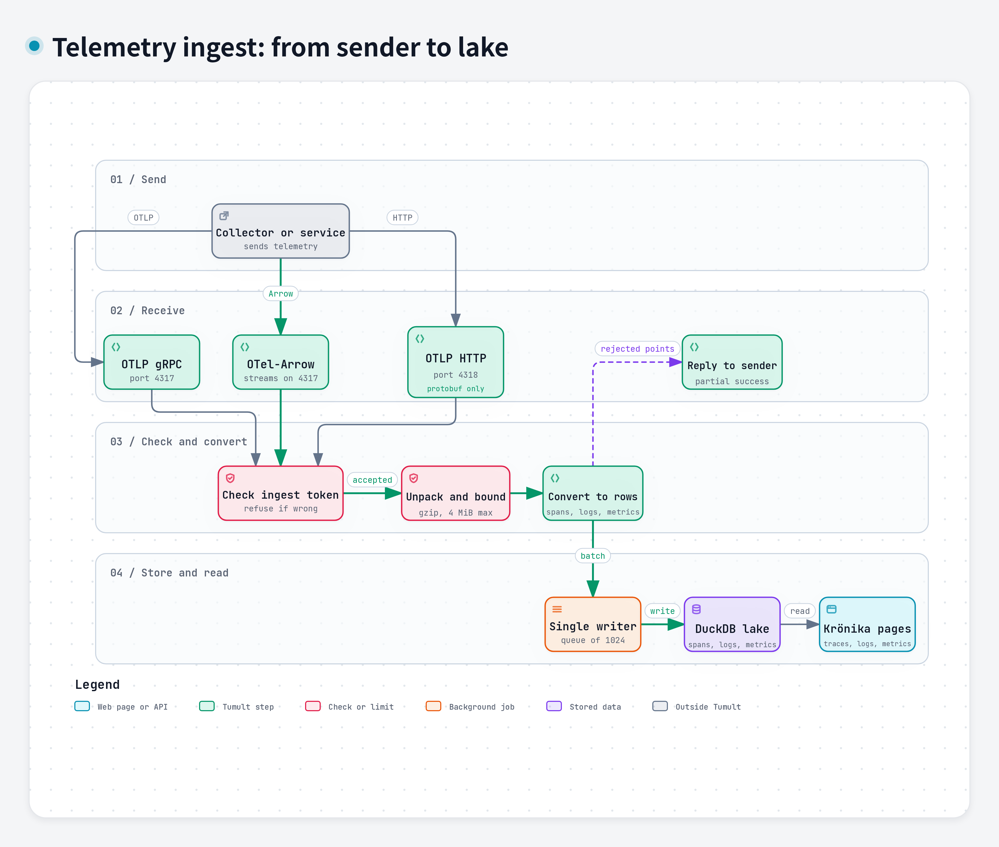

# Observability Setup

Tumult emits OpenTelemetry traces, metrics, and logs for every experiment run. This guide covers the complete span hierarchy, attribute reference, structured events, and how to route telemetry to your backend.



## Architecture

```
Tumult ──OTLP──▶ OTel Collector ──▶ Your Backend
                  (the fan-out)
                       │
                       ├──▶ Jaeger / Tempo (traces)
                       ├──▶ Prometheus / Mimir (metrics)
                       ├──▶ Loki / Elasticsearch (logs)
                       └──▶ SigNoz / Datadog / etc.
```

Tumult speaks OTLP only. The OTel Collector routes telemetry to your backend of choice. You never need to change Tumult configuration when switching backends.

## Quick Start (Development)

The fastest way to see traces locally:

```bash
docker compose -f docker/docker-compose.observability.yml up -d --wait
```

This starts:
- **OTel Collector** on `localhost:14317` (gRPC) and `localhost:14318` (HTTP)
- **SigNoz UI** on `http://localhost:3301`

Jaeger is optional: add `--profile classic` before `up` to expose its UI at
`http://localhost:16686`. Run these commands from the repository root.

Then run an experiment:

```bash
tumult init
OTEL_EXPORTER_OTLP_ENDPOINT=http://localhost:14317 tumult run experiment.toon
```

Open SigNoz at `http://localhost:3301` → Services → `tumult`, and inspect the spans for the activities that ran. Baseline-only observations
and experiments without optional phases do not emit a complete fault lifecycle.

## Configuration

### Environment Variables

| Variable | Default | Description |
|----------|---------|-------------|
| `TUMULT_OTEL_ENABLED` | `true` | Enable/disable telemetry collection |
| `TUMULT_OTEL_CONSOLE` | `false` | Also print spans to stdout |
| `TUMULT_MCP_TOKEN` | — | Bearer token for MCP server auth (unset = no auth) |
| `TUMULT_CLICKHOUSE_URL` | — | ClickHouse URL for SigNoz cross-correlation mode |
| `OTEL_EXPORTER_OTLP_ENDPOINT` | unset (no export) | OTLP/gRPC endpoint, e.g. `http://localhost:14317` |
| `OTEL_EXPORTER_OTLP_HEADERS` | unset | Export authorization metadata, e.g. `authorization=Bearer <ingest-token>` |
| `OTEL_SERVICE_NAME` | `tumult` | Service name in telemetry |
| `OTEL_RESOURCE_ATTRIBUTES` | — | Additional resource attributes (e.g., `deployment.environment=staging`) |

### Disabling Telemetry

```bash
TUMULT_OTEL_ENABLED=false tumult run experiment.toon
```

Telemetry is still collected internally (for the journal), but nothing is exported via OTLP.

## Collector Configurations

Reference configs are provided in the `collector/` directory:

| File | Backend | Use Case |
|------|---------|----------|
| `otel-collector-config.yaml` | Console (stdout) | Development, debugging |
| `otel-collector-dev.yaml` | Jaeger | Local development with docker-compose |
| `otel-collector-signoz.yaml` | SigNoz | All-in-one observability |
| `otel-collector-grafana.yaml` | Tempo + Mimir + Loki | Grafana stack |

### SigNoz

```bash
# Start via Docker (recommended — see docker/README.md)
make up-observe
open http://localhost:3301

# Or run the collector standalone:
otelcol --config collector/otel-collector-signoz.yaml
```

### Grafana Stack (Tempo + Mimir + Loki)

```bash
# Reference stack with all backends wired up (see docs/guides/grafana-stack.md):
docker compose -f docker/docker-compose.grafana-full.yml up -d

# Or run the collector standalone against your own backends:
otelcol --config collector/otel-collector-grafana.yaml
```

### OTel-Arrow carrier

tumultd accepts a second carrier next to OTLP: the OpenTelemetry Protocol
with Apache Arrow (OTel-Arrow, "OTAP"), what the Collector's `otelarrow`
exporter speaks. Instead of one protobuf request per export, the exporter
keeps a bidirectional gRPC stream open per signal
(`ArrowTracesService/ArrowTraces`, `ArrowLogsService/ArrowLogs`,
`ArrowMetricsService/ArrowMetrics`) and sends `BatchArrowRecords`: one
Arrow IPC record batch per OTAP table (spans, span attributes, resource
attributes, events, ...), dictionary-encoded and zstd-compressed. Each
batch is answered with a `BatchStatus`.

**Why.** Telemetry columns repeat heavily (service names, attribute keys,
target labels), and columnar batches compress far better than row-wise
protobuf, so the same spans cross the network in a fraction of the bytes.
The lake is Arrow-native (DuckDB, Arrow appender), so the batches are
decoded without a detour through protobuf allocation per span. Decoded
batches go through the exact same `tumult-otlp` conversion and the same
single-writer channel as OTLP: every promoted column (service, target,
experiment, fault, outcome) and the `span_attrs` / `resource_attrs` maps
come out identical whichever carrier delivered them. The receiver is
always on, on the same listener as OTLP/gRPC (`KRONIKA_OTLP_GRPC_ADDR`,
`:4317`), guarded by the same bearer token (`KRONIKA_INGEST_TOKEN`), with
the same backpressure: a batch is acknowledged only after the writer took
it, and a decode or write failure is reported in that batch's status
rather than closing the stream.

**Enable it in the Collector** (contrib distribution only; verified with
`otel/opentelemetry-collector-contrib:0.157.0`; see
`examples/otel/otel-collector.yaml` for the full pipeline):

```yaml
exporters:
  otelarrow/tumultd:
    endpoint: tumultd.host:4317
    tls:
      insecure: true            # or the daemon's TLS certificate
    headers:
      authorization: "Bearer ${env:KRONIKA_INGEST_TOKEN}"
    arrow:
      disable_downgrade: true   # fail loudly instead of falling back to OTLP
      num_streams: 2
      max_stream_lifetime: 30s
```

**Limits.**

- gRPC compression: the exporter default works. It compresses each message
  with zstd and announces it as `grpc-encoding: zstdarrow<level>` (level 1
  to 9, default `zstdarrow5`); the daemon accepts those names as zstd, plus
  plain `zstd`, `gzip` and `none`. Any other encoding is refused with
  `UNIMPLEMENTED` naming it. The Arrow IPC payloads are zstd-compressed too
  (`arrow.payload_compression`, default `zstd`).
- Span links and metric exemplars are not stored, exactly as on the OTLP
  path (no lake column holds them).
- A multivariate metric batch is refused in its own `BatchStatus`
  (`INVALID_ARGUMENT`, carrying the batch id and `MULTIVARIATE_METRICS` in
  the message); the stream stays open and univariate batches keep landing.
  Summary and exponential-histogram data points are counted and rejected
  exactly as on the OTLP path.
- Span events arrive sorted by name from the exporter and are restored to
  time order; attribute maps arrive sorted by key.
- Per-batch `headers` (hpack metadata) are ignored; authenticate with the
  stream metadata, as above.
- Rows that point at a parent that is not in the batch (an attribute, event
  or data point whose `parent_id` matches no row) and duplicate ids fail
  the whole batch with `INVALID_ARGUMENT`; nothing is dropped silently.
  The Collector's own receiver ignores such rows; its exporter never
  produces them.

**What the exporter is told.** Every batch gets a `BatchStatus`; the codes
are chosen for how the `otelarrow` exporter reacts to them.

| Event | `BatchStatus` | Stream |
|---|---|---|
| Stored | `OK` | stays open |
| Lake write failed | `UNAVAILABLE` (retried by the exporter) | stays open |
| Decoded but not convertible: multivariate metrics, orphan rows, duplicate ids, a required column missing, a trace or span id of the wrong length or all zero, a table of another signal, too many attributes | `INVALID_ARGUMENT` (not retried) | stays open; closed with `INVALID_ARGUMENT` after `KRONIKA_OTAP_MAX_REJECTED_BATCHES` of them |
| Payload not decodable (malformed IPC, a column type outside the allowlist, a schema over the structural caps, payload type `UNKNOWN`) | `INVALID_ARGUMENT` (not retried) | closed with `INVALID_ARGUMENT` |
| Over a limit of the batch or of the stream itself (rows, decoded bytes, bytes retained per stream, dictionary deltas) | `INVALID_ARGUMENT` (not retried) | closed with `RESOURCE_EXHAUSTED` |
| Over the batch deadline | `INVALID_ARGUMENT` (not retried) | closed with `RESOURCE_EXHAUSTED` |
| Over the client's own share of the retained bytes (its connection's or its peer's) | `INVALID_ARGUMENT` (not retried: the client's own streams hold the bytes) | closed with `RESOURCE_EXHAUSTED` |
| Over the retained bytes all streams share | `UNAVAILABLE` (retried: other clients' streams hold the bytes) | closed with `RESOURCE_EXHAUSTED` |
| Message over the size limit, or a broken gRPC frame | none | closed with the read error (`OUT_OF_RANGE` for size) |
| No message for the idle timeout, or the stream is older than its lifetime | none | closed with `UNAVAILABLE` |
| The client takes no status for the ack timeout | none | closed |
| Too many open streams, in total, on one connection or from one peer | none | refused with `RESOURCE_EXHAUSTED` |
| Missing or wrong token | none | refused with `UNAUTHENTICATED`, logged at WARN without the token |

A payload that cannot be decoded may have carried the schema or
dictionaries that later payloads build on, so the stream ends after its
batch is acked and the exporter opens a fresh one. Only a stream the client
closes ends without an error status.

The batch is always acked before such a close, and with a code the exporter
does not retry, because of how the `otelarrow` exporter (contrib 0.157.0)
behaves: it decides per batch from the `BatchStatus` alone
(`INVALID_ARGUMENT` is permanent, `UNAVAILABLE` is retried,
`RESOURCE_EXHAUSTED` is retried only with a `RetryInfo` detail, which a
`BatchStatus` cannot carry), it only logs the gRPC status a stream closes
with, and it sends every batch that had no status when the stream ended
again on a new stream. A batch that deterministically breaks a limit would
come back forever if the stream closed without answering it. Only the
shared retained-bytes pool, which other streams may free, is answered with
the retried `UNAVAILABLE`. One close has no status to give: a message tonic
refuses (over `KRONIKA_OTAP_MAX_MESSAGE_BYTES`, or badly compressed) has no
batch id, so an exporter configured to send larger messages than the
receiver takes resends until its own `retry_on_failure` and `timeout`
settings give up. Keep the exporter's `max_stream_lifetime` below
`KRONIKA_OTAP_STREAM_LIFETIME_SECS` so the exporter, not the receiver, ends
long-lived streams.

Release builds of tumultd abort on panic (`panic = "abort"`), so nothing a
client sends may reach one. Arrow IPC messages are therefore decoded by the
receiver's own checked reader (`tumult-ingest::otap::ipc`), not by the
`arrow-ipc` stream reader, whose record batch and dictionary readers assert
on buffer ranges, variadic buffer counts and union type ids. The reader
accepts only the column types OTAP uses (bool, the integer and float types,
Utf8, Binary, FixedSizeBinary, Timestamp, Duration, Struct, List, and
Dictionary of a primitive, string or binary type); Null, Union, run-end
encoded, view, Map, ListView, fixed-size list, Large*, decimal, date, time
and interval columns and nested dictionaries are refused, as are record
batches with variadic buffer counts. Node and buffer counts must match the
schema, every buffer must lie inside the message body and be long enough
for its node's length and type, offsets must be monotonic and inside the
values buffer, and dictionary keys must be inside the dictionary. In builds
that unwind, a panic in the decode task still closes the stream with
`INTERNAL`.

**Resource limits.** Everything a peer declares (row counts, IPC message
body lengths, decompressed buffer sizes) is checked before memory is
allocated for it. A value over its maximum is replaced by the maximum, a
zero or unparsable one by the default, each with a warning at startup.

| Variable | Default | Maximum | Bounds |
|---|---|---|---|
| `KRONIKA_OTAP_MAX_ROWS` | 250000 | 10000000 | rows per OTAP table and per dictionary |
| `KRONIKA_OTAP_MAX_ATTRIBUTES` | 1000000 | 100000000 | attributes per batch, all attribute tables together |
| `KRONIKA_OTAP_MAX_DECODED_BYTES` | 67108864 | 4294967296 | decompressed Arrow buffers plus expanded dictionary columns per batch |
| `KRONIKA_OTAP_MAX_MESSAGE_BYTES` | 4194304 | 268435456 | one `BatchArrowRecords` message, before and after gRPC decompression |
| `KRONIKA_OTAP_MAX_STREAMS` | 64 | 4096 | Arrow streams open at once |
| `KRONIKA_OTAP_MAX_STREAMS_PER_CONNECTION` | 32 | `MAX_STREAMS` | Arrow streams open at once from one connection (one peer socket address) |
| `KRONIKA_OTAP_MAX_STREAMS_PER_PEER` | half of `MAX_STREAMS` (32) | `MAX_STREAMS` | Arrow streams open at once from one peer, over all its connections |
| `KRONIKA_OTAP_MAX_CONCURRENT_DECODES` | 4 | 256 | batches decoded, converted or waiting for the writer at once; the permit is held until the batch is stored. Waiting batches take turns peer by peer, then connection by connection |
| `KRONIKA_OTAP_STREAM_IDLE_SECS` | 300 | 86400 | silence before a stream is closed |
| `KRONIKA_OTAP_STREAM_LIFETIME_SECS` | 600 | 604800 | age at which a stream is closed, however busy |
| `KRONIKA_OTAP_ACK_TIMEOUT_SECS` | 30 | 3600 | how long a status may wait for a client that does not read |
| `KRONIKA_OTAP_BATCH_DEADLINE_MS` | 10000 | 600000 | wall-clock time to decode and convert one batch, checked inside the row loops |
| `KRONIKA_OTAP_MAX_STREAM_RETAINED_BYTES` | 33554432 | 1073741824 | schemas and dictionaries one stream keeps between batches |
| `KRONIKA_OTAP_MAX_RETAINED_BYTES` | 268435456 | 17179869184 | the same, all streams together |
| `KRONIKA_OTAP_MAX_CONNECTION_RETAINED_BYTES` | an eighth of `MAX_RETAINED_BYTES` (33554432) | `MAX_RETAINED_BYTES` | the same, all streams of one connection |
| `KRONIKA_OTAP_MAX_PEER_RETAINED_BYTES` | an eighth of `MAX_RETAINED_BYTES` (33554432) | `MAX_RETAINED_BYTES` | the same, all streams of one peer |
| `KRONIKA_OTAP_MAX_DICTIONARY_DELTAS` | 65536 | 16777216 | delta dictionary batches per stream |
| `KRONIKA_OTAP_MAX_REJECTED_BATCHES` | 8 | 1000000 | refused batches before the stream is closed |
| `KRONIKA_GRPC_MAX_CONNECTIONS` | 1024 | 65536 | TCP connections open on the gRPC listener |
| `KRONIKA_GRPC_MAX_CONNECTIONS_PER_PEER` | 64 | `MAX_CONNECTIONS` | TCP connections open from one peer |
| `KRONIKA_GRPC_MAX_CONNECTIONS_PER_IPV6_SITE` | four times `PER_PEER` (256) | `MAX_CONNECTIONS` | TCP connections open from one IPv6 /48 |
| `KRONIKA_GRPC_HANDSHAKE_TIMEOUT_SECS` | 10 | 300 | time a new connection has to finish the TLS handshake and send the HTTP/2 preface |
| `KRONIKA_GRPC_AUTH_TIMEOUT_SECS` | 10 | 300 | with an ingest token: time a new connection has, from accept, to make its first call that carries the token |
| `KRONIKA_GRPC_MAX_CONNECTION_AGE_SECS` | 1800 | 604800 | age a connection may reach |
| `KRONIKA_GRPC_MAX_CONNECTION_AGE_GRACE_SECS` | 600 | 3600 | time after that age at which the connection is cut, whatever is in flight |

Not configurable: 256 fields and 64 dictionaries per schema, schema nesting
4 deep, schema ids of 256 bytes, field names of 128 bytes, CBOR attribute
values nested 16 deep, trace ids of exactly 16 and span ids of exactly 8
bytes.

The connection limits are the gRPC listener's: unary OTLP/gRPC exports and
OTel-Arrow streams share them, and a connection over a limit is closed as
soon as it is accepted. A connection that has not finished the TLS
handshake and sent the HTTP/2 preface within
`KRONIKA_GRPC_HANDSHAKE_TIMEOUT_SECS` is closed and its place given back,
so silent connections cannot use up the limit; a slow client that keeps
making progress has the whole time. The listener does the TLS handshake
itself, and the handshake counts as finished when the TLS library says
so, not when bytes have arrived. No connection lives longer than the
connection age plus its grace (40 minutes by default): it is cut then and
the client reconnects, so keep the exporter's `max_stream_lifetime` well
below it. The listener also allows 64 concurrent HTTP/2 streams and 64
in-flight requests per connection, switches TCP keepalive on for every
accepted socket, pings every 30 s and drops a connection whose ping goes
unanswered for 20 s.

**Connections that never authenticate.** With `KRONIKA_INGEST_TOKEN` set,
a connection is a client's once it has made one call that carries the
token, a unary export or an Arrow stream. Until then:

- it has `KRONIKA_GRPC_AUTH_TIMEOUT_SECS` from the moment it is accepted
  (the TLS handshake included) and is closed when the time is up, whether
  or not it answers pings. A client that connects before it has anything
  to send is closed as well; it reconnects when it has, which gRPC clients
  do on their own;
- it is the one that goes when there is no room. When the listener, a
  peer or an IPv6 site is at its limit, a new connection takes the place
  of the oldest connection in it that has not authenticated yet, which is
  closed. A connection that has authenticated is never closed for one
  that has not; when every place is held by an authenticated connection
  the newcomer is refused.

So connections without the token can no longer keep clients with the
token out: whatever they hold is handed over on demand and lost after ten
seconds anyway.

**Without an ingest token the listener cannot tell clients apart**, and
none of the above applies: no connection is asked to authenticate, none is
closed for a newcomer, and a newcomer that finds no room is refused. The
arithmetic is then plain. With the defaults one peer may hold 64 of 1024
connections and one IPv6 /48 may hold 256, so 16 IPv4 addresses or four
IPv6 /48s that complete the handshake and answer pings hold every place
for the connection age plus its grace, 40 minutes, and can take them
again when they are cut. Only run without a token where
everyone who can reach the gRPC port is trusted; anywhere else set
`KRONIKA_INGEST_TOKEN`, or put the limit in front of the daemon.

**File descriptors.** Every connection is a file descriptor, and the
default of 1024 connections equals the usual soft `nofile` limit of a
process, which the daemon also needs for its HTTP listener, the lake and
its own files. Raise the limit (`LimitNOFILE=` in a systemd unit,
`ulimit -n` in a shell) or lower `KRONIKA_GRPC_MAX_CONNECTIONS` so the
listener's limit is the one that is reached. When the process does run
out, accepting fails; the listener then waits 200 ms before it tries
again and logs `gRPC listener cannot accept connections, backing off`
(rate-limited) instead of spinning.

**Peers and proxies.** A peer is an IPv4 address or an IPv6 /64 (one host
usually has a whole /64 to pick source addresses from). On top of that
all /64s of one IPv6 /48, the block a provider usually gives one customer,
share `KRONIKA_GRPC_MAX_CONNECTIONS_PER_IPV6_SITE`; without it a /56 would
be 256 peers. A link-local IPv6 address (`fe80::/10`) is a peer by itself
together with the interface it arrived on, so the hosts of one link do not
share an allowance, and one link is one site. The per-peer
limits, `KRONIKA_GRPC_MAX_CONNECTIONS_PER_PEER`,
`KRONIKA_OTAP_MAX_STREAMS_PER_PEER` and
`KRONIKA_OTAP_MAX_PEER_RETAINED_BYTES`, keep one peer from taking every
connection, every stream slot or the whole retained pool, and waiting
batches are decoded peer by peer in turn. Behind a proxy, a load balancer
or NAT every client arrives from one address and they all share one peer's
allowance: raise the three per-peer variables there (each up to its total)
and let the proxy limit its clients. With the defaults all Collectors
behind one address share 64 connections, 32 streams and 32 MiB of retained
schemas and dictionaries. The `peer` in a rejected-token warning is then
the proxy's address as well.

Only zstd is accepted for Arrow IPC buffer compression (what the exporter
uses); LZ4 payloads are refused. Before memory is allocated for a
compressed buffer its zstd frame headers are read: the content sizes they
carry must add up to the declared size, and the declared size must not be
more than the compressed bytes can hold. That check is a coarse filter
for sizes that cannot be true; the limit is
`KRONIKA_OTAP_MAX_DECODED_BYTES`, which every decoded buffer and every
expanded dictionary column (its values and its keys) is charged to.
Within it a small compressed message may still expand a lot; the budget
bounds the result, not the ratio. A dictionary column of strings or
bytes that would expand past 2 GiB is refused whatever the budget: its
offsets are 32-bit.

The ingest token is checked before a request body is read: a unary
OTLP/gRPC export without it is refused before its message is decoded.

**Logs.** Text a peer chooses (schema ids, field names, error text built
from them) is cut to 256 bytes and has control characters, line breaks
included, quotes and backslashes escaped before it reaches a log line or a
`BatchStatus`; in a log line it is a quoted value, so it cannot add
`key=value` pairs of its own. Column types are named by kind only. The
warnings a peer can cause at will (rejected token on gRPC and HTTP, refused
stream, refused connection, rejected or undecodable batch, failed stream
read) are limited per 10 s, counted kind by kind, so a flood of one does
not hide the first of another; the next one logged carries
`suppressed=<n>`. A rejected-token warning carries the peer's IP address
(`peer=`), never the token.

A live proof of the whole path (fresh daemon under an address-space cap,
real Collector container, `curl` OTLP/HTTP traces, logs and metrics in,
rows out through `/api/experiments`, `/api/traces`, `/api/topology`,
`/api/logs` and `/api/metrics/query`, a second batch on the same stream,
and a hostile client: missing token, wrong token, undecodable payload,
oversized message, the IPC messages that panic the `arrow-ipc` reader, row
counts without data, a log-forging schema id, a flood of refused batches
and 2000 damaged copies of a valid batch, with the daemon checked alive
after each) is `scripts/proof/otap/proof.sh`. Run it on a debug and on a
release build (`PROOF_PROFILE=release`): only the release daemon aborts on
a panic.

## Span Hierarchy

A fault run uses `resilience.experiment` as its root span. The following
inventory shows instrumentation available across the crates; only executed
paths emit spans. Statistical baseline acquisition is separate from the
ordinary runner. With MCP, the tool-call span is a parent of the experiment,
not its child.

```
resilience.experiment                    (root — tumult-core runner)
├── resilience.hypothesis.before
│   └── resilience.probe                 (one per hypothesis probe)
│       └── script.execute              (tumult-plugin)
│           └── [subprocess spans via TRACEPARENT env var]
├── resilience.action                    (one per method step)
│   ├── script.execute                  (for script plugins)
│   │   └── [subprocess spans via TRACEPARENT env var]
│   ├── ssh.connect                     (tumult-ssh — when target is Ssh)
│   ├── ssh.execute                     (tumult-ssh — remote command)
│   ├── k8s.pod.delete                  (tumult-kubernetes)
│   ├── k8s.node.drain
│   ├── k8s.deployment.scale
│   └── k8s.network_policy.apply
├── resilience.hypothesis.after
│   └── resilience.probe
├── resilience.rollback                  (one per rollback step)
│   └── resilience.action
├── baseline.acquire                     (tumult-baseline)
│   └── baseline.sample                 (repeated per interval)
├── resilience.analytics.ingest         (tumult-lake → DuckDB or ClickHouse)
│   ├── resilience.analytics.query
│   └── resilience.analytics.export
└── mcp.tool.call                        (tumult-mcp — when run via MCP)
```

### Trace Context Propagation

When Tumult executes a script plugin, it injects `TRACEPARENT` and `TRACESTATE` environment variables into the subprocess. This allows scripts that emit their own OTel spans to attach as children of the `script.execute` span:

```bash
#!/usr/bin/env bash
# The TRACEPARENT env var is automatically set by Tumult.
# Any OTel-instrumented process launched here inherits the trace context.
my-otel-instrumented-service --do-chaos
```

When running via the MCP server, you can pass a `parent_context` in `RunConfig` to link the experiment root span to the calling agent's trace.

## Span Attributes Reference

### `resilience.experiment` (root span)

| Attribute | Type | Description |
|-----------|------|-------------|
| `resilience.experiment.id` | string | UUID for this experiment run |
| `resilience.experiment.name` | string | Experiment title |
| `resilience.experiment.status` | string | `Completed`, `Failed`, `Aborted`, `Interrupted` |
| `resilience.experiment.duration_ms` | int | Total experiment wall-clock time |
| `resilience.hypothesis.met` | bool | Did the steady-state hypothesis hold? |
| `resilience.hypothesis.deviations` | int | Number of probe deviations detected |

### `resilience.action` / `resilience.probe`

| Attribute | Type | Description |
|-----------|------|-------------|
| `resilience.action.name` | string | Activity name from experiment definition |
| `resilience.probe.name` | string | Probe name from experiment definition |
| `resilience.plugin.name` | string | Plugin executing the activity |
| `resilience.activity.duration_ms` | int | Activity execution duration |
| `resilience.activity.status` | string | `success`, `failure`, `timeout` |
| `resilience.activity.phase` | string | `before`, `method`, `after`, `rollback` |

### `script.execute`

| Attribute | Type | Description |
|-----------|------|-------------|
| `script.plugin_name` | string | Script plugin name |
| `script.function_name` | string | Action or probe function name |
| `script.exit_code` | int | Script process exit code |
| `script.duration_ms` | int | Script execution duration |

### `ssh.connect` / `ssh.execute`

| Attribute | Type | Description |
|-----------|------|-------------|
| `net.peer.name` | string | SSH target hostname |
| `net.peer.port` | int | SSH port (default 22) |
| `ssh.user` | string | SSH username |
| `ssh.auth_method` | string | `key_file`, `agent`, `password` |
| `ssh.command_exit_code` | int | Remote command exit code |

### `baseline.acquire`

| Attribute | Type | Description |
|-----------|------|-------------|
| `baseline.probe_name` | string | Name of the probe being baselined |
| `baseline.method` | string | `mean_stddev`, `percentile`, `iqr`, `error_rate` |
| `baseline.sample_count` | int | Number of samples collected |
| `baseline.duration_ms` | int | Baseline acquisition wall time |
| `baseline.anomaly_detected` | bool | Whether the baseline itself was anomalous |

### `resilience.analytics.ingest`

| Attribute | Type | Description |
|-----------|------|-------------|
| `analytics.backend` | string | `duckdb` or `clickhouse` |
| `analytics.experiment_id` | string | Experiment ID being ingested |
| `analytics.rows_inserted` | int | Number of activity rows written |

## Structured Span Events

Tumult emits structured span events (not logs) at key lifecycle points. These appear as timeline markers within spans in Jaeger/SigNoz.

| Event Name | Parent Span | Fields | Description |
|------------|-------------|--------|-------------|
| `journal.ingested` | `resilience.analytics.ingest` | `experiment_id`, `activity_count` | Journal successfully written to store |
| `drain.completed` | `resilience.experiment` | `spans_exported`, `metrics_exported` | OTel flush completed at experiment end |
| `tolerance.derived` | `baseline.acquire` | `probe_name`, `method`, `lower`, `upper` | Baseline tolerance bounds calculated |
| `anomaly.detected` | `baseline.acquire` | `probe_name`, `reason`, `cv` | Baseline anomaly found before experiment |
| `script.completed` | `script.execute` | `exit_code`, `stdout_bytes`, `stderr_bytes` | Script plugin finished execution |
| `experiment.started` | `resilience.experiment` | `experiment_id`, `title`, `triggered_by` | Audit event: experiment begins |
| `experiment.completed` | `resilience.experiment` | `experiment_id`, `status`, `duration_ms` | Audit event: experiment ends |

### Audit Events

The `experiment.started` and `experiment.completed` events are also emitted as structured `tracing::info!` log records with fields compatible with SIEM ingestion:

```
INFO experiment.started experiment_id="abc-123" title="Kill DB connections" triggered_by="cli"
INFO experiment.completed experiment_id="abc-123" status="Completed" duration_ms=45231
```

The sample above is the terminal (text) rendering. Without a terminal the same events are JSON lines on stderr; see [Logging](logging.md) for the format and the field vocabulary.

Correlation with the experiment trace depends on the path the record takes:

- OTLP log records carry the trace and span id of the span that was active when the event fired. This is what a log aggregator behind a Collector (Loki, Elasticsearch) correlates on.
- Local JSON and text lines carry `trace_id` and `span_id` only when the event fired inside an active OpenTelemetry span. An event logged outside a span (process start, shutdown, background tasks) has neither key.

## Metrics Reference

All metrics use the `resilience.` namespace.

### Counters

| Metric | Labels | Description |
|--------|--------|-------------|
| `resilience.experiments.total` | `status` | Experiments run, by outcome |
| `resilience.actions.total` | `plugin`, `outcome` | Actions executed |
| `resilience.probes.total` | `plugin`, `outcome` | Probes executed |
| `resilience.hypothesis.deviations.total` | `experiment` | Steady-state violations, by experiment name |
| `resilience.script.executions.total` | `plugin`, `function`, `outcome` | Script plugin invocations |
| `resilience.rollbacks.total` | `outcome` | Rollback executions |
| `resilience.rollback.failures` | — | Rollback steps that failed (non-fatal) |

### Histograms

| Metric | Labels | Description |
|--------|--------|-------------|
| `resilience.action.duration_seconds` | `plugin` | Action execution latency |
| `resilience.probe.duration_seconds` | `plugin` | Probe execution latency |
| `resilience.experiment.duration_seconds` | `status` | Total experiment duration |
| `resilience.baseline.duration_seconds` | `method` | Baseline acquisition time |

### Gauges (Store)

| Metric | Description |
|--------|-------------|
| `resilience.store.experiments` | Total experiments in persistent store |
| `resilience.store.activities` | Total activity rows in store |
| `resilience.store.size_bytes` | DuckDB file size in bytes |
| `resilience.store.disk_usage_pct` | Store disk usage as percentage of volume |

## Trace-to-Metrics Correlation (SigNoz)

When using SigNoz with the ClickHouse backend, experiment data lands in the same database as SigNoz traces and metrics. This enables powerful cross-signal queries:

```sql
-- Find all traces for a specific experiment
SELECT e.title, e.status, t.traceID, t.serviceName
FROM tumult.experiments e
JOIN signoz_traces.signoz_index_v2 t
  ON e.experiment_id = t.traceID
WHERE e.status = 'Failed'

-- Correlate experiment timing with infrastructure metrics
SELECT e.title, s.unix_milli, s.value AS cpu_pct
FROM tumult.experiments e
JOIN signoz_metrics.samples_v4 s
  ON s.unix_milli BETWEEN e.started_at AND e.completed_at
WHERE s.metric_name = 'system.cpu.utilization'
```

To enable:

```bash
TUMULT_CLICKHOUSE_URL=http://localhost:8123 tumult run experiment.toon
```

## Trace Context from MCP Callers

When an AI agent or orchestration system calls Tumult via MCP (`tumult_run_experiment`), the experiment's root span can be linked to the agent's trace. Pass the W3C trace context in the MCP call metadata:

```json
{
  "_meta": {
    "extra": {
      "authorization": "Bearer <token>",
      "traceparent": "00-4bf92f3577b34da6a3ce929d0e0e4736-00f067aa0ba902b7-01"
    }
  }
}
```

The MCP handler extracts the `traceparent` header and wires it into `RunConfig.parent_context`, making the experiment a child span of the calling agent.

## Troubleshooting

**No traces appearing?**
1. Check `TUMULT_OTEL_ENABLED` is not `false`
2. Set `OTEL_EXPORTER_OTLP_ENDPOINT=http://localhost:14317`; gRPC port 4317 is not an HTTP health endpoint
3. Check collector health at `http://localhost:13133` and logs with `docker compose -f docker/docker-compose.observability.yml logs tumult-collector`
4. Try `TUMULT_OTEL_CONSOLE=true tumult run experiment.toon` to dump spans to stdout

**Traces appear but no metrics?**
- Ensure your collector config has a `metrics` pipeline
- Verify the backend supports OTLP metrics ingestion

**`hypothesis.deviations.total` not broken down by experiment?**
- This metric carries the `experiment` label. Ensure your metrics backend supports high-cardinality labels, or filter with `--experiment <name>` in queries.

**Subprocess spans not connecting to parent?**
- The subprocess must read `TRACEPARENT`/`TRACESTATE` from environment and use them as its OTel context. Most OTel SDKs do this automatically if you call `opentelemetry::global::get_text_map_propagator`.

**SigNoz not showing experiment data?**
- Confirm `TUMULT_CLICKHOUSE_URL` is set correctly.
- Check ClickHouse is healthy: `curl http://localhost:8123/ping`
- The ClickHouse backend retries 3 times with exponential backoff (2s/4s/8s) before failing.
