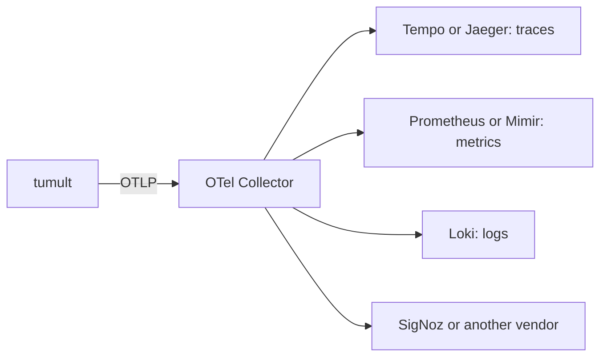
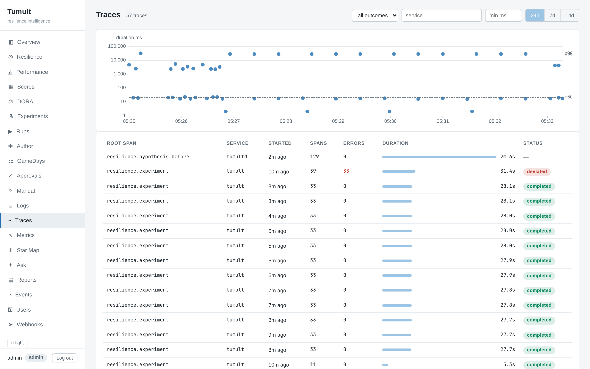

# Observability setup

Tumult speaks OpenTelemetry. Every run sends traces, metrics and logs,
and the daemon `tumultd` receives telemetry from your services into the
lake. This page shows how to wire both ends.



## See your runs in a backend

The fastest way to see traces is the local observability stack: an
OpenTelemetry Collector and SigNoz. Run this from the repository root:

```bash
docker compose -f docker/docker-compose.observability.yml up -d --wait
OTEL_EXPORTER_OTLP_ENDPOINT=http://localhost:14317 tumult run experiment.toon
```

Open SigNoz at `http://localhost:3301`, then **Services**, then `tumult`.
The Collector listens on `localhost:14317` (gRPC) and `localhost:14318`
(HTTP). Add `--profile classic` for Jaeger at `http://localhost:16686`.

Tumult only speaks OTLP. The Collector sends it on to the backend you
use, so you never change Tumult when you change backends:



Ready configs are in `collector/`:

| File | Sends to |
|---|---|
| `otel-collector-config.yaml` | The console, for debugging |
| `otel-collector-dev.yaml` | Jaeger |
| `otel-collector-signoz.yaml` | SigNoz |
| `otel-collector-grafana.yaml` | Tempo, Mimir and Loki, see [Grafana stack](grafana-stack.md) |

## Settings

| Variable | Default | Meaning |
|---|---|---|
| `OTEL_EXPORTER_OTLP_ENDPOINT` | unset, no export | OTLP gRPC endpoint, such as `http://localhost:14317` |
| `OTEL_EXPORTER_OTLP_HEADERS` | unset | Headers to send, such as `authorization=Bearer <ingest-token>` |
| `OTEL_SERVICE_NAME` | `tumult` | The service name on the telemetry |
| `OTEL_RESOURCE_ATTRIBUTES` | none | More resource attributes, such as `deployment.environment.name=staging` |
| `OTEL_EXPORTER_OTLP_METRICS_TEMPORALITY_PREFERENCE` | `delta` | `delta`, `cumulative` or `lowmemory` |
| `TUMULT_OTEL_ENABLED` | `true` | `false` exports nothing. The journal is still written |
| `TUMULT_OTEL_CONSOLE` | `false` | Also print spans to the terminal |

### Delta metrics

Tumult exports counters and histograms as deltas: each export holds what
happened since the last one.

- To Krönika or SigNoz: nothing to do.
- Through a Collector to Prometheus or Mimir: add the `deltatocumulative`
  processor (the configs in `collector/` have it), or set the temporality
  to `cumulative`. Do not set `cumulative` for a process that exports to
  Krönika.
- Other services that send cumulative counters to Krönika: send deltas,
  or put the Collector's `cumulativetodelta` processor in front.

## Send your services to the daemon

`tumultd` takes three protocols. All write the same rows to the lake.

| Protocol | Address | Variable |
|---|---|---|
| OTLP gRPC | `:4317` | `KRONIKA_OTLP_GRPC_ADDR` |
| OTel-Arrow (OTAP) | `:4317`, same listener | `KRONIKA_OTLP_GRPC_ADDR` |
| OTLP HTTP (`/v1/traces`, `/v1/metrics`, `/v1/logs`) | `:4318`, with the API | `KRONIKA_OTLP_HTTP_ADDR` |

Set `KRONIKA_INGEST_TOKEN`, and send it as a bearer token. The daemon
does not start on an open address without one. Point your services at a
Collector, and let the Collector send to the daemon:

```yaml
exporters:
  otelarrow/tumultd:          # otlp/tumultd takes the same, without arrow
    endpoint: tumultd.host:4317
    tls:
      insecure: true          # or the daemon's TLS certificate
    headers:
      authorization: "Bearer ${env:KRONIKA_INGEST_TOKEN}"
    arrow:
      disable_downgrade: true # fail loudly instead of falling back to OTLP
```

OTel-Arrow sends columns of Arrow data over one open stream, so the same
spans take far fewer bytes. It needs the contrib Collector. The full
pipeline is in `examples/otel/otel-collector.yaml`.

A batch is answered only after the lake took it. If the write fails, the
answer asks the Collector to retry. A message may be 4 MiB, also after
gzip. The limits and their variables are in the
[telemetry reference](telemetry-reference.md).

Krönika shows what arrived on its **Traces**, **Logs** and **Metrics**
pages.



## When nothing shows up

1. Check that `TUMULT_OTEL_ENABLED` is not `false`.
2. Use the gRPC endpoint: `http://localhost:14317`.
3. Check the Collector at `http://localhost:13133` and read its log:
   `docker compose -f docker/docker-compose.observability.yml logs tumult-collector`.
4. Run with `TUMULT_OTEL_CONSOLE=true` to print the spans.

Traces but no metrics? The Collector config needs a `metrics` pipeline.

A script step gets `TRACEPARENT` and `TRACESTATE`, so its own spans join
the run. The script's OpenTelemetry SDK must read them.

## Next

- [Telemetry reference](telemetry-reference.md): spans, attributes, metrics and limits.
- [Auto-instrumentation](otel-autoinstrumentation.md): name your services so Tumult can match them.
- [Logging](logging.md): the daemon's own log lines.
