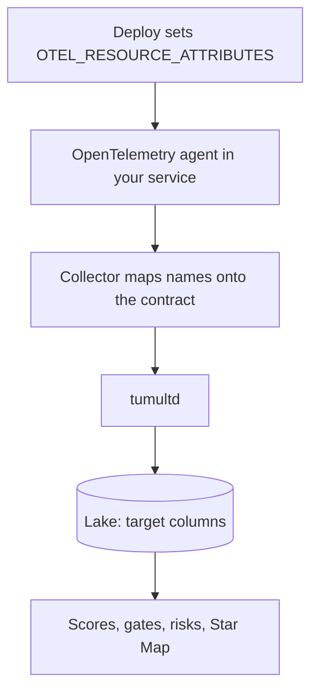

# Auto-instrumentation

Tumult scores, gates and ranks risks by **target**. A service takes part
when its telemetry carries a few naming attributes, the contract. It does
not call a Tumult API, and with an OpenTelemetry agent it does not change
a line of code.



The runnable example is in `examples/otel/`. The meaning of each
attribute is in [the metadata standard](../resilience-metadata-standard.md).

## What Tumult reads

| Attribute | Drives |
|---|---|
| `service.name`, `service.version` | The service map, and performance verdicts per build |
| `resilience.target.system` | Scores, the gate, coverage and risks |
| `resilience.target.technology` | Risk rules and reports |
| `resilience.target.environment`, or `deployment.environment.name` | Environment scopes and the gate's `env=` |
| `resilience.target.component`, `.tier`, `.criticality`, `.region` | Reports and conformance |
| `ict.schema.version`, `ict.entity.id`, `ict.entity.tier`, `ict.entity.owner` | The ICT spine, the DORA score and the Star Map |

A `resilience.target.*` attribute on a span wins. When a span has none,
the resource attributes fill in, which is how an auto-instrumented
service says what it is, once, at deploy time.

## Set the contract at deploy time

Every OpenTelemetry agent reads the same variables. Set them in your Helm
values, task definition or systemd unit:

```sh
OTEL_SERVICE_NAME=checkout
OTEL_RESOURCE_ATTRIBUTES="service.version=1.4.2,\
deployment.environment.name=staging,\
resilience.target.system=api,\
resilience.target.technology=jvm,\
resilience.target.component=shop/checkout,\
ict.schema.version=0.1.0,\
ict.entity.id=cif-0042,\
ict.entity.tier=critical,\
ict.entity.owner=team-checkout"
OTEL_EXPORTER_OTLP_ENDPOINT=http://otel-collector:4317
OTEL_PROPAGATORS=tracecontext,baggage
```

`resilience.target.system` is one of `database`, `cache`,
`message-broker`, `api`, `container`, `vm`, `host`, `kubernetes`,
`network`, `application`, `middleware` or `cloud-service`.

Then start the service with its agent:

| Language | Command |
|---|---|
| Java | `JAVA_TOOL_OPTIONS="-javaagent:/otel/opentelemetry-javaagent.jar" java -jar checkout.jar` |
| Python | `pip install opentelemetry-distro opentelemetry-exporter-otlp && opentelemetry-bootstrap -a install`, then `opentelemetry-instrument python app.py` |
| Node.js | `node --require @opentelemetry/auto-instrumentations-node/register server.js` |
| .NET | `CORECLR_ENABLE_PROFILING=1 dotnet Checkout.dll`, after the install script of the .NET automatic instrumentation |
| Go and others | OpenTelemetry eBPF Instrumentation with the same variables, or set the resource in the SDK |
| Kubernetes | The OpenTelemetry Operator injects the agent: see `examples/otel/k8s-instrumentation.yaml` |

## Fix the names in one place

Teams use different names: plain semantic conventions, the ICT spine,
Kubernetes labels. The Collector in `examples/otel/otel-collector.yaml`
maps them onto one contract:

- It sets `ict.schema.version` and takes the environment from
  `deployment.environment.name`.
- It copies `ict.entity.id` to `resilience.target.component`, and
  `ict.entity.tier` to `resilience.target.criticality`, when those are
  missing. Without either, the component is `<namespace>/<deployment>`.
- It drops request ids, such as `user.id` and `session.id`, before they
  become metric labels.
- It sends to `tumultd` over OTel-Arrow with the ingest token.

Point every agent at the Collector, not at the daemon, and the contract
is set in one place.

## During a run

A script step gets `TRACEPARENT`, so its spans join the run's trace. A
service under test is linked to the run by its **target**: the run's
`resilience.target.*` matches the service's resource, and the run's time
window (`/api/experiments/windows`) picks its spans.

## Check what arrived

`GET /api/otel/conformance?range=24h` says, per `service.name`, which
contract attributes arrived and which are missing:

| Level | Means |
|---|---|
| `none` | Spans arrived without a full target |
| `target` | `resilience.target.system`, `.technology` and `.environment` on every span |
| `spine` | `target` plus the four `ict.*` attributes |

The **Conformance** lens of the [Star Map](star-map.md) shows the same
level on each service. Look here first when a target is missing from the
Resilience page.

## Next

- [Observability setup](observability-setup.md): send to the daemon and to your backend.
- [Entity events](entity-events.md): track hosts and pods as they come and go.
