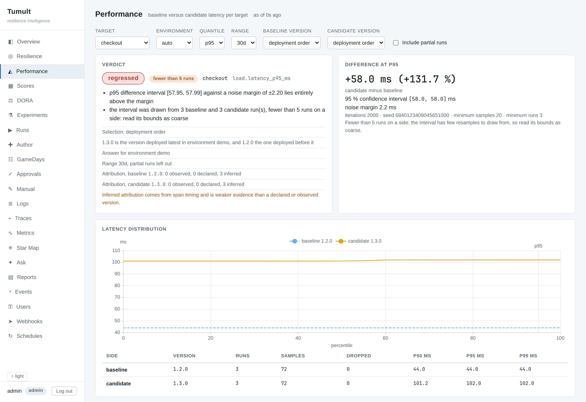
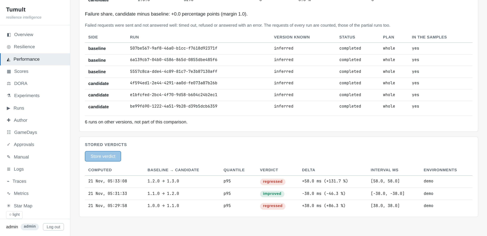
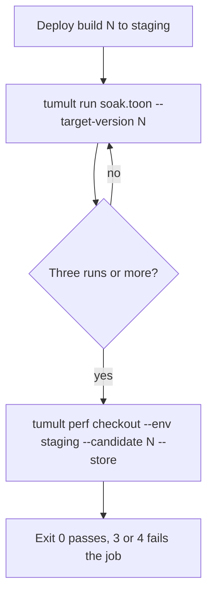

# Performance verdicts

A performance verdict answers one question per build: is this version of
a service slower than the one before it? Tumult compares the latency
samples of load runs against both versions and gives one of four answers:
`improved`, `unchanged`, `regressed` or `inconclusive`.

One rule comes first: **the verdict is never better than the evidence.**
Too little evidence is `inconclusive`, and that fails the gate by default.



## See it in Krönika

Open **Performance** and pick a target. The page shows the two versions,
their runs and the verdict. **Store verdict** keeps it in the history.





## How a verdict is made

1. **Find the version of each run.** The best source is the version you
   declare: `tumult run soak.toon --target-version 1.5.0`, or
   `target.version` in the experiment. Without it, the run records the
   version that served at least 95 % of the target's requests during the
   run. A run with no clear version takes no part, and the answer counts
   it in `unattributed_runs`.
2. **Pick two versions in one environment.** The candidate is the
   version deployed last, the baseline the one before it, unless you name
   them. A baseline from one environment is never compared with a
   candidate from another.
3. **Take the samples.** By default the series is `load.latency_p95_ms`,
   the p95 of each window that an `oha` load writes. A k6 run writes one
   summary only, so point `probe` at a series it has.
4. **Check the requests first.** A build that stops answering, or fails
   more requests than the baseline (by more than one percentage point and
   by more than chance, over enough requests), is `regressed` whatever
   its latency.
5. **Compare the latency.** Tumult draws a 95 % interval for the
   difference at p95 by resampling whole runs 2000 times, and compares it
   with a noise margin of 5 % of the baseline.

| Verdict | When |
|---|---|
| `regressed` | The whole interval lies above the margin, or the requests failed |
| `improved` | The whole interval lies below minus the margin |
| `unchanged` | The interval is inside the margin, or covers zero and leaves the margin on one side at most |
| `inconclusive` | Fewer than 3 runs or 20 samples on a side, one version only, or an interval too wide to tell |

Each side needs at least 3 runs. An interval from fewer than 5 runs is
flagged as resting on few runs. `reasons` in the answer says in words why
the verdict is what it is.

## Gate a pipeline

```bash
export TUMULT_DAEMON_URL=http://tumultd.internal:4318
export TUMULT_DAEMON_TOKEN=kro_...   # viewer reads; --store needs operator
tumult perf checkout --env staging --candidate 1.5.0 --store
```

```text
perf checkout: REGRESSED (p95 of load.latency_p95_ms)
  versions: the request named the pair in environment staging: the candidate is 1.5.0 and it is compared against 1.4.0
  baseline  1.4.0: 100.0 ms over 72 sample(s) in 5 run(s)
  candidate 1.5.0: 150.0 ms over 72 sample(s) in 5 run(s)
  delta +50.0 ms (+50.0%), CI [31.0, 70.0], margin ±5.0
  - p95 difference interval [31.00, 70.00] against a noise margin of ±5.00 lies entirely above the margin
  verdict stored in perf_verdicts
```

| Exit | Meaning |
|---|---|
| `0` | `improved` or `unchanged` |
| `1` | The command failed, for example the daemon could not be reached or `--store` did not store |
| `2` | Usage error |
| `3` | `regressed` |
| `4` | `inconclusive` |

`--fail-on regressed` lets `inconclusive` pass, and `--fail-on never`
only prints. `--json` prints the daemon's answer.

A pipeline that works:



Always pass `--candidate`: the pipeline knows which build it tests. The
gate templates are in `deploy/ci/`.

## Options

| Option | Default | Meaning |
|---|---|---|
| `--probe` | `load.latency_p95_ms` | The sample series to compare |
| `--quantile` | `p95` | `p50`, `p95` or `p99` |
| `--margin-pct` | `5` | Noise margin, percent of the baseline |
| `--min-runs` | `3` | Fewest runs a side needs (1 to 1000) |
| `--min-samples` | `20` | Fewest samples a side needs |
| `--baseline`, `--candidate` | the two versions deployed last | The versions to compare |
| `--env` | the only one that can answer | The environment |
| `--range` | `30d` | How far back runs and samples are read |
| `--include partial` | off | Keep samples of aborted or cut short runs |

The same options are query parameters of `GET /api/perf/{target}`
(Viewer role). `POST /api/perf/{target}/verdicts` (Operator role) also
stores the verdict. A retry with the same evidence stores nothing new.

## Next

- [Load testing](load-testing-guide.md): write the soak that feeds the verdict.
- [Forecasting](forecasting.md): how far a run pushed a metric.
