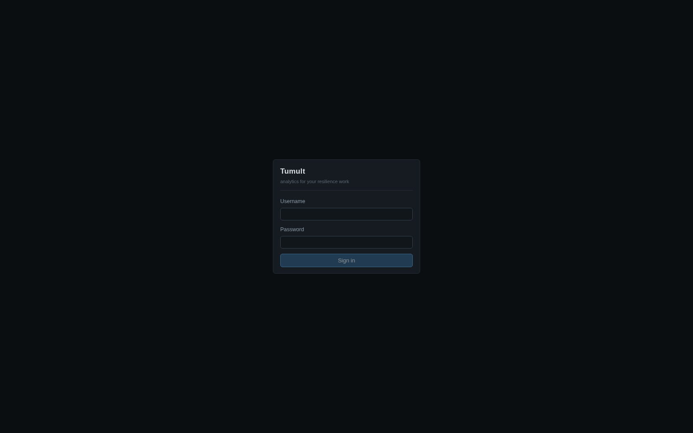
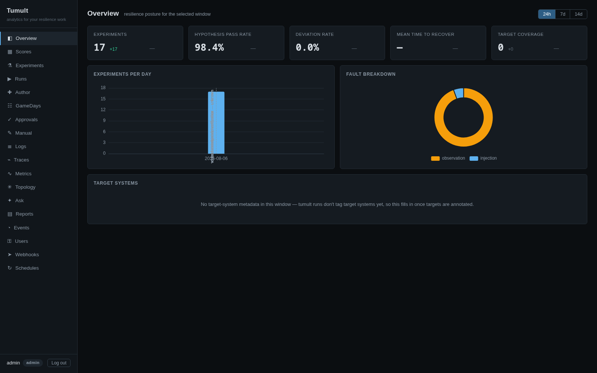
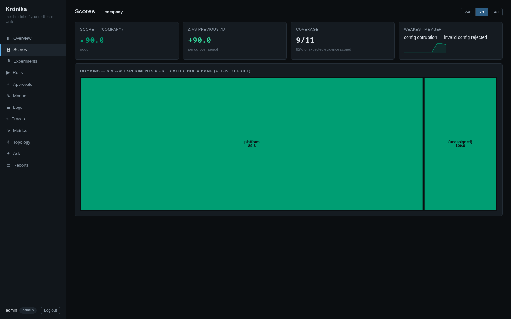
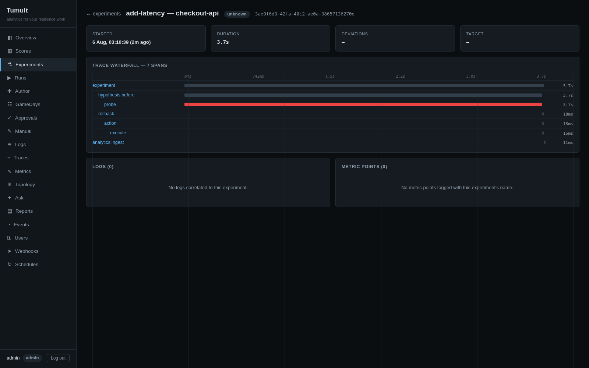
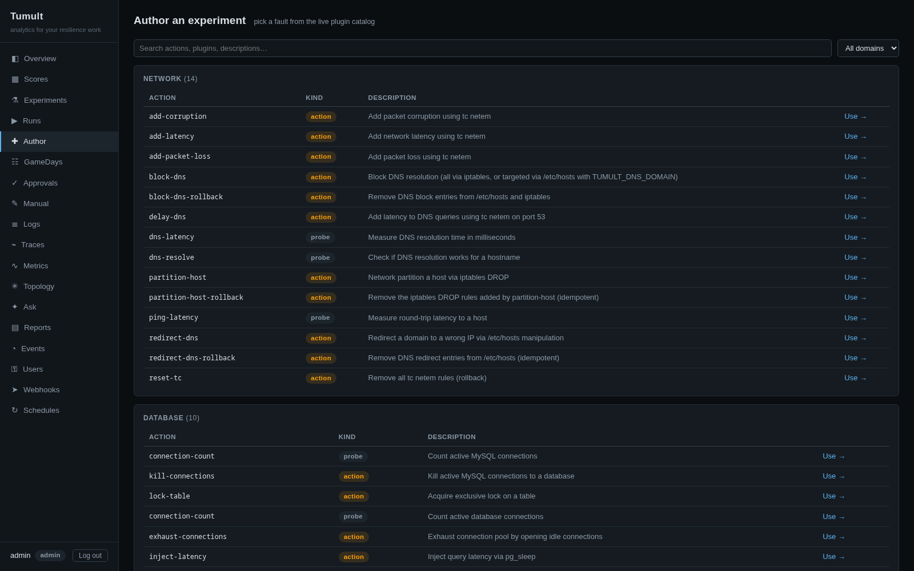
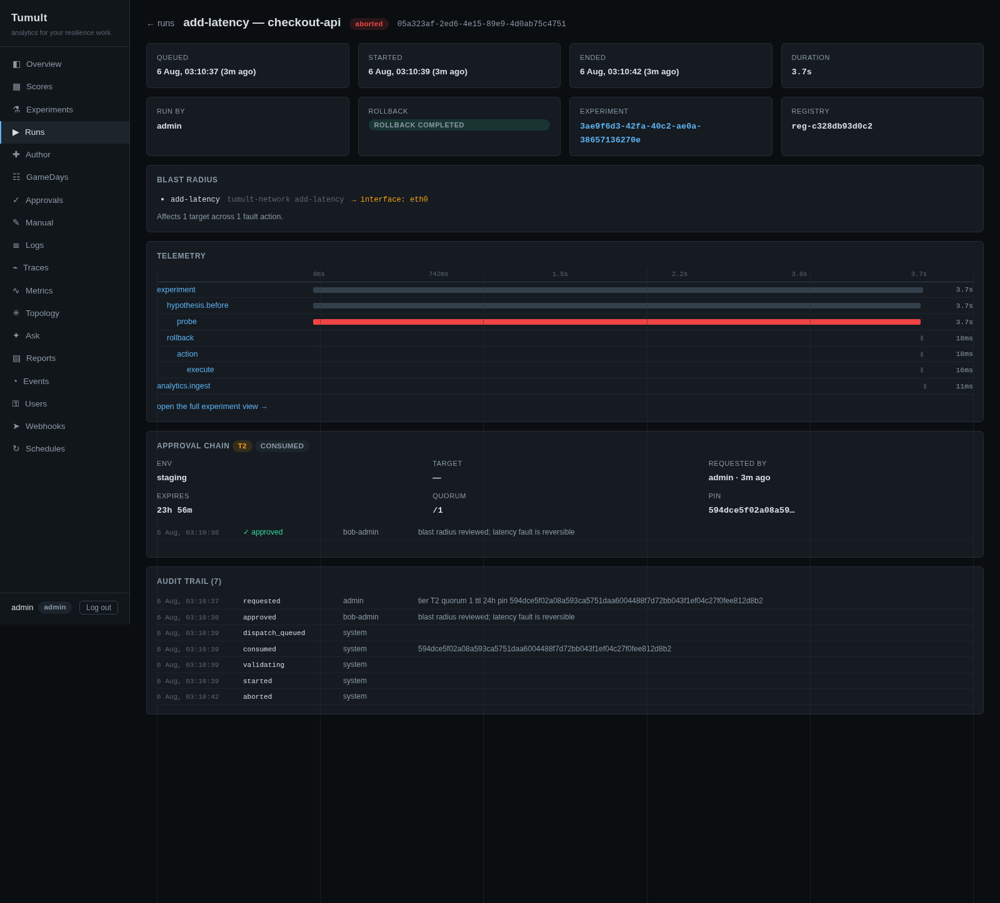
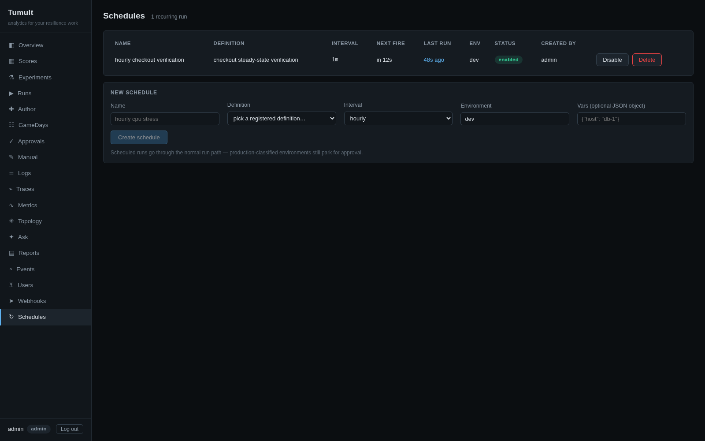
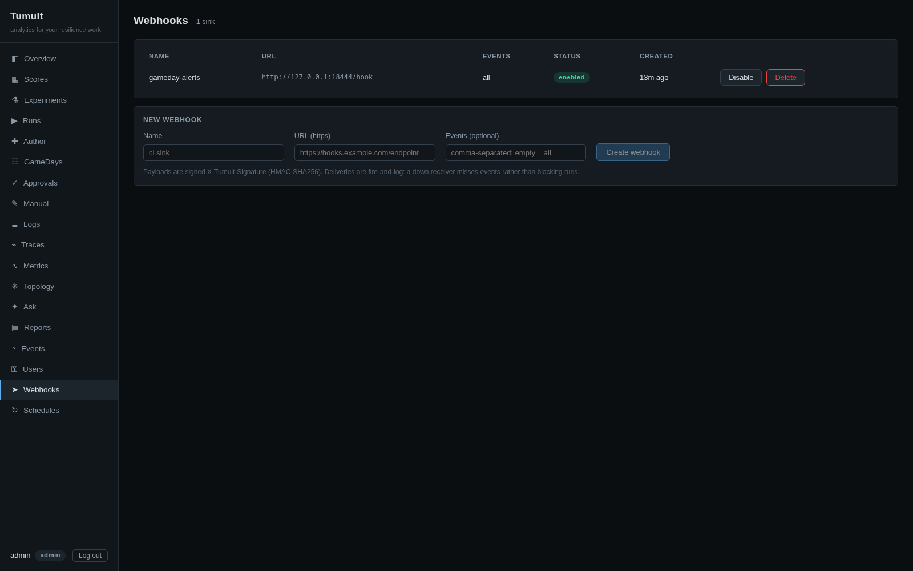
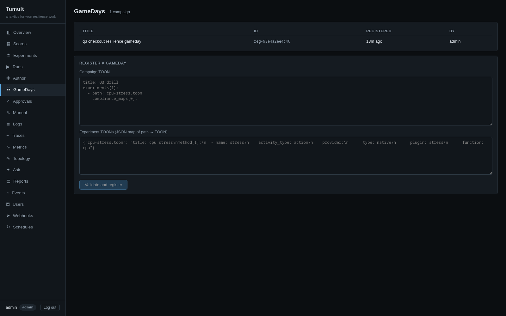

# Platform Walkthrough

A click-through of the Tumult platform: sign in, register an
experiment, run it behind an approval quorum, e-stop a gated run, and
generate an evidence pack. Screenshots illustrate earlier seeded demo runs;
they are real captures, but do not establish that the current image and all
provider journeys have been tested together. Current approval and binding
requirements below take precedence over the pictured values.

The click-through covers the governed run. The pages that turn stored
evidence into scores, verdicts and a map are listed one by one in
[Krönika pages, charts and evidence](#krönika-pages-charts-and-evidence)
at the end.

## Start the demo stack

```bash
cp .env.example .env
# Set all three KRONIKA_* values in .env; use the generation commands there.
docker compose -f docker/docker-compose.kronika.yml up -d --build
# Open http://localhost:14318/ and sign in as admin with the password you set.
```

The stack builds the UI and the `tumultd` binary, seeds an eight-experiment
demo suite (run for real over OTLP), three manual-evidence records in
different lifecycle states, and two demo identities: an admin and `bob`, an
approver.

## Sign in



Sessions are 256-bit opaque cookies (`HttpOnly`, `SameSite=Strict`, 12h);
automation uses revocable `kro_`-prefixed tokens instead. Authorization is a
single route table with `viewer < operator < approver < admin` roles —
unmatched routes fail closed.

## The seeded posture

The overview answers "how are we doing" from the store, not from opinion:
hypothesis pass rate, deviation rate, experiments per day, and the fault
breakdown over the selected window.



Posture opens the way the market now reads resilience: the ranked findings of
the passive risk scan (a failed latest run, a discipline with no evidence, a
breached objective, a dependency nothing has ever tested, a workload with one
replica or no disruption budget) and the coverage matrix of targets against
the seven disciplines, then the continuous posture score per target. No fault
runs for any of it. An operator can accept a finding for a while; the
suppression is hash-chained in the lake and expires on its own.

Scores roll per-experiment results up by org domain to the company root, with
coverage against expected evidence and the weakest member called out. The
treemap drills from company to domain to member.



Every experiment keeps its full trace — hypothesis probes, the fault action,
steady-state checks, and the analytics ingest — as a waterfall built from the
OTLP spans the engine emitted.



Manual evidence covers what telemetry can't: game days, tabletops, vendor
failovers. Records move draft → submitted → verified with reviewer ≠ enterer
(the register below shows a verified record with `bob-admin` as verifier),
each transition appended to a hash-chained audit trail.


## Author from the catalog

The Author page browses the live fault catalog — every action and probe the
mounted plugins expose, grouped by domain — and scaffolds a definition from
any of them without leaving the UI.



Picking an action opens the scaffolding wizard: title, target, the action's
arguments, and an optional steady-state probe, then a generated TOON ready to
validate and register.


The same catalog and scaffolding are available over the API — the same code
paths as the MCP `tumult_fault_catalog` / `tumult_scaffold_experiment`
tools, with no MCP hop:

```bash
curl http://localhost:14318/api/authoring/catalog      # domains → actions → args
curl -X POST http://localhost:14318/api/authoring/scaffold \
  -H 'Content-Type: application/json' \
  -d '{"plugin":"tumult-containers","action":"pause-container",
       "args":{"container_id":"demo-postgres"},"target":"demo-postgres"}'
```

Both endpoints are Viewer-level and persist nothing — the scaffolded TOON
registers through `POST /api/runs/validate` like any other definition.

## Register and run an experiment

Registration happens via the API or the CLI — the definition is validated by
the exact pipeline the CLI uses and content-hash-deduped into the registry:

```bash
curl -X POST http://localhost:14318/api/runs/validate \
  -H "Cookie: kro_session=<session>" -H 'Content-Type: application/json' \
  -d "{\"toon\": $(jq -Rs . < demo/kronika/experiments/config-corruption.toon)}"
```

The Run page then drives the whole loop: pick the registered definition, fill
any `${var}` parameters, dry-run the *exact resolved plan* — hypothesis,
method steps, rollbacks — and start.


## Approval gate

Before starting, a deployment administrator must review the dry-run inputs,
provider destinations and credentials and configure an
[execution binding](execution-bindings.md). Select the same environment and
target when creating the run. The demo does not authorize new definitions
automatically. A missing binding results in T3 for unscoped operators and a
binding error for scoped operators; T3 also requires the configured autopilot
gate and cannot be approved just by following the old screenshot.

Run creation is change management. Reviewed bindings and the definition's
frozen facts classify the run into a risk tier. The pictured earlier run was
T2 and parked in `pending_approval`
behind a quorum of one approver, with a SHA-256 pin over the resolution
inputs, a 24h TTL, and single-use consumption at dispatch.


Segregation of duties is enforced by the writer: the requester can never
approve their own run. Sign in as the seeded `bob` approver to review it; the
earlier screenshots use a separately provisioned `bob-admin` identity. The
approver reviews the pending request in the queue against its pin and records
a decision note.


## The executed run

Once approved, the run dispatches onto the worker pool and its page polls to
terminal. The detail page is the whole story on one screen: the telemetry
waterfall as loopback spans land (here the steady-state probe failed, so the
run aborted and the rollback restored the target), the consumed approval
chain with bob-admin's note, and the per-run hash-chained audit trail from
`requested` through `approved`, `dispatch_queued`, `consumed`, `started`,
`aborted`.



## E-stop a gated run

A second gated run — the pause-container definition parked in
`pending_approval` — is stopped before it ever dispatches. The two-step
e-stop is deliberate: the first click arms and the confirm cancels dispatch.
No fault ran in this example, so no rollback is needed. For an active run,
cancellation prevents later dispatch and applies its rollback strategy; a
provider call already in progress may finish or time out first.


The result: state `aborted`, "cancelled before start", `stop_requested`
attributed to the operator in the audit trail, and the approval request
closed out — no approval can resurrect a stopped run. The Runs page also
carries a global two-step **Halt all** for stopping everything active at
once.


## Evidence pack

Finally, the compliance story: R1 executive digests, R2 evidence packs
(DORA/NIS2/ISO 27001/SOC 2), and R3 game-day reports are generated from the
store as document-controlled PDFs. The R2 pack includes the approval chain of
every gated run in the window (SOC 2 CC8.1) — the two runs above,
bob-admin's approval included.

Reports summarize available evidence; they do not certify framework compliance
or infer independent testing from a passing experiment. Unmapped clauses and
unverified assertions remain explicit in the evidence pack.

Reports respect the same per-user environment scopes as the rest of Tumult.
A user scoped to specific environments generates digests, evidence packs and
metric reports containing only those environments' data, and each generated
artifact records the coverage it was built from. Scoped users then see only
artifacts whose coverage lies inside their own scopes; global reports and
older artifacts without coverage metadata stay visible to unscoped users
only (a scoped user gets a 404, as with out-of-scope traces). Unscoped
users see and generate everything, exactly as before.


## Operate the platform

The remaining nav pages cover day-to-day operation. The Runs page lists
every run with state filters and the global **Halt all** — the same two-step
arm/confirm as the per-run e-stop, stopping everything active in one shot.


Schedules fire registered definitions on an interval through the normal run
path — production-classified environments still park for approval.



The events feed is the audit spine across runs: every `requested`,
`approved`, `started`, `passed`, `aborted`, and `stop_requested`, newest
first, attributed to the actor (including schedules).


Webhooks push those same events to external sinks, each payload signed
`X-Tumult-Signature` (HMAC-SHA256) with a per-hook secret shown once at
creation.



Users manages accounts and revocable `kro_` API tokens under
`viewer < operator < approver < admin` roles, with optional per-environment
scopes.


GameDays group experiments into scored campaigns — register the campaign
TOON, launch it, and the child runs execute in order under the same approval
tiers.



## Krönika pages, charts and evidence

Krönika is the web UI embedded in `tumultd`. Every page reads the lake
through the JSON API with the signed-in user's role and environment
scopes; a page stores nothing of its own. The list below follows the
sidebar and names, for each page, the charts on it and the evidence they
are drawn from. Pages without a chart are tables or forms and say so.

### Evidence and intelligence

| Page | Charts and panels | Evidence shown | API |
|---|---|---|---|
| **Overview** (`/`) | KPI cards with sparklines (experiments, hypothesis pass rate, deviation rate, mean time to recover, target coverage); experiments per day as a bar chart for `24h` and a calendar heatmap for longer ranges; fault breakdown pie; target systems table | Experiment runs in the selected range, with run windows overlaid on the `24h` chart | `GET /api/overview`, `GET /api/experiments/windows` |
| **Posture** (`/posture`) | Top risks list with inline accept; accepted findings; coverage heatmap of targets against the seven disciplines (missing, stale, covered) and a coverage radar per discipline; objectives heatmap of targets against objectives; compliance score line over 14 days; telemetry contract table; posture score per target | Findings of the passive risk scan, objective verdicts, discipline coverage, the score history, and which services carry the OpenTelemetry naming contract | `GET /api/risks`, `GET /api/posture`, `GET /api/scores/tree`, `GET /api/otel/conformance`, `POST /api/risks/{id}/suppress` |
| **Performance** (`/performance`) | Target picker; verdict with how the two versions were selected and attributed; difference at the compared quantile with its confidence interval; latency distribution chart (percentile curves of baseline and candidate, the baseline dashed); tables of latency, partial runs and windows, requests and runs by version; stored verdict history | Load and probe latency samples of two `service.version`s of one target in one environment, and the verdicts an operator stored | `GET /api/perf`, `GET /api/perf/{target}`, `POST /api/perf/{target}/verdicts` |
| **Scores** (`/scores`) | Company score with a trend sparkline; treemap of domains (area by experiments and criticality, colour by band) that drills from company to domain to member; member table with sparklines | Latest run per experiment rolled up through the `org.yaml` hierarchy, with coverage against expected evidence | `GET /api/scores/tree` |
| **DORA** (`/scores?view=dora`) | Legal entity picker; heatmap of articles against functions or org units with a table alternative; expected and actual evidence status with the largest gap first and an evidence drawer per row; maturity gauge, component bars and a level-and-index line per quarter; maturity per node with the node that caps the level; reporting readiness of the function register | Runs and manual records matched to the DORA requirement registry, the stored daily snapshots, and the function register declared in `org.yaml` | `GET /api/dora`, `GET /api/dora/{article}`, `GET /api/maturity` |
| **Star Map** (`/starmap`) | One graph of organisation units, ICT entities, systems, components, services, workloads and definitions; lens switch (evidence, risk, conformance); environment and range pickers; focus on a neighbourhood; node list with a filter; evidence drawer with coverage by discipline, runs, gate verdict, objective verdicts, manual records and risks | Spans, runs, verified manual records, risk suppressions, `org.yaml` and the manifests under `KRONIKA_MANIFESTS_DIR`, assembled per request | `GET /api/starmap`, `GET /api/gate/{target}` (drawer) |

The DORA page reports what evidence exists. It does not state that an
entity complies; see the [DORA score guide](dora-score.md). The Star Map
lenses and marks are explained in the [Star Map guide](star-map.md), and
the performance verdict in
[Performance Regression](performance-regression.md). `/topology` is kept
as a redirect to the Star Map.

### Experiments and runs

| Page | Charts and panels | Evidence shown | API |
|---|---|---|---|
| **Experiments** (`/experiments`) | Filterable table: status, experiment, started, duration, faults, target | Every experiment run in the lake, from the CLI, MCP or the daemon | `GET /api/experiments`, `GET /api/dimensions` |
| **Experiment detail** (`/experiments/{id}`) | Trace waterfall with a span drawer | The spans the engine emitted for the run: hypothesis probes, actions, rollbacks, ingest | `GET /api/experiments/{id}` |
| **Runs** (`/runs`) | Table with state filters and the two-step **Halt all** | Daemon runs and their states | `GET /api/runs`, `POST /api/runs/stop-all` |
| **New run** (`/runs/new`) | Definition picker, parameter form, dry-run preview of the resolved plan | Registered definitions | `GET /api/registry`, `POST /api/runs/dry-run`, `POST /api/runs` |
| **Run detail** (`/runs/{id}`) | Run header with e-stop; live trace waterfall; **Impact** panel: one chart per probe of observed values against the counterfactual median and its 80 % band, with the fault window and peak and recovery marks, and the model that produced it; approval chain; hash-chained audit timeline | The run's state and audit rows, its spans, and its raw probe samples compared with a forecast | `GET /api/runs/{id}`, `GET /api/experiments/{id}`, `GET /api/runs/{id}/impact` |
| **Author** (`/author`, `/author/new`) | Fault catalog browser; scaffolding wizard with a TOON editor | The actions and probes of the mounted plugins | `GET /api/authoring/catalog`, `POST /api/authoring/scaffold`, `POST /api/runs/validate` |
| **GameDays** (`/gamedays`, `/gamedays/{id}`) | Campaign table and registration form; campaign detail with its child runs | Registered campaigns and the runs they started | `GET /api/gamedays`, `GET /api/gamedays/{id}`, `POST /api/gamedays/{id}/runs` |
| **Approvals** (`/approvals`) | Queue of pending requests with approve and reject | Approval requests with their content-hash pin | `GET /api/approvals`, `POST /api/runs/{id}/approve`, `POST /api/runs/{id}/reject` |
| **Schedules** (`/schedules`, operator) | Table and form | Recurring runs of registered definitions | `GET /api/schedules` |
| **Manual** (`/manual`) | Entry and review tabs | Manual evidence records in their draft, submitted, verified or rejected state | `GET /api/manual/experiments` |

The Impact panel is described in
[Forecasting and run impact](forecasting.md). It is the only place in the
UI that draws a forecast: `GET /api/forecast` returns forecast bands for
semantic metrics, and no page charts them yet.

### Telemetry explorers

| Page | Charts and panels | Evidence shown | API |
|---|---|---|---|
| **Logs** (`/logs`) | Log volume by severity as a bar chart; searchable table with attribute filters | Log records ingested over OTLP and OTel-Arrow | `GET /api/logs`, `GET /api/logs/volume` |
| **Traces** (`/traces`, `/traces/{id}`) | Scatter chart of trace durations; trace table; per-trace waterfall with a span drawer | Spans grouped into traces | `GET /api/traces`, `GET /api/traces/durations`, `GET /api/traces/{id}` |
| **Metrics** (`/metrics`) | One chart of a chosen metric as line, area or bar, optionally grouped by an attribute, with experiment windows overlaid | Raw sums, gauges and histograms | `GET /api/metrics/catalog`, `GET /api/metrics/query`, `GET /api/experiments/windows` |
| **Ask** (`/ask`) | Question box, the generated SQL and a result table | Whatever the guarded, read-only query returns from the lake | `POST /api/ask` |

### Reports and administration

| Page | Charts and panels | Evidence shown | API |
|---|---|---|---|
| **Reports** (`/reports`) | Compliance report table (R1, R2, R3) with SHA-256, HTML preview and PDF download; quick digests | Generated documents and the coverage each was built from | `GET /api/reports/v2`, `POST /api/reports/v2/generate`, `GET /api/reports` |
| **Events** (`/events`) | Table, newest first | Run lifecycle events with their actor | `GET /api/events` |
| **Users** (`/users`, admin) | Accounts, roles, environment scopes, API tokens | The auth tables | `GET /api/users`, `GET /api/tokens` |
| **Webhooks** (`/webhooks`, admin) | Table and form | Configured sinks for run events | `GET /api/webhooks` |
| **Login** (`/login`) | Sign-in and first-login password change | | `POST /api/auth/login` |

Entities stored from [entity events](entity-events.md) have no page yet;
they are read through `GET /api/entities`. Charts follow the theme
(`dark`, `light` or `auto`), and tooltips escape every value that comes
from the lake.

## Where next

- [Architecture](../architecture/kronika-architecture.md) — the ingest
  paths, the single-writer lake, run queue, approval pinning, scoring and
  report pipeline behind these screens.
- [Production deployment](production-deployment.md) — binaries, containers,
  hardening.
- [CLI reference](cli-reference.md) — the same loop from the command line.
