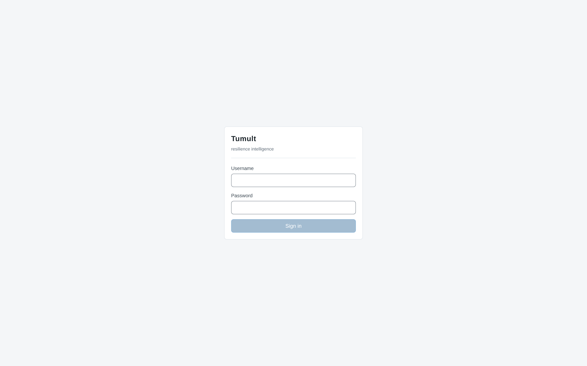
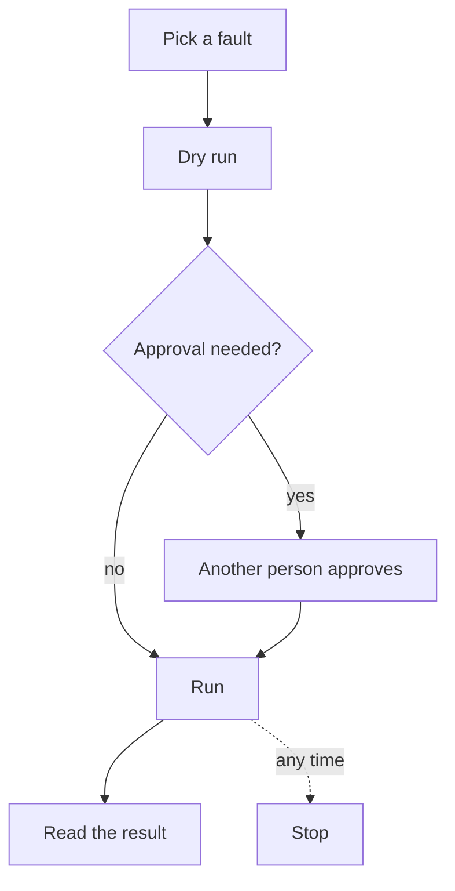
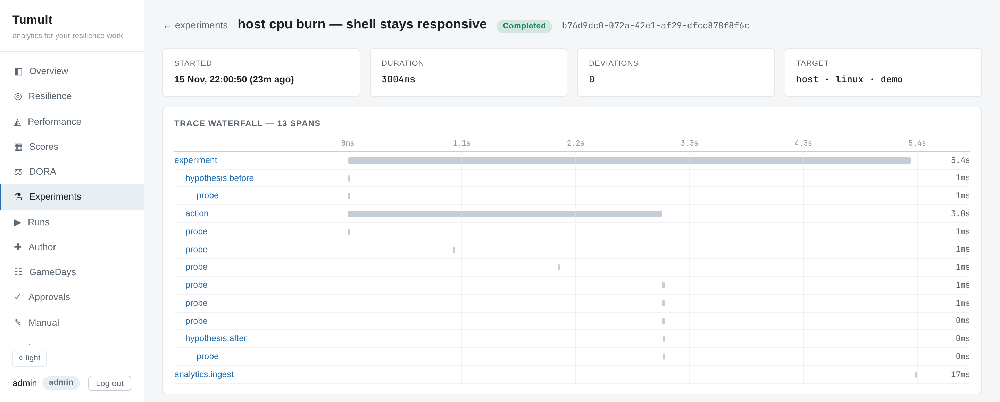
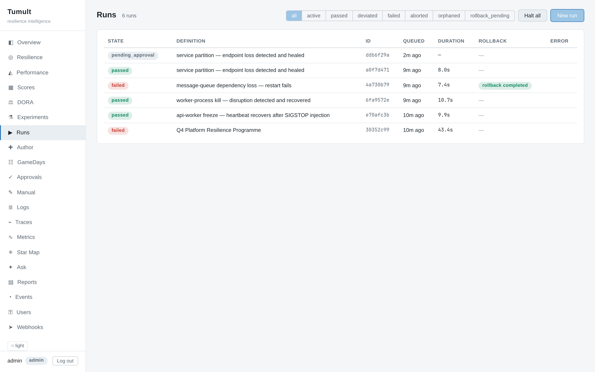
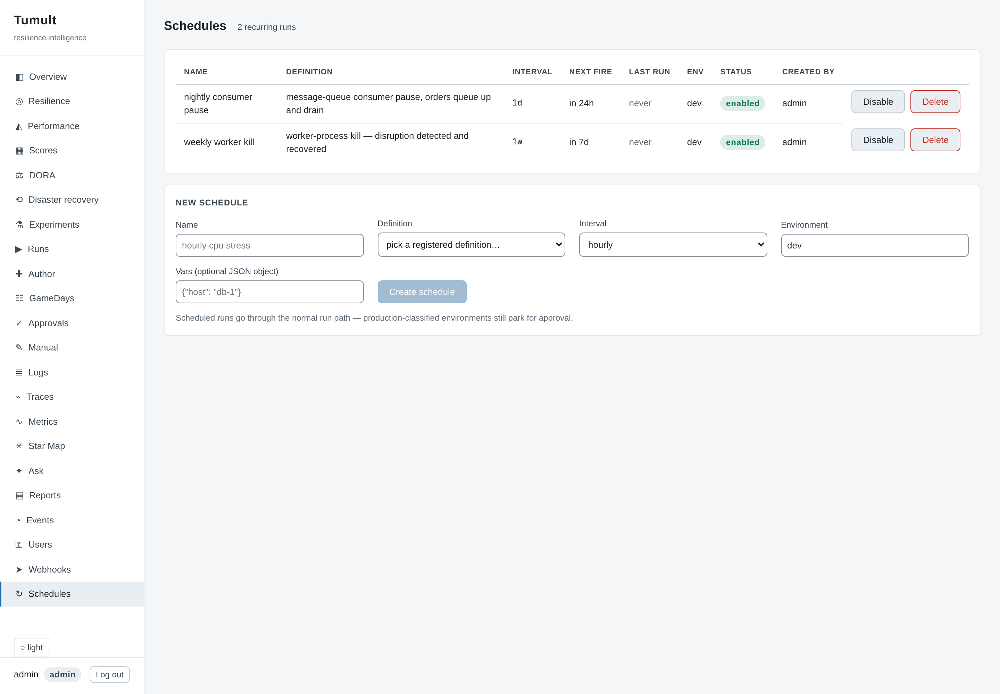
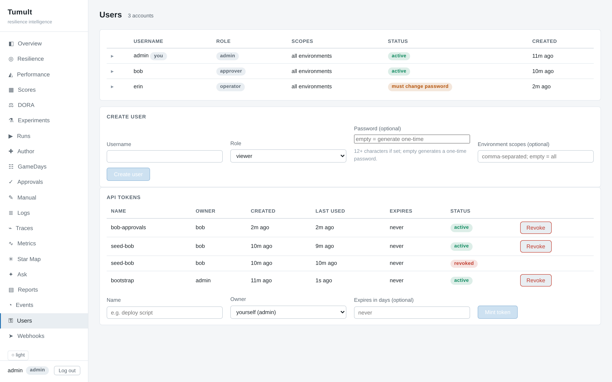

# Platform walkthrough

A picture tour of Krönika, the Tumult web UI: what the evidence says, how to
run an experiment safely, and daily work. The pictures show the demo data.

## Start the demo

Start [the whole platform](../get-started/other-ways-to-run.md#the-whole-platform-in-the-web-ui)
and sign in as `admin`. The demo runs eight experiments for real, adds three
manual records and runs one GameDay. It also makes a second user, `bob`, who
may approve runs. You cannot approve your own run, so sign in as `bob`
(password `demo-bob-permanent-pw`, local demo only) to approve one that
`admin` started.

## Part 1: what does the evidence say?

The Overview shows the pass rate, deviations, time to recover and the mix
of faults, for the time range you pick.

### Star Map

Everything in one graph: organisation, systems, services, workloads and
experiments. Switch the lens to colour the nodes by evidence, by risk or by
telemetry quality. Double-click a node to focus on it; the drawer shows its
evidence. More in the [Star Map guide](star-map.md).

### Resilience

A ranked list of risks, found without running any fault: the last run
failed, a service was never tested, a workload has one replica. Below it, a
grid shows which kinds of test each target has had. You can accept a risk
for a while; the acceptance is recorded and ends by itself.

### Scores and DORA

Scores roll up from single experiments to teams to the whole company. The
DORA view shows which articles and business functions have evidence, and a
maturity level from 1 to 5. It shows what evidence exists. It does not say
that you comply. More in the [DORA score guide](dora-score.md).

### Performance

Did the new version get slower? Pick a target. Tumult compares two versions
and gives a verdict: better, worse, the same, or not enough data. More in
the [performance guide](performance-regression.md).

## Part 2: run an experiment safely

**1. Pick a fault.** The Author page lists every fault and probe of your
plugins. Pick one, and a wizard writes the experiment file.

**2. Dry run, then start.** Choose the experiment and fill in its values.
The dry run shows the exact steps and rollbacks.

**3. Approval.** Every run gets a risk tier, T0 to T3. Higher tiers wait
for another person. An administrator must first allow the experiment to
touch its target with an [execution binding](execution-bindings.md). More in
[runs, approvals and roles](../architecture/runs-and-approvals.md).

**4. Read the result.** Each step on a timeline, who approved, and an audit
trail that cannot be changed quietly. The Impact panel shows how far the
fault pushed each probe from its normal range, and how long it took to come
back. More: [forecasting and run impact](forecasting.md).

**5. Stop.** Stopping takes two clicks, so it cannot happen by accident. A
stopped run rolls back. **Halt all** on the Runs page stops every run.

## Part 3: reports

| Report | For | Content |
|---|---|---|
| R1 | Management | A short resilience digest |
| R2 | Audit and risk | An evidence pack for DORA, NIS2, ISO 27001 and SOC 2, with the approval chain |
| R3 | The team | One run in detail |

Reports summarise evidence. They do not certify compliance.

## Part 4: daily work

| Page | What it is for | Picture |
|---|---|---|
| Runs | All runs, with filters and **Halt all** |  |
| Manual | Records of exercises that telemetry cannot see. A second person verifies each one. |  |
| GameDays | Groups of experiments run as one scored campaign |  |
| Schedules | Run experiments on a timer |  |
| Events | Who did what, newest first |  |
| Webhooks | Send events to other tools, signed |  |
| Users | Accounts, roles and API tokens |  |

Each page reads the lake through the API and stores nothing of its own.
Its charts and API routes are in the [page reference](../reference/kronika-pages.md).

## Next

- [Architecture](../architecture/kronika-architecture.md): how it works behind the screens.
- [Production deployment](production-deployment.md): run it for real.
- [CLI reference](cli-reference.md): the same work from a terminal.
