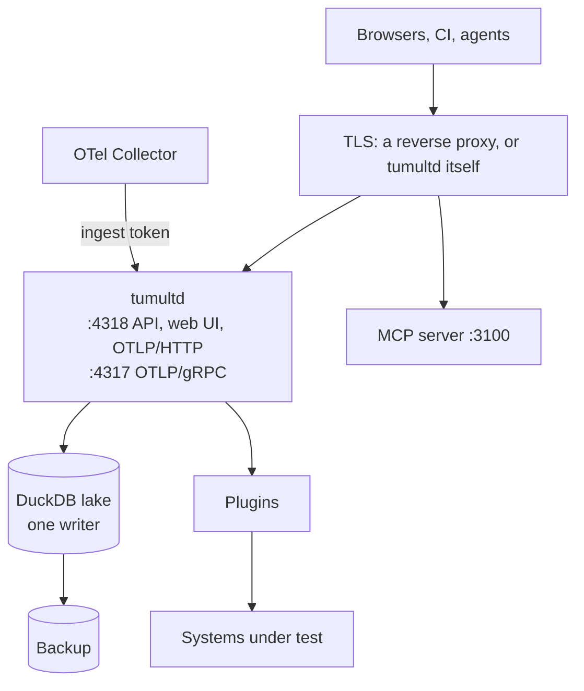

# Production deployment

Run `tumultd` (API, web UI, ingest, run queue) and the MCP server as secure
services. A plain `tumult run` on one machine needs none of this.



## Secure it first

- **The daemon fails closed.** `tumultd` refuses to start on a non-loopback
  address when OTLP ingest has no `KRONIKA_INGEST_TOKEN`, or when the API has
  no user yet and no bootstrap admin password.
- **Encrypt the network.** Set `KRONIKA_TLS_CERT` and `KRONIKA_TLS_KEY` (PEM)
  and both listeners serve TLS; exporters then use `https://`. Set both or
  neither: one alone, a missing file or a bad pair stops the start. Or leave
  them unset, bind to `127.0.0.1` and end TLS at a proxy (gRPC needs HTTP/2).
- **Give the MCP server tokens.** It binds `127.0.0.1` by default and will not
  serve HTTP on another address without auth. Never expose `:3100` to the
  internet; put a TLS proxy in front.
- **Verify SSH host keys** with the default `verify` policy; `accept-any` is
  for throwaway labs only. See [tumult-ssh](../plugins/tumult-ssh.md).

### MCP tokens and roles

The MCP server reads a TOML file from `--auth-config`, `TUMULT_MCP_AUTH_CONFIG`
or `~/.tumult/mcp-auth.toml` (mode `600`). Without a file,
`TUMULT_MCP_TOKEN` is one token with the operator role.

```toml
[[tokens]]                  # one block per token
token = "<viewer-secret>"   # openssl rand -hex 32
role  = "viewer"            # viewer, operator, approver or admin
```

A **viewer** calls the read-only tools; operator, approver and admin call
every tool. An unknown token is refused, an unknown role stops the start, and
a broken file refuses every request.

## Deploy

### Daemon on Kubernetes

`deploy/k8s/tumultd.yaml` runs one pod (`replicas: 1`, `Recreate`) as UID
`10001` with a `/data` volume. For a new, empty database, create the secrets
first (in Bash; the admin password needs 12 characters or more):

```bash
read -r -s -p "Initial admin password: " TUMULT_INITIAL_ADMIN_PASSWORD
printf '\n'
TUMULT_INITIAL_PROBE_TOKEN="kro_$(openssl rand -hex 32)"
kubectl create secret generic tumultd-secrets \
  --from-literal=ingest-token="$(openssl rand -hex 32)" \
  --from-literal=bootstrap-admin-password="$TUMULT_INITIAL_ADMIN_PASSWORD" \
  --from-literal=bootstrap-api-token="$TUMULT_INITIAL_PROBE_TOKEN"
kubectl create secret generic tumultd-probe-token \
  --from-literal=token="$TUMULT_INITIAL_PROBE_TOKEN"
unset TUMULT_INITIAL_ADMIN_PASSWORD TUMULT_INITIAL_PROBE_TOKEN
kubectl apply -f deploy/k8s/tumultd.yaml
kubectl rollout status deployment/tumultd
```

The health probes send `TUMULTD_PROBE_TOKEN`, which starts as the token of
the bootstrap admin. Before you open the ingress:

1. As an admin, create a Viewer user and change its password at its first
   sign in. Then mint its token: `POST /api/tokens` with its `user_id`. A
   password change revokes the tokens the user had before.
2. Put that token in the `tumultd-probe-token` secret and run
   `kubectl rollout restart deployment/tumultd`.
3. When both probes pass, revoke the bootstrap token and remove
   `KRONIKA_BOOTSTRAP_ADMIN_PASSWORD` and `KRONIKA_BOOTSTRAP_TOKEN` from the
   manifest and the secret.

A database with users skips the bootstrap. With TLS on, probes need `https`.

### Daemon under systemd

`deploy/systemd/tumultd.service` binds loopback and keeps its state in
`/var/lib/tumult`. Install `tumultd` and `tumult-net-proxyd` in
`/usr/local/bin`. The archive has no metric definitions; copy them from the
source of the same release:

```bash
sudo install -d -m 0755 /var/lib/tumult/metrics
sudo install -m 0644 metrics/*.yaml /var/lib/tumult/metrics/
```

Put `KRONIKA_INGEST_TOKEN` and `TUMULT_PLUGIN_PATH` in `/etc/tumult/tumultd.env`.
Create the first admin with `tumultd create-admin` while the service is stopped.

### MCP server

- **systemd:** `deploy/systemd/tumult-mcp.service` runs `tumult mcp serve` on
  `127.0.0.1:3100` with `TUMULT_MCP_TOKEN` from `/etc/tumult/mcp.env`.
- **Kubernetes:** `deploy/k8s/tumult-mcp.yaml` binds `0.0.0.0` for the
  Service, safe only because the `tumult-mcp-token` secret is required. Its
  health check is `GET /health` on the port plus one.

## Run one writer

One process owns the DuckDB file: no CLI or MCP process can open it while the
daemon has it, and a shared volume does not make two writers safe. Run one
replica. With `TUMULT_DAEMON_URL` and `TUMULT_DAEMON_TOKEN` set, the CLI sends
its journal to the daemon. Backups: [Data portability](data-portability.md).

## Limit the impact of a run

- `max_concurrent_faults` is enforced: it caps the faults that run at once.
- `blast_radius` is a note for the journal and the audit. It enforces nothing.
- A guard probe halts the run and rolls back after `min_breaches` breaches in a row (default 1).

## Provider capabilities

| Runtime | What it includes |
|---|---|
| Release archives | `tumult`, or `tumultd`, each with the TCP helper `tumult-net-proxyd`; install plugin scripts and their tools yourself |
| CLI and MCP image | the CLI, `tumult-mcp`, the script plugins, examples and GameDays, the TCP helper, the Docker CLI and an SSH client |
| Daemon image | `tumultd` with the web UI, the CLI, the script plugins, the metric definitions, the TCP helper, the Docker CLI, an SSH client and `stress-ng` |
| MCP on Kubernetes | auth, a workspace and a temp directory; no target access and no Docker socket |

A listed plugin can still lack its tools (k6, oha, Docker), credentials or
network. Try a harmless probe in the real image, then a small fault with a
rollback on a disposable target.

## Before you go live

- [ ] One strong MCP token per user, viewer tokens for read-only use, a rotation plan
- [ ] TLS on `tumultd` or a TLS proxy; `KRONIKA_INGEST_TOKEN` set
- [ ] `OTEL_EXPORTER_OTLP_ENDPOINT` set; the lake volume persistent, encrypted, backed up
- [ ] [Execution bindings](execution-bindings.md) for the targets runs may touch
- [ ] Experiments set `max_concurrent_faults` and have guard probes
- [ ] Health, metrics and alerts: [Daemon settings and health](../operate/daemon-settings.md)
