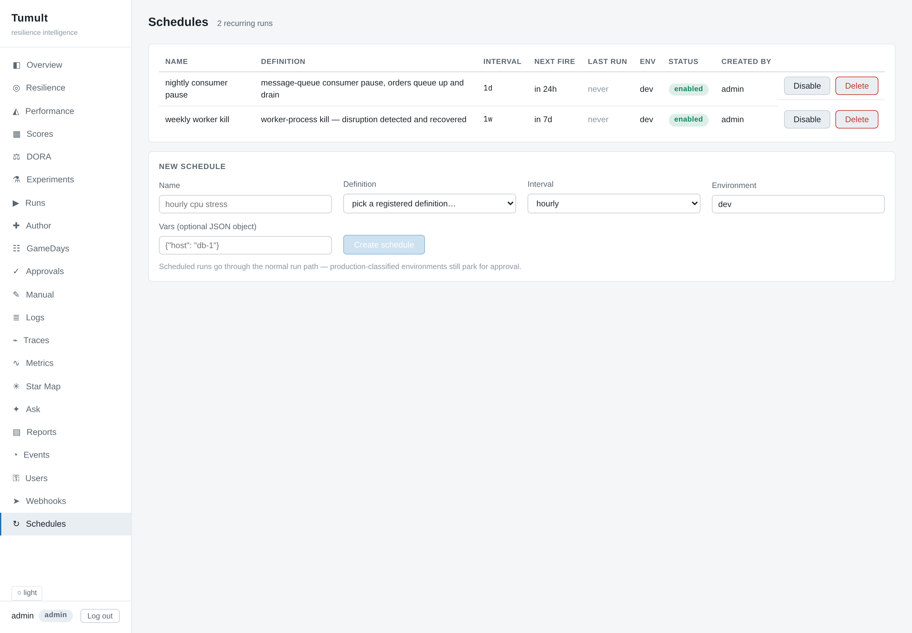
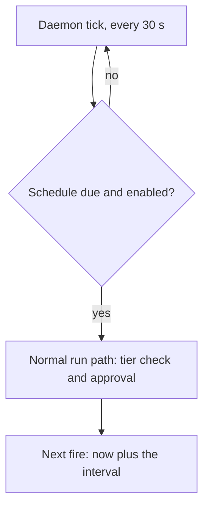

# Experiment scheduling

A schedule runs a registered experiment again and again, on a fixed interval.
The daemon `tumultd` fires it, so fresh evidence arrives without anyone
starting a run.



## Create a schedule

On the **Schedules** page (operator role), pick a registered definition, an
interval (every 15 minutes up to weekly), an environment, and variables if the
experiment needs them. The page lists each schedule with its next fire, last
run and status, and can disable or delete it.

The same through the API:

```bash
curl -X POST http://127.0.0.1:4318/api/schedules \
  -H "Authorization: Bearer $TUMULT_TOKEN" -H "Content-Type: application/json" \
  -d '{"name": "hourly-latency", "registry_id": "<registry id>",
       "interval_s": 3600, "vars": {"duration_s": "30"}, "env": "dev"}'
```

| Call | Does |
|---|---|
| `GET /api/schedules` | Lists the schedules of your environments |
| `POST /api/schedules` | Creates an enabled schedule. `vars`, `env` (default `dev`) and `target` are optional |
| `POST /api/schedules/{id}/enable` with `{"enabled": false}` | Disables it (`true` enables it again) |
| `POST /api/schedules/{id}/delete` | Deletes it. Runs it already fired stay |

The interval is 60 seconds to 30 days. Creation checks that the definition
resolves with the given variables, so a broken schedule fails at once with a
400.

## How a schedule fires



- The first fire is one interval after creation.
- A scheduled run goes through the same tier check and approval as any run,
  so a production run still waits for approval. Its actor is the person who
  made the schedule, and it shows in the audit trail.
- After the daemon was down, a schedule fires once on the first tick back.
  Missed fires do not pile up.
- A full run queue tries again on the next tick. A definition that no longer
  resolves moves on to its next fire, so it does not fail every tick.
- `TUMULTD_SCHEDULE_TICK_S` sets the tick (default 30, at least 1).

## Without the daemon

Use cron or a systemd timer. This also works for a GameDay, which schedules do
not run:

```cron
# Every weekday at 10:00
0 10 * * 1-5 /usr/local/bin/tumult run /etc/tumult/experiments/api-latency.toon
0 11 * * 1   /usr/local/bin/tumult gameday run /etc/tumult/gamedays/weekly.toon
```

## Next

- [Production deployment](production-deployment.md): run the daemon.
- [Variables and secrets](variables-and-secrets.md): the values a schedule
  sends.
